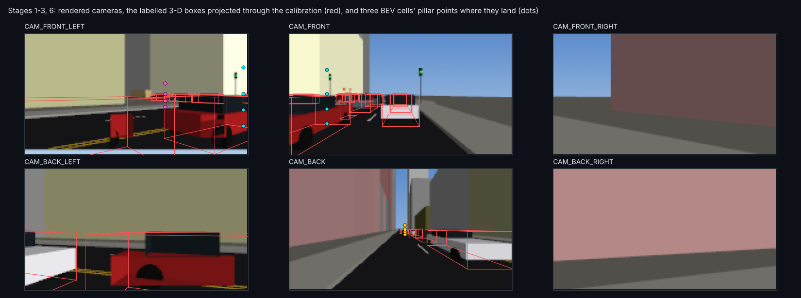
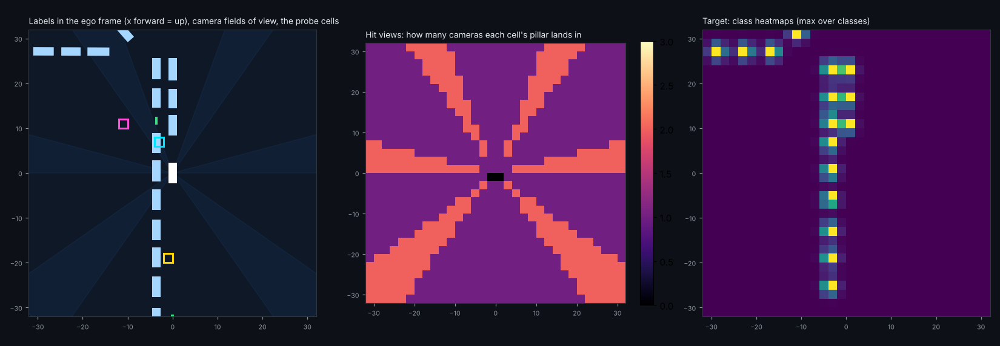
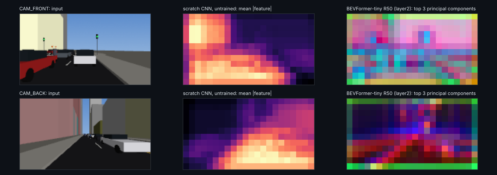
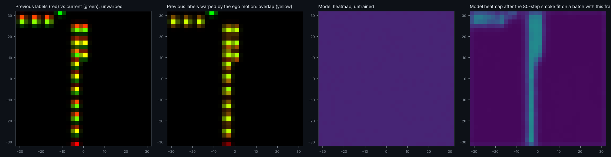
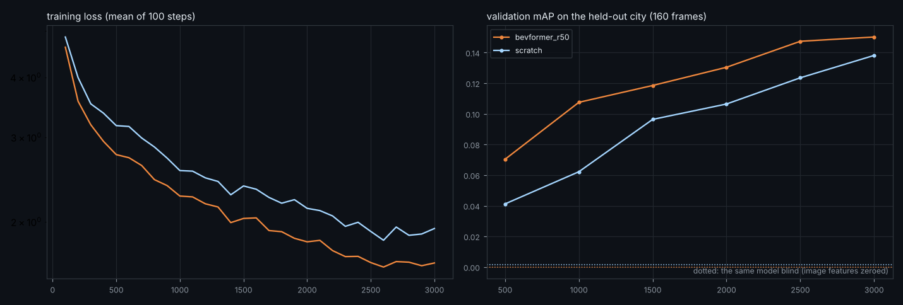
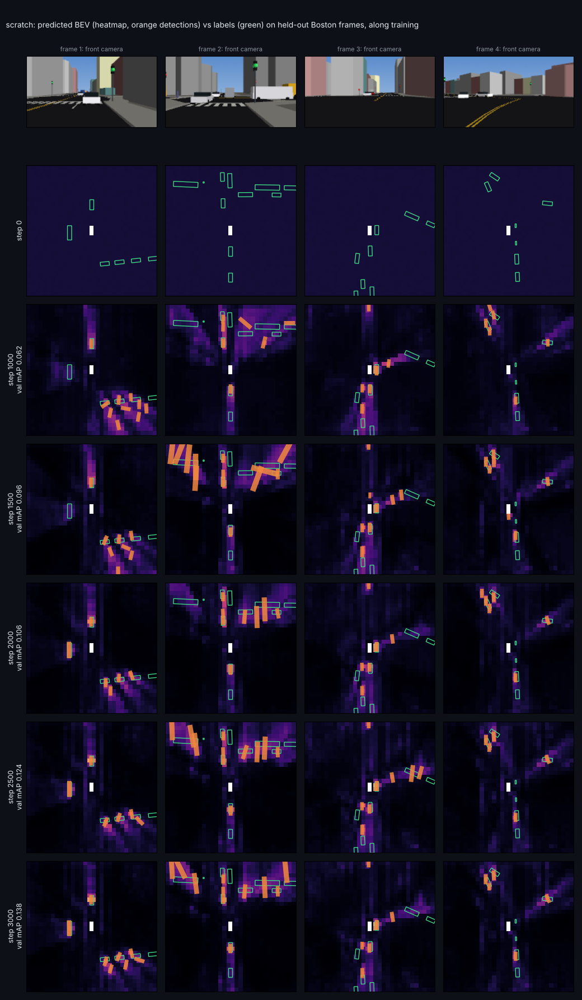
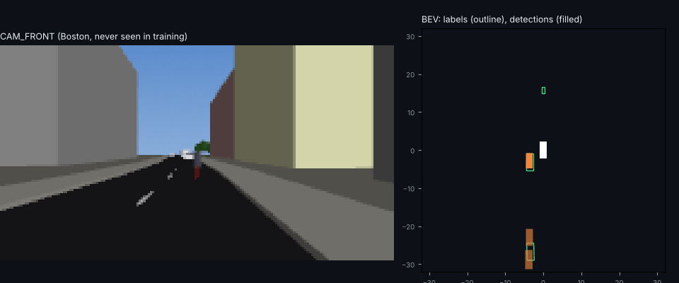

# Camera BEV perception: a CPU-sized BEVFormer on av_world, traced front to back

`bev/` is a new, separate section: rendered multi-camera images from av_world's 3-D cities go in, 3-D boxes in a bird's-eye view
come out, with BEVFormer's encoder in the middle. Nothing in the simulator imports it, and it changes no existing behaviour (the one
touch outside `bev/` is `scene3d.Renderer` gaining `set_agents` / `shoot`, checked to render pixel-identical frames for every
existing caller). This page is the pipeline traced end to end, before any real training.

```bash
python -m bev.data new_york 0          # render + label: data/bev/new_york_s0.npz (needs pyvista + OSMesa, ~1.5 min per 150 samples)
python -m bev.backbone fetch           # optional: BEVFormer-tiny's ResNet-50 stem from the released checkpoint (400 MB download, 6 MB kept)
python -m bev.trace data/bev/new_york_s0.npz    # every stage of one sample: results/bev/trace.json, docs/img/bev_trace_*.png
python -m bev.train --smoke            # overfit one batch: proves the gradients reach every stage (not training)
av-world export-perception out --area chicago --scenario bus_dartout   # any scenario as a nuScenes-style folder (bev/export.py)
```

`export-perception` writes PNGs per camera, `samples.json` (3-D boxes in the ego frame, and what `xnet.perception`'s sensor model
reports: misses behind occluders, noise, ghosts), `calibration.json` (K, ego2cam, ego2img) and the same data as `data.npz` for
`bev.train`. Walkthrough: [notebooks/04_perception_export.ipynb](../notebooks/04_perception_export.ipynb).

## 1. How good is BEVFormer already

The reference is [BEVFormer](https://github.com/fundamentalvision/BEVFormer) (Li et al., ECCV 2022, Apache-2.0), camera-only 3-D
detection on nuScenes. Its released models (validation set, 24 epochs):

| model | backbone | NDS | mAP | GPU memory |
|---|---|---|---|---|
| BEVFormer-tiny | ResNet-50 | 35.4 | 25.2 | 6.5 GB |
| BEVFormer-small | ResNet-101-DCN | 47.9 | 37.0 | 10.5 GB |
| BEVFormer-base | ResNet-101-DCN | 51.7 | 41.6 | 28.5 GB |
| BEVFormerV2 (t8, 24 ep.) | ResNet-50 | 55.3 | 46.0 | 40 GB |

I downloaded BEVFormer-tiny's checkpoint and read it without PyTorch (`bev/torch_ckpt.py`: a pickle reader that maps torch's tensor
rebuilders to inert descriptors and refuses to run anything else from the file). Its real inventory
(`results/bev/bevformer_tiny_inventory.json`): **643 tensors, 33.6 M parameters**:

| part | parameters | |
|---|---|---|
| ResNet-50 image backbone | 23.6 M | 70 % |
| FPN neck | 1.1 M | |
| BEV encoder: 3 layers of temporal self-attention + spatial cross-attention + FFN | 2.0 M | 6 % |
| deformable-DETR decoder: 6 layers, 900 object queries | 4.1 M | |
| BEV queries (50 x 50 x 256) and object queries | 1.1 M | |
| class and box heads | 1.6 M | |

Its config: 800 x 450 inputs from 6 cameras, a 50 x 50 BEV over +-51.2 m, 256 channels, 4 pillar heights, 8 sampling points per
camera, a queue of 3 frames, 10 nuScenes classes. The lesson for a CPU version: **the BEV part is small; the image backbone and the
DETR decoder are the cost.**

## 2. What was built, and how it maps to BEVFormer

| | BEVFormer-tiny | `bev` MiniBEVFormer |
|---|---|---|
| input | 6 cameras, 800 x 450, nuScenes | 6 cameras in nuScenes' layout, 176 x 96, rendered from av_world (`bev/rig.py`) |
| backbone | ResNet-50 (+FPN), fine-tuned | **scratch**: 4-layer CNN, 49 k params; or **bevformer_r50**: BEVFormer-tiny's own stem + layer1 + layer2, frozen (1.44 M) |
| BEV grid | 50 x 50, 2.05 m cells, 256 ch | 32 x 32, 2 m cells (+-32 m), 64 ch |
| encoder | 3 x (TSA, SCA, FFN), 8 heads | 2 x (TSA, SCA, FFN), 4 heads, same mechanism |
| detection | DETR decoder, 900 queries, Hungarian matching | dense CenterPoint-style head on the BEV map |
| classes | 10 | 5: car, truck, bus, cyclist, pedestrian |
| parameters | 33.6 M | 0.32 M (scratch) / 0.33 M trainable + 1.44 M frozen |
| metric | nuScenes NDS / mAP | the same definitions (`bev/metrics.py`), with four TP errors instead of five (no attributes) |

**The ported backbone is exact.** `bev/backbone.py` folds BEVFormer-tiny's frozen batch norms into its convolutions and runs them
in JAX; against a PyTorch rebuild of the same layers loaded from the same checkpoint, the outputs agree to a relative error of
4.5e-6 (float rounding).

## 3. The pipeline, front to back

Every number below is from `python -m bev.trace` on one New York frame (`results/bev/trace.json`), on this 4-core CPU.

| stage | what happens | tensor | time |
|---|---|---|---|
| 1 sample | the simulator runs; a moving car in traffic carries the rig; 6 views rendered from the open-data city with the agents (the carrier hidden) | images [6, 96, 176, 3] | 65 ms render |
| 2 labels | every object within 36 m: box in the ego frame (x, y, z, l, w, h, yaw, vx, vy), class, *occluded* (another vehicle blocks the line of sight) | [20, 9] here: 18 cars, 2 cyclists, 13 occluded | |
| 3 calibration | ego2img = K [R \| t] per camera: BEVFormer's `lidar2img` | [6, 4, 4] | |
| 4 image features | backbone at stride 8 | [6, 12, 22, 64] scratch / [6, 12, 22, 512] R50 | 4 ms / 28 ms |
| 5 queries + pillars | one learned query per BEV cell; each cell lifted to points at 0.4, 1.0, 1.6, 2.6 m | [1024, 4, 3] | |
| 6 projection | pillar points through ego2img into every camera; a camera that receives any of a cell's points is one of its *hit views* | [6, 1024, 4, 2] | |
| 7 temporal alignment | the previous BEV warped by the ego motion into the current frame | [1024, 64] | |
| 8 encoder | 2 x (temporal self-attention over [queries, aligned previous BEV] -> spatial cross-attention into the hit views -> FFN) | BEV [1024, 64] | 36 ms |
| 9 head | per cell: 5 class logits, 10 box numbers | [32, 32, 5], [32, 32, 10] | |
| 10 targets + loss | Gaussian heatmaps at object centres (focal loss) + L1 on the box numbers at the centres | | |
| 11 decode + metrics | 3x3 peak picking -> boxes -> nuScenes-style mAP / NDS | | |
| 12 smoke fit | 80 steps on one batch of 4 frame pairs | | 0.5 s / step |

**Stages 1-3, 6** (`docs/img/bev_trace_cameras.png`): the labelled boxes, projected through the calibration, sit on the rendered
vehicles in every camera, so labels, geometry and pixels agree. The coloured dots are three BEV cells' pillar points: each lands in
the camera that faces it, stacked by height.



**Stages 2, 5, 6, 10** (`docs/img/bev_trace_bev.png`): the labels in the ego frame (x forward = up) with the cameras' fields of view;
how many cameras each cell is seen by; the heatmap targets. 72 % of cells are seen by one camera only and 27 % by two, so most of
the scene rests on a single view (nuScenes' overlaps are similarly narrow).



**Stage 4** (`docs/img/bev_trace_features.png`): the untrained scratch CNN, and BEVFormer-tiny's ResNet on these renders (top three
principal components of its 512 channels). Trained on real nuScenes photos, it still separates sky, facades and road here, so the
port carries some useful prior across the domain gap.



**Stages 7, 9, 12** (`docs/img/bev_trace_temporal_output.png`): warping the previous frame's labels by the ego motion raises their
correlation with the current labels from 0.72 to 0.90 (on a faster frame, 0.03 to 0.72); the rest is the other vehicles' own motion,
which temporal attention has to learn. Then the untrained output, and the output after the 80-step smoke fit on a batch containing
this frame: it has learned *where cars are likely* (the lane) before *where they are*, and reaches mAP 0.13 on that batch. That is
the plumbing working, not a result.



Checks that must hold and do (`tests/test_bev.py`): a point ahead projects to the image centre and every direction is seen; the ego
motion maps previous-frame points exactly onto current ones; labels sit in the ego frame with the drawn sizes; labels -> targets ->
decoding is exact (NDS 1.00); with no motion the warp is the identity; the metrics penalise a 1.5 m shift as they should; a few
steps lower the loss.

## 3b. Pseudocode

The same pipeline as pseudocode, one block per file.

```
# ---- rig.py: frames and calibration
ego frame: origin on the ground under the car, x forward, y left, z up (BEVFormer's "lidar" frame); camera frame: OpenCV
for camera i in FRONT, FRONT_LEFT, FRONT_RIGHT, BACK, BACK_LEFT, BACK_RIGHT:   yaw (0, +55, -55, 180, +110, -110), hfov 70 (back 110)
    K_i = [[f, 0, W/2], [0, f, H/2], [0, 0, 1]],  f = (W/2) / tan(hfov/2)
    mount_i = (0.5 cos yaw, 0.5 sin yaw, 1.6);  R_i = rows [right, down, forward] in ego coordinates
    ego2img_i = K_i [R_i | -R_i mount_i]                             # BEVFormer's lidar2img
ego_motion(prev, now): R = rot(yaw_prev - yaw_now), t = previous ego position in the current frame;  p_now = R p_prev + t

# ---- data.py: simulate, render, label
sim = Simulator(city, denser traffic); sim.run(warm); scene = sim.record(seconds)
egos = cars seen >= 40 frames and moving >= 40 % of the time, ranked by (agents within 32 m) x (share moving)
for ego, for every 2nd frame k:
    renderer.set_agents(scene, k, signal lights, hide=ego)
    images = [renderer.shoot(camera i's world eye and target, vertical fov) for i in 6 cameras]
    labels = for each agent within 36 m: [x, y, z, l, w, h, yaw, vx, vy] in ego, class, occluded (2-D line of sight)

# ---- backbone.py: image features at stride 8
scratch:       4 x (conv3x3, ReLU), strides 2, 2, 2, 1 -> 64 channels, trained
bevformer_r50: normalise; conv7x7/2; maxpool/2; layer1 (3 bottlenecks); layer2 (4, first stride 2) -> 512 channels, frozen
               (batch norm folded: W' = W gamma / sqrt(var + eps), b' = beta - mean gamma / sqrt(var + eps))

# ---- model.py: MiniBEVFormer
x = learned query per BEV cell (32 x 32, 2 m)
pillar points: every cell lifted to z in (0.4, 1.0, 1.6, 2.6) m, projected into every camera -> uv, valid
aligned = previous BEV warped: for each current cell p, sample prev at R^T (p - t)          (none on a sequence's first frame)
repeat 2 layers:
    x = norm(x + TSA(x, aligned or x))      # deformable attention over [queries, aligned previous BEV], learned offsets
    x = norm(x + SCA(x, feats, uv, valid))  # for each camera the pillar lands in (hit view): sample features at uv + learned
                                            # offsets, weight, sum over points; average over hit views
    x = norm(x + FFN(x))
head: conv3x3 + ReLU -> 5 class logits and 10 box numbers per cell
targets: Gaussian heatmap at each object's cell, regression (offset, z, log size, sin/cos yaw, velocity) at that cell
loss: CenterNet focal loss on heatmaps + 0.5 x L1 on the regression at object cells
decode: 3x3 peaks with p > 0.1, top 60 -> boxes in the ego frame

# ---- train.py
pairs (t-1, t) of the same ego; prev = stop_gradient(encode(frame t-1)); bev = encode(frame t, prev, ego motion)
AdamW, cosine learning rate from 1e-3, batch 4 pairs; frozen backbone features computed once and cached

# ---- metrics.py (nuScenes definitions)
AP per class and centre distance (0.5, 1, 2, 4 m), greedy matching by score; TP errors at 2 m: ATE, ASE, AOE, AVE
mAP = mean AP; NDS = (5 mAP + sum (1 - min(1, error))) / 9      (no attributes, so 4 TP errors instead of 5)
```

## 4. What it costs on a CPU

| step | measured |
|---|---|
| render 6 views | 65 ms per sample (176 x 96) |
| a data run (simulate, warm up, render, label) | 84 s for 150 samples, of which 10 s is rendering; the rest is the 200 s simulator warm-up, compilation and labelling, mostly paid once per run |
| BEVFormer R50 features (cached once) | 45 ms per sample |
| encoder + head, inference | ~36 ms per sample |
| a training step (batch 4, temporal: two encoder passes) | 0.50 s scratch, 0.44 s with cached R50 features |

So a first real experiment fits in an hour or two of CPU: about 6,000 samples from several cities and scenarios (roughly an hour of
rendering, run in ~10-minute jobs), then ~3,000 steps per backbone (about 25 minutes each).

## 5. What the numbers will and will not mean

* **Not comparable to nuScenes NDS 35.4.** The renders are untextured, the agents are proxy shapes, there is no sensor noise, blur
  or night, the range is 32 m instead of 51 m, and there are 5 classes. The *definitions* match, so the numbers are the same kind,
  but synthetic and real are different tests.
* **Class balance comes from the simulator.** One New York run gave 1,156 cars, 138 cyclists, 5 pedestrians and no buses; the
  dataset has to mix cities and scenarios (bus dart-outs, jaywalkers) for the rare classes, and report them separately.
* **Occlusion is common and tagged.** 13 of 20 objects in the traced frame are occluded; evaluation can be split by the tag, which
  is exactly where camera BEV models struggle.
* **The occlusion tag is approximate.** It is the sensor model's 2-D line-of-sight test against vehicle footprints, so a car
  directly behind a cyclist can be tagged occluded while visible over it.

## 6. First training: proof of concept on a CPU

**Data** (`python -m bev.data <city> <seed> <scenario> 40 6`): 11 runs, ~6,200 samples, about 45 minutes of wall time on 4 cores
(two runs at a time). Training: New York, Chicago and Oakland, each with everyday traffic plus the bus dart-out and jaywalker
scenarios, 5,141 samples (26,251 cars, 2,312 trucks, 1,167 buses, 1,152 cyclists, 1,662 pedestrians in the grid). Validation:
**Boston, a city never seen in training**, everyday and dart-out, 1,042 samples. 4.5-9.6 objects per sample, 12-40 % occluded,
egos moving 1.6-3.4 m per step.

**Training** (`python -m bev.train --backbone ...`): 3,000 steps, batch 4 frame pairs, temporal attention on, AdamW with warm-up and
cosine decay; about 25 minutes per run (0.47-0.51 s per step), plus 4 minutes to cache BEVFormer's frozen ResNet features once
(reduced 512 -> 64 channels by a fixed PCA keeping 77 % of the variance; caching all 512 would need ~6.5 GB).



| backbone | trainable params | Boston mAP | NDS | blind mAP | training-city mAP | 0-16 m | 16-32 m | recall@2m visible / occluded |
|---|---|---|---|---|---|---|---|---|
| BEVFormer-tiny R50 stem, frozen | 273 k | **0.144** | 0.179 | 0.000 | 0.360 | 0.312 | 0.080 | 0.56 / 0.27 |
| scratch CNN | 323 k | 0.134 | 0.174 | 0.001 | 0.267 | 0.242 | 0.090 | 0.54 / 0.25 |

| backbone | car | truck | bus | cyclist | pedestrian | mATE (m) | mASE | mAOE (rad) | mAVE (m/s) |
|---|---|---|---|---|---|---|---|---|---|
| BEVFormer-tiny R50 stem | 0.376 | 0.167 | 0.166 | 0.004 | 0.008 | 1.01 | 0.33 | 0.77 | 1.28 |
| scratch CNN | 0.400 | 0.118 | 0.150 | 0.000 | 0.000 | 1.05 | 0.32 | 0.78 | 1.11 |

**Do the metrics make sense?** Each check that should hold does:
* **It uses the images.** The same trained model with its image features zeroed scores mAP 0.000-0.001; nothing comes from a road prior alone.
* **Near beats far** (0.31 vs 0.08), **visible beats occluded** (recall 0.56 vs 0.27), **large beats small** (car 0.38-0.40, cyclist
  and pedestrian ~0): what a 176 x 96 camera should give. A pedestrian 20 m away is a few pixels tall and smaller than a 2 m BEV cell.
* **Localisation is cell-limited.** Car AP is 0.10 at the 0.5 m threshold and 0.67 at 4 m; mATE is 1.0 m with 2 m cells.
* **NDS has a floor.** The blind model still scores NDS 0.08-0.16 from the TP-error terms, so mAP is the number to watch at this stage.
* **Generalisation gap.** Training cities score 2-2.5x the held-out city; the pretrained stem fits the training cities more (0.36 vs
  0.27) and transfers slightly better (0.144 vs 0.134; one seed each, so the gap is suggestive, not established).

**Predictions against labels along training** (`python -m bev.gallery scratch`; the same four Boston frames at every saved step):
blank at step 0; a smeared road prior with false positives at step 1,000; detections settling onto the objects by 2,000-3,000. The
remaining errors are visible: far objects missed, some long or far boxes turned 90 degrees.





*The pretrained-stem model on a Boston sequence: the car ahead is found on its label; the cyclist to the right is missed.*

## 7. What this proves for a GPU scale-up, and what to scale

The pipeline works end to end at toy scale: rendered multi-camera data with exact labels, BEVFormer's encoder mechanism, a
pretrained BEVFormer backbone ported exactly, nuScenes-style metrics, and a held-out city, all on a 4-core CPU in about 2 hours.
Both validation curves were still rising at the last step. Each limit above points at one scale-up:

| limit seen here | evidence | scale-up |
|---|---|---|
| small objects invisible | cyclist / pedestrian AP ~0 at 176 x 96 | BEVFormer-tiny's 800 x 450 input (21x the pixels) |
| coarse boxes | mATE 1.0 m, AP@0.5 m 0.10 for cars, 2 m cells | 100 x 100 BEV at 1 m (or BEVFormer's 50 x 50 over +-51 m), 256 channels |
| features | the frozen R50 stem led at every validation point and learned faster | the whole BEVFormer-tiny backbone + FPN, fine-tuned or with LoRA adapters |
| not converged, overfitting | curves still rising at 3,000 steps; training cities 2-2.5x the held-out one | 10-20x the data, more cities, augmentation |
| data generation cost | 0.4-0.6 s per sample in dense traffic, dominated by rebuilding every agent's meshes each frame | instanced vehicle prototypes in the renderer, many parallel workers |
| the decoder | dense head chosen for CPU | try BEVFormer-tiny's own DETR decoder with LoRA, from its released weights |

The first GPU step is cheap: run the full BEVFormer-tiny zero-shot on these renders (no training) to see how much of its nuScenes
skill transfers to the synthetic city, then fine-tune it (full or LoRA) on the same splits, and compare with the numbers above.
