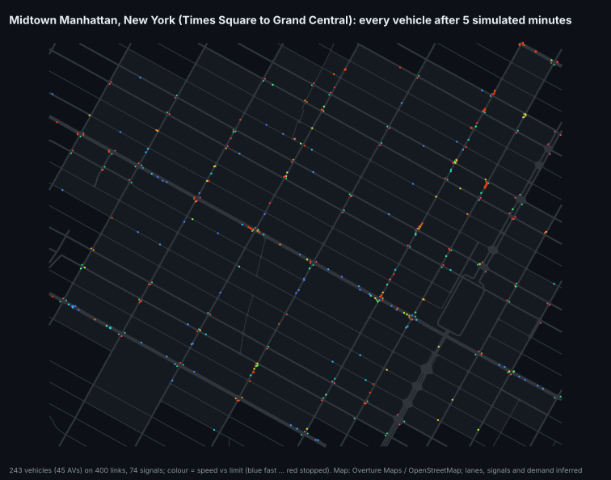
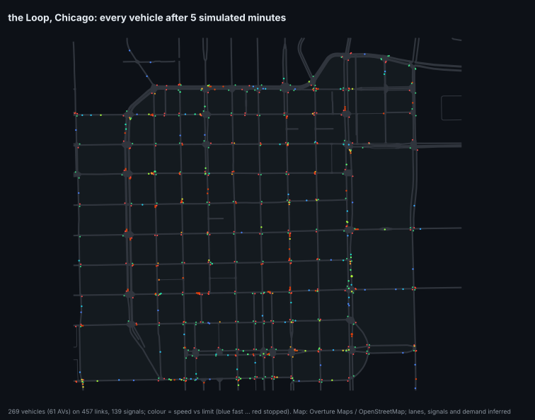
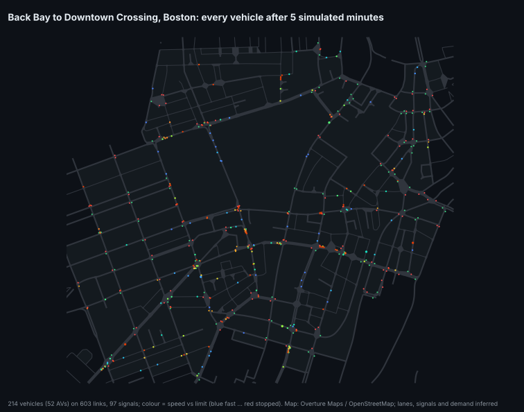

# New York, Chicago, Boston

Three more cities, built the same way as the Pittsburgh areas: road segments from [Overture Maps](https://docs.overturemaps.org/) (built
largely from OpenStreetMap; release 2026-09-23.1), lanes, signals, stop signs, crosswalks and demand inferred from road class, and the junction
model, routing and calibrated human behaviour of the area simulator. Each is about the size of the Oakland area. The trimmed map files
(about 130 kB each) ship with the package, so nothing needs downloading.

```python
import av_world
env = av_world.make("new_york", n_envs=8)            # or "chicago", "boston"
```
```bash
av-world export-carla manhattan --area new_york --seconds 60       # OpenDRIVE map + trajectories + replay script for CARLA
av-world sil --area chicago --egos 1                               # drive an AV in the Loop from your own controller (SIL_HIL.md)
python -m xnet.cities survey                                       # the table below (~5 min)
python -m xnet.cities fetch && python -m xnet.cities bundle        # refresh the maps from Overture
```

| | Midtown Manhattan | Chicago Loop | Back Bay to Downtown Crossing, Boston | Oakland, Pittsburgh (reference) |
|---|---|---|---|---|
| area (west, south, east, north) | -73.997, 40.748, -73.972, 40.763 | -87.640, 41.874, -87.618, 41.889 | -71.078, 42.345, -71.055, 42.360 | -79.968, 40.436, -79.940, 40.452 |
| directed links / paths through junctions | 400 / 990 | 457 / 1,127 | 603 / 1,281 | 622 / 1,253 |
| signalised junctions / crosswalks | 74 / 699 | 139 / 716 | 97 / 926 | 34 / 608 |
| km of lanes | 81.5 | 78.7 | 63.9 | 81.5 |
| vehicles on the network (mean) | 279 | 379 | 309 | 574 |
| mean speed | 17.9 km/h | 15.2 km/h | 13.0 km/h | 14.3 km/h |
| simulated s per wall-clock s (8 copies, 4 CPU cores) | 667 | 604 | 648 | 668 |
| crashes in 1.3 area-hours (calibrated humans, 25 % rule-based AVs) | 3 (merge 2, pedestrian 1) | 7 (pedestrian 4, rear-end 2, merge 1) | 13 (pedestrian 6, angle 5, left-turn 1, merge 1) | 4 (pedestrian 2, rear-end 1, left-turn 1) |





## What is and is not real here

* **Real:** the street geometry, which streets are one-way, the road classes, and speed limits where the map has them. Manhattan's rotated
  grid of one-way streets and Chicago's Loop grid come out as they are.
* **Inferred, not observed:** lanes per road, which junctions have signals, signal timings, and traffic demand. Demand comes from road
  class, the same rule as Pittsburgh, so Midtown carries fewer cars here (about 280 on the network) than it does at a real rush hour, and the
  pedestrian volumes are generic. Boston's irregular junctions produce more angle crashes than the grids; with 1.3 simulated hours per city
  the crash counts are small, and the differences between cities are not significant.
* Two lanes per direction at most (Manhattan's avenues have more), no bus lanes, bike lanes, turn restrictions or parking.
