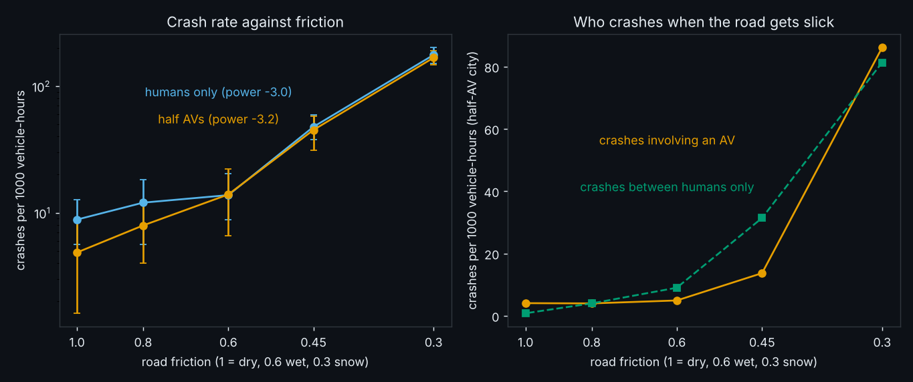
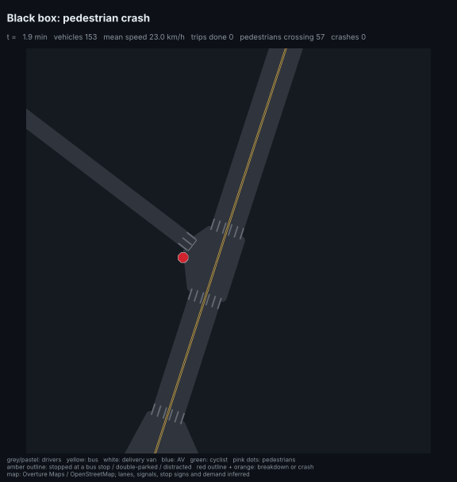
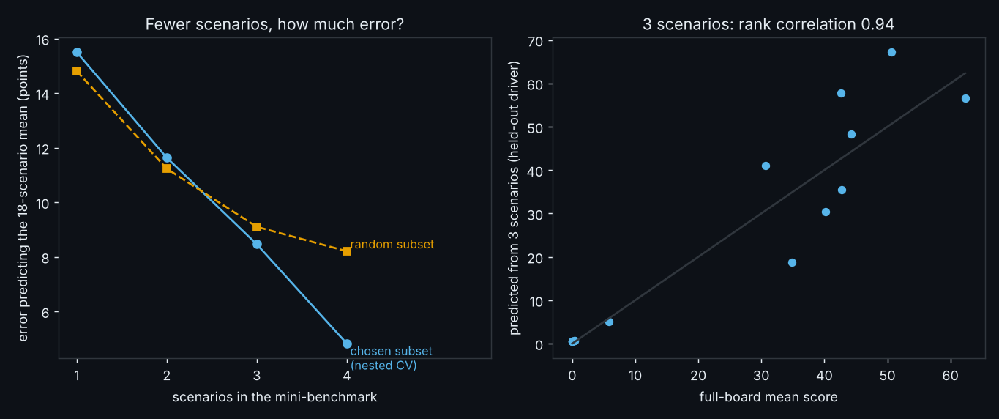
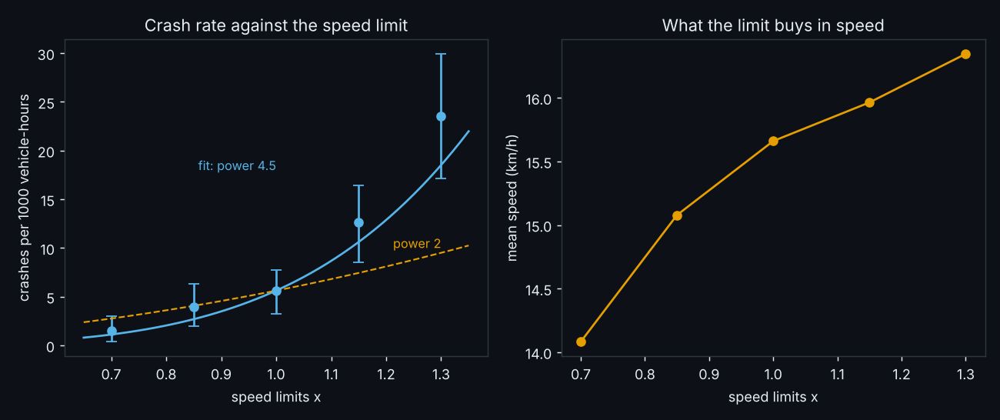
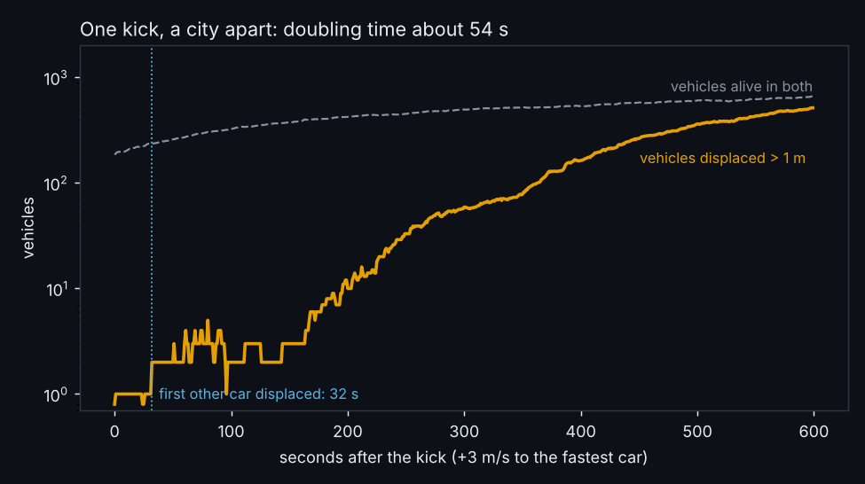
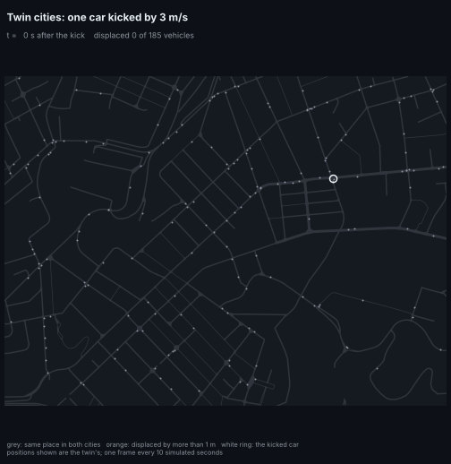
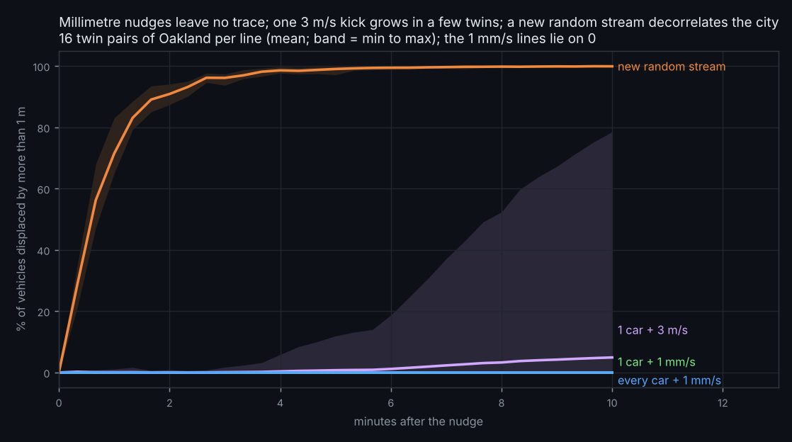
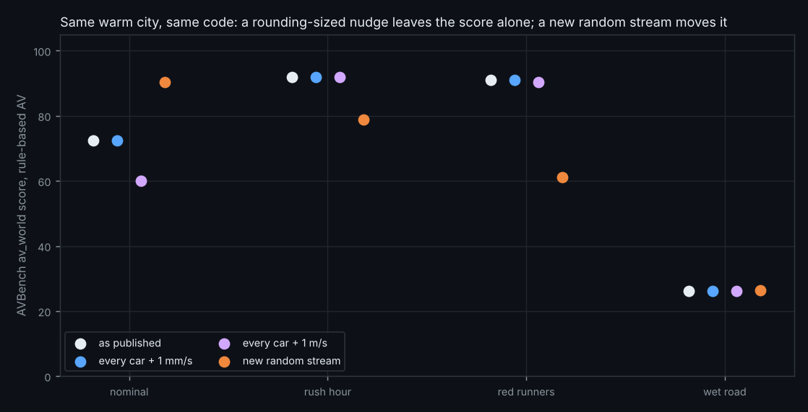
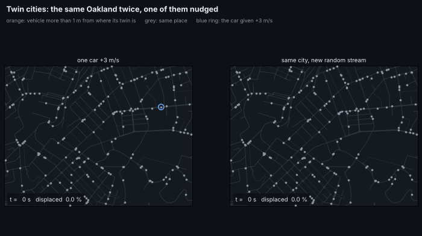

# Daily research log

One entry per day, newest first. Each entry: the ideas kept, the pseudocode, the result, the figures, and what to try next. The
search behind each day's choice (candidates, probes, scores) is in `results/daily/<date>/search.json`.

## What to try next (running list)

1. **Check which random stream the L4 leaderboard used** (carried over). Re-score the rule-based AV on CPU with `unsafe_rbg` and compare with the stored GPU row.
2. **Seeds with intervals on every leaderboard row** (carried over): `avlab.twins.bench` with `restream=1..N`, ~45 min, split over days.
3. **Is the junction-box handoff the cause of the twin divergence in general?** `avlab.twintrace` explained one twin (seed 9). Run it on the other kicks (and a 1 m/s kick to every car) and count, per divergence, whether the first other car is displaced from a junction box.
4. Settle H4's curve shape and H3's wet-road threshold (GPU-sized data).
5. **Speed limit x AV share and x demand** (child of 2026-11-04 idea 1): does an AV-heavy city pay less for a higher limit? Also weight crashes by speed at impact to compare with Nilsson's fatal exponent 4.
6. **Pedestrian crashes carry the speed effect (38 of 57 at x1.3).** Rerun the sweep with pedestrian crossings' yield behaviour varied, or at crossings only.

7. **Find the friction cliff's cause** (2026-11-06): the rate jumps 3.5x between friction 0.6 and 0.45. Print the braking the drivers *need* (gap / speed at the moment of each crash) to see whether 9 x friction falls below what car-following and junction approaches demand, then test a finer grid (0.6, 0.55, 0.5, 0.45).
8. **Why does a half-AV city lose its advantage when the road is slick?** Rate ratio 0.55 (dry) to 0.95 (friction 0.3), but no single interval excludes 1; ~4x the copies at friction 1.0, 0.6 and 0.3 would decide it (AVBench's wet_road is the rule-based AV's worst scenario).
9. **Mini-benchmark with more drivers**: the 4-scenario subset (rush_hour, squirrel_hill, downtown, cut_in) beats random subsets only because 15 drivers are few; rerun the nested test when the board has seeds (step 2).

---

## 2026-11-06 - Where is the friction cliff, and a cheaper AVBench

**Ideas kept** (from 14 candidates; [search](../results/daily/2026-11-06/search.json)): (1) a friction dose-response in a human-only and a half-AV
Oakland (child of H3 and of the speed-limit run), with a black-box GIF of a crash on slick road; (2) which few AVBench scenarios predict the whole board
(follow-up of H5; no simulation, uses `results/bench/leaderboard.json`). Prior art: friction and crash risk are linked but hard to quantify, with
threshold-like behaviour reported below some skid number ([review notes via SWOV](https://swov.nl/en/publicatie/friction-measurement-methods-and-correlation-between-road-friction-and-traffic-safety),
[TRB report](https://www.nap.edu/read/23038/chapter/4); I read search snippets only); benchmark reduction by anchor points and tinyBenchmarks
([Vivek et al.](https://arxiv.org/pdf/2309.08638), [Polo et al.](https://ar5iv.labs.arxiv.org/html/2402.14992)), and a caution that rank correlation alone overstates agreement
([arXiv 2510.08730](https://arxiv.org/pdf/2510.08730v2)).

### Pseudocode (what the code does)

```
1. avlab/friction.py   for mu in 1.0 0.8 0.6 0.45 0.3, p_av in 0, 0.5:  16 copies of Oakland, Behaviour(calibrated humans, friction=mu, p_av=p_av)
                         all 160 copies in ONE compiled run (examples._common.run_copies), warm 120 s, count 600 s
                         quasi-Poisson regression (offset log vehicle-hours): slope on log mu per share, curvature (log mu)^2, slope difference between shares
                         exact conditional rate ratio (half-AV / humans) per friction, Holm-adjusted over the 5 frictions
2. avlab/minibench.py  M[driver, scenario] = av_score, 15 drivers x 18 scenarios; target = row mean
                         for k = 1..4, every k-subset: nested leave-one-driver-out (choose the subset on 14 drivers by smallest LOO RMSE of a line
                         target ~ subset mean, predict the held-out driver); compare with random k-subsets
```

### Predictions, written before the full runs ([friction](../results/daily/2026-11-06/predictions.md), [minibench](../results/daily/2026-11-06/predictions2.md))

* P1: humans-only crash rate rises as friction falls, elasticity b < -1.
* P2: a cliff: the log-rate is convex in log friction (curvature > 0, interval excludes 0).
* P3: a half-AV city is hurt more by slick roads (interaction < 0, interval excludes 0).
* P4: a 3-scenario subset chosen by nested CV gives Spearman >= 0.9 and an RMSE >= 25 % below a random 3-subset's.

### Results

| friction | humans only: crashes per 1000 vehicle-h | half AVs | rate ratio (95 % interval), Holm p |
|---|---|---|---|
| 1.0 | 8.8 (11 crashes) | 4.9 (6) | 0.55 (0.17-1.62), p 1 |
| 0.8 | 12.0 (15) | 7.9 (10) | 0.66 (0.27-1.57), p 1 |
| 0.6 | 13.8 (17) | 13.9 (17) | 1.01 (0.49-2.11), p 1 |
| 0.45 | 47.7 (59) | 45.1 (56) | 0.94 (0.64-1.39), p 1 |
| 0.3 | 176 (223) | 167 (210) | 0.95 (0.78-1.15), p 1 |





(GIF: a left-turning car at 37 km/h strikes a pedestrian on a slick road, friction 0.35; its peak braking, 3.2 m/s^2, is at the road's limit of 9 x 0.35 = 3.15. One crash from `avlab.blackbox`, not a statistic.)

**P1 held, P2 held, P3 failed.** Humans only: elasticity **-2.95** (SE 0.19; the rate goes as friction^-3). Curvature **+1.25** (SE 0.51, 95 % interval 0.24 to 2.25): the rate
is nearly flat from 1.0 to 0.6 (8.8 to 13.8) and then jumps 3.5x to 0.45 and 3.7x again to 0.3. The slope difference between the half-AV and the human-only city is
**-0.27** (SE 0.28), not distinguishable from 0; the half-AV city's lower crash rate in dry weather (rate ratio 0.55) is not significant at any friction after Holm
correction, and it disappears at 0.6 and below. So today's data do not say that AVs are hurt more by slick roads, only that the half-AV advantage was not seen once
friction is 0.6 or lower. Caveats: 16 copies per cell and 6 to 17 crashes per cell at friction 0.6 and above; one network; friction changes humans' and AVs' braking limit (9 x friction) but we did not check which knobs the AV's own planner reads, so "AVs do not adapt" is a hypothesis. `results/friction/friction.json`.

| scenarios in the subset | nested Spearman | nested RMSE (points) | random subset RMSE | in-sample RMSE |
|---|---|---|---|---|
| 1 | 0.83 | 15.5 | 14.8 | 9.2 |
| 2 | 0.96 | 11.6 | 11.2 | 4.6 |
| 3 | 0.94 | 8.5 | 9.1 | 3.1 |
| 4 | 0.99 | 4.8 | 8.2 | 1.8 |



**P4 half failed.** At 3 scenarios the nested Spearman is 0.94 (>= 0.9, held) but the RMSE is only 7 % below a random 3-subset's (8.5 against 9.1), not 25 %. Rank is cheap: the leaderboard's
score is one dominant factor (first principal component 71 % of variance, spread of the target 22 points), so even a random 3-subset has median Spearman 0.94. Predicting the *value* needs more:
a 4-scenario subset (rush_hour, squirrel_hill, downtown, cut_in when picked on all 15 drivers) has nested RMSE 4.8 against 8.2 for random (41 % lower), but the same subset was picked in 67 % of leave-one-out rounds, and in-sample RMSE (1.8) is far below nested, so selection on 15 drivers overfits.
Single scenario scores are themselves draws (2026-11-03), which sets a floor. `results/minibench/minibench.json`.

**Tests**: `tests/test_daily_1106.py` (Poisson fit recovers a known slope and slope difference, summary shapes, subset helpers).

---

## 2026-11-04 - A power law for speed limits, and anatomy of a diverging twin

**Ideas kept** (from 14 candidates; [search](../results/daily/2026-11-04/search.json)): (1) scale every speed limit of Oakland and fit the crash
rate's power of the limit (next step 5 of yesterday); (2) trace the one twin that diverged after a 3 m/s kick, to find how the
disturbance spreads (next step 3). Prior art: Nilsson's power model puts the exponent at 2 for injury crashes, 3 for serious
and 4 for fatal ones, and later work (Elvik 2009, 2013) finds lower, speed-dependent exponents
([Elvik, TOI](https://toi.brage.unit.no/toi-xmlui/bitstream/11250/2602719/2/Elvik_10.1016_j.aap.2012.07.012.pdf),
[ITF](https://www.itf-oecd.org/sites/default/files/docs/speed-changes-crash-risk.pdf); I did not retrieve the exact 2009 values).
Perturbation growth in car-following models is classic traffic physics (e.g. [chaos in traffic flow models](https://arxiv.org/pdf/chao-dyn/9812006)).

### Pseudocode (what the code does)

```
1. avlab/speedlimit.py   for scale in 0.7 0.85 1.0 1.15 1.3:
                           net["link_v"] *= scale                 # a copy of the net dict; xnet/ is untouched
                           32 copies of Oakland, calibrated humans, warm 120 s, count 600 s -> crashes, vehicle-hours, vehicle-km
                         quasi-Poisson regression (offset log vehicle-hours) of crashes on log(scale), per copy
2. avlab/twintrace.py    copy 9 of the 16-copy twin experiment; warm 120 s; kick the fastest car of the twin by +3 m/s
                         run both for 600 s in 1 s steps, recording alive / track / arc position / speed per slot
                         displaced = alive in both and (|ds| > 1 m or another track); first[v] = first second displaced
                         parent(v) = nearest already-displaced vehicle on v's track within 30 m, else none
                         doubling time = 1 / slope of log2(#displaced) over the stretch where it goes from 4 to half its maximum
```

### Predictions, written before the full runs

* P1 (speed limits): the crash rate rises with the limit with elasticity b >= 2 (lower 95 % bound above 0), although mean speed rises less than the limit because the city is congested. (Quick probe: mean speed 18.6 -> 22.8 km/h for x0.7 -> x1.3.)
* P2 (twin): the kick spreads first through car following: the first other vehicle displaced is on the kicked car's track. (The doubling time came from the first full run, so it is not a prediction.)

### Results

| limit | crashes | vehicle-h | crashes per 1000 vehicle-h | mean speed (km/h) | trips finished |
|---|---|---|---|---|---|
| x0.70 | 4 | 2646 | 1.5 | 14.1 | 13,124 |
| x0.85 | 10 | 2545 | 3.9 | 15.1 | 14,143 |
| x1.00 | 14 | 2489 | 5.6 | 15.7 | 14,626 |
| x1.15 | 31 | 2452 | 12.6 | 16.0 | 14,931 |
| x1.30 | 57 | 2425 | 23.5 | 16.3 | 15,226 |



**P1 held.** Crash rate against the limit: elasticity **b = 4.5** (SE 0.6; 95 % interval 3.4 to 5.7, dispersion 1.0), well above 2
and consistent with 4. A 30 % higher limit raises mean speed by 4 % (15.7 to 16.3 km/h) and finished trips by 4 %, but crashes per
vehicle-hour by 4.2x. Pedestrian crashes carry most of it: 5 at x1.0 and 38 at x1.3 (of 14 and 57 crashes in total). Caveats:
the counts are small (116 crashes in all), one network (Oakland), crashes are all severities (Nilsson's 2 to 4 are for injury classes),
and the fit against measured mean speed (b = 10.3, SE 1.9) is not comparable because mean speed barely moves in a congested city.
`results/speedlimit/speedlimit.json`.





**P2 failed.** After the kick the first other vehicle is displaced at 32 s, *not* on the kicked car's track: the kicked car was in a
junction box, and the displaced car was on another track (1.6 m and 1.7 m/s off; the code does not say which rule fired, so "a conflict or gap-acceptance effect" is a reading, not a measurement). The second, at 51 s, is
off by 140 m, which is a different decision (a turn or a gap), not a slow drift; 3 cars are displaced at 60 s, 59 at 300 s, 514 of 656
at 600 s, a doubling time of **54 s**. Of 571 displaced vehicles, 126 had a displaced vehicle within 30 m on their own track, 445 did not:
the spread is mostly through junctions and discrete decisions, not through queues. One twin, one kick: this explains one divergence,
not all. `results/twintrace/trace.json`.

**Tests**: `tests/test_daily_1104.py` (Poisson fit recovers a known elasticity, displacement and parent logic on toy data).

---

## 2026-11-03 - Twin cities: is the simulator chaotic, and what moved the leaderboard?

**Ideas kept** (from 16 candidates; [search](../results/daily/2026-11-03/search.json)): (1) twin-run test of sensitive dependence on initial
conditions; (2) its child: AVBench scores of the rule-based AV under the same nudges. Both test one explanation from
[FIXES.md](FIXES.md#14-the-leaderboard-does-not-reproduce-across-hardware): "floating-point differences flip rare events".
Prior art: sensitive dependence is the definition of chaos (Lorenz 1963); traffic models with car following are known to be
stable or unstable depending on parameters (string stability of IDM, e.g. Treiber and Kesting, *Traffic Flow Dynamics*, 2013); the
non-determinism of GPU numerics is documented for deep learning (e.g. Nagarajan et al., *Deterministic implementations for reproducibility in deep reinforcement learning*, 2018). (No web search was run today: the search tools were not used; these are cited from memory and should be checked before quoting.)

### Pseudocode (what `avlab/twins.py` does)

```
A. for each of 16 seeds: warm Oakland (calibrated humans) 120 s; twin = a copy of the state
   nudge the twin: one car +1 mm/s | one car +3 m/s (the fastest car) | every car +1 mm/s | the simulator's random key re-keyed (fold_in)
   run both 600 s in 20 s steps (same code, same everything else)
   displaced(t) = share of vehicles alive in both whose arc position differs by > 1 m (or on another track)
   at the end: same crash count? same trips finished?
B. rule-based AV on AVBench scenarios nominal, rush hour, red runners, wet road (8 copies, 300 s warm, 180 s scored), from the
   leaderboard's warm state, under: as published | every car +1 mm/s | every car +1 m/s | the state's random key re-keyed
   (avrl.bench.runner got `kick`, `restream`, `seed`, `key_seed`; defaults reproduce the leaderboard run exactly)
```

### Predictions, written before the full runs (after a 4-copy probe, so P1 was already half-known)

* P1: nudges of 1 mm/s (one car or every car) displace < 1 % of vehicles at 10 min, and >= 90 % of twins keep the same crash count and trips; the same nudges change no AVBench score by more than 1 point.
* P2: a new random stream decorrelates the city (> 50 % displaced within 1 min, the same crash count in < 60 % of twins) and moves AVBench scores by >= 10 points on average.

### Result

| nudge | displaced at 1 / 5 / 10 min | twins with any displacement | same crash count | same trips |
|---|---|---|---|---|
| one car + 1 mm/s | 0 / 0 / 0 % | 0 of 16 | 16 / 16 | 16 / 16 |
| every car + 1 mm/s | 0.02 / 0 / 0 % | 0 of 16 | 16 / 16 | 16 / 16 |
| one car + 3 m/s | 0.1 / 0.7 / 4.9 % | **1 of 16** (79 % of its vehicles) | 16 / 16 | 15 / 16 |
| new random stream | **71 / 99 / 99.9 %** | 16 of 16 | 7 / 16 | 0 / 16 |



AVBench, rule-based AV, one run each from the leaderboard's warm state (`results/twins/bench.json`):

| scenario | as published | every car +1 mm/s | every car +1 m/s | new random stream |
|---|---|---|---|---|
| nominal | 72.5 | 72.5 | 60.1 | 90.3 |
| rush hour | 92.0 | 92.0 | 91.9 | 78.8 |
| red runners | 91.0 | 91.0 | 90.4 | 61.2 |
| wet road | 26.2 | 26.2 | 26.1 | 26.5 |
| mean absolute change | | 0.01 | 3.3 | **15.3** |





(The GIF shows seed 0, where the +3 m/s twin stays in step: the 1-in-16 divergence is not that one.)

**Both predictions held.** The simulator is **not chaotic at rounding scale**: a nudge of a thousandth of a metre per second to
every car leaves no vehicle displaced by a metre in ten minutes and no AVBench score changed (0 of 16 twins diverged: 95 % upper
bound 21 %). A large kick to one car does cascade sometimes (1 of 16, 95 % interval 1-28 %), so sensitive dependence exists, but
rarely. A different random stream changes everything, and moves a rule-based AV's scenario score by 15 points on average
(+17.9, −13.2, −29.7, +0.3), the same size as the CPU-versus-GPU drift in FIXES.md #14 (core means moved 8; single scenarios up to 75).
A 1 m/s kick to every car, far above rounding, moved one scenario (nominal) by 12 points and the others by under 1.

**What it means.** Per-scenario scores are draws from a wide distribution, not constants, and a hardware change matters through
whatever re-rolls the random stream, not through rounding. That is consistent with the drift but does not prove its cause: the
GPU run's generator was not recorded (next step 1). The practical rule is the one already in the README: read means over scenarios
and rankings, and put an interval on any single score.

**What failed.** The first version of the "new random stream" condition changed `key_seed`, which only reaches a *learned* policy;
the rule-based AV and the humans draw from the simulator state's own key, so the four scores came back identical and the condition
did nothing. It was caught by the null result, fixed with `restream` (re-keying the state), and rerun; only the fixed numbers are
reported above. Limits: 16 twin pairs and one AVBench run per cell (a single scenario score is itself a draw), one city, one nudge
location rule (the fastest car), and "displaced" uses a 1 m threshold, so sub-metre differences are not counted.

Commands: `python -m avlab.twins` (~3 min), `python -m avlab.twins --bench` (~10 min), `python -m avlab.twins --plot`; test: `tests/test_twins.py`.
