# Daily research log

One entry per day, newest first. Each entry: the ideas kept, the pseudocode, the result, the figures, and what to try next. The
search behind each day's choice (candidates, probes, scores) is in `results/daily/<date>/search.json`.

## Foundations backlog (one per day, see `.claude/skills/daily-research/SKILL.md`)

Changes that add a capability. Several earlier ideas were dropped because one of these was missing.

1. ~~**Per-crash event log**~~ (done 2026-11-19: `avlab.crashlog`, one row per vehicle that becomes a wreck, with time, place,
   impact speed, role and link, plus vehicle-seconds per link; read-only over `xnet.sim.step(diag=True)`, no `xnet/` change).
   Still open: the *other* party of a crash per row (today's rows are grouped into events by a 25 m chain instead).
2. ~~**Friction that varies by street**~~ (done 2026-11-18: `xnet.sim.patch_links` + `Behaviour.patch_friction`; patchy ice at mean 0.7 gave 3.3x the crashes of uniform 0.7).
3. **Visibility (rain, night)**: a per-copy sight distance that limits what drivers and AVs observe.
4. ~~**AV sensor noise**~~ (done 2026-11-20, second run: `avlab.sensornoise`, range / speed error and missed detections on the leader,
   per step, fixed seed; the envelope absorbs it). ~~Correlated misses~~ (done 2026-11-21: `avlab.tracker`, memory in the policy slot through `aux`, Markov misses and a hold tracker). Still open: **latency**.
5. **A speed benchmark** (timing tool `avlab.speedcheck` added 2026-11-18; still to do: the failing test) in `tests/` that fails when 200 steps of 16 Oakland copies get more than 5 % slower.
6. **Seeds on every AVBench row**: the leaderboard with 95 % intervals from several random streams.
7. **A scenario generator** that searches behaviour parameters for AV failures (cross-entropy method), with a replay GIF per failure.

## What to try next (running list)

1. **Check which random stream the L4 leaderboard used** (carried over). Re-score the rule-based AV on CPU with `unsafe_rbg` and compare with the stored GPU row.
2. **Seeds with intervals on every leaderboard row** (carried over): `avlab.twins.bench` with `restream=1..N`, ~45 min, split over days.
3. **Is the junction-box handoff the cause of the twin divergence in general?** `avlab.twintrace` explained one twin (seed 9). Run it on the other kicks (and a 1 m/s kick to every car) and count, per divergence, whether the first other car is displaced from a junction box.
4. Settle H4's curve shape and H3's wet-road threshold (GPU-sized data).
5. **Speed limit x AV share and x demand** (child of 2026-11-04 idea 1): does an AV-heavy city pay less for a higher limit? Also weight crashes by speed at impact to compare with Nilsson's fatal exponent 4.
6. **Pedestrian crashes carry the speed effect (38 of 57 at x1.3).** Rerun the sweep with pedestrian crossings' yield behaviour varied, or at crossings only.

7. **Friction cliff** (2026-11-08): the finer grid shows no step and the crashes are merge / pedestrian / bicycle, not rear-end. Next: more copies at 0.7 and 0.6 to see whether 0.7->0.6 really doubles, and why bicycle crashes only appear at friction <= 0.5.
10. ~~Does the AV planner read friction?~~ (answered 2026-11-10: no, `friction` appears only in the braking cap, `xnet/sim.py:231`; the AVs' time headway, speed and comfortable braking are fixed.)
8. **Why does a half-AV city lose its advantage when the road is slick?** Rate ratio 0.55 (dry) to 0.95 (friction 0.3), but no single interval excludes 1; ~4x the copies at friction 1.0, 0.6 and 0.3 would decide it (AVBench's wet_road is the rule-based AV's worst scenario).
11. **Why does the AV advantage vanish at speed but not on slick roads?** (2026-11-10) AV / human pedestrian+bicycle strike ratio is 0.33 at friction 0.4 (28 of 139) but 0.91 at limit x1.3 (25 of 61). Split by crash site (crossing vs mid-block) and by the AV's time headway; repeat at 96+ copies at friction 1.0 (only 10 strikes today).
12. ~~Confirm the knee at 0.7~~ (answered 2026-11-11: replicated on a fresh random stream, extra slope 3.4, one-sided p 0.004). Next: a third stream at 0.8 / 0.75 / 0.65 to place the knee more finely (the replication's searched hinge was 0.85 on a 3-point grid).
13. ~~Is the speed-limit elasticity also a knee?~~ (answered 2026-11-11: no, search-corrected p 0.54; a plain power law, b 4.5, is enough.)
14. ~~Why a knee at 0.7?~~ (answered 2026-11-12: not the onset of braking at the cap.) ~~Which of friction's channels makes the knee?~~ (2026-11-13: not the stop line, not the commitment rule; both are almost absent before crashes. By elimination the braking cap carries it, but its rate has no bend.) Next: **the knee may be in what the cap *fails to stop*, not in how often it is hit**: for each car braking at the cap, record the speed it still had when it hit (impact speed) or stopped; test whether the share of cap-braking episodes that end in contact bends at 0.7.
15. ~~A results index~~ (done 2026-11-12: `python -m avlab.resultsindex`, [RESULTS_INDEX.md](RESULTS_INDEX.md); 375 of 479 tracked files are mentioned by no doc or code path, most of them written through a directory variable).
16. ~~Friction tomography~~ (done 2026-11-13.) ~~Give the AVs that estimate~~ (2026-11-14.) ~~The merge channel~~ (2026-11-15: 0.54x.) ~~Confirm on a fresh stream~~ (2026-11-16: 0.63, p 0.076.) ~~Powered confirmation~~ (2026-11-17: 0.81, 0.58-1.12, p 0.20, failed; three streams pooled post hoc 0.70, 0.55-0.90; the estimate shrank each time.) Next: **stop re-testing the same contrast**; instead ask *which* merges caution prevents: split today's 156 AV crashes by merge site (junction vs lane change) and by whether the other car was human, and try a **graded** gap scale (gsc 1.25, 1.35) to see whether the benefit is monotone in caution. Also a harder test with friction varying by street.
17. ~~Crash-rate knee, third stream~~ (pooled 2026-11-14.) ~~Fourth stream~~ (2026-11-15.) ~~Where is the knee?~~ (2026-11-16: 0.56-0.84.) ~~Place it with data~~ (2026-11-17: stream 5 flat from 0.75 to 0.65, 41 vs 40 crashes; set narrows to 0.57-0.72, best 0.65; kink beats smooth p 0.014.) Next: **close the bootstrap's second mode**: 48 copies at friction 0.9 and 0.95 on a sixth stream (no run lies between 0.85 and 1.0), ~10 min; and ask *what changes at 0.65*: crash types per cell at 0.75 vs 0.6 from stream 5 + 4 (the type counts are saved).

18. ~~Merge or port the 2026-11-09 branch~~ (2026-11-15: the 11-05, 11-07 and 11-09 branches are ported to `main`.) Next: explain why sqrt(friction) speed helps the rule-based AV (0.12x) but not the IDM policy (0.78x): rerun both policies in one compiled program at friction 0.45 and 0.4 with 32 copies, split AV crashes by type. Today's result suggests a lead: the IDM policy's gap scale is 1.15, the rule-based AV's 1.25.

19. ~~Doctor~~: `av-world doctor` flags a `python` that differs from the packages' interpreter (2026-11-16); ~~README line~~ (2026-11-17: the install section says to use one interpreter).

20. **Where does ice form?** (2026-11-18) Patchy ice costs what the mixture predicts (0.84x, 0.67-1.07). Next: a mask on bridges,
    shaded or steep links, or one contiguous zone, against a random mask of the same length; and AVs that read the patch map
    (per-link `avlab.stopline.tomography`) and are gap-cautious only on icy links.

21. **Use the crash log** (2026-11-19). (a) Next step 14, what capped braking fails to stop: impact speed of cap-braking cars
    at friction 0.75 vs 0.6. (b) Next step 16, which merges caution prevents: log the gap and gap-cautious AV cells and compare
    crash sites. (c) Why the masked links are riskier when dry (10 vs 0 crashes): rank links by dry crash rate per vehicle-hour and
    check junction count and speed limit; then a mask matched on dry risk.

22. **Formal methods** (2026-11-19, second run). `formal/` proves the AV barrier sound iff friction >= 2/3; the friction-aware fix
    did nothing measurable (0.98). Next: prove the lane-change barriers and the junction margin; the human IDM's collision-freedom
    condition (does it also break at 2/3?); a learned policy behind the barrier.

23. **Timed Elastic Band** (2026-11-20): with the envelope +10 % AV speed, -23 % hard brakes, -43 % jerk; unaided it crashes 0.4-2.3
    per AV-hour (AVBench ~1). Next: crash log on unaided TEB; a hard feasibility check on the first pose; then a powered safety test.

24. **Sensor noise** (2026-11-20, second run): missed detections make an unaided IDM AV creep into a stopped leader (453x the
    crashes at 15 % misses); the envelope removes it. Next: a hold-last-detection tracker; Markov (bursty) misses; learned
    policies behind the severe model on AVBench.

25. **Perception memory** (2026-11-21): bursty misses at 15 % are 8x as dangerous as independent ones; a 1 s hold removes
    the independent-miss crashes but only 44 % of the bursty ones. Next: latency in the same memory; a hold that never expires at
    standstill; learned AVBench policies behind bursty misses.

9. **Mini-benchmark with more drivers**: the 4-scenario subset (rush_hour, squirrel_hill, downtown, cut_in) beats random subsets only because 15 drivers are few; rerun the nested test when the board has seeds (step 2).

---

## 2026-11-21 - AV perception with memory: bursty misses and a tracker

**What changed.** AV policies can now carry memory from step to step without any change to `xnet/`. `avlab/tracker.py`
returns the policy's new memory as `aux`; `xnet.sim.step` already hands `aux` back in the transition, and the driving loop
`tracker.run` feeds it into the next step. On top of that memory: missed detections that come in runs (a two-state Markov
chain) and a tracker that keeps predicting a lost leader for `hold_s` seconds. New: `avlab/trackerbench.py` (experiment),
`avlab/tracker_plot.py` (GIF, figure, scripted-lane check), `tests/test_tracker.py` (4 tests, one shows the clean model
reproduces a plain IDM run).

**Why.** Real detection failures are correlated in time; perception error models treat "detected" as a hidden Markov state
(Piazzoni et al., [PEM, arXiv 2302.11919](https://arxiv.org/abs/2302.11919)) or a continuous-time Markov chain
([arXiv 2509.12137](https://arxiv.org/abs/2509.12137)). Yesterday's model drew misses independently and named this as its main limit.

**How it works.** Per AV row and per 0.2 s step, with miss state $m_t$, mean burst $L = $ `burst_s` $/ 0.2$ steps and miss share $p$:

$$P(m_t \mid m_{t-1}) = 1 - 1/L, \qquad P(m_t \mid \neg m_{t-1}) = q = \frac{p}{L(1-p)},$$

so the long-run miss share is $q/(q + 1/L) = p$; `burst_s = 0.2` gives independent misses. The tracker:

```
if leader exists and not m_t:  show the true leader; store (g, v_lead); age = 0
elif age < hold_s / 0.2:      g <- g - (v - v_lead) * 0.2; age += 1; show (g, v_lead) as a detected leader
else:                          show "no leader"
memory of rows that are not alive AVs is cleared after every step (a reused slot starts empty)
```

**Experiment** (pre-registered in `results/daily/2026-11-21/predictions.md`). Oakland, 16 copies per cell, keys 43000+i,
half AVs, friction 1.0, envelope off, IDM policy, 120 s warm-up then 600 s. H1: with independent misses ($p = 0.15$) the 1 s
hold lowers the AV crash rate, $\mathrm{RR} = \lambda_\text{hold} / \lambda_\text{none} < 1$; exact conditional Poisson test,
two-sided $p < 0.05$. Power: an RR of 0.8 needs 315 crashes per arm; yesterday's comparable cell had 1603. Secondary (Holm,
$m = 2$): S1 bursty (mean 1 s) vs independent misses at the same share; S2 the 1 s hold under bursty misses.

**Result.**

| cell | AV-hours | AV crashes | per AV-hour (95 %) |
|---|---|---|---|
| clean sensors | 582.4 | 5 | 0.009 (0.003-0.020) |
| independent misses | 532.1 | 1293 | 2.43 |
| independent + 1 s hold | 582.9 | 2 | 0.003 (0.0004-0.012) |
| bursty misses (1 s) | 276.4 | 5336 | 19.3 |
| bursty + 1 s hold | 384.8 | 4159 | 10.8 |
| bursty + 2 s hold (exploratory) | 502.2 | 2179 | 4.34 |

| test | RR (95 %) | p |
|---|---|---|
| H1 hold vs none, independent | 0.0014 (0.0002-0.0051) | < 1e-300 |
| S1 bursty vs independent | 7.95 (7.48-8.45) | Holm < 1e-300 |
| S2 hold vs none, bursty | 0.56 (0.54-0.58) | Holm 8e-175 |

H1 holds: a 1 s hold removed the independent-miss crashes (2 vs 1293), back to the clean rate. **Success.** The same 15 % miss
share is 8x as dangerous when misses come in 1 s runs, and the same tracker then removes only 44 % of the crashes; a 2 s hold
removes 78 %. In the scripted lane (`python -m avlab.tracker_plot --creep`, 40 noise seeds, `results/tracker/creep.json`)
85 % of bursty followers touched the stopped leader by 40 s, 37.5 % with the 1 s hold and none with independent misses; the
mean standing gap at 40 s was -0.06, 1.07 and 1.15 m.

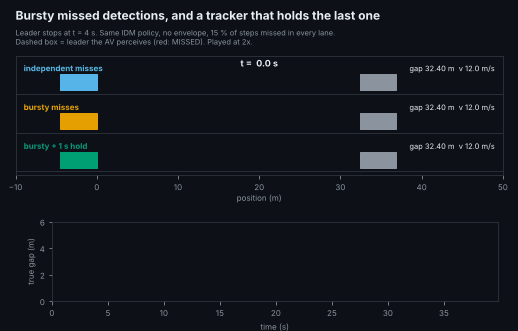 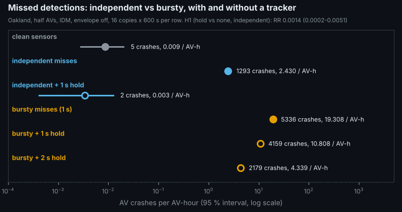

**Limits.** The envelope is off in every cell. Yesterday it absorbed independent misses; bursty misses with the envelope on are untested. Only the leader is
corrupted, and the tracker holds the old leader even when a new car cuts in. Crashes remove AVs, so the bursty cells have
fewer AV-hours.

**Next.** (1) Latency: a ring buffer of the last $d$ leader observations in the same memory. (2) A tracker that does not
creep: hold the last gap at standstill indefinitely (the creep survives because the hold expires). (3) Learned policies
behind bursty misses on AVBench, unaided and with the envelope.

---

## 2026-11-20 (second run) - AV sensor noise and missed detections

**What changed.** A perception error model for AV policies, `avlab/sensornoise.py`. `noisy(policy, SensorModel(...))` wraps any
policy in the simulator's policy slot and corrupts what it sees of its leader: range error, leader-speed error and missed
detections. The safety envelope inside `xnet.sim.step` still sees the truth. New: `avlab/sensorbench.py` (the experiment),
`avlab/sensornoise_plot.py` (GIF, figure, standstill-creep check), `tests/test_sensornoise.py` (5 tests). `xnet/` is untouched.

**Why.** Real AVs plan on detections, not on ground truth. Perception error models inject object-level errors into a simulator
instead of simulating sensors (Piazzoni et al., [PEM, arXiv 2302.11919](https://arxiv.org/abs/2302.11919)). This was backlog item 4.

**How it works.** Per AV and per 0.2 s step, independently, with the noise key `fold_in(step key, 0x5E05)`:

$$\text{detected} = h \wedge (u \ge p_m),\quad g' = g\, e^{\sigma_r \varepsilon_1},\quad v_\ell' = \max(v_\ell + \sigma_v \varepsilon_2, 0),\quad u \sim U(0,1),\ \varepsilon_i \sim N(0,1)$$

where $h$ says a leader exists, $g$ is the gap (m) and $v_\ell$ the leader's speed (m/s). Closing speed, needed deceleration and
time headway are recomputed from $g'$ and $v_\ell'$ with the simulator's formulas. A missed leader looks like no leader.
Levels $(\sigma_r, \sigma_v, p_m)$: mild (0.05, 0.25, 0.02), moderate (0.10, 0.5, 0.05), severe (0.20, 1.0, 0.15).

```
for cell in {envelope off} x {clean, mild, moderate, severe, range only, speed only, missed only} + {envelope on} x {clean, severe}:
    X.SHIELD = "off" or "idm"
    16 Oakland copies, keys 41000+i, half AVs, friction 1.0, AV policy = noisy(IDM, level)
    run 120 s warm-up, then 600 s; save per-copy AV crashes, AV-seconds, envelope cuts
```

**Experiment** (pre-registered in `results/daily/2026-11-20b/predictions.md`). H1: with severe noise, the AV crash rate ratio
$\mathrm{RR} = \lambda_\text{on} / \lambda_\text{off}$ is below 1; exact conditional Poisson test, two-sided $p < 0.05$. Secondary,
Holm with $m = 3$, envelope off, each against clean: severe, missed only, range only. I expected ~63 AV-hours per cell; the runs
had 496-575, so the test had more power than planned.

**Result.**

| cell | AV-hours | AV crashes | per AV-hour (95 %) | vs clean, envelope off |
|---|---|---|---|---|
| off, clean | 575.0 | 4 | 0.007 (0.002-0.018) | 1 |
| off, mild | 573.6 | 4 | 0.007 | 1.00 (0.19-5.38) |
| off, moderate | 570.3 | 92 | 0.161 | 23.2 (8.8-86.9) |
| off, severe | 496.4 | 1842 | 3.71 | 533 (208-1960), Holm p < 1e-300 |
| off, range only | 575.0 | 6 | 0.010 | 1.50 (0.36-7.23), Holm p 0.55 |
| off, speed only | 575.1 | 5 | 0.009 | 1.25 (0.27-6.30) |
| off, missed only | 508.5 | 1603 | 3.15 | 453 (177-1665), Holm p < 1e-300 |
| on, clean | 572.1 | 4 | 0.007 | |
| on, severe | 572.5 | 3 | 0.005 | |

H1 holds: with severe noise the envelope cut the AV crash rate to 0.0014x (95 % 0.0003 to 0.0041; 3 vs 1842 crashes;
$p$ below floating-point resolution). **Success.** Missed detections carry the effect; range and speed error alone do nothing
measurable. With the envelope on, severe noise left crashes and AV speed unchanged (3 vs 4 crashes; 14.67 vs 14.58 km/h) but
the envelope cut the AV's command 19x as often (3.3 % vs 0.17 % of AV time). The crashes are rear-ends (1623 of the typed AV
crashes in the severe cell). The scripted lane (`python -m avlab.sensornoise_plot --creep`, `results/sensor/creep.json`) shows the
mechanism: at standstill a too-short perceived gap cannot push a car back because speed is clipped at 0, while a missed leader
or a too-long gap moves it forward, so the standing gap ratchets down: 2.06 m at 16 s to 0.64 m at 40 s (severe, mean of 40
noise seeds; clean holds 2.50 m), with contact in 2 of 40 seeds.

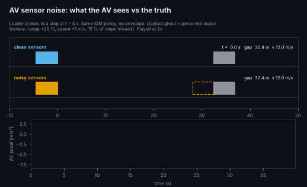 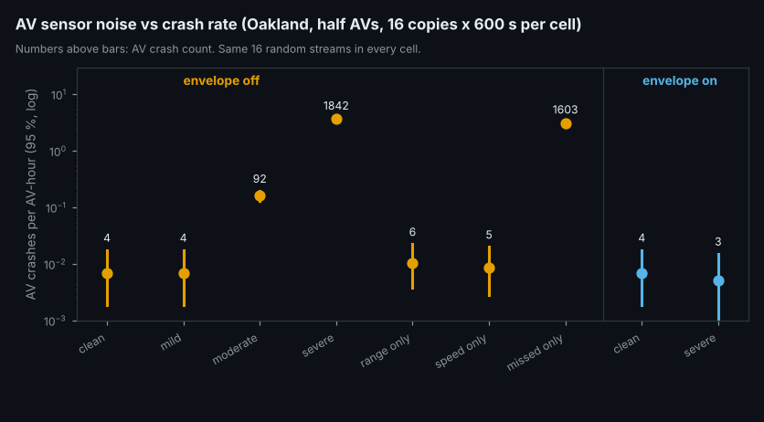

**Limits.** Errors are independent per step; real misses come in runs (tracks drop for seconds), which this model understates,
and a tracker would smooth them away. Only the leader is corrupted; stop lines, signals and junction gaps are exact. The IDM policy
has no filtering; a policy with memory would behave differently.

**Next.** (1) Correlated misses (a two-state Markov dropout) and latency; both need a per-AV state, which the policy slot does not
carry. (2) A tracker baseline: hold the last detection for $k$ steps; does it remove the creep? (3) Run AVBench's learned
policies behind the severe model, unaided.

---

## 2026-11-20 - Timed Elastic Band as an AV planning rule

**What changed.** A new AV planner, `avlab/teb.py`: a one-dimensional Timed Elastic Band that runs in the simulator's policy slot
with the same 28 features as the IDM baseline. `teb_policy` plans every row; `teb_policy_masked` plans only the AV rows (up to 256 per
copy). New: `avlab/tebbench.py` (experiments), `avlab/teb_plot.py`, `tests/test_teb.py` (3 tests). `xnet/` is untouched.

**Why.** TEB (Rösmann et al.: [ROBOTIK 2012](https://jake-ketchum.squarespace.com/s/06309484.pdf),
[ECMR 2013](https://rst.etit.tu-dortmund.de/storages/rst-etit/r/Global/Paper/Roesmann/2013_Roesmann_ECMR.PDF),
[ROS teb_local_planner](https://index.ros.org/p/teb_local_planner)) is a widely used local planner that optimises poses *and* the time
between them, so it can trade travel time against comfort and obstacle limits. The question: does it plan better than IDM here?

**How it works.** Band: $N = 8$ intervals with mean speeds $v_i \ge 0$ and durations $\Delta T_i \in [0.1, 1.5]$ s; positions
$s_i = \sum_{j \le i} v_j \Delta T_j$, accelerations from consecutive $v_i$. Cost (sum of squared residuals, as in g2o):

$$J = \sum \Delta T_i^2 + 0.5 (s_N - D)^2 + 20 \sum [v_i - v_0]_+^2 + 10 \sum ([a_i - 1.5]_+^2 + [-a_i - 3]_+^2)
 + 60 \sum [s_i + 2.5 + 1.2 v_i - x_\text{lead}(t_i)]_+^2 + 60 \sum [s_i - (g_\text{stop} - 1)]_+^2 + 5 v_N^2 + 0.5 \sum (a_i - a_{i-1})^2$$

where $D$ is the stop target minus 1 m (or $v_0 \cdot 4$ s), the leader moves at constant speed, and the stop terms apply only with an
active stop target.

```
teb_policy(obs):
    f = speeds, desired speed (junction cap included), leader gap and speed, stop-target gap   # same features as careful_idm
    z = IDM rollout over 4 s                                  # warm start
    repeat 10: Levenberg-Marquardt step on the residuals; keep it only if J falls
    a = 2 (v_1 - v) / dT_1, clipped to [-8, 3]               # first command; u0 = a/3 or a/8
```

A first version used 30 Adam steps and did not converge (from rest a lone car stalled at 1.7 m/s). Levenberg-Marquardt, TEB's own
solver, fixed it: a lone car reaches its 13 m/s desired speed, stops 1.0 m before a red line and 2.5 m behind a stopped car.

**Experiment** ([predictions, written before the runs](../results/daily/2026-11-20/predictions.md)). E1: Oakland, half AVs, friction
1.0, 24 copies per policy on the same keys (stream 31), 360 s, both policies under the usual envelope. H1: AV mean speed TEB > IDM,
paired t-test, two-sided $p < 0.05$. H2: AV crash rate ratio, upper 95 % bound below 2. Success needs both. Secondary (Holm, m = 2):
hard brakes, jerk. E2 (descriptive): AVBench scorecards on six scenarios, where safety is scored *without* the envelope.

**Result** ([teb.json](../results/teb/teb.json)).

| E1, with the envelope | IDM | TEB | TEB vs IDM |
|---|---|---|---|
| AV speed (km/h) | 16.1 | 17.8 | **+1.68 km/h (+1.50 to +1.85), p 5e-16** |
| AV crashes / AV-hours | 3 / 429 | 5 / 415 | **1.72 (0.34 to 11.1)**, p 0.50 |
| hard brakes per AV-hour | 27.8 | 21.5 | 0.77 (0.75 to 0.80), Holm p 1e-74 |
| jerk RMS (m/s$^3$) | 3.88 | 2.23 | -1.65, Holm p 5e-27 |
| AV trips finished | 1971 | 2246 | |
| share of AV time the envelope cut the command | 0.2 % | 12.6 % | |

| E2 AVBench scenario | rule-based AV | IDM | TEB | IDM crashes/AV-h unaided | TEB crashes/AV-h unaided | TEB envelope share |
|---|---|---|---|---|---|---|
| nominal | 72.2 | 81.0 | 0.5 | 0.000 | 0.707 | 12.3 % |
| rush_hour | 68.0 | 84.1 | 1.7 | 0.000 | 0.417 | 11.8 % |
| red_runners | 90.3 | 41.2 | 0.6 | 0.047 | 0.807 | 11.6 % |
| jaywalkers | 24.1 | 70.7 | 0.2 | 0.022 | 2.315 | 14.8 % |
| wet_road | 89.6 | 65.7 | 0.7 | 0.000 | 0.734 | 11.8 % |
| cut_in | 60.5 | 79.7 | 0.9 | 0.000 | 0.634 | 12.4 % |

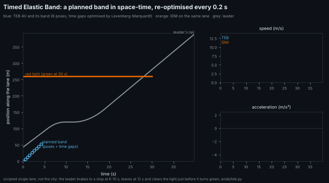

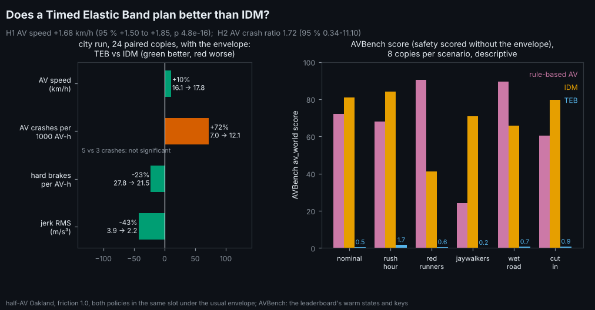

**The experiment failed (H1 held, H2 failed).** With the envelope, TEB AVs were 10 % faster than IDM AVs, finished 14 % more trips,
braked hard 23 % less often and had 43 % less jerk. Crashes were too few to judge safety (5 against 3; the bound of 11 is far above
the margin of 2, because I expected 15 to 30 crashes per arm and got 3 to 5). Without the envelope, TEB crashed 0.4 to 2.3 times per
AV-hour, while IDM had none in four of six scenarios and at most 0.05 in the other two. Its AVBench score is near 0 (mean 0.8 against
70.4 for IDM and 67.5 for the rule-based AV). The envelope cut TEB's command in 12 % of AV time.
So TEB's gains come with the filter doing safety work. On its own it does not plan better here.

A post-hoc check (labelled, not pre-registered; `--diag`, [diag.json](../results/teb/diag.json)): fixing the first interval at the
0.2 s control step and raising the obstacle and stop weights tenfold left unaided crashes at 0.68 per AV-hour on nominal (score 0.7).
Those two suspects are ruled out.

**Limits.** The band is one-dimensional: crossing traffic at junctions, pedestrians and merges reach it only through the stop-target
features, as for IDM. One tuning, one network, one stream for E1; AVBench uses 8 copies per scenario.

**Next.** (1) Run the crash log (`avlab.crashlog`) on unaided TEB to see which crash types it causes. (2) Add hard feasibility (a
stopping-distance check on the first pose, as `teb_local_planner` does) or the proved barrier condition from `formal/` as a
constraint, then re-test unaided. (3) A powered safety test (about 120 copies per arm) if (2) fixes the unaided crashes.

Commands: `python -m avlab.tebbench [--quick|--e1|--e2|--diag]`, `python -m avlab.teb_plot [--bench]`.

---

## 2026-11-19 (second run) - A machine-checked limit of the AV barrier on ice

**What changed.** The repository has its first formal proofs. `formal/AvFormal/Barrier.lean` (Lean 4.25 + Mathlib) states the
AVs' longitudinal barrier from `xnet.sim.cbf_bound` and proves, over the reals, when it can be obeyed on a road whose braking
cap is $9\mu$. New: `formal/` (Lake project, README), `avlab/barrierfriction.py` (+ `_plot`), `tests/test_barrier_formal.py`
(the Lean definitions checked against the code on random states). `xnet/` is untouched.

**Why.** The barrier $h = g - d_0 - \tau v - (v^2 - v_l^2)/(2b)$ assumes braking $b = 6$ m/s$^2$ for the AV and the obstacle,
while the road gives $9\mu$. ROADMAP item 4 asks for the braking assumption to adapt to the road; the proof says exactly when it must.

**How it works.** With $B$ the road's braking, $\alpha \ge 0$, $a_l \ge -b$:

| theorem | statement |
|---|---|
| `bound_feasible` | $B \ge b,\ h \ge 0 \Rightarrow$ cap $> -B$ |
| `bound_infeasible` | $B < b,\ v > v_{feas} = B b \tau/(b - B) \Rightarrow$ on $h = 0$ with a stopped obstacle, cap $< -B$ |
| `stop_gap_sound` | $B_f \ge b \ge B_l,\ h \ge 0 \Rightarrow$ gap after both stop $\ge d_0$ |
| `stop_gap_unsound` | $B_f < b \Rightarrow \exists$ state with $h = 0$ ending in contact |
| `friction_threshold` | $b = 6,\ \tau = 1/2,\ B = 9\mu$: feasible on every $h \ge 0$ state $\iff \mu \ge 2/3$ |

$v_{feas}$ is 27, 9 and 4.5 m/s at $\mu$ = 0.6, 0.5, 0.4. Contact from $h = 0$ starts above the root of
$k v^2 = \tau v + d_0$, $k = 1/(18\mu) - 1/12$: 12 m/s at $\mu = 0.4$.

```
avlab.barrierfriction: X.SHIELD = "cbf" (every AV filtered), half-AV Oakland, calibrated humans
E1: b = 6, friction 1.0 / 0.8 / 0.7 / 0.6 / 0.5 / 0.4, 12 copies each, stream 21, warm 60 s, 300 s
    per moving AV step (v > 2): inside = bar_h < 0; over = v > v_feas(mu)
E2: friction 0.4, X.CBF["b"] = 6 vs 3.6 (= 9 mu), 40 copies each, stream 22, warm 120 s, 480 s, two compiles
    AV crashes / AV-hours, exact conditional Poisson
```

**Experiment** ([predictions, written before the run](../results/daily/2026-11-19b/predictions.md)). H1: the friction-aware
barrier ($b = 9\mu = 3.6$) has an AV crash rate ratio below 1 against $b = 6$ at friction 0.4, two-sided $p < 0.05$. About 35 AV
crashes per arm give 80 % power only for RR $\le 0.51$. P1 (E1): the inside share is flat from 1.0 to 0.7 (ratio within
0.67-1.5) and at 0.4 at least twice the 0.7 share (bar: copy-bootstrap interval of the ratio above 1). S2: speed cost under 15 %.
One secondary (S1, inside share across arms) was dropped before the run because $h$ uses each arm's own $b$.

**Result** ([barrierfriction.json](../results/barrierfriction/barrierfriction.json)).

| friction | 1.0 | 0.8 | 0.7 | 0.6 | 0.5 | 0.4 |
|---|---|---|---|---|---|---|
| moving AV steps inside the barrier | 0.12 % | 0.15 % | 0.16 % | 0.19 % | 0.22 % | 0.28 % |
| moving AV steps faster than $v_{feas}$ | 0 | 0 | 0 | 0 | 55 % | 85 % |

| test | estimate (95 %) | p |
|---|---|---|
| **H1: AV crashes, b 3.6 / b 6 at friction 0.4** | **0.98 (0.62 to 1.53)**; 42 vs 43 crashes, 996 vs 998 AV-hours | **1.0** |
| P1: inside share 0.7 / 1.0 | 1.30 | |
| P1: inside share 0.4 / 0.7 | 1.73 (copy bootstrap 1.54 to 1.96) | |
| S2: AV speed cost | 0.1 % (17.13 vs 17.14 km/h) | |
| city crashes, b 3.6 / b 6 (not pre-registered) | 0.86 (0.66 to 1.13) | 0.26 |

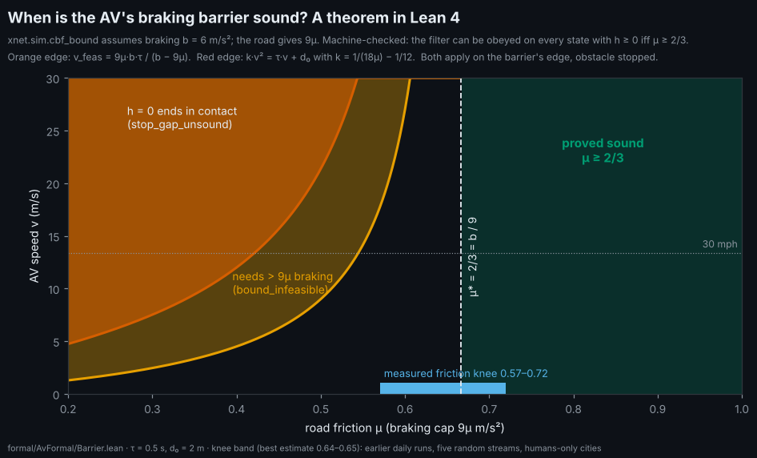

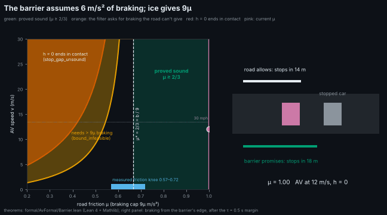

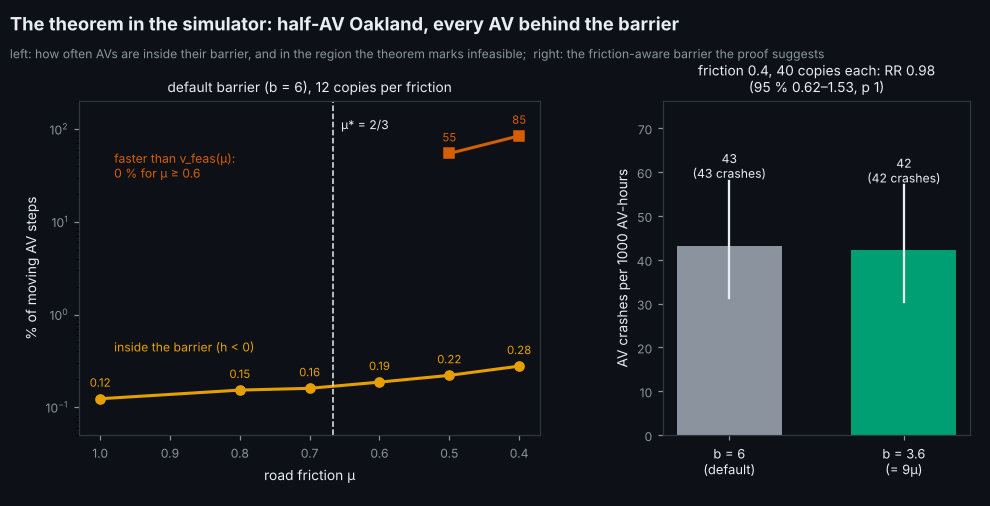

**The experiment failed.** The proof holds and the simulator shows its premise: at friction 0.4, 85 % of moving AV time is spent
faster than the speed above which the barrier can demand impossible braking. But the friction-aware barrier changed nothing
measurable (0.98) and cost no speed, so the barrier is rarely the binding constraint on these AVs: they are inside it for under
0.3 % of moving steps, and their crashes on ice are mostly merges (2026-11-14), which a longitudinal barrier does not govern.
P1 held on its bar but not on its "twice" wording (1.73), and the inside share rises smoothly with no bend at 2/3. The threshold
$\mu^* = 2/3$ lies inside the humans-only friction knee's range (0.57-0.72); that is a coincidence of numbers here, since human
drivers do not use this barrier.

**Limits.** The theorems are kinematic (constant braking, no reaction lag beyond $\tau$, one dimension). The simulation filters the
rule-based AV only; a learned policy that leans on the barrier may behave differently.

**Next.** (1) Prove the lane-change barriers `h_b`, `h_f` (`xnet/sim.py:589`, they assume 3 and 6 m/s$^2$) and the junction
time margin. (2) Re-run E2 with a learned policy behind the barrier (`SHIELD = "cbf"`, `rl=`). (3) A Lean proof that the IDM
of the human drivers is collision-free iff its deceleration term stays above $-9\mu$, to test whether 2/3 is more than a coincidence.

Commands: `python -m avlab.barrierfriction [--quick|--run]` (~8 min), `python -m avlab.barrierfriction_plot [--sim]`,
`cd formal && lake build`.

---

## 2026-11-19 - A per-crash event log, and where patchy-ice crashes happen

**What changed.** The repository can now say where and when each crash happened. `avlab.crashlog.Logger` runs the unchanged
simulator step with `diag=True` inside a scan and writes one row per vehicle that becomes a wreck: time, copy, slot, track,
position, speed just before contact (impact speed), AV flag, kind, role (rear-end striker, junction conflict, lane change,
pedestrian, other) and reference link. It also sums vehicle-seconds per link, so rates per street need no second run.
`events()` groups rows of one copy and time step that are within a 25 m chain into one crash. New: `avlab/crashlog.py`,
`avlab/icemap.py` (+ `_plot`), `tests/test_crashlog.py`. `xnet/` is untouched. This is foundations backlog item 1.

**Why.** Crash counters per copy cannot test anything about place, and several open next steps (14, 16, 20) need it. Studies of
real icy roads report crash risk per exposure on snow or ice about 15 to 20 times that on dry pavement
([Marquette, wet-pavement report](https://www.eng.mu.edu/drakopoa/web_documents/Wet%20pavement%20MU%20report/PCC%20and%20asphalt%20pavement%20texture%20relation%20to%20accidents.pdf),
per vehicle-mile; search snippet only), so a per-street rate is the quantity worth comparing.

**How it works.**

```
log_step(state, net, beh):                         # vmapped over copies, scanned over steps
    out, d = xnet.sim.step(state, net, beh, nh, diag=True)
    link = state.trk // 2 if on a link else mov_in[box move]       # reference link
    new = d.crashed & (state.wreck_t <= 0)                         # vehicles that become wrecks this step
    role = pedestrian if d.ped_hit else lane_change if d.ss else junction if d.in_hit else rear if d.rear else other
    rows[n : n + sum(new)] = (t, slot, trk, s, v, av, kind, role, link, link_patch[link])   # fixed capacity per copy
    expo[link of every alive vehicle] += DT
events(rows): union rows with the same copy and step whose positions are < 25 m apart
```

Checks (tests/test_crashlog.py): the final state of a logged run equals that of a plain run leaf by leaf; events per copy equal the
simulator's crash counters summed over types; exposure equals `veh_s`. In today's run the events matched the counters in all
96 copies (269 = 269) and exposure matched `veh_s` to 6e-5. The logged run took 14.3 s against 13.4 s for a plain run of 4 copies
over 300 s (compile included); the simulator itself is unchanged.

**Experiment** ([predictions, written before the run](../results/daily/2026-11-19/predictions.md)). Three cells, 32 copies each,
humans-only Oakland, random stream 11, warm-up 120 s, 600 s logged, the 2026-11-18 mask (292 of 622 links, half the length):
P (friction 1.0, x 0.4 on the mask), D (1.0 everywhere), I (0.4 everywhere). H1: inside P, the rate ratio
$\mathrm{RR} = (k_{ice}/t_{ice}) / (k_{dry}/t_{dry}) > 1$, where $k$ is crash events and $t$ vehicle-hours on masked and unmasked
links. Test: exact conditional Poisson, $k_{ice} \sim \mathrm{Bin}(k_{ice} + k_{dry},\, t_{ice}/(t_{ice} + t_{dry}))$, bar two-sided
$p < 0.05$. Expected RR about 11; power above 0.9. Secondary (Holm, m = 2): S1, masked links P / I, predicted interval contains 1;
S2, unmasked links P / D (spillover), low power.

**Result** ([icemap.json](../results/icemap/icemap.json)).

| cell | masked links: crashes, veh-h, per 1000 veh-h | other links: crashes, veh-h, per 1000 veh-h |
|---|---|---|
| D, dry everywhere | 10, 1401, 7.1 | 0, 1102, 0 |
| P, ice on the mask | 91, 1382, 65.9 | 6, 1111, 5.4 |
| I, ice everywhere | 87, 1337, 65.1 | 75, 1111, 67.5 |

| test | estimate (95 %) | p |
|---|---|---|
| **H1: P, icy / dry links** | **12.2 (5.4 to 34.1)**; copy bootstrap 6.0 to 43.2 | **5e-17** |
| S1: masked links, P / I | 1.01 (0.75 to 1.37) | 0.94 (Holm 0.94) |
| S2: other links, P / D | 6 vs 0 crashes; lower bound 1.17 | 0.031 (Holm 0.063) |
| post hoc: D, masked / other links | 10 vs 0 crashes; lower bound 1.76 | 0.003 |
| post hoc: I, masked / other links | 0.96 (0.70 to 1.33) | 0.81 |

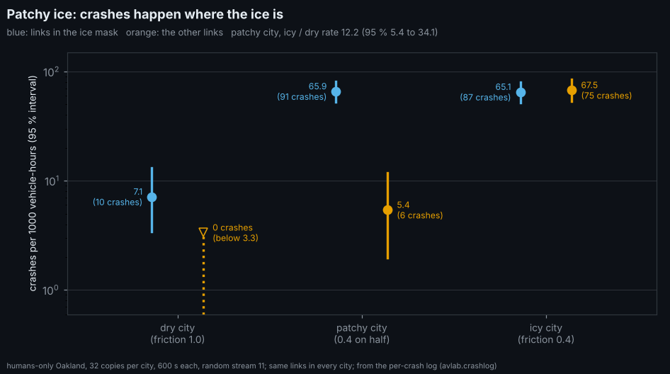

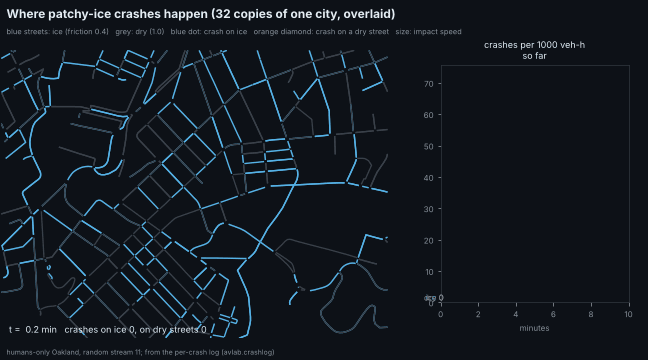

**The experiment succeeded.** In the patchy city, a vehicle-hour on an icy street carried 12 times the crash risk of one on a dry
street, close to the 11.6 that the uniform cities of 2026-11-18 predicted. The icy streets in the patchy city crashed at the same
rate as the same streets in an all-ice city (1.01), so the risk is local to the ice. The six crashes on dry streets of the patchy city
against none in the dry city hint at spillover but do not pass Holm. Median impact speed of rear-end strikers was 8 km/h on ice
against 18 km/h in the dry city: ice crashes here are more frequent and slower.

**Limits.** The mask is not risk-neutral when dry: in the dry city all 10 crashes fell on masked links (p 0.003, post hoc), while at
uniform ice the two link sets match (0.96). The dry-city rates are small (7 per 1000 veh-h) next to the icy rates (65), so this does
not explain a 12x ratio, but a ratio adjusted for dry risk cannot be estimated with zero crashes. One mask, one stream, one network,
and drivers do not see the ice.

**Next.** (1) Use the log on next step 14 (what capped braking fails to stop) and 16 (which merges caution prevents). (2) Find why
the masked links are riskier when dry, then repeat with a mask matched on dry risk. (3) Record the other party of each crash in the row.

Commands: `python -m avlab.icemap [--quick|--run]` (~5 min run), `python -m avlab.icemap_plot [--no-gif]`.

---

## 2026-11-18 - Friction that varies by street, and a patchy-ice test

**What changed.** The simulator can now give each street its own friction. `xnet.sim.patch_links(net, share, seed)` returns a
mask over links covering `share` of the network's length; put it in the jnp network as `J["link_patch"]`, and on those links the
friction becomes $\mu \cdot m$, where $\mu$ is `Behaviour.friction` and $m$ is the new field `Behaviour.patch_friction` (default 1).
A car inside a junction box uses its approach link. With no mask in the network the new code is never traced. New: `avlab/patchyice.py`
(+ `_plot`), `avlab/speedcheck.py` (the 200-step timing used by the rule for `xnet/` changes), `tests/test_daily_1118.py`.
This is foundations backlog item 2.

**Why.** Road friction in real cities is patchy: black ice forms on bridges, in shade and on some streets before others. Iowa State
work maps spatial pavement friction to crash probability per road section
([InTrans](https://www.intrans.iastate.edu/wp-content/uploads/2018/07/Impact-of-Spatial-Pavement-Friction-on-Crash-Risk-Assessment-_04252017.pdf)),
and a microsimulation digital twin found lower friction raises conflict measures ([arXiv 2502.09561](https://arxiv.org/pdf/2502.09561)),
but I found no city-scale test of patchy against uniform friction at the same mean. (Search snippets only.)

**How it works.**

```
xnet.sim.step (only when "link_patch" in net):
    a_min = -9 * friction                                   # the hardest braking the road allows, as before
    patched = link_patch[link if on a link else approach link of the junction move]
    a_min = a_min * (patch_friction if patched else 1)      # per car; every later use of a_min is elementwise
avlab.patchyice.run: one compiled program, humans-only Oakland, calibrated drivers, seed 9, warm 120 s, score 600 s, 40 copies per cell
    U1.0, U0.7, U0.4: friction 1.0 / 0.7 / 0.4, patch_friction 1      P: friction 1.0, patch_friction 0.4
    mask = patch_links(net, 0.5, seed 0): 292 of 622 links, 49.8 % of length (length-weighted mean friction 0.70)
    w = P's share of vehicle-steps on patched links (from st.link_n after the warm-up)
```

Checks for the `xnet/` change (default off): per-copy counters for 200 steps of 16 Oakland copies (seed 0) are bit-identical before and
after; the median of 5 timings went from 2.311 s to 2.178 s ($t_1/t_0 = 0.94 \le 1.05$). Tests also show that a mask with $m = 1$
changes nothing and that a full mask with $\mu = 1, m = 0.5$ equals scalar friction 0.5.

**Experiment** ([predictions, written before the run](../results/daily/2026-11-18/predictions.md)). H1: the crash rate ratio
$\mathrm{RR} = \lambda_P / \lambda_{U0.7} > 1$, where $\lambda = k/t$ is crashes per vehicle-hour. Test: exact conditional Poisson,
$k_P \sim \mathrm{Bin}(k_P + k_{U0.7},\, t_P/(t_P + t_{U0.7}))$ under RR = 1, bar two-sided $p < 0.05$. Expected RR about 4 by Jensen's
inequality on a convex crash curve; power about 0.88 even at RR = 2 with ~30 crashes in U0.7. Secondary (Holm, m = 2): S1, P against the
mixture $E = t_P\,(w\,\lambda_{0.4} + (1 - w)\,\lambda_{1.0})$, predicted $O/E$ in 0.75-1.33, delta method on $\log(O/E)$;
S2, $\lambda_P / \lambda_{U0.4} < 1$.

**Result** ([patchyice.json](../results/patchyice/patchyice.json)).

| cell | crashes | vehicle-hours | per 1000 veh-h | share of vehicle-steps on patched links |
|---|---|---|---|---|
| U1.0 | 17 | 3113 | 5.5 | 0.558 |
| U0.7 | 30 | 3103 | 9.7 | 0.557 |
| P (0.4 on half the streets) | 101 | 3126 | 32.3 | 0.562 |
| U0.4 | 201 | 3143 | 64.0 | 0.555 |

| test | estimate (95 %) | p |
|---|---|---|
| **H1: P / U0.7** | **3.34 (2.20 to 5.21)** | **4e-10** |
| S1: P / mixture of U0.4 and U1.0 | 0.84 (0.67 to 1.07); 101 observed, 119.8 expected | 0.16 (Holm 0.16) |
| S2: P / U0.4 | 0.51 (0.39 to 0.64) | 9e-9 (Holm 2e-8) |

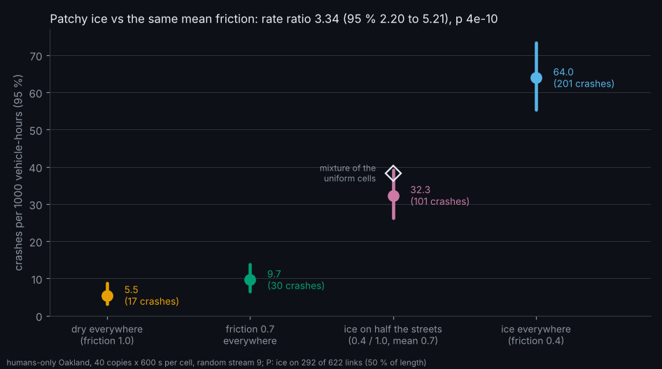

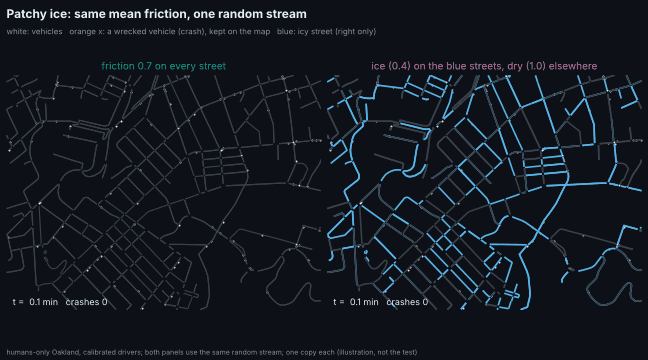

**The experiment succeeded.** Ice on half of Oakland's streets gave 3.3 times the crash rate of friction 0.7 everywhere, although
the mean friction by length is the same. Patchy ice cost about what a mixture of the all-dry and all-ice cities predicts (0.84 of it,
interval includes 1), so in this simulator the risk comes from the time spent on ice and the transitions add nothing measurable.
Speeds hardly moved (15.6-15.8 km/h in every cell).

**Limits.** Traffic is not spread evenly: 56 % of vehicle-steps fell on the patched 50 % of length, so the exposure-weighted mean
friction in P is 0.66, not 0.70; the effect is far larger than the 0.65-0.7 difference (stream 5: 41 vs 40 crashes). Drivers here
do not see ice, so this tests the braking cap only. One random mask, one stream, one network.

**Next.** (1) Put the mask where ice forms: bridges and shaded links, or a contiguous zone, and compare with a random mask of equal length.
(2) Give AVs a sensed patch map (`avlab.stopline.tomography` per link) and test gap caution only on icy links. (3) A one-line
`av_world` option for patchy ice.

Commands: `python -m avlab.patchyice [--quick|--run]` (~10 min run with the GIF job alongside), `python -m avlab.patchyice_plot --gif`,
`python -m avlab.speedcheck [--save f.json]`.

---

## 2026-11-17 - Gap caution on ice, a powered test (it shrank). And the friction knee's empty cells, filled

**Ideas kept** (14 candidates; [search](../results/daily/2026-11-17/search.json)): (1) the powered confirmation asked for in next
step 16: one pre-registered test of gap caution at friction 0.4 on a third random stream (seed 8) with 120 copies per cell, three
times the earlier runs; (2) next step 17, "place the knee with data": a fifth random stream (seed 5) with 48 copies at the two
frictions no run had, 0.65 and 0.75, scored against what each four-stream model predicted; (3) small: the README install section now
says to use one interpreter for pip and python (next step 19). Tools: `avlab/gappowered.py` (+ `_plot`), `avlab/knee5.py` (+ `_plot`).
Prior art: the Mantel-Haenszel rate ratio pools stratified person-time as sum(a_i T0_i / T_i) / sum(b_i T1_i / T_i)
([MetricGate](https://metricgate.com/docs/mantel-haenszel-rate-ratio/)); the exact single-pair test conditions on the total count
(`poisson.test`), and I found no packaged exact *stratified* version, so `stratified_rr` convolves the per-stratum binomials (it
reproduces 2026-11-16's merge pooling, 0.36, 0.20-0.64). On where to put design points to locate a breakpoint I found only
estimation work with fixed, evenly spaced designs ([Chen, LSE](https://personal.lse.ac.uk/CHENY100/JumpKink.pdf);
[arXiv 2408.13751](https://arxiv.org/abs/2408.13751)), no optimal-design result. (Search snippets only.)

### Pseudocode

```
avlab.gappowered (xnet/ untouched; reuses avlab.gapconfirm.run: IDM AVs through the policy slot, gsc = 1.15 + 0.35 tanh(u1))
  cells (one compiled program, copy i of both cells on key 8000 + i; half-AV Oakland, calibrated humans, friction 0.4;
         warm 120 s, score 480 s): blind (gsc 1.15) and gap (gsc 1.495), 120 copies each
  the ONE pre-registered test: AV crashes per AV-hour, gap vs blind, exact conditional Poisson, bar two-sided p < 0.05
  post hoc (labelled): seeds 6, 7, 8 pooled: MH rate ratio; exact stratified test (convolve Bin(n_s, r t_a/(r t_a + t_b)) over
         streams; interval inverts the two 2.5 % tails); Cochran's Q on log rate ratios for "do the streams differ?"

avlab.knee5 (humans-only Oakland, calibrated drivers, the knee.replicate protocol: warm 120 s, 600 s scored)
  stream 5 = seed 5: 48 copies at friction 0.75 and 0.65
  predictions (from the four saved streams, before the run): rate(0.65)/rate(0.75) under power law / hinge 0.64 / 0.7 / 0.8
  stream 5 alone: exact rate ratio; Poisson likelihood of its two cells under each predicted ratio (level profiled out)
  five streams: avlab.kneeprofile.analyse(load=load_all5): profile on h = 0.42..0.96, copy bootstrap B 999, kink vs quadratic
```

### Predictions, written before the full runs ([file](../results/daily/2026-11-17/predictions.md))

* G1 (confirmatory): gap vs blind at 0.4, rate ratio < 1 with p < 0.05. G2: merge rate ratio <= 0.5. G3: speed cost < 5 %.
* K1: stream 5's ratio 0.65/0.75 > 1 (point estimate). K2: with five streams the 3.84 set stays wider than 0.15. K3: kink vs smooth
  quadratic p < 0.1.

### Results ([gappowered.json](../results/frictionmerge/gappowered.json), [knee5.json](../results/knee/knee5.json), [stream5.json](../results/knee/stream5.json))

| gap caution at friction 0.4 | AV crashes gap vs blind | AV rate ratio (95 %) | p | merge crashes | merge rate ratio (95 %) |
|---|---|---|---|---|---|
| seed 6 (2026-11-15, 40 copies/cell) | 20 vs 37 | 0.54 (0.29-0.95) | | 6 vs 22 | 0.27 (0.09-0.69) |
| seed 7 (2026-11-16, 40 copies/cell) | 24 vs 38 | 0.63 (0.36-1.07) | 0.076 | 12 vs 27 | 0.44 (0.20-0.90) |
| **seed 8 (today, 120 copies/cell, pre-registered)** | **70 vs 86** | **0.81 (0.58-1.12)** | **0.20** | 29 vs 38 | 0.76 (0.45-1.26) |
| three streams pooled (post hoc) | 114 vs 161 | 0.70 (0.55-0.90) | 0.005 | 47 vs 87 | 0.54 (0.37-0.77), p 0.0006 |
| streams differ? (Cochran's Q, 2 df) | | Q 1.9, p 0.39 | | | Q 4.5, p 0.11 |

Today's cells: about 3,200 AV-hours each; AV speed ratio 0.975 (2.5 % slower), AV trips 0.97x, city-wide crash rate ratio 0.92
(0.78-1.08).

| friction knee | estimate |
|---|---|
| stream 5 crashes (per 1000 veh-h), 0.75 / 0.65 | 40 (10.6) / 41 (11.0) |
| stream 5 rate ratio 0.65 / 0.75 | 1.03 (0.65-1.64) |
| four-stream predictions (relative likelihood on stream 5) | hinge 0.64: 1.16 (1.00); hinge 0.7: 1.33 (0.60); power law: 1.49 (0.29); hinge 0.8: 1.59 (0.18) |
| five streams: copies, crashes | 620, 961 |
| best hinge; hinges within 3.84 of the best | 0.65; **0.57-0.72** (was 0.56-0.84) |
| copy bootstrap of the best hinge (B 999) | median 0.64, 95 % 0.58-0.94; 82 % of draws in 0.6-0.8 (was 72 %) |
| kink vs smooth quadratic | T 6.9 (null 95 % point 4.7), p 0.014 (Holm 0.014); power ~52 % |
| curvature (quadratic vs power law) | p 1e-5 (Holm 2e-5) |
| extra slope at fixed hinge 0.6 / 0.7 / 0.8 | 2.1 / 2.8 / 4.3 |

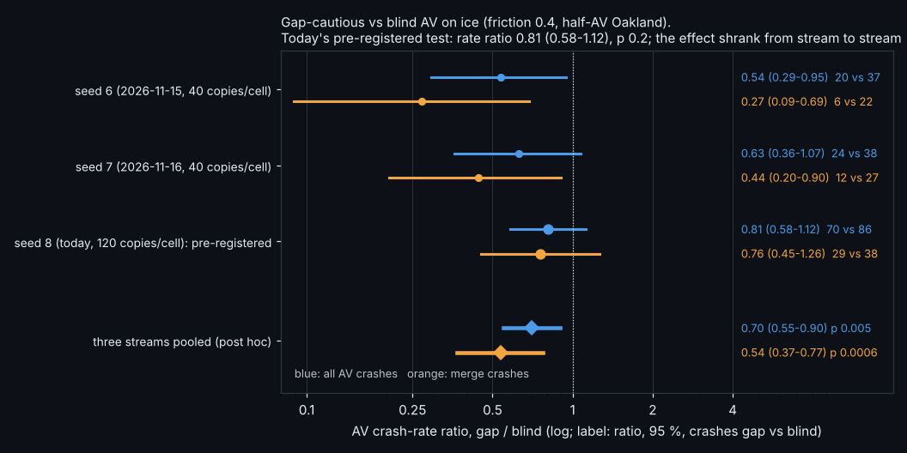

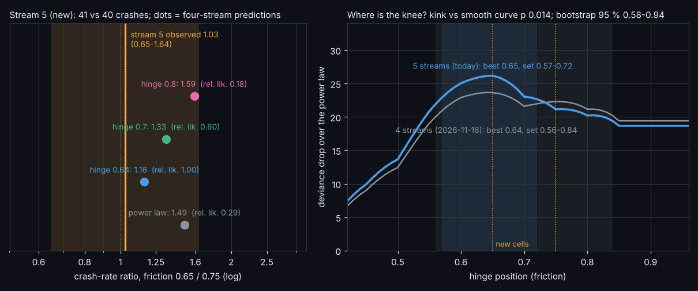

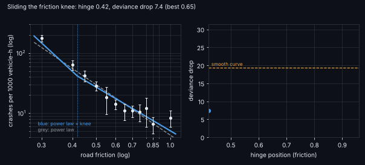

**G1, G2 failed; G3 held. K1 held (barely), K2 failed in the useful direction, K3 held.** With three times the copies, the gap-cautious
AV had 70 AV crashes to the blind AV's 86 (rate ratio 0.81, 0.58-1.12, p 0.20): the pre-registered test failed, and the point
estimate has moved toward 1 on every new stream (0.54, 0.63, 0.81), the pattern expected when an effect is first noticed on a lucky
draw. The streams do not differ significantly (Q p 0.39), so the best summary is the post hoc pooled 0.70 (0.55-0.90): gap caution
probably helps on ice, by about 30 % rather than the 46 % first seen, at 2.5 % of speed. **The knee:** stream 5 is flat between 0.75
and 0.65 (41 vs 40 crashes), which is what a knee near 0.64 predicts and what a knee at 0.8 or a plain power law does not (relative
likelihoods 0.18 and 0.29). With it, the set of hinges that fit narrows from 0.56-0.84 to 0.57-0.72, and a kink beats a smooth
curve more clearly (p 0.014). The bootstrap still has a thin second mode at 0.80-0.96, because no run lies between 0.85 and 1.0.

**What failed / limits.** The confirmatory gap test failed; the pooled number is post hoc. Stream 5's ratio alone is not significant
(81 crashes); its weight comes from the comparison of four pre-computed predictions, and those predictions came from the same model
family the profile uses. The 3.84 set is descriptive, not a calibrated interval. One network (Oakland), one AV policy.

**Tests**: `tests/test_daily_1117.py` (exact stratified rate ratio matches the single-pair test and tightens with more strata;
Cochran's Q; model-predicted ratios recover planted power laws and hinges; the two-cell likelihood peaks at the observed ratio).

Commands: `python -m avlab.gappowered [--quick|--plot]` (~12 min full with another job running; ~9 alone),
`python -m avlab.knee5 [--quick|--run]` (~10 min run with another job running; analysis 35 s).

---

## 2026-11-16 - Gap caution on ice, confirmed on a fresh stream? And where is the friction knee, and is it a knee at all?

**Ideas kept** (15 candidates; [search](../results/daily/2026-11-16/search.json)): (1) the confirmation asked for in next step 16:
one pre-registered test of gap caution at friction 0.4 on a new random stream (seed 7), plus its cost at friction 0.6 and 1.0;
(2) next step 17 without simulation: a profile likelihood and a copy bootstrap for the knee's position on the four pooled streams,
and a test of whether a kink beats a smooth curve; (3) small: `av-world doctor` now warns when `python` on PATH is a different
interpreter from the one with the packages (today's setup: `pip` and `av-world` on Python 3.13, a bare `python` 3.11 without jax).
Tools: `avlab/gapconfirm.py` (+ `_plot`), `avlab/kneeprofile.py` (+ `_plot`).
Prior art: breakpoint intervals are non-standard because the breakpoint is not identified under the no-break null (Davies test);
Muggeo's `segmented` package offers delta, score and gradient intervals, and finds smoothed score intervals better than Wald or
likelihood-ratio ones in practice ([confint.segmented](https://rdrr.io/cran/segmented/man/confint.segmented.html)); a nonparametric
bootstrap gave less biased and narrower breakpoint intervals than the piecewise-linear approach in small samples
([PMC7713952](https://www.ncbi.nlm.nih.gov/pmc/articles/PMC7713952/)). On AV gap acceptance in low friction I again found no
study that counts city crashes; a U.S. DOT report says weather can enter gap-acceptance models but found no suitable empirical data
for lane changes and gap acceptance in adverse weather ([ROSA P dot/4003](https://rosap.ntl.bts.gov/view/dot/4003/dot_4003_DS1.pdf)).
(Search snippets only.)

### Pseudocode

```
avlab.gapconfirm (xnet/ untouched; AVs through the policy slot, IDM T = 1.5 s, u[:, 1] sets the gap scale gsc = 1.15 + 0.35 tanh(u1))
  cells (one compiled program, copy i of every cell on key 7000 + i; half-AV Oakland, calibrated humans; warm 120 s, score 480 s):
     blind@0.4, gap@0.4 (40 copies each)  <- the ONE pre-registered test: AV crashes per AV-hour, exact conditional Poisson, bar p < 0.05
     blind@0.6, gap@0.6, blind@1.0, gap@1.0 (20 copies each)   <- cost of caution (speed, trips); crash ratios reported, not tested
     blind: gsc 1.15 (u1 = 0); gap: gsc 1.495 (the slot's maximum, which is what 2026-11-15's clip(1.15/mu) gave at mu 0.4)
  post hoc (labelled as such): fixed-effect pooling of the 0.4 cells with 2026-11-15's stream (seed 6)

avlab.kneeprofile (no simulation; 524 copies, 880 crashes from four streams; copies summed into 25 (run, friction) cells)
  model: log rate = a_run + b log mu [+ c max(log h - log mu, 0)]          (quasi-Poisson IRLS, as in avlab.knee)
  profile: deviance drop over the power law for h = 0.42 .. 0.96 step 0.01; 'set' = {h : drop >= max - 3.84} (descriptive only)
  copy bootstrap (B 999): resample copies within each cell, refit on h step 0.02, keep the best h -> 2.5 / 97.5 % quantiles
  knee vs curve: T = dev(power + c (log mu - log 0.7)^2) - dev(best hinge); p from 999 Poisson draws under the fitted quadratic
                 (power: share of draws under the best hinge with T above the null's 95 % point); curvature: quadratic vs power, LR chi^2 1 df
  Holm over {knee vs curve, curvature}
```

### Predictions, written before the full runs ([file](../results/daily/2026-11-16/predictions.md))

* C1 (confirmatory): gap vs blind at 0.4, rate ratio < 1 with p < 0.05. C2: merge rate ratio <= 0.5. C3: caution costs < 5 % of AV
  speed and < 8 % of AV trips at 0.6 and 1.0. C4: at 1.0 the crash ratio's interval includes 1.
* K1: the hinge's profile is flat (set wider than 0.2 in friction; half-known from a probe). K2: a kink does **not** beat a smooth
  quadratic (p > 0.05). K3: the bootstrap interval of the best hinge is wider than 0.6-0.8.

### Results ([gapconfirm.json](../results/frictionmerge/gapconfirm.json), [kneeprofile.json](../results/knee/kneeprofile.json))

| cell (seed 7) | AV crashes / AV-h | of which merges | per 1000 AV-h | AV speed km/h | AV trips |
|---|---|---|---|---|---|
| blind@0.4 | 38 / 1065 | 27 | 35.7 | 15.2 | 5365 |
| gap@0.4 | 24 / 1073 | 12 | 22.4 | 14.8 | 5174 |
| blind@0.6 | 3 / 527 | 1 | 5.7 | 15.3 | 2702 |
| gap@0.6 | 9 / 528 | 3 | 17.0 | 15.0 | 2614 |
| blind@1.0 | 2 / 526 | 0 | 3.8 | 15.2 | 2669 |
| gap@1.0 | 2 / 530 | 0 | 3.8 | 14.9 | 2604 |

| comparison | AV rate ratio (95 %) | p | merge rate ratio (95 %) | AV speed ratio | AV trip ratio |
|---|---|---|---|---|---|
| **gap vs blind, 0.4 (confirmatory)** | **0.63 (0.36-1.07)** | **0.076** | 0.44 (0.20-0.90) | 0.98 | 0.96 |
| gap vs blind, 0.6 | 2.99 (0.75-17.2) | 0.15 | 3 vs 1 crashes | 0.98 | 0.97 |
| gap vs blind, 1.0 | 0.99 (0.07-13.7) | 1.0 | 0 vs 0 | 0.98 | 0.98 |
| 0.4, both streams pooled (post hoc) | 0.58 (0.39-0.86) | 0.004 | 0.36 (0.20-0.64) | | |

| knee | estimate |
|---|---|
| best hinge (profile, step 0.01) | 0.64, deviance drop 23.7 over the power law |
| hinges within 3.84 of the best | 0.56-0.84 |
| copy bootstrap of the best hinge (B 999) | median 0.66, 95 % 0.58-0.96; 72 % of draws in 0.6-0.8 |
| curvature at all (quadratic vs power law) | drop 17.8, p 2e-5 (Holm 5e-5) |
| kink vs smooth curve | T = 5.8 (null 95 % point 5.3), bootstrap p 0.037 (Holm 0.037); power of this test about 38 % |
| fixed hinges 0.6 / 0.7 / 0.8: extra slope | 2.1 / 2.8 / 4.5 |

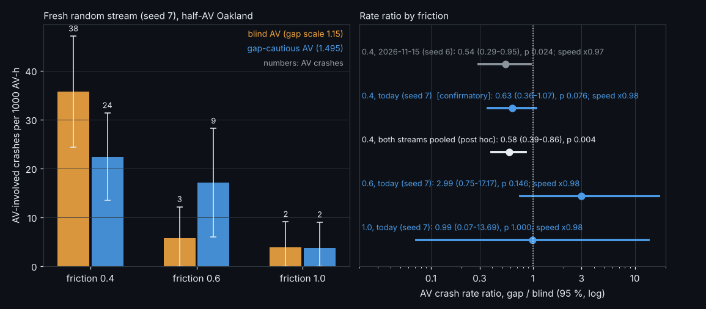

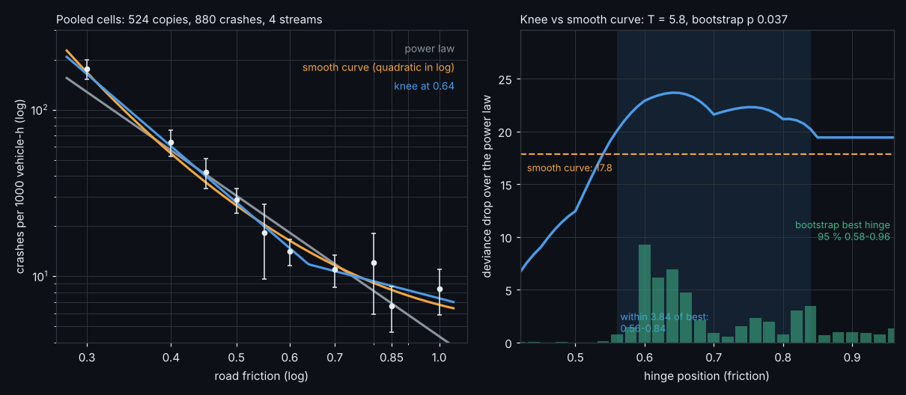

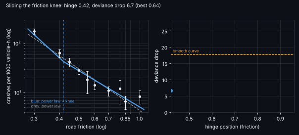

**C1 failed, C2-C4 held; K1 and K3 held, K2 failed.** On a fresh random stream the gap-cautious AV again had fewer crashes on ice
(24 vs 38, rate ratio 0.63) and fewer merge crashes (12 vs 27, 0.44, 0.20-0.90), for 2 % of speed and 4 % of trips, but the
pre-registered test missed its bar (95 % 0.36-1.07, p 0.076): two streams, two point estimates in the same direction (0.54 and 0.63),
neither alone decisive after correction. Pooled after the fact the two streams give 0.58 (0.39-0.86, p 0.004); that number was not
pre-registered and should be read as a meta-analytic summary, not a confirmation. At friction 0.6 the cautious AV had 9 crashes to
the blind AV's 3 (n.s., interval 0.75-17): caution where it is not needed did not help, and may cost. **The knee** is real
curvature (p 2e-5), and a kink fits a little better than a smooth quadratic (p 0.037), so "knee" survives as the better description,
but *where* is not pinned down: every hinge from 0.56 to 0.84 fits within 3.84 deviance of the best, and the bootstrap puts the best
hinge anywhere from 0.58 to 0.96 (bimodal: a mode at 0.60-0.66 and a second at 0.76-0.84).

**What failed / limits.** The confirmatory test failed its bar; 40 copies per cell detect a 0.5 ratio but not 0.6. The 0.6 cost cells
are small (12 AV crashes). The knee-vs-curve test is weak (power ~38 % under the fitted hinge), only one smooth alternative was tried,
and the 3.84 set is descriptive, not a calibrated interval (the hinge is not a regular parameter). The profile flattens above 0.85
because no data lie between 0.85 and 1.0. Setup note: `python` and `pip` were different interpreters in this environment; all runs
used `python3.13`.

**Tests**: `tests/test_daily_1116.py` (aggregation preserves deviance differences; the profile finds a planted hinge; knee vs curve
on synthetic data; the gap-confirm summary and u1 map; the doctor's interpreter check).

Commands: `python -m avlab.gapconfirm [--quick|--plot]` (~6 min full), `python -m avlab.kneeprofile [--quick]` (~1 min).

---

## 2026-11-15 - The merge channel: an AV that is more careful at gaps on ice. And the friction knee on a fourth stream

**Ideas kept** (14 candidates; [search](../results/daily/2026-11-15/search.json)): (1) give the friction-aware AV of 2026-11-14 the
policy slot's second output, the gap-acceptance scale, because 13 of its 21 crashes at friction 0.4 were merges (next step 16);
(2) a fourth random stream with 32 copies at 0.85 / 0.7 / 0.6, to see whether stream 3's high 0.7 cell was a fluke (next step 17);
(3) cleanup with no simulation: the three daily branches that were never merged (2026-11-05, -07, -09) are now on `main` (next step 18).
Tools: `avlab/frictionmerge.py` (+ `_plot`), `avlab/knee4.py`.
Prior art: drivers accept longer gaps in rain, about 10 % longer at roundabout entries with 10-20 % lower acceptance probability for
the same gap ([J. Adv. Transp. 2018, logit model](https://pure.uos.ac.kr/en/publications/evaluation-of-the-rain-effects-on-gap-acceptance-behavior-at-roun/)),
and longer left-turn gaps as rain gets heavier ([TRID 1091714](https://trid.trb.org/view/1091714)); a Virginia Tech dissertation finds
drivers less aggressive as rain increases ([VTechWorks](https://vtechworks.lib.vt.edu/server/api/core/bitstreams/2ceb9c12-3c3d-4df5-b082-457f160e086b/content)).
These are measurements of human drivers; I found none that changes an AV's gap acceptance with friction and counts crashes in a city
(search snippets only). Pooling random streams is a fixed-effects count meta-analysis; random-effects Poisson pooling is the usual
choice when the studies differ ([PMC8985876](https://pmc.ncbi.nlm.nih.gov/articles/PMC8985876)). The heterogeneity test below checks
whether they do.

### Pseudocode

```
avlab.frictionmerge (xnet/ untouched; AVs driven through the policy slot X.step(..., rl=(policy, key)), under the usual envelope)
  xnet: gsc = 1.15 + 0.35 tanh(u[:, 1]) multiplies the AV's critical gap at junctions and its lane-change / zipper gaps
        (the example IDM sends u1 = 0 -> gsc 1.15, i.e. less cautious than the rule-based AV's 1.25)
  policy = avlab.frictionaware.aware_idm (T = 1.5 s * T_scale) with u[:, 1] = u1
     blind        T_scale 1,    u1 0
     headway      T_scale 1/mu, u1 0
     gap          T_scale 1,    u1 = arctanh((clip(1.15/mu, 1.15, 1.495) - 1.15) / 0.35)    (at mu 0.4: gsc 1.495, the slot's maximum)
     headway+gap  both
  all at friction 0.4, p_av 0.5, calibrated humans; 40 copies per cell, copy i of every cell on key (6000 + i); one compiled program;
  warm 120 s, score 480 s
  tests: 4 pre-registered rate ratios of AV-involved crashes per AV-hour (exact conditional Poisson), Holm over 4;
         merge-only rate ratios and city rate ratios reported, not tested
  GIF: blind AVs, 8 copies, seed 11: run 20 s chunks until an AV crash; fork the state at that chunk's start; replay it once with
       blind and once with headway+gap (same cars, signals, random numbers), zoomed side by side

avlab.knee4
  run: avlab.knee.replicate(E = 32, mus = (0.85, 0.7, 0.6), seed = 4)     (humans only, warm 120 s, 600 s scored)
  stream 4 alone: rate(0.7) / rate(0.6), one-sided exact test that it is < 1; fixed 0.7 hinge (one-sided)
  four streams (kneepool's runs 0-3 + stream 4 as run 4): fixed 0.7 hinge; sup over 0.45..0.8 (1999 parametric bootstrap draws);
     heterogeneity: one extra slope per stream vs one common, LR chi^2 with 3 df; Holm over the three one-sided tests
```

### Predictions, written before the full runs ([file](../results/daily/2026-11-15/predictions.md))

* P1: `gap` cuts AV merge crashes vs `blind` by >= 50 %.
* P2: `headway+gap` vs `blind`: rate ratio <= 0.6 with Holm-corrected p < 0.05.
* P3: `headway+gap` vs `headway`: rate ratio < 1.
* P4: `gap` costs < 10 % of AV speed.
* P5: stream 4's 0.7 cell is below its 0.6 cell. P6: pooled over four streams, c > 0 with p < 0.001. P7: streams do not differ (p > 0.05).

### Results ([frictionmerge.json](../results/frictionmerge/frictionmerge.json), [knee4.json](../results/knee/knee4.json))

| cell (friction 0.4) | AV crashes / AV-h | of which merges | per 1000 AV-h | AV speed km/h | city crashes per 1000 veh-h | AV trips |
|---|---|---|---|---|---|---|
| blind | 37 / 1076 | 22 | 34.4 | 15.3 | 46.0 | 5423 |
| headway | 28 / 1112 | 10 | 25.2 | 13.8 | 45.0 | 4785 |
| gap | 20 / 1085 | 6 | 18.4 | 14.8 | 42.9 | 5232 |
| headway+gap | 21 / 1116 | 6 | 18.8 | 13.5 | 37.9 | 4686 |

| test | AV rate ratio (95 %) | p (Holm) | merge rate ratio (95 %) | AV speed ratio |
|---|---|---|---|---|
| headway vs blind | 0.73 (0.43-1.23) | 0.22 (0.44) | 0.44 (0.19-0.97) | 0.90 |
| gap vs blind | 0.54 (0.30-0.95) | 0.024 (0.097) | 0.27 (0.09-0.69) | 0.97 |
| headway+gap vs blind | 0.55 (0.30-0.96) | 0.026 (0.097) | 0.26 (0.09-0.67) | 0.89 |
| headway+gap vs headway | 0.75 (0.40-1.36) | 0.32 (0.44) | 0.60 (0.18-1.82) | 0.98 |

| knee test | copies (crashes) | estimate (95 %) | one-sided p (Holm) |
|---|---|---|---|
| stream 4 cells: 0.85 / 0.7 / 0.6 | 96 (84) | 8.1 / 12.1 / 13.8 per 1000 veh-h | |
| stream 4: rate 0.7 / rate 0.6 | | 0.87 (0.52-1.47) | 0.31 (0.62) |
| stream 4 alone, fixed hinge 0.7 | | extra slope -1.2 (-6.4 to 4.0) | 0.67 (0.67) |
| four streams pooled, fixed hinge 0.7 | 524 (880) | **2.8 (1.6 to 3.9)** | 2e-6 (6e-6); searched hinge 0.6, bootstrap p 0.0005 |
| streams differ? | | c = 2.8 / 3.1 / 2.4 / 1.1 (SE 0.6 / 0.9 / 0.8 / 1.7) | LR p 0.45 (3 df) |

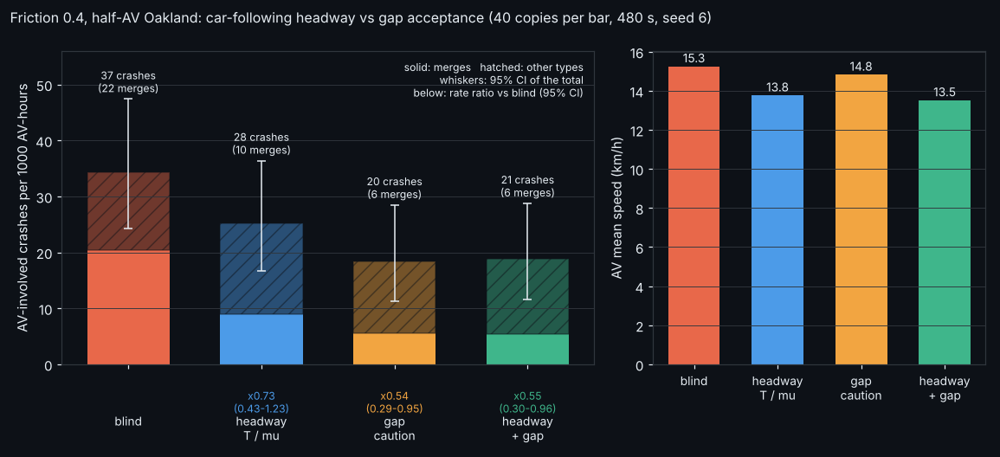

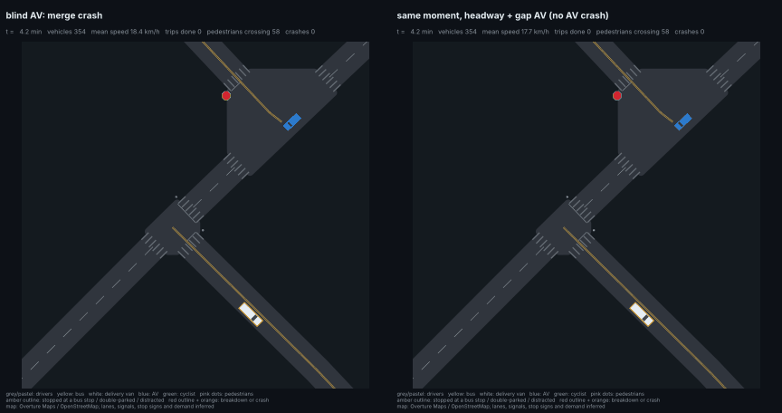

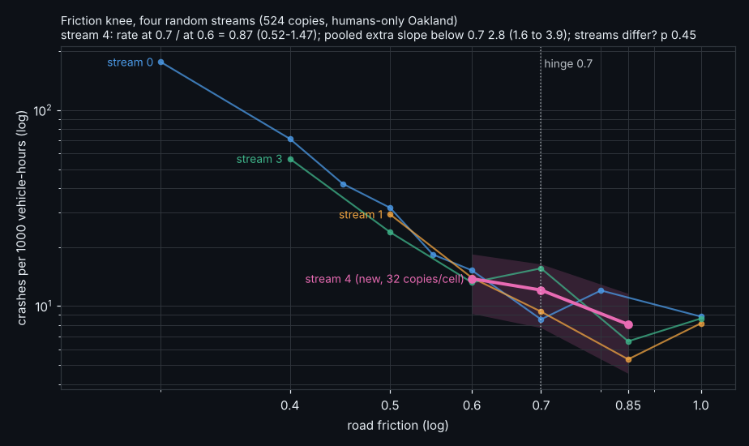

**P1 held, P2 failed (narrowly), P3 held as a point estimate only, P4 held; P5 held (not significantly), P6 held, P7 held.** Asking
the AV to accept only longer gaps on ice (gap scale 1.15 -> 1.5) cut its merge crashes from 22 to 6 (rate ratio 0.27, 0.09-0.69) and
all its crashes by 46 % (0.54, 0.30-0.95) for 3 % of speed; on its own that interval excludes 1 (p 0.024), but after Holm over the
four pre-registered tests it is p 0.097, so the pre-registered bar (Holm p < 0.05) was missed. Lengthening the headway on top added
little (0.75 vs headway alone, n.s.) and cost 11 % of speed. In the counterfactual GIF, the same city, forked at the start of the 20 s chunk that holds a blind
AV's merge crash, replays with no AV crash once the AV is gap-cautious. **The fourth stream** puts its 0.7 cell (12.1) below 0.6
(13.8), as predicted, but the rise is in 0.85 -> 0.7, not below 0.7, so stream 4 on its own shows no knee at 0.7 either (its
three cells span too little friction to tell); pooled over four streams the knee stays (2.8, 1.6-3.9), the streams still do not
differ (p 0.45), and the searched hinge moves from 0.7 to 0.6. The knee exists over the wide range; where exactly it sits
between 0.6 and 0.85 the data do not pin down.

**What failed / limits.** One friction (0.4), one network, one stream for the merge run; the gap scale saturates at the slot's
maximum (1.495) for every mu below 0.77, so this is "maximum gap caution", not a calibrated 1/mu law. Headway alone also cut merges
(0.44, unadjusted p 0.033), so part of what looks like a merge effect may be the AV leaving more room for merging humans. Slower,
more careful AVs finished 12-14 % fewer trips with headway; gap alone cost 3.5 %. The GIF is one hand-picked crash (the first one
found with seed 11) and illustrates, it does not test.

**Tests**: `tests/test_daily_1115.py` (the u1 -> gap-scale map, including the clip; merge_idm only changes u[:, 1]; the four-stream
loader and tests on a synthetic stream). The ported branches' tests (`test_daily_1105/1107/1109.py`, 11 tests) pass on `main`.

Commands: `python -m avlab.frictionmerge [--quick|--plot]` (~9 min full), `python -m avlab.knee4 [--quick|--run]` (~6 min run,
~1 min tests).

---

## 2026-11-14 - Does an AV that knows the road's friction crash less? And the friction knee on three random streams

**Ideas kept** (14 candidates; [search](../results/daily/2026-11-14/search.json)): (1) give the AVs the friction estimate that 2026-11-13 showed the fleet can read in 10-20 s, and measure what it buys in a half-AV city (next step 16, ROADMAP item 1); (2) pool 2026-11-13's third random stream into the knee test and ask whether the knee differs by stream (next step 17). Tools: `avlab/frictionaware.py` (+ `_plot`), `avlab/kneepool.py`.
Prior art: adjusting the ACC following interval with the road's friction is an old patent family ([US 6208106](https://image-ppubs.uspto.gov/dirsearch-public/print/downloadPdf/6208106)); a Hyundai patent sets a minimum safety distance from estimated peak friction ([US 7739023](https://image-ppubs.uspto.gov/dirsearch-public/print/downloadPdf/7739023)); a 2025 Chalmers thesis builds a friction- and curvature-aware ACC with robust MPC ([odr.chalmers.se](https://odr.chalmers.se/bitstreams/8b2704ac-ae40-433b-8b52-7997f84bfee6/download)). These evaluate single vehicles in simulation; I found none that measured crashes city-wide with mixed traffic (search snippets only). The hinge test is a threshold (broken-stick) Poisson regression; the searched-hinge p-value uses a parametric bootstrap for the Davies problem, as in `avlab.knee` (cf. the hinge models of the R package [chngpt](https://cran.nics.utk.edu/cran/web/packages/chngpt/chngpt.pdf)).

### Pseudocode

```
avlab.frictionaware (xnet/ untouched; AVs driven through the policy slot X.step(..., rl=(policy, key)), under the usual envelope)
  policy = examples/my_policy.careful_idm with T = 1.5 s * T_scale, v0 = v0 * v_scale       (mu assumed known exactly: 2026-11-13)
     blind   T_scale 1,     v_scale 1
     headway T_scale 1/mu,  v_scale 1
     slow    T_scale 1/mu,  v_scale sqrt(mu)        (keeps the dry road's stopping distance v^2 / 2a)
  cells: blind@1.0, {blind, headway, slow} @ 0.6 and @ 0.4; 24 copies each, p_av 0.5, calibrated humans,
         copy i of every cell uses key (5000 + i), one compiled program; warm 120 s, score 480 s
  per cell: AV-involved crashes / AV-hours, AV km / AV-hours, city crashes / vehicle-hours, trips
  tests: aware vs blind at the same mu, exact conditional Poisson rate ratio (avlab.whocrashes.rate_ratio), Holm over 4

avlab.kneepool (no simulation)
  per-copy humans-only crashes, hours, mu from: stream 0 (friction.json p_av 0 + cliff.json, 2 run dummies),
     stream 1 (knee/replicate.json), stream 3 (stopline/stopline.json, NEW, includes mu 0.4)
  log rate = run dummy + b log mu + c max(log 0.7 - log mu, 0)    quasi-Poisson IRLS (avlab.knee.fixed_hinge), one-sided on c > 0
  tests: stream 3 alone (all mu; mu >= 0.5); all pooled (fixed 0.7; sup over 0.45..0.8 with 1999 bootstrap draws);
         heterogeneity: one c per stream vs a common c, LR chi^2 with 2 df
```

### Predictions, written before the runs ([file](../results/daily/2026-11-14/predictions.md))

* P1: at friction 0.4, `headway` cuts the AV-involved crash rate by >= 30 % with the rate ratio's 95 % upper bound below 1.
* P2: `slow` cuts it more than `headway` at 0.4 and 0.6.
* P3: `headway` costs < 10 % of AV speed at 0.4; `slow` 25-40 %.
* P4: city crash rate falls with `slow` at 0.4 (rate ratio < 1), by less than the AV rate.
* P5: pooled with stream 3, the fixed 0.7 hinge keeps c > 0 with one-sided p < 0.05; stream 3 alone (mu >= 0.5) has c > 0.

### Results ([frictionaware.json](../results/frictionaware/frictionaware.json), [kneepool.json](../results/knee/kneepool.json))

| cell | AV crashes / AV-h | per 1000 AV-h | AV speed km/h | city crashes per 1000 veh-h | AV trips |
|---|---|---|---|---|---|
| blind @ 1.0 | 0 / 643 | 0 | 15.2 | 3.5 | 3194 |
| blind @ 0.6 | 8 / 641 | 12.5 | 15.2 | 9.8 | 3175 |
| headway @ 0.6 | 5 / 651 | 7.7 | 14.6 | 8.3 | 3056 |
| slow @ 0.6 | 3 / 680 | 4.4 | 13.1 | 8.1 | 2579 |
| blind @ 0.4 | 21 / 641 | 32.7 | 15.2 | 47.6 | 3169 |
| headway @ 0.4 | 15 / 660 | 22.7 | 13.8 | 40.6 | 2802 |
| slow @ 0.4 | 18 / 708 | 25.4 | 11.3 | 42.1 | 2053 |

| test | rate ratio vs blind (95 %) | p (Holm) | AV speed ratio |
|---|---|---|---|
| headway @ 0.6 | 0.62 (0.16-2.13) | 0.42 (0.96) | 0.96 |
| slow @ 0.6 | 0.35 (0.06-1.47) | 0.14 (0.54) | 0.86 |
| headway @ 0.4 | 0.69 (0.33-1.41) | 0.32 (0.96) | 0.91 |
| slow @ 0.4 | 0.78 (0.39-1.53) | 0.52 (0.96) | 0.74 |

| knee test | copies (crashes) | extra slope c below 0.7 (95 %) | one-sided p |
|---|---|---|---|
| stream 3 alone, mu 0.4-1.0 | 96 (113) | 1.9 (-1.3 to 5.2) | 0.12 |
| stream 3 alone, mu 0.5-1.0 | 80 (62) | 0.15 (-4.2 to 4.5) | 0.47 |
| three streams pooled | 428 (796) | **2.9 (1.7 to 4.1)** | 5e-6 (Holm 1e-5); searched hinge 0.7, bootstrap p 0.0005 |
| pooled, mu >= 0.45 only | 384 | 2.7 (1.1 to 4.3) | 0.0005 |
| streams differ? | | c = 3.0 / 3.4 / 2.6 (SE 0.6 / 1.0 / 0.8) | LR p 0.49 (2 df) |

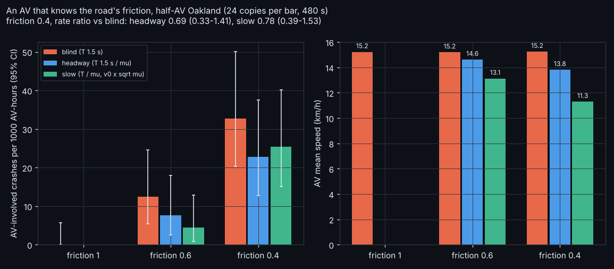

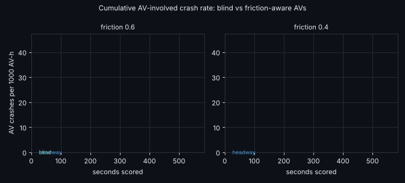

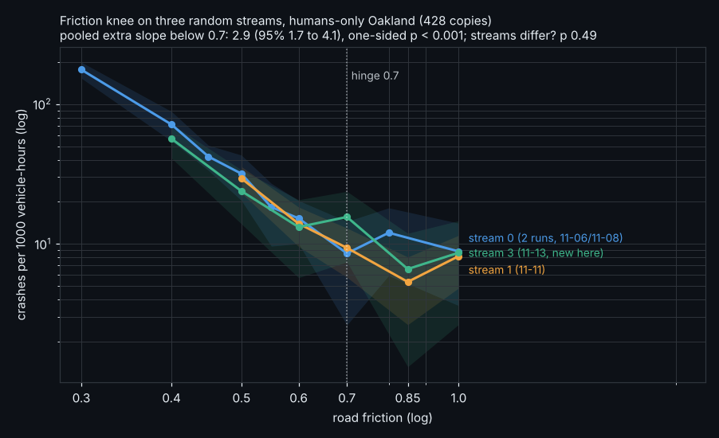

**P1 failed, P2 failed, P3 held, P4 failed, P5 held (weakly).** Knowing the friction and lengthening the headway as 1/mu lowered the AV-involved crash rate at friction 0.4 by 31 % (0.69) for 9 % less AV speed, but with 21 and 15 crashes the interval runs from 0.33 to 1.41, so this run cannot tell it from no effect; slowing down as well (v0 x sqrt(mu)) cost 26 % of AV speed and 35 % of AV trips and did no better at 0.4 (0.78). The reason is visible in the crash types: at 0.4, 13 of the blind AVs' 21 crashes were **merges** (and 11 of 18 for `slow`), which a longer car-following headway does not reach; rear-end crashes went 4 -> 0 with `headway` but 4 -> 6 with `slow`. **The friction knee is not a one-stream artefact**: pooled over three streams it is sharp (extra slope 2.9, 1.7-4.1) and still there without friction below 0.45 (2.7), and the streams' slopes do not differ significantly (p 0.49). But stream 3 on its own does not show it (p 0.12; within 0.5-1.0 c = 0.15), because its 0.7 cell is high (15.6 per 1000 vehicle-h, above 0.6's 13.2), so the knee's position is less sure than its existence.

**Overlap found after the run.** The 2026-11-09 run did a similar test on the **rule-based AV** (its headway and desired-speed state clamped after each step, friction 0.45, 16 copies), but that work is on branch `claude/exciting-bohr-cmq43w` and was never merged into `main`, so today's run (which starts from `main`) did not see it; I found it in the daily artifact's history while publishing. The two runs agree on headway (0.67, 95 % 0.33-1.32 then; 0.69, 0.33-1.41 today, both not significant) and **disagree on speed**: capping the rule-based AV's speed at sqrt(friction) cut its AV-involved crashes to 0.12x (0.02-0.40, 3 crashes), while today's IDM policy with the same sqrt(friction) speed scale gave 0.78x (0.39-1.53). So the benefit of slowing down depends on the AV's policy (and maybe on 0.45 vs 0.4, and on 3 crashes in one cell). That branch should be reviewed and merged, or its results copied into `main` (next step 18).

**What failed / limits.** The AV policy is the example IDM, not the rule-based AV or a learned one (the rule-based AV's headway is internal to xnet/ and was not touched); mu is given exactly, not estimated online; 24 copies per cell, one stream (seed 5), one network; the AV-hours differ by cell because slower AVs stay longer, which the rate ratio accounts for but the trip counts do not. The heterogeneity test assumes a common power slope b across streams.

**Tests**: `tests/test_daily_1114.py` (policy scales; the aware IDM equals the example policy at mu 1 and never asks for more acceleration; the hinge and heterogeneity tests on synthetic data; the stream-3 loader).

Commands: `python -m avlab.frictionaware [--quick|--plot]` (~8 min full), `python -m avlab.kneepool` (~30 s).

---

## 2026-11-13 - Is the friction knee the stop-line rule? And friction tomography: reading the road from braking

**Ideas kept** (14 candidates; [search](../results/daily/2026-11-13/search.json)): (1) count the cars in each of friction's three channels in the simulator, with a dry-road counterfactual computed on the same state, and ask which channel the crash-involved cars had just been in (next step 14); (2) friction tomography: estimate the road's friction from the braking of the fleet alone, with and without sensor noise (next step 16). Both come from one run (shared sub-result). Tools: `avlab/stopline.py`, `avlab/stopline_plot.py`.
Prior art: the dilemma zone, where a driver can neither stop before the line nor clear the junction, depends on approach speed and the maximum deceleration ([FHWA EAR 15082](https://www.fhwa.dot.gov/publications/research/ear/15082/002.cfm)), and wet pavement changes both deceleration and reaction (Rakha et al., Virginia Tech, [thesis](https://vtechworks.lib.vt.edu/server/api/core/bitstreams/625e7311-0884-49d9-ae3b-40ec6645f6bb/content)). Fleet friction maps aggregate per-vehicle friction estimates from connected vehicles ([RSS 2022](https://www.nrso.ntua.gr/rss2022/wp-content/uploads/2022/06/RSS2022_Presentation_141.pdf), [NSF PAR](https://par.nsf.gov//servlets/purl/10395516)); a patent estimates friction from a short brake pulse until ABS engages ([US 9156447](https://image-ppubs.uspto.gov/dirsearch-public/print/downloadPdf/9156447)). I found no work that reads friction off the *fleet's* braking histogram (search snippets only).

### Pseudocode (what `avlab/stopline.py` does)

```
friction enters xnet/sim.py three times (grep): braking cap clip(acc, -9 mu, .); can_stop (commitment) uses min(4, 9 mu),
    so it is identical to the dry road for every mu >= 4/9; stoppable (overrun) uses 9 mu
for mu in 1.0 0.85 0.7 0.6 0.5 0.4: 16 copies of humans-only Oakland, calibrated drivers, seed 3 (fresh stream), warm 120 s, count 480 s
    each 0.1 s step (X.step(..., diag=True); xnet/ untouched), human moving cars (as on 2026-11-12):
        told_stop    = at a link end with a next movement, not allowed to enter, not distracted
        overrun      = told_stop & ~stoppable(mu);     fric_overrun = overrun & stoppable(mu = 1)     (would have stopped on a dry road)
        blind_commit = entered without a clear gap because ~can_stop(mu); fric_commit = blind_commit & can_stop(mu = 1)
        sat          = braking at the cap
        per slot: seconds since the car was last in each channel; crash-involved cars: in that channel within 2 s?
        per copy and per 10 s: histogram of braking in 0.05 m/s^2 bins
tomography, per copy, using the first W seconds of its city (W = 10 ... 320):
    exact:  mu_hat = (upper edge of the hardest braking bin) / 9
    noisy:  jitter every braking sample by N(0, sigma), sigma = 0.3 or 0.5 m/s^2; mu_hat = argmax over >= 3 m/s^2 of
            log(narrow Gaussian smoothing) - log(wide smoothing) (the spike at the cap over its background) / 9
    share of copies within 0.05 of the true mu
```

The noisy estimator was tuned on the 2-copy probe (seed 0): the first two versions failed there (they picked the histogram's cut at 2 m/s^2), so the full run (seed 3) is the held-out test.

### Predictions, written before the full run ([file](../results/daily/2026-11-13/predictions.md))

* P1: friction-caused overruns bend at 0.7 (log-log slope below 0.7 steeper than above by >= 1).
* P2: crash-involved cars were in a friction-caused overrun within 2 s far more often than moving cars (mu <= 0.6: enrichment lower bound > 1, share >= 10 %).
* P3 (code check): the commitment channel adds no blind entries for mu >= 0.5.
* P4: Spearman(friction-overrun rate, crash rate) >= 0.8.
* P5: exact estimator within 0.05 for >= 95 % of copies after 10 s at every mu; with 0.3 m/s^2 noise, >= 90 % by 80 s.

### Results ([stopline.json](../results/stopline/stopline.json))

| friction | 1.0 | 0.85 | 0.7 | 0.6 | 0.5 | 0.4 |
|---|---|---|---|---|---|---|
| crashes (per 1000 vehicle-h) | 8 (8.6) | 6 (6.6) | 14 (15.6) | 12 (13.2) | 22 (23.8) | 51 (56.5) |
| braking at the cap, per 100,000 moving car-steps | 145 | 199 | 285 | 395 | 588 | 1002 |
| overruns (any), per 100,000 | 9.9 | 16.2 | 26.1 | 37.5 | 56.6 | 110.8 |
| friction-caused overruns, per 100,000 | 0 | 4.1 | 12.4 | 22.6 | 40.0 | 89.9 |
| friction-caused blind commitments, per 100,000 | 0 | 0 | 0 | 0 | 0 | 0.31 |
| crash-involved human cars | 12 | 10 | 20 | 19 | 34 | 79 |

| test | result | p (Holm over P2, P4) |
|---|---|---|
| P1 overruns bend at 0.7 | **failed**: log-log slope -5.7 above 0.7 and -3.5 below (steeper *above*, from a near-zero start); no bend | - |
| P2 crash cars in a friction overrun within 2 s | **failed**: mu <= 0.6, 1 of 132 (0.8 %) vs 0.20 % of moving car-steps, enrichment 3.9 (0.55-27); any overrun 3 of 132 | 0.23 (Holm 0.23) |
| P3 no blind commitment above 0.44 | held: exactly 0 for mu >= 0.5, 0.31 per 100,000 at 0.4, 0 crash cars | - |
| P4 Spearman(overrun rate, crash rate) | held, rho 0.89, but uninformative: braking at the cap has the same rho, as both are monotone in mu | 0.019 (Holm 0.038) |
| P5 tomography | held on the held-out run: exact, 16 of 16 copies within 0.05 after 10 s at every mu; 0.3 m/s^2 noise, 14 to 16 of 16 at 10 s and 16 of 16 from 20 s; 0.5 m/s^2 noise, 11 to 16 at 10 s, 16 of 16 by 80 s | - |

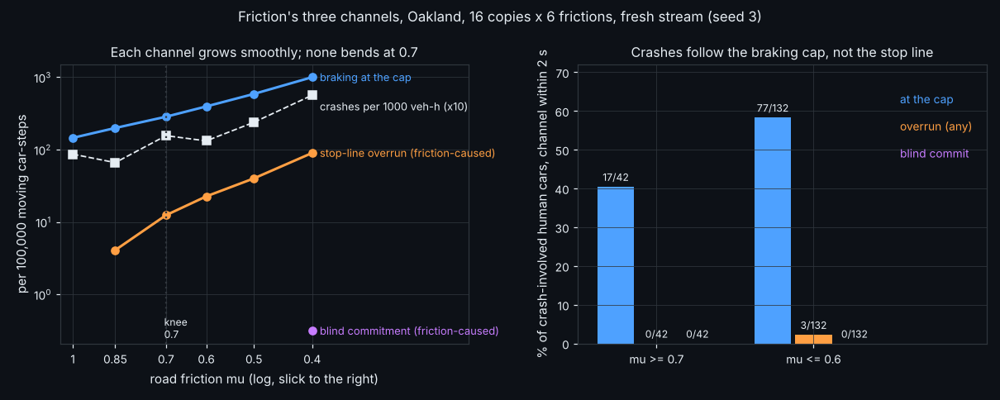

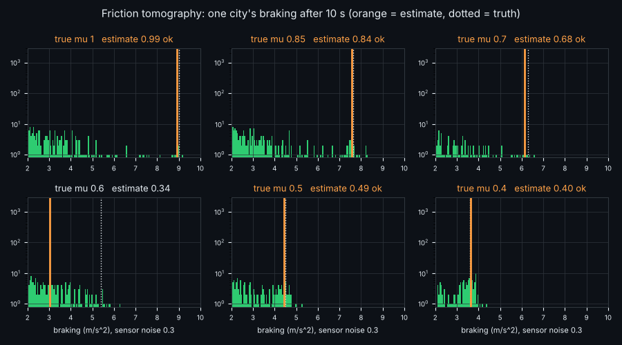

(GIF: one copy per friction, braking with 0.3 m/s^2 sensor noise, accumulating 10 s per frame; orange is the estimate, dotted the truth.)

**The knee is not the stop-line rule, and not the commitment rule.** Cars told to stop that physically cannot do so on a slick road become more common smoothly (4 to 90 per 100,000 moving car-steps from 0.85 to 0.4), but only 1 of 132 crash-involved human cars at friction <= 0.6 had been in one in the 2 s before, while 77 of 132 (58 %) had braked at the cap, which replicates 2026-11-12's "half" on a fresh stream (17 of 42 at mu >= 0.7). The commitment rule is identical to a dry road above 0.44 by construction. So of friction's three channels only the braking cap is present before crashes, yet its rate has no bend: the knee must be in what capped braking *fails to prevent*, which this run did not measure. **Friction is easy to read from braking**: because the simulator clips braking at 9 mu, the hardest braking seen by a city's fleet gives mu exactly within 10 s, and a spike detector still finds it within 20 s with 0.3 m/s^2 sensor noise. This is easier than in reality, where braking is not clipped this cleanly (ABS, tyres, slopes). Caveats: one network, 16 copies per cell, 113 crashes; the 2 s window is a choice; the tomography uses only what the simulator logs (no measurement model beyond Gaussian noise).

**Tests**: `tests/test_daily_1113.py` (the commitment rule is dry above 4/9, stoppable is monotone in mu, both estimators recover mu on a synthetic clipped histogram, the ratio interval and the log-log slopes).

---

## 2026-11-12 - Why is there a friction knee near 0.7? Braking at the road's limit, cell by cell. And an index of results/

**Ideas kept** (14 candidates; [search](../results/daily/2026-11-12/search.json)): (1) log the braking human drivers actually do at six frictions and test whether the knee is where braking starts to hit the road's cap, 9 mu m/s^2 (next step 14); (2) a results index: every tracked `results/` file, the docs and code that mention it, orphans and broken links (next step 15). Tools: `avlab/brakedemand.py` (+ `brakedemand_plot.py`) and `avlab/resultsindex.py`.
Prior art: surrogate safety analysis compares the deceleration a conflict needs (DRAC) with the maximum the road allows (MADR); wet roads give more DRAC > MADR conflicts ([Castelo Branco group, UFC](https://repositorio.ufc.br/ri/bitstream/riufc/55714/1/2020_dis_rsm.pdf); a digital-twin study adding tyre-road friction to microsimulation finds lower minimum TTC and higher DRAC as mu falls, [arXiv 2502.09561](https://arxiv.org/pdf/2502.09561)). Here the simulator lets us count the cap being hit directly, rather than infer it from trajectories (search snippets only).

### Pseudocode (what `avlab/brakedemand.py` does)

```
for mu in 1.0 0.85 0.7 0.6 0.5 0.4: 10 copies of humans-only Oakland, calibrated drivers, seed 2 (a fresh stream), warm 120 s, count 480 s
    (one compiled vmapped run of X.step(..., diag=True); xnet/ untouched)
    each 0.1 s step, per copy:
        moving    = alive & human & not wrecked & not halted & v > 0.5 m/s     (state before the step)
        acc       = applied acceleration after the step (already clipped to a_min = -9 mu)
        histogram of -acc over braking moving cars (0.25 m/s^2 bins); saturated = acc <= a_min + 0.01
        sat_age   = seconds since this slot's car last braked at the cap (reset when the slot empties)
        involved  = diag 'crashed' & human & not already a wreck; recent = sat_age <= 1 s
per cell: saturated share (bootstrap over copies), dry-road prediction = share of mu=1.0 braking steps at or beyond 9 mu,
          enrichment = P(recent | involved) / P(recent | moving car-step) with a Katz log interval; Spearman(saturated share, crash rate)
```

### Predictions, written before the run ([file](../results/daily/2026-11-12/predictions.md))

* P1 (mechanical knee): saturated share changes < 1.5x from mu 1.0 to 0.7 and at least doubles from 0.7 to 0.5.
* P2 (no adaptation): the dry-road histogram predicts the saturated share at every mu within 2x.
* P3: crash-involved cars braked at the cap in the 1 s before far more often than moving cars (pooled mu <= 0.6, lower bound > 1).
* P4: crash rate and saturated share rank together across cells (Spearman >= 0.8).

### Results ([brake.json](../results/brakedemand/brake.json))

| friction | 1.0 | 0.85 | 0.7 | 0.6 | 0.5 | 0.4 |
|---|---|---|---|---|---|---|
| cap (m/s^2) | 9.0 | 7.65 | 6.3 | 5.4 | 4.5 | 3.6 |
| moving car-steps braking at the cap (%, 95 % CI) | 0.153 (0.148-0.158) | 0.191 (0.183-0.199) | 0.298 (0.290-0.306) | 0.396 (0.384-0.408) | 0.590 (0.574-0.603) | 0.980 (0.957-1.004) |
| observed / dry-road prediction | 1.00 | 1.06 | 1.31 | 1.36 | 1.39 | 1.58 |
| crashes (per 1000 vehicle-h) | 3 (5.3) | 2 (3.5) | 7 (12.3) | 17 (29.1) | 11 (19.2) | 30 (52.7) |

| test | result | p (Holm over P3, P4) |
|---|---|---|
| P1 knee in braking at the cap | **failed**: x1.94 from 1.0 to 0.7, x1.98 from 0.7 to 0.5; log-log slope -1.87 above 0.7 and -2.14 below (-2.05 overall) | - |
| P2 dry-road histogram predicts it within 2x | held (ratio 1.00 to 1.58), but the ratio grows as mu falls | - |
| P3 crash-involved cars at the cap within 1 s | held: mu <= 0.6, 47 of 92 (51 %) vs 1.3 % of moving car-steps, enrichment 39 (32-48); mu >= 0.7, 8 of 18 (44 %) vs 0.6 % | < 1e-10 |
| P4 Spearman(saturated share, crash rate) | held: rho 0.89 | 0.019 (Holm 0.019) |

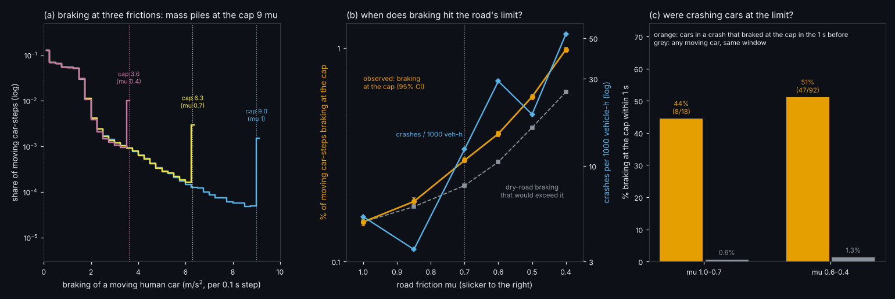

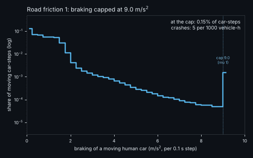

(GIF: the braking histogram per friction; the cap moves left and the mass beyond it piles up at the cap.)

**The knee is not where braking starts to hit the road's limit.** Braking at the cap is rare (0.15 % of moving car-steps on a dry road) and grows smoothly, about mu^-2.1, with no bend at 0.7 (P1 failed). The dry-road braking histogram has a smooth tail beyond 4 m/s^2, so lowering the cap from 9 to 6.3 catches only a little more braking. What the cap does matter for is crashes: about half of the human cars involved in a crash were braking at the cap in the second before (55 of 110 over all cells), against about 1 % of moving cars in general. Hard braking just before a crash is also what a driver does when a crash is coming, so this is not proof that the cap caused them. Drivers on slick roads also end up braking at the cap more than dry-road braking predicts (1.58x at 0.4), so slick roads create harder situations, not only weaker brakes. So the knee must come from somewhere else. Friction's other channel, whether a car can still stop before a line (`stoppable`), is the next candidate. Caveats: 70 crashes in all, 10 copies per cell, so the crash rates here are noisy (0.5 lower than 0.6); the enrichment interval treats car-steps as independent and is too narrow; one network, one seed.

**Results index**: `python -m avlab.resultsindex` writes [RESULTS_INDEX.md](RESULTS_INDEX.md) (479 tracked files in 94 directories; 375 mentioned by no doc or code path, most of them written by tools through a directory variable). `--check` exits 1 if a doc links a `results/` file that does not exist. Git-ignored outputs (notebook runs) are allowed. Today: 0 broken links.

**Tests**: `tests/test_daily_1112.py` (exceedance from a histogram, the ratio interval, the per-cell summary, and the index on a throwaway git repo: citation, use, a broken link, an ignored output).

---

## 2026-11-11 - Does the friction knee replicate on a fresh random stream? And is there a speed-limit knee?

**Ideas kept** (14 candidates; [search](../results/daily/2026-11-11/search.json)): (1) a pre-registered replication of the knee at friction 0.7 (next step 12): a new humans-only run on a fresh random stream with the hinge fixed in advance; (2) a search-corrected p-value for the pooled hinge of 2026-11-10, whose F-test ignored that the hinge was picked from six positions; (3) the same corrected test on the pooled speed-limit runs (next step 13). One tool, `avlab/knee.py`.
Prior art: testing a breakpoint is Davies' problem, a nuisance parameter that exists only under the alternative (Davies 1987, *Biometrika* 74:33-43; implemented as [segmented::davies.test](https://rdrr.io/cran/segmented/man/davies.test.html)); here a parametric bootstrap of the sup statistic plays that role. Pavement studies look for friction thresholds below which crash rates rise ([FDOT BE385](https://fdotwww.blob.core.windows.net/sitefinity/docs/default-source/research/reports/fdot-be385-rpt.pdf), [FHWA 2023](https://highways.dot.gov/sites/fhwa.dot.gov/files/2023-06/FHWA%20Characterizing%20Road%20Safety%20Performance%20Using%20Pavement%20Friction.pdf)), and FDOT recommends checking such thresholds further; I found no study that confirms one out of sample (search summaries only).

### Pseudocode (what `avlab/knee.py` does)

```
model:  log E[crashes_i] = log hours_i + a + r*run_i + b*log x_i + c*max(log h - log x_i, 0)     # 'above' knee for speed limits: max(log x - log h, 0)
replicate: humans-only Oakland, 36 copies at friction 1.0 0.85 0.7 0.6 0.5, run_copies(seed=1) (earlier runs: seed 0), warm 120 s, count 600 s
fixed hinge (h = 0.7, chosen before the run): quasi-Poisson fits with and without the hinge term; LR = deviance drop / dispersion;
           one-sided p = P(N(0,1) > sign(c) sqrt(LR))
search-corrected: S = max over the hinge grid of the Poisson deviance drop vs the power law
           null: 1999 parametric bootstrap draws y* ~ Poisson(fitted power law), refit every hinge, p = (1 + #{S* >= S}) / 2000
           friction pool (152 copies, grid 0.45-0.8); speed-limit pool (196 human-only copies, x0.7-1.3, knee above 0.85 / 1.0 / 1.15)
Holm over the three primary p-values (replication fixed hinge, friction pool, speed-limit pool)
```

### Predictions, written before the run ([file](../results/daily/2026-11-11/predictions.md))

* P1: in the new run the extra slope below 0.7 is positive with one-sided p < 0.05. P2: the slope above 0.7 has a 95 % interval that includes 0.
* P3: the pooled friction hinge survives the search correction (p < 0.05). P4: the speed-limit pool shows no knee (corrected p > 0.05).

### Results ([knee.json](../results/knee/knee.json), [replicate.json](../results/knee/replicate.json))

| friction (new run, 36 copies each) | 1.0 | 0.85 | 0.7 | 0.6 | 0.5 |
|---|---|---|---|---|---|
| crashes (per 1000 vehicle-h) | 23 (8.2) | 15 (5.3) | 26 (9.4) | 39 (14.0) | 84 (29.4) |

| test | statistic | p | Holm p |
|---|---|---|---|
| new run, hinge fixed at 0.7 | extra slope 3.42 (SE 1.30; 95 % 0.86 to 5.98); slope above 0.7 -0.39 (SE 0.80) | 0.0039 (one-sided) | 0.012 |
| friction pool, hinge searched | deviance drop 9.2 at 0.7; null 95 % quantile 5.7 | 0.010 (bootstrap) | 0.020 |
| speed-limit pool, knee searched | deviance drop 1.1 at x1.0; null 95 % quantile 5.5 | 0.54 (bootstrap) | 0.54 |

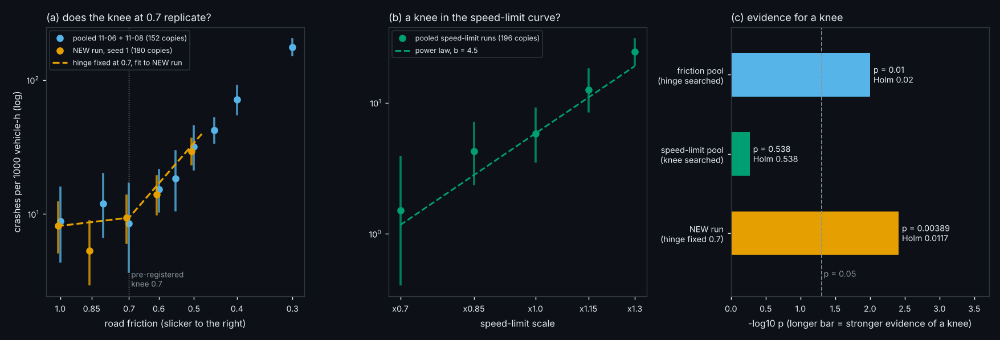

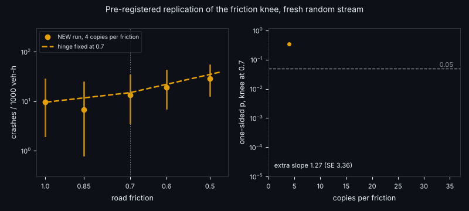

(GIF: the fixed-hinge test on the new run as copies are added. The p-value is recomputed at each step, so the animation shows how the evidence builds, not an anytime-valid sequential test.)

**All four predictions held.** On a fresh random stream the crash rate is again flat from friction 1.0 to 0.7 (8.2, 5.3, 9.4 per 1000 vehicle-h; slope -0.39, SE 0.80) and then steepens. The extra slope, 3.42 (SE 1.30), is almost the same as the pooled estimate from the old runs (3.47, SE 1.08), and the one-sided p is 0.004 (Holm 0.012). The old pooled hinge also survives the correction for having searched six positions (bootstrap p 0.010 against the nominal 0.003). The speed-limit curve has no knee (p 0.54): crash rate ~ limit^4.5 (SE 0.5) across x0.7 to x1.3. So friction has a knee and speed has a power law. Caveats: the new run's own searched hinge lands at 0.85, not 0.7, because the 0.85 cell is low (15 crashes). The data say a knee somewhere in 0.7 to 0.85, not exactly at 0.7. Dry cells have 15 to 26 crashes each. This is one network, and the bootstrap assumes Poisson counts (dispersion 1.0 to 1.05).

**Tests**: `tests/test_daily_1111.py` (hinge design, a known knee recovered by the fixed test, and a bootstrap that leaves a pure power law alone but flags a planted knee).

---

## 2026-11-10 - Do AVs strike fewer road users than humans on the same roads? And is the friction cliff real?

**Ideas kept** (14 candidates; [search](../results/daily/2026-11-10/search.json)): (1) in a half-AV Oakland, compare AV and human drivers on pedestrian and bicycle strikes per vehicle-hour at friction 1.0 / 0.6 / 0.4 and at a x1.3 speed limit (merges next steps 8 and 10 of 2026-11-08); (2) pool the two human-only friction runs and test a cliff against a power law (no new simulation).
Prior art: an observational California matched case-control study finds highly automated vehicles about a third as likely to crash in rain and pedestrians in 3 % of AV crashes against 15 % for humans, though as shares and not per-mile rates ([Nature Communications 2024](https://media.springernature.com/original/springer-static/esm/art%3A10.1038%2Fs41467-024-48526-4/MediaObjects/41467_2024_48526_MOESM1_ESM.pdf), snippet only); skid-resistance studies report thresholds in wet crash rates ([Texas CRR thesis](https://tdl-ir.tdl.org/handle/2152/23567), a Spanish SCRIM threshold near 55 by Mayora and Pina, 2008, via [SWOV](https://swov.nl/en/publicatie/assessment-skid-resistance-effect-traffic-safety-under-wet-pavement-conditions)). I found no simulation study that compares AV and human strike rates inside one mixed city.

### Pseudocode (what the code does)

```
1. avlab/whocrashes.py   for (mu, s) in (1.0,1) (0.6,1) (0.4,1) (1.0,1.3):   # friction, speed-limit scale (a copy of the net dict; xnet/ untouched)
                           48 copies of Oakland, calibrated humans, p_av=0.5, warm 120 s, count 600 s (one compiled run per scale)
                           strikes = pedestrian + bicycle crashes; AV strikes = av_pedestrian + av_bicycle; AV hours = sum av_veh_s / 3600
                           AV rate = AV strikes / AV hours; human rate = (strikes - AV strikes) / (hours - AV hours)
                           ratio with exact conditional interval (binomial on the AV share); Holm over the four cells
2. avlab/frictionpool.py  per-copy (crashes, hours, friction, run) from results/friction and results/cliffcause, humans only: 152 copies, 496 crashes, 9 frictions
                           quasi-Poisson fits with a run indicator: power law, + quadratic, + hinge (best of 0.45-0.8), exponential in mu
                           F-type test of each bend against the power law; leave-one-friction-out predicted deviance
```

### Predictions, written before the runs ([file](../results/daily/2026-11-10/predictions.md))

* P1: at friction 1.0 the AV strike rate is lower than the humans' (upper bound < 1). P2: the ratio moves to 1 on slick roads (AVs do not read friction). P3: the AV advantage persists at limit x1.3.
* P4: pooled data support no cliff (no bend passes an F-test at 0.05; the power law is within 10 % of the best leave-one-out deviance). P5: the two runs' elasticities agree within 2 SE.

### Results ([who](../results/whocrashes/who.json), [pool](../results/frictionpool/pool.json))

| cell | AV strikes / all | AV rate | human rate (per 1000 vehicle-h) | ratio AV / human (95 % interval) | Holm p |
|---|---|---|---|---|---|
| friction 1.0, limit x1 | 2 / 10 | 1.2 | 3.8 | 0.32 (0.03-1.62) | 0.61 |
| friction 0.6 | 11 / 29 | 6.8 | 8.6 | 0.79 (0.34-1.77) | 1 |
| friction 0.4 | 28 / 139 | 17.4 | 52.9 | **0.33 (0.21-0.50)** | < 0.001 |
| friction 1.0, limit x1.3 | 25 / 61 | 16.0 | 17.6 | 0.91 (0.53-1.56) | 1 |

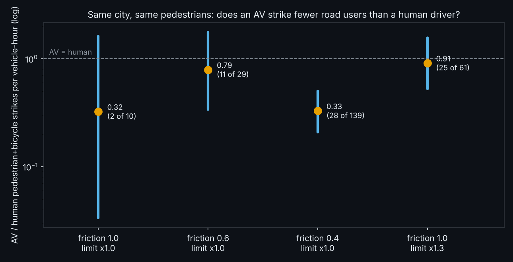

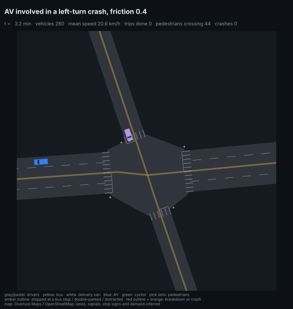

(GIF: one AV crash on a slick road, a left-turn crash at 59 km/h closing speed; one case, not the statistic.)

**P1, P2 and P3 all failed as stated.** At friction 1.0 the ratio is 0.32 but only 10 strikes occurred, so the interval (0.03 to 1.62) includes 1. P2 failed the other way: on the slickest road (0.4) AVs still strike 3x fewer road users per vehicle-hour (28 of 139 strikes with 43 % of the hours). Instead the advantage vanishes at a x1.3 speed limit (0.91, interval 0.53 to 1.56). The 0.6 cell (0.79) sits between, with wide intervals, so the ratio is not a smooth function of friction here. Reading: whatever helps the AV (0.3 s reaction, 1.3 s headway) matters on slick roads, and a fast city makes pedestrian conflicts so frequent that it is swamped, but the data do not test that mechanism. Caveats: one network, one seed stream, 10-139 events per cell, strikes are all severities, and the AV and human drivers share the same roads but not the same decisions per vehicle (AVs have a different car-following parameter set, so this is a comparison of the two driver models, not of the real world).

**Pooled friction** (152 copies, 496 crashes): elasticity -3.05 (SE 0.17); the two runs give -2.95 (SE 0.19) and -3.69 (SE 0.48), so **P5 held** (difference 0.74, SE 0.52). **P4 failed in sample, held out of sample.** A hinge at 0.7 (flat above, extra slope -3.5, SE 1.1 below) beats the power law (F-test p = 0.003, 0.017 after multiplying by the 6 hinge positions tried; quadratic p = 0.03); but in leave-one-friction-out prediction the plain power law is best (deviance 29 against 43 for the hinge, 283 for the quadratic, 141 for an exponential), partly because held-out end points make the bends extrapolate. So: the data are flat from 1.0 to 0.7 (8.8, 12, 8.6 per 1000 vehicle-h) and then rise as friction^-3.5; a bend near 0.7 is likely, a "cliff" (step) is not, and 8-15 crashes per dry cell cannot settle it.

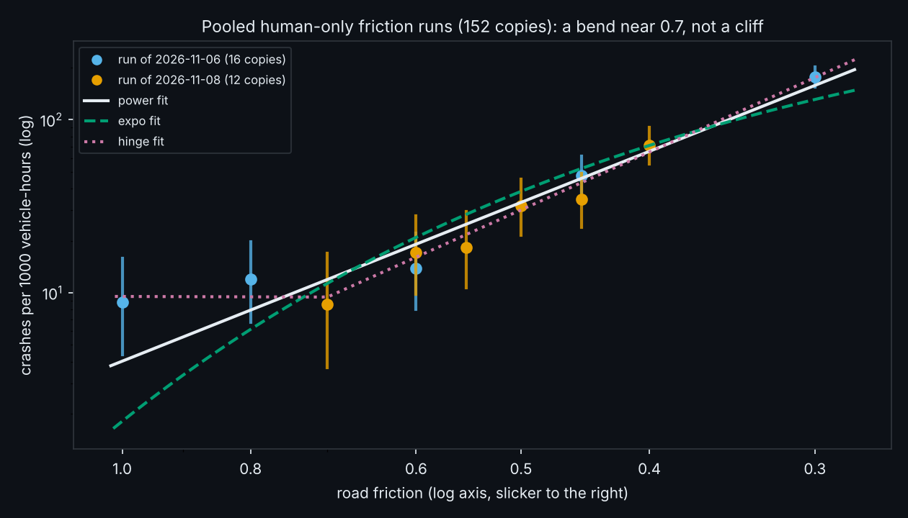

**Tests**: `tests/test_daily_1110.py` (rate ratio, Holm, hinge recovery).

---

## 2026-11-09 - Do AVs that read the road friction crash less? And where do kicked twins first diverge?

**Ideas kept** (13 candidates, short paper search; [search](../results/daily/2026-11-09/search.json)): (1) make the AV friction-aware from outside the simulator (next step 10 of 2026-11-08); (2) 24 kicked twins instead of one (next step 3). A grep showed that `xnet/sim.py` uses friction only in the braking cap `a_min = -9 x friction`: an AV keeps its 1.3 s headway and its desired speed on any road.
Prior art: friction-adaptive headway and braking thresholds are standard in patents and ACC papers ([patent 7739023](https://image-ppubs.uspto.gov/dirsearch-public/print/downloadPdf/7739023), [friction-aware policy preprint 2605.08528](https://arxiv.org/pdf/2605.08528)); disturbance growth through intersections ([Treiber and Kesting simulator notes](https://arxiv.org/pdf/1012.4913)). I read search snippets only.

### Pseudocode

```
frictionav.py: half-AV Oakland, mu = 0.45, 16 copies per cell (same initial states), 4 cells: base | headway | speed | both
               after every X.step:  av slots:  T = max(T, 1.3/mu)   [headway, 2.9 s]   v0f = min(v0f, sqrt(mu))   [speed, 0.67]   (xnet/ untouched)
               warm 120 s, count 600 s; AV-involved crashes per AV vehicle-hour vs base: exact conditional rate ratio, Holm over 3 cells
twinkicks.py:  12 copies warmed 120 s; per mode (fastest car / random moving car) a twin with that car +3 m/s; 300 s at 1 s resolution
               displaced = alive in both and (|ds| > 1 m or other track); first other displaced car: following (same track <= 30 m) / box (kicked or it in a junction box) / other
```

### Predictions ([1](../results/daily/2026-11-09/predictions.md), [2](../results/daily/2026-11-09/predictions2.md)) and results ([frictionav](../results/frictionav/frictionav.json), [twinkicks](../results/twinkicks/twinkicks.json))

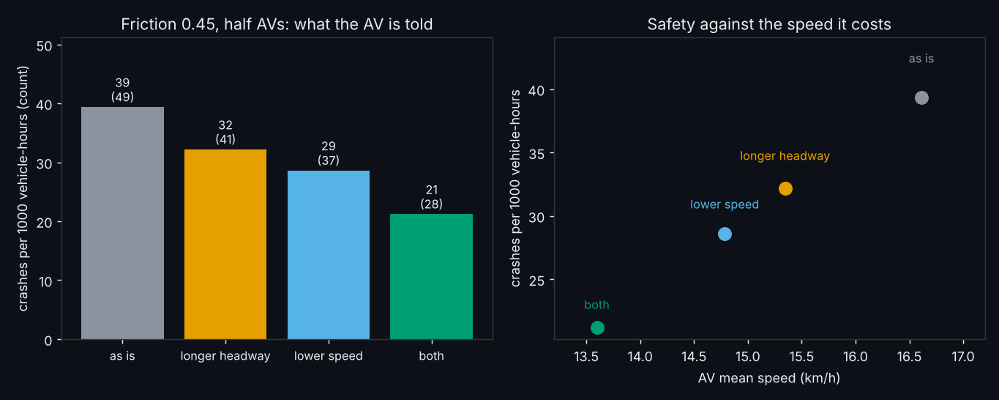

| cell | all crashes (per 1000 veh-h) | AV-involved crashes (per 1000 AV-h) | AV-involved ratio vs base (95 %), Holm p | AV mean speed |
|---|---|---|---|---|
| base | 49 (39.3) | 23 (42.0) | 1 | 16.6 km/h |
| headway 2.9 s | 41 (32.2) | 16 (28.0) | 0.67 (0.33-1.32), p 0.26 | 15.3 |
| speed x0.67 | 37 (28.6) | 3 (5.1) | 0.12 (0.02-0.40), p 1e-4 | 14.8 |
| both | 28 (21.2) | 5 (8.2) | 0.20 (0.06-0.53), p 4e-4 | 13.6 |

**P1 held, P2 failed, P3 failed.** Slowing the AVs' desired speed (or both) cuts AV-involved crashes by 80-90 %; all crashes fall to 0.54 (0.33-0.87) with both changes (unadjusted p 0.009; Holm over 3 cells 0.026). Headway alone gives 0.67 but its interval includes 1 (P2 predicted > 0.8: the point estimate is lower, so P2 failed, though it is not significant). The speed price is 11 % for the speed cell (16.6 to 14.8 km/h), 18 % for both (to 13.6), so P3 (> 15 % for the speed cell) failed. Human-involved crashes are not changed by design, so the city total falls less than the AV part.
Caveat: 3 and 5 AV crashes per cell, one network, one initial-state set, clamp values chosen once (no tuning); `finished` trips also fall (7397 to 6430 with both).

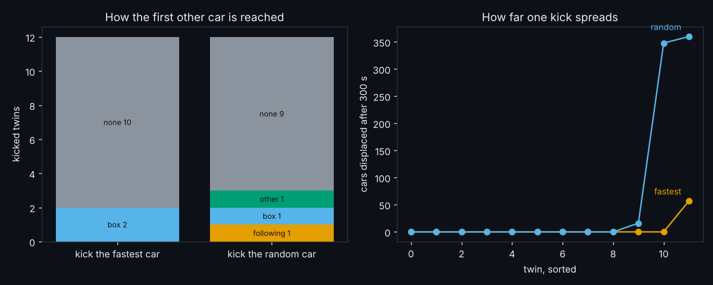

**Q1 inconclusive, Q2 failed.** Only 3 of 24 kicks (1 of 12 fastest-car, 2 of 12 random-car) spread to >= 25 cars within 300 s; of those, 2 began through a junction box and 1 through car-following (2/3, interval 0.09-0.99). Kicking the fastest car did not diverge more often (1/12 vs 2/12). Two random-car twins displaced 348 and 360 cars, so when a divergence happens it spreads city-wide; most +3 m/s kicks (21 of 24) never move another car in 300 s, which says the earlier single diverging twin was a lucky draw, not the typical case.

**Tests**: `tests/test_daily_1109.py`. No new GIF today (time); `img/twintrace.gif` shows the divergence mechanism.

### Next
* Tune the AV clamp: speed-only with sqrt(mu)^k, k in 0.25..1, to draw the safety-vs-speed frontier; more copies (48) per cell.
* Does an AV that slows only near pedestrian crossings keep the gain at a smaller speed price?
* 100+ kicks (cheap: 1-2 s per pair) to settle box vs following, and kick size vs divergence probability.

### Follow-up (same day): can an AV learn the friction from its own braking?

Question from the review of the first result: the clamp above was an oracle (`mu` read from the config). `avlab/frictionsense.py` asks whether it can be *measured*. xnet has one city-wide friction value that only caps braking (`a = max(a_cmd, -9 x friction)`), so the patches here are **patches in time** (1.0 -> 0.45 -> 0.7 -> 0.3 -> 1.0, 50 s ramps), not in space; spatial patches would need a per-road friction inside `xnet/sim.py`, which we do not change. Prior art on road-friction estimation from vehicle braking and slip is large (tyre-force and slip-slope methods); this is the simplest version, a cap detector, and I did not review the literature further.

```
frictionsense.py: 8 copies of half-AV Oakland, friction = mu(t) interpolated inside the scan; each second keep, per slot, the largest deceleration
                  applied by an AV moving > 1 m/s (st.acc); the estimator never sees mu
estimate(W = 30 s): f = largest deceleration of the fleet in the window; n = events within 3 % of f; n >= 3 -> mu_hat = f / 9, else only mu >= f / 9
```

Predictions ([file](../results/daily/2026-11-09/predictions3.md)) and results ([json](../results/frictionsense/frictionsense.json)):

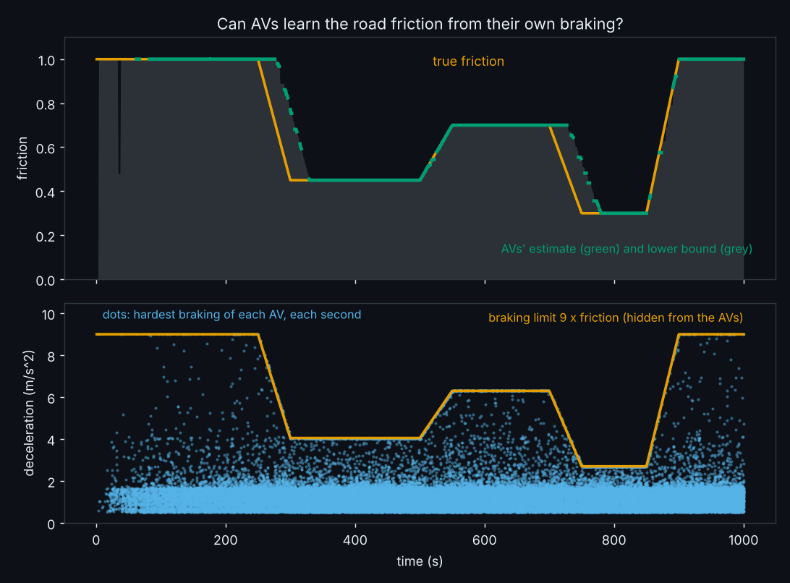

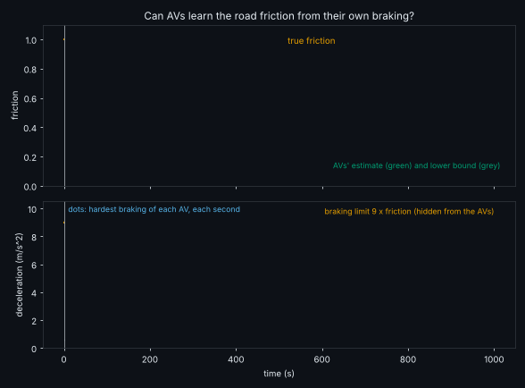

* **R1 held.** On slick road (mu < 0.6) the estimate is identified 87 % of the time, within 0.1 of the truth in 84 % of those seconds (median error ~0: the cap is exact).
* **R2 failed.** On dry road it is identified 88 % of the time, not < 20 %: AVs brake at the 9 m/s^2 limit often enough (emergency stops) that the floor is visible even when dry. I checked that the scripted "halted" branch (where xnet sets acc = cap) is not the source: it accounts for 1e-5 of floor events.
* **R3 failed on the fleet size.** One AV alone identifies the floor in 1.1 % of seconds (3 AVs 4 %, 10 AVs 12 %, 30 AVs 21 %); the full fleet (807 slots that were ever an AV braking) 88 %. So the information is a fleet or cloud one, not a single vehicle's.
* **Delay.** After a ramp ends the estimate needs 19 to 28 s to reach the new value going to 0.45 (median 23 s) and 16 to 19 s going to 0.3, mostly the 30 s window; ramp-downs are tracked with a lag, ramp-ups (to 0.7, 1.0) show a bound before an identified value.
* **Noise.** Adding accelerometer noise (sigma 0.2 / 0.5 m/s^2) to the recorded decelerations: the naive largest-value estimator is identified only 55 % / 23 % of slick seconds; a robust one (mean of the top 5, band 2 sigma) stays at 100 % with a bias of +0.04 / +0.11 in mu.
Caveats: the simulator's cap is exact and noise-free, which flatters the estimator; patches are temporal and city-wide; one network, 8 copies; real tyres have a slip-dependent curve, not a hard cap. **Test**: `tests/test_daily_1109.py`.

**Next:** feed the estimate back into the AV (clamp with `mu_hat` instead of `mu`) and re-run the crash comparison; spatial patches (needs per-road friction in xnet, a design change to discuss); a noise-aware floor detector (mode of the top cluster rather than top-5 mean).

*Ported on 2026-11-15 from branch `claude/exciting-bohr-cmq43w`, which was never merged into `main`; its files are now on `main` unchanged.*

---

## 2026-11-08 - What is behind the friction cliff? And do AVs flatten the speed-limit curve?

**Ideas kept** ([search](../results/daily/2026-11-08/search.json), only 8 candidates and a short search today): (1) humans-only Oakland at friction 0.7, 0.6, 0.55, 0.5, 0.45, 0.4 (12 copies each) with crashes split by type
(next step 7 of 2026-11-06); (2) speed limit x0.85 / 1.0 / 1.3 with 0 and 50 % AVs (12 copies per cell; next step 5). Prior art: skid-resistance studies find
wet-crash rates rise faster at low friction, with thresholds that vary by method ([Texas CRR thesis](https://tdl-ir.tdl.org/handle/2152/23567), [SWOV review](https://swov.nl/en/publicatie/assessment-skid-resistance-effect-traffic-safety-under-wet-pavement-conditions));
Nilsson's exponents and their weaker fit on urban roads ([ACRS](https://archive.acrs.org.au/article/nilssons-power-model-connecting-speed-and-road-trauma-does-it-apply-on-urban-roads)); I found no study of the power model in AV mixed traffic (search snippets only).

### Pseudocode (what `avlab/cliffcause.py` does)

```
cliff: for mu in 0.7..0.4: 12 copies, calibrated humans, friction=mu, one compiled run (examples._common.run_copies), warm 120 s, count 600 s
       sum the seven crash-type counters per mu; rear-end share; hinge model: grid over mu of a quasi-Poisson fit with an extra slope below the hinge
limit: for scale in .85 1 1.3: link_v *= scale (copy of the net dict); 12 copies with p_av=0 and 12 with p_av=0.5; slope of log rate on log scale per share,
       and the slope difference (interaction)
```

### Predictions (written before the runs, [file](../results/daily/2026-11-08/predictions.md))

* P1: rear-end share rises from < 35 % at friction >= 0.6 to > 50 % at <= 0.5.  * P2: a hinge between 0.5 and 0.6 with extra slope whose interval excludes 0.  * P3: half-AV elasticity smaller than humans' (interaction < 0, interval excludes 0).

### Results ([cliff](../results/cliffcause/cliff.json), [limit](../results/cliffcause/limit.json))

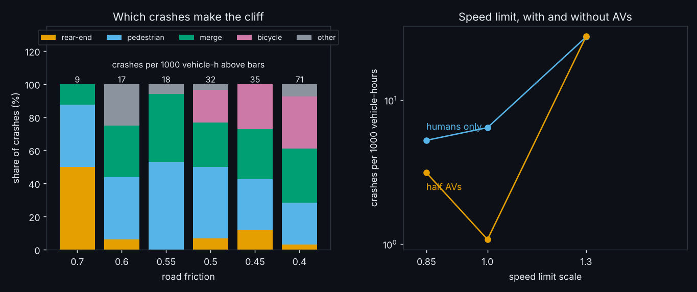

| friction | 0.7 | 0.6 | 0.55 | 0.5 | 0.45 | 0.4 |
|---|---|---|---|---|---|---|
| crashes (per 1000 vehicle-h) | 8 (8.6) | 16 (17.1) | 17 (18.4) | 30 (31.8) | 33 (34.8) | 67 (71.4) |

**All three predictions failed.** (P1) Rear-end crashes are a small part of the slick-road crashes: 21 % of crashes at friction >= 0.6 (5 of 24; the 0.7 cell alone is 4 of 8) and 6 % at <= 0.5 (8 of 130).
What grows is merge, pedestrian and, from 0.5 on, bicycle crashes (0, 0, 0, then 6, 9, 21). So the 9 x friction braking cap is not biting car-following; it is the other conflict types that get worse. (P2) On this
finer grid there is no sharp cliff: the rate climbs steadily (8.6, 17, 18, 32, 35, 71) and the best hinge (at 0.45) has an extra slope of -2.4 with SE 2.1, not distinguishable from 0; yesterday's "flat to 0.6, then 3.5x" came from a 16-copy cell with 17 crashes and is not
reproduced as a step (here 0.7 to 0.6 doubles). (P3) The half-AV city's speed-limit elasticity is 7.1 (SE 1.7) against 4.4 (SE 1.1) for humans, the opposite sign to the prediction (interaction +2.7, SE 2.0, not significant): at x1.3 both cities have 25 crashes (27.7 vs 27.5 per 1000 vehicle-h) while at x1.0 it is 1 against 6.
Caveats: 8-67 crashes per cell, one network, one seed stream; type counts per cell are small. Whether the AV planner reads the friction value is still unchecked.

**Tests**: `tests/test_daily_1108.py`. No new GIF today (the existing `img/friction_blackice.gif` shows one slick-road crash).

---

## 2026-11-07 - Which crashes make the friction cliff, and do pedestrian violators carry the speed-limit effect?

**Ideas kept** (from 13 candidates; [search](../results/daily/2026-11-07/search.json)): (1) the friction sweep again on a finer grid, crash counts split by type (next step 7);
(2) speed limit x1.0 and x1.3 with pedestrian violators on or off (next step 6). Prior art: collision risk is commonly framed as the braking a follower
*needs* against the braking the road *allows* (DRAC against maximum available deceleration, [arXiv 1810.04776](https://arxiv.org/pdf/1810.04776)); jaywalking raises conflict risk and one Seoul
study put 40 % of pedestrian fatalities on jaywalkers ([SWOV](https://swov.nl/nl/publicatie/pedestrian-crashes-during-jaywalking-can-we-afford-overlook); search snippets only, full texts not read).

### Pseudocode (what `avlab/crashmix.py` does)

```
A. for mu in 1.0 0.8 0.7 0.6 0.55 0.5 0.45 0.4 0.3: 12 copies of Oakland, calibrated humans, friction=mu, warm 120 s, count 600 s (one compiled run)
     per cell: crashes by type, vehicle-hours, rear-end closing speed (imp_rear_closing / imp_rear_n)
     single power law vs power law with one hinge (hinge tried at each interior grid value), Poisson deviance + 2 x parameters
B. for limit scale in 1.0 1.3 (net link_v *= scale): 24 copies with p_ped_violate 0.03 and 24 with 0; same protocol
     rate ratio x1.3 / x1.0 per violator setting (exact conditional interval), elasticity = ln(ratio) / ln 1.3
```

### Predictions ([written before the runs](../results/daily/2026-11-07/predictions.md)) and results

| prediction | result |
|---|---|
| A1 rear-ends carry > 50 % of the extra crashes from friction 0.6 to 0.45 | **failed**: 12 % (2.2 of 17.5 extra crashes per 1000 vehicle-h); cyclist crashes 11.9, merge 8.7, pedestrian -4.1 |
| A2 a hinge beats one power law, break at 0.5-0.6 | **failed**: best hinge at 0.8, delta AIC 2.6 (search not paid for), so no evidence for a break on this grid |
| A3 rear-end closing speed rises as friction falls | **failed**: Spearman 0.19 (p 0.65); closing speeds 2.9-6.9 m/s with no trend, from 0-26 rear-ends per cell |
| B1 no violators: pedestrian crashes at x1.3 fall by > 70 % | **point estimate held, not established**: ratio 0.23 (95 % 0.08-0.53), 7 against 31 crashes; the interval includes a 47 % fall |
| B2 limit elasticity falls below 3 without violators | **failed**: 5.2 (1.7-9.4) without violators against 5.7 (3.2-8.6) with them; crashes 6 -> 23 and 11 -> 48 |

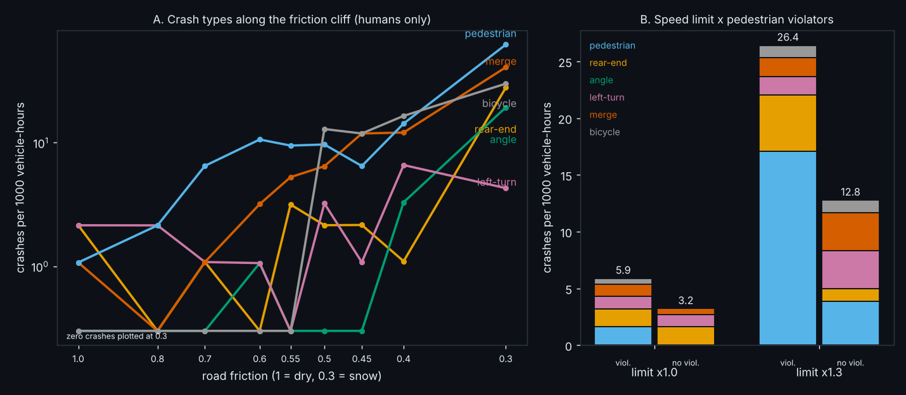

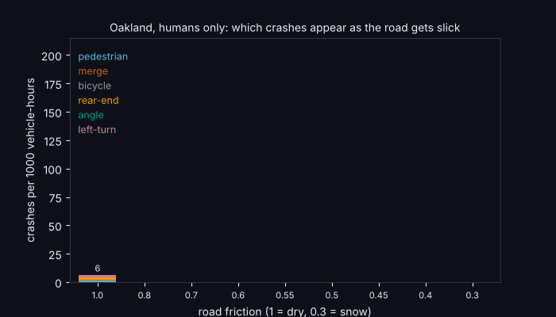

Per-1000-vehicle-hour totals along the friction grid: 6.4, 4.3, 9.7, 15.9, 17.9, 34.4, 33.4, 53.8, 184 (1.0 down to 0.3). The cliff here sits between 0.55 and 0.5 (17.9 to 34.4), not between 0.6 and 0.45 as yesterday's coarser grid suggested; with 4 to 17 crashes per cell
at 0.6 and above, the location is not pinned down. The one sharp feature is the cyclist type: 0 crashes in each of the six cells from 1.0 to 0.55, then 12 at 0.5, 11 at 0.45, 15 at 0.4, 28 at 0.3. That was seen after the fact, so it is a hypothesis
(a car closing on a slow cyclist needs braking the road no longer gives; `bicycle` bundles rear-end, junction and side-swipe events with cyclists), not a finding. Rear-end closing speed is an indirect proxy for "braking needed";
the simulator does not record needed deceleration at a crash. Violators matter for pedestrian crashes (31 -> 7 at x1.3) but the speed-limit effect on all crashes survives without them, so the speed power law is not mainly a violator story.
Caveat: 11 crashes at limit x1.0 with violators here against 14 in the 2026-11-04 run (32 copies), consistent with Poisson noise. `results/crashmix/crashmix.json`.

**Tests**: `tests/test_daily_1107.py` (hinge fit finds a planted break and does not favour one for a pure power law, rate-ratio interval, type counts).

**What to try next**: (a) test the cyclist hypothesis: friction grid with `p_bike=0` (does the 0.5 jump vanish?), 9 cells x 12 copies, ~8 min; (b) a 16-copy rerun of friction 0.6, 0.55, 0.5 only to place the cliff; (c) add a needed-deceleration recorder as a read-only counter ratio outside `xnet/` (replay with `avlab.blackbox`).

*Ported on 2026-11-15 from branch `claude/exciting-bohr-e6iwkj`, which was never merged into `main`; its files are now on `main` unchanged.*

---

## 2026-11-06 - Where is the friction cliff, and a cheaper AVBench

**Ideas kept** (from 14 candidates; [search](../results/daily/2026-11-06/search.json)): (1) a friction dose-response in a human-only and a half-AV
Oakland (child of H3 and of the speed-limit run), with a black-box GIF of a crash on slick road; (2) which few AVBench scenarios predict the whole board
(follow-up of H5; no simulation, uses `results/bench/leaderboard.json`). Prior art: friction and crash risk are linked but hard to quantify, with
threshold-like behaviour reported below some skid number ([review notes via SWOV](https://swov.nl/en/publicatie/friction-measurement-methods-and-correlation-between-road-friction-and-traffic-safety),
[TRB report](https://www.nap.edu/read/23038/chapter/4); I read search snippets only); benchmark reduction by anchor points and tinyBenchmarks
([Vivek et al.](https://arxiv.org/pdf/2309.08638), [Polo et al.](https://ar5iv.labs.arxiv.org/html/2402.14992)), and a caution that rank correlation alone overstates agreement
([arXiv 2510.08730](https://arxiv.org/pdf/2510.08730v2)).

### Pseudocode (what the code does)

```
1. avlab/friction.py   for mu in 1.0 0.8 0.6 0.45 0.3, p_av in 0, 0.5:  16 copies of Oakland, Behaviour(calibrated humans, friction=mu, p_av=p_av)
                         all 160 copies in ONE compiled run (examples._common.run_copies), warm 120 s, count 600 s
                         quasi-Poisson regression (offset log vehicle-hours): slope on log mu per share, curvature (log mu)^2, slope difference between shares
                         exact conditional rate ratio (half-AV / humans) per friction, Holm-adjusted over the 5 frictions
2. avlab/minibench.py  M[driver, scenario] = av_score, 15 drivers x 18 scenarios; target = row mean
                         for k = 1..4, every k-subset: nested leave-one-driver-out (choose the subset on 14 drivers by smallest LOO RMSE of a line
                         target ~ subset mean, predict the held-out driver); compare with random k-subsets
```

### Predictions, written before the full runs ([friction](../results/daily/2026-11-06/predictions.md), [minibench](../results/daily/2026-11-06/predictions2.md))

* P1: humans-only crash rate rises as friction falls, elasticity b < -1.
* P2: a cliff: the log-rate is convex in log friction (curvature > 0, interval excludes 0).
* P3: a half-AV city is hurt more by slick roads (interaction < 0, interval excludes 0).
* P4: a 3-scenario subset chosen by nested CV gives Spearman >= 0.9 and an RMSE >= 25 % below a random 3-subset's.

### Results

| friction | humans only: crashes per 1000 vehicle-h | half AVs | rate ratio (95 % interval), Holm p |
|---|---|---|---|
| 1.0 | 8.8 (11 crashes) | 4.9 (6) | 0.55 (0.17-1.62), p 1 |
| 0.8 | 12.0 (15) | 7.9 (10) | 0.66 (0.27-1.57), p 1 |
| 0.6 | 13.8 (17) | 13.9 (17) | 1.01 (0.49-2.11), p 1 |
| 0.45 | 47.7 (59) | 45.1 (56) | 0.94 (0.64-1.39), p 1 |
| 0.3 | 176 (223) | 167 (210) | 0.95 (0.78-1.15), p 1 |

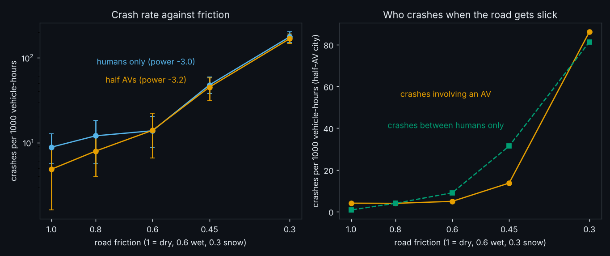

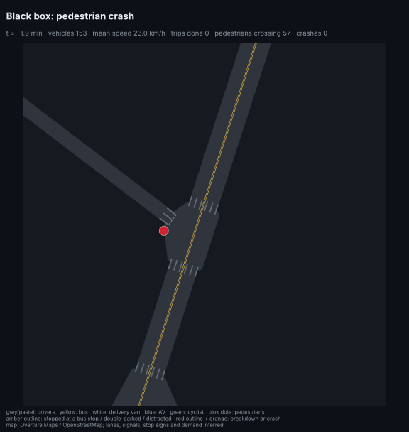

(GIF: a left-turning car at 37 km/h strikes a pedestrian on a slick road, friction 0.35; its peak braking, 3.2 m/s^2, is at the road's limit of 9 x 0.35 = 3.15. One crash from `avlab.blackbox`, not a statistic.)

**P1 held, P2 held, P3 failed.** Humans only: elasticity **-2.95** (SE 0.19; the rate goes as friction^-3). Curvature **+1.25** (SE 0.51, 95 % interval 0.24 to 2.25): the rate
is nearly flat from 1.0 to 0.6 (8.8 to 13.8) and then jumps 3.5x to 0.45 and 3.7x again to 0.3. The slope difference between the half-AV and the human-only city is
**-0.27** (SE 0.28), not distinguishable from 0; the half-AV city's lower crash rate in dry weather (rate ratio 0.55) is not significant at any friction after Holm
correction, and it disappears at 0.6 and below. So today's data do not say that AVs are hurt more by slick roads, only that the half-AV advantage was not seen once
friction is 0.6 or lower. Caveats: 16 copies per cell and 6 to 17 crashes per cell at friction 0.6 and above; one network; friction changes humans' and AVs' braking limit (9 x friction) but we did not check which knobs the AV's own planner reads, so "AVs do not adapt" is a hypothesis. `results/friction/friction.json`.

| scenarios in the subset | nested Spearman | nested RMSE (points) | random subset RMSE | in-sample RMSE |
|---|---|---|---|---|
| 1 | 0.83 | 15.5 | 14.8 | 9.2 |
| 2 | 0.96 | 11.6 | 11.2 | 4.6 |
| 3 | 0.94 | 8.5 | 9.1 | 3.1 |
| 4 | 0.99 | 4.8 | 8.2 | 1.8 |

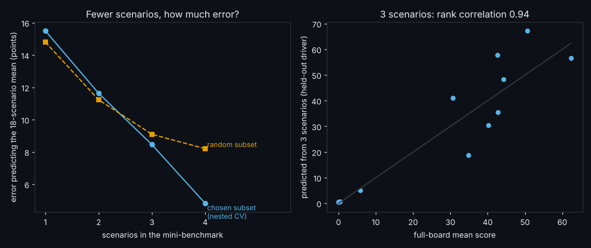

**P4 half failed.** At 3 scenarios the nested Spearman is 0.94 (>= 0.9, held) but the RMSE is only 7 % below a random 3-subset's (8.5 against 9.1), not 25 %. Rank is cheap: the leaderboard's
score is one dominant factor (first principal component 71 % of variance, spread of the target 22 points), so even a random 3-subset has median Spearman 0.94. Predicting the *value* needs more:
a 4-scenario subset (rush_hour, squirrel_hill, downtown, cut_in when picked on all 15 drivers) has nested RMSE 4.8 against 8.2 for random (41 % lower), but the same subset was picked in 67 % of leave-one-out rounds, and in-sample RMSE (1.8) is far below nested, so selection on 15 drivers overfits.
Single scenario scores are themselves draws (2026-11-03), which sets a floor. `results/minibench/minibench.json`.

**Tests**: `tests/test_daily_1106.py` (Poisson fit recovers a known slope and slope difference, summary shapes, subset helpers).

---

## 2026-11-05 - Does a city with AVs pay less for a higher speed limit? (No measurable difference)

**Ideas kept** (from 12 candidates; [search](../results/daily/2026-11-05/search.json)): (1) repeat the speed-limit sweep with about half of the cars AVs and compare the
crash-rate elasticity, overall and by crash type (next step 5 of yesterday, merged with step 6's by-type question); (2) a zoomed black-box GIF of a
pedestrian crash at x1.3 limits. Prior art: the power model (Nilsson; Elvik) is for human traffic, and a 2025 review of speed and crash
models says mixed-traffic effects on it are neglected ([ITF, speed changes and crash risk](https://www.itf-oecd.org/sites/default/files/docs/speed-changes-crash-risk.pdf)); a standard web search found nothing on AV share and the exponent, so as far as I can tell this has not been measured.

### Pseudocode (what the code does)

```
avlab/speedlimit.py --p-av 0.5   (the saved 0 % run is unchanged)
    for scale in 0.7 0.85 1.0 1.15 1.3:   net["link_v"] *= scale;  32 copies, calibrated humans with Behaviour.p_av = 0.5 (rule-based AV under its envelope),
                                          warm 120 s, count 600 s; record crashes, vehicle-hours, by crash type
avlab/speedshare.py
    b, se   = quasi-Poisson regression of crashes on log(scale), offset log vehicle-hours, per copy, for each world
    per type: the same on the 5 scale totals, SE x sqrt(dispersion of the all-types fit)   (per-copy type counts are not stored)
    z = (b_0 - b_50) / sqrt(se_0^2 + se_50^2); two-sided p; Holm correction over the 5 comparisons (all types + 4 types with crashes at >= 3 scales)
    --gif: hunt (blackbox.hunt, new `types` filter) for a pedestrian crash with all limits x1.3, replay it, zoomed GIF
```

### Prediction, written before the full run

P1: with half the cars AVs, the elasticity is lower than 4.5 by at least 1 (the difference significant at 95 %), because AV share halves crashes in the AV-share sweep and AVs keep a longer headway. (Quick probe at x0.7 showed no visible AV effect, 5 against 4 crashes, but that is a few crashes.)

### Result

| limit | crashes, 0 % AVs | crashes, ~45 % AVs | rate per 1000 vehicle-h, 0 % | rate, ~45 % |
|---|---|---|---|---|
| x0.70 | 4 | 5 | 1.5 | 1.9 |
| x0.85 | 10 | 6 | 3.9 | 2.4 |
| x1.00 | 14 | 11 | 5.6 | 4.4 |
| x1.15 | 31 | 26 | 12.6 | 10.7 |
| x1.30 | 57 | 59 | 23.5 | 24.6 |

(AV share measured on a probe run: 41-47 % of the alive vehicles are AVs through the 12 minutes; buses, vans and cyclists are never AVs.)

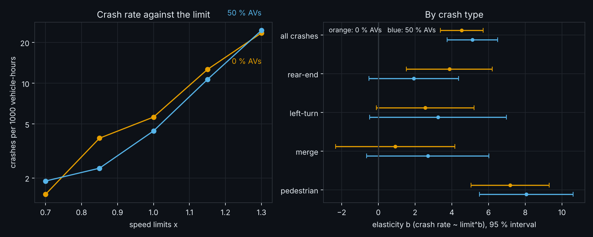

**P1 failed.** Elasticity 4.5 (SE 0.6) with no AVs and **5.1 (SE 0.7)** with about half: the difference is -0.6 (p = 0.53), so the data cannot tell the two
apart and the point estimate goes the wrong way. The interval of the difference is roughly +-1.8, so an effect of 1 or less is not excluded.
By crash type (totals-based SEs, Holm over 5 comparisons, all adjusted p = 1.0): pedestrian 7.2 (SE 1.1) against 8.1 (SE 1.3); rear-end 3.9 against 1.9 (the one hint of an AV effect: p = 0.26 unadjusted); left-turn and merge are too sparse.
Pedestrian crashes at x1.3 are 38 against 41: the AVs do not remove the crashes that carry the speed effect. At the standard limit the AVs have fewer crashes (14 to 11), which is within the noise of yesterday's AV-share sweep. `results/speedlimit/speedshare.json`, `results/speedlimit/speedlimit_av50.json`.

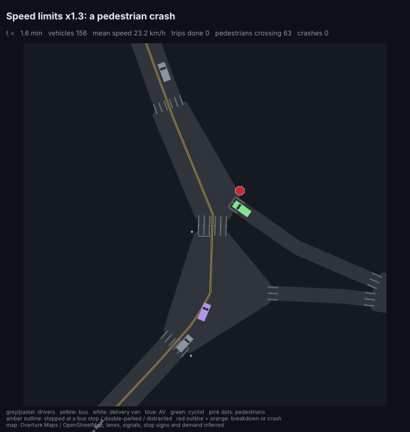

The GIF is one pedestrian crash with every limit x1.3 (102 s in; a car at 57 km/h three seconds before, 37 km/h at impact after braking at -9 m/s^2, hitting a pedestrian who started crossing without WALK). One example, not a sample.

**Tests**: `tests/test_daily_1105.py` (Holm, the elasticity fit recovers a known power, the comparison detects a real difference and not an absent one). Health check at the start: `tests/test_ideas.py tests/test_easy.py tests/test_examples.py` 27 passed, 1 skipped.

*Ported on 2026-11-15 from branch `claude/exciting-bohr-eetr4g`, which was never merged into `main`; its files are now on `main` unchanged.*

---

## 2026-11-04 - A power law for speed limits, and anatomy of a diverging twin

**Ideas kept** (from 14 candidates; [search](../results/daily/2026-11-04/search.json)): (1) scale every speed limit of Oakland and fit the crash
rate's power of the limit (next step 5 of yesterday); (2) trace the one twin that diverged after a 3 m/s kick, to find how the
disturbance spreads (next step 3). Prior art: Nilsson's power model puts the exponent at 2 for injury crashes, 3 for serious
and 4 for fatal ones, and later work (Elvik 2009, 2013) finds lower, speed-dependent exponents
([Elvik, TOI](https://toi.brage.unit.no/toi-xmlui/bitstream/11250/2602719/2/Elvik_10.1016_j.aap.2012.07.012.pdf),
[ITF](https://www.itf-oecd.org/sites/default/files/docs/speed-changes-crash-risk.pdf); I did not retrieve the exact 2009 values).
Perturbation growth in car-following models is classic traffic physics (e.g. [chaos in traffic flow models](https://arxiv.org/pdf/chao-dyn/9812006)).

### Pseudocode (what the code does)

```
1. avlab/speedlimit.py   for scale in 0.7 0.85 1.0 1.15 1.3:
                           net["link_v"] *= scale                 # a copy of the net dict; xnet/ is untouched
                           32 copies of Oakland, calibrated humans, warm 120 s, count 600 s -> crashes, vehicle-hours, vehicle-km
                         quasi-Poisson regression (offset log vehicle-hours) of crashes on log(scale), per copy
2. avlab/twintrace.py    copy 9 of the 16-copy twin experiment; warm 120 s; kick the fastest car of the twin by +3 m/s
                         run both for 600 s in 1 s steps, recording alive / track / arc position / speed per slot
                         displaced = alive in both and (|ds| > 1 m or another track); first[v] = first second displaced
                         parent(v) = nearest already-displaced vehicle on v's track within 30 m, else none
                         doubling time = 1 / slope of log2(#displaced) over the stretch where it goes from 4 to half its maximum
```

### Predictions, written before the full runs

* P1 (speed limits): the crash rate rises with the limit with elasticity b >= 2 (lower 95 % bound above 0), although mean speed rises less than the limit because the city is congested. (Quick probe: mean speed 18.6 -> 22.8 km/h for x0.7 -> x1.3.)
* P2 (twin): the kick spreads first through car following: the first other vehicle displaced is on the kicked car's track. (The doubling time came from the first full run, so it is not a prediction.)

### Results

| limit | crashes | vehicle-h | crashes per 1000 vehicle-h | mean speed (km/h) | trips finished |
|---|---|---|---|---|---|
| x0.70 | 4 | 2646 | 1.5 | 14.1 | 13,124 |
| x0.85 | 10 | 2545 | 3.9 | 15.1 | 14,143 |
| x1.00 | 14 | 2489 | 5.6 | 15.7 | 14,626 |
| x1.15 | 31 | 2452 | 12.6 | 16.0 | 14,931 |
| x1.30 | 57 | 2425 | 23.5 | 16.3 | 15,226 |

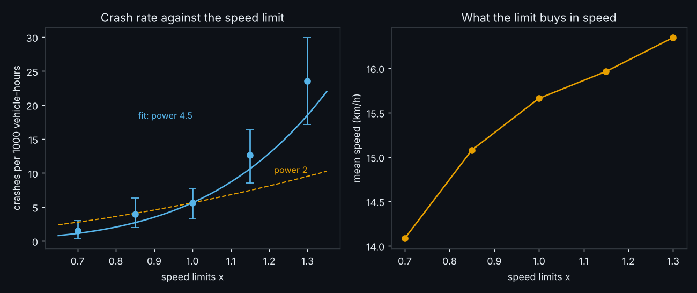

**P1 held.** Crash rate against the limit: elasticity **b = 4.5** (SE 0.6; 95 % interval 3.4 to 5.7, dispersion 1.0), well above 2
and consistent with 4. A 30 % higher limit raises mean speed by 4 % (15.7 to 16.3 km/h) and finished trips by 4 %, but crashes per
vehicle-hour by 4.2x. Pedestrian crashes carry most of it: 5 at x1.0 and 38 at x1.3 (of 14 and 57 crashes in total). Caveats:
the counts are small (116 crashes in all), one network (Oakland), crashes are all severities (Nilsson's 2 to 4 are for injury classes),
and the fit against measured mean speed (b = 10.3, SE 1.9) is not comparable because mean speed barely moves in a congested city.
`results/speedlimit/speedlimit.json`.

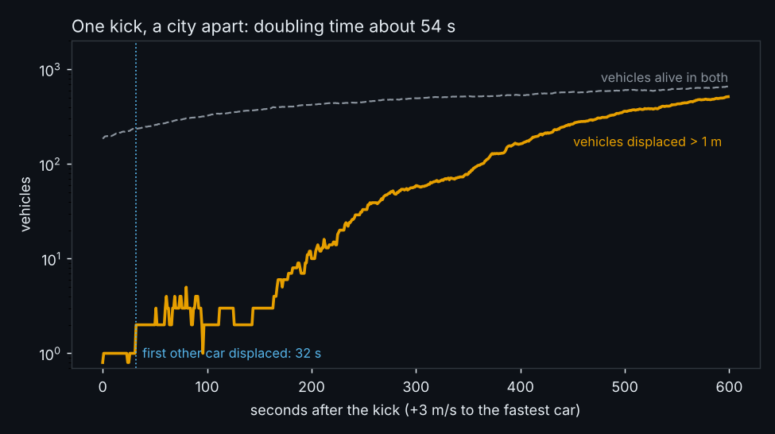

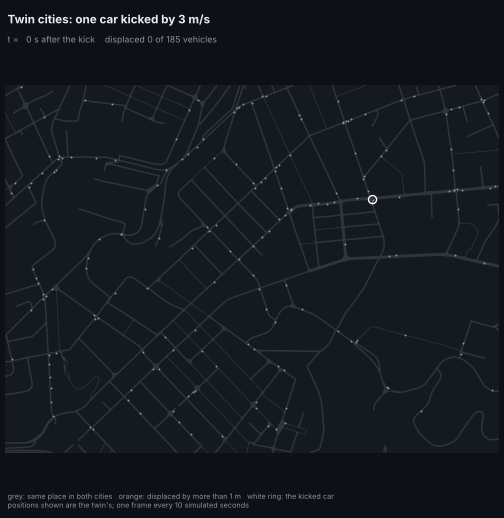

**P2 failed.** After the kick the first other vehicle is displaced at 32 s, *not* on the kicked car's track: the kicked car was in a
junction box, and the displaced car was on another track (1.6 m and 1.7 m/s off; the code does not say which rule fired, so "a conflict or gap-acceptance effect" is a reading, not a measurement). The second, at 51 s, is
off by 140 m, which is a different decision (a turn or a gap), not a slow drift; 3 cars are displaced at 60 s, 59 at 300 s, 514 of 656
at 600 s, a doubling time of **54 s**. Of 571 displaced vehicles, 126 had a displaced vehicle within 30 m on their own track, 445 did not:
the spread is mostly through junctions and discrete decisions, not through queues. One twin, one kick: this explains one divergence,
not all. `results/twintrace/trace.json`.

**Tests**: `tests/test_daily_1104.py` (Poisson fit recovers a known elasticity, displacement and parent logic on toy data).

---

## 2026-11-03 - Twin cities: is the simulator chaotic, and what moved the leaderboard?

**Ideas kept** (from 16 candidates; [search](../results/daily/2026-11-03/search.json)): (1) twin-run test of sensitive dependence on initial
conditions; (2) its child: AVBench scores of the rule-based AV under the same nudges. Both test one explanation from
[FIXES.md](FIXES.md#14-the-leaderboard-does-not-reproduce-across-hardware): "floating-point differences flip rare events".
Prior art: sensitive dependence is the definition of chaos (Lorenz 1963); traffic models with car following are known to be
stable or unstable depending on parameters (string stability of IDM, e.g. Treiber and Kesting, *Traffic Flow Dynamics*, 2013); the
non-determinism of GPU numerics is documented for deep learning (e.g. Nagarajan et al., *Deterministic implementations for reproducibility in deep reinforcement learning*, 2018). (No web search was run today: the search tools were not used; these are cited from memory and should be checked before quoting.)

### Pseudocode (what `avlab/twins.py` does)

```
A. for each of 16 seeds: warm Oakland (calibrated humans) 120 s; twin = a copy of the state
   nudge the twin: one car +1 mm/s | one car +3 m/s (the fastest car) | every car +1 mm/s | the simulator's random key re-keyed (fold_in)
   run both 600 s in 20 s steps (same code, same everything else)
   displaced(t) = share of vehicles alive in both whose arc position differs by > 1 m (or on another track)
   at the end: same crash count? same trips finished?
B. rule-based AV on AVBench scenarios nominal, rush hour, red runners, wet road (8 copies, 300 s warm, 180 s scored), from the
   leaderboard's warm state, under: as published | every car +1 mm/s | every car +1 m/s | the state's random key re-keyed
   (avrl.bench.runner got `kick`, `restream`, `seed`, `key_seed`; defaults reproduce the leaderboard run exactly)
```

### Predictions, written before the full runs (after a 4-copy probe, so P1 was already half-known)

* P1: nudges of 1 mm/s (one car or every car) displace < 1 % of vehicles at 10 min, and >= 90 % of twins keep the same crash count and trips; the same nudges change no AVBench score by more than 1 point.
* P2: a new random stream decorrelates the city (> 50 % displaced within 1 min, the same crash count in < 60 % of twins) and moves AVBench scores by >= 10 points on average.

### Result

| nudge | displaced at 1 / 5 / 10 min | twins with any displacement | same crash count | same trips |
|---|---|---|---|---|
| one car + 1 mm/s | 0 / 0 / 0 % | 0 of 16 | 16 / 16 | 16 / 16 |
| every car + 1 mm/s | 0.02 / 0 / 0 % | 0 of 16 | 16 / 16 | 16 / 16 |
| one car + 3 m/s | 0.1 / 0.7 / 4.9 % | **1 of 16** (79 % of its vehicles) | 16 / 16 | 15 / 16 |
| new random stream | **71 / 99 / 99.9 %** | 16 of 16 | 7 / 16 | 0 / 16 |

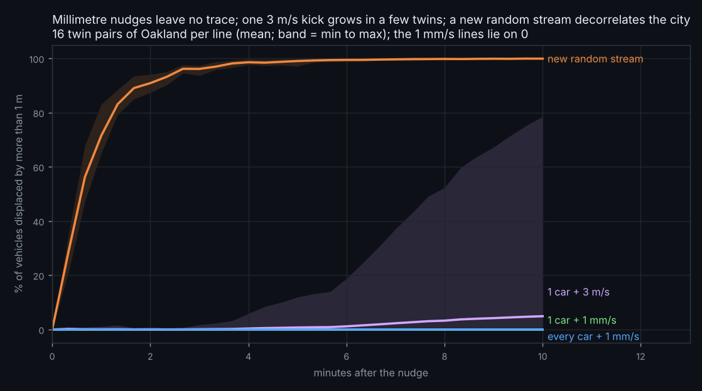

AVBench, rule-based AV, one run each from the leaderboard's warm state (`results/twins/bench.json`):

| scenario | as published | every car +1 mm/s | every car +1 m/s | new random stream |
|---|---|---|---|---|
| nominal | 72.5 | 72.5 | 60.1 | 90.3 |
| rush hour | 92.0 | 92.0 | 91.9 | 78.8 |
| red runners | 91.0 | 91.0 | 90.4 | 61.2 |
| wet road | 26.2 | 26.2 | 26.1 | 26.5 |
| mean absolute change | | 0.01 | 3.3 | **15.3** |


(The GIF shows seed 0, where the +3 m/s twin stays in step: the 1-in-16 divergence is not that one.)

**Both predictions held.** The simulator is **not chaotic at rounding scale**: a nudge of a thousandth of a metre per second to
every car leaves no vehicle displaced by a metre in ten minutes and no AVBench score changed (0 of 16 twins diverged: 95 % upper
bound 21 %). A large kick to one car does cascade sometimes (1 of 16, 95 % interval 1-28 %), so sensitive dependence exists, but
rarely. A different random stream changes everything, and moves a rule-based AV's scenario score by 15 points on average
(+17.9, −13.2, −29.7, +0.3), the same size as the CPU-versus-GPU drift in FIXES.md #14 (core means moved 8; single scenarios up to 75).
A 1 m/s kick to every car, far above rounding, moved one scenario (nominal) by 12 points and the others by under 1.

**What it means.** Per-scenario scores are draws from a wide distribution, not constants, and a hardware change matters through
whatever re-rolls the random stream, not through rounding. That is consistent with the drift but does not prove its cause: the
GPU run's generator was not recorded (next step 1). The practical rule is the one already in the README: read means over scenarios
and rankings, and put an interval on any single score.

**What failed.** The first version of the "new random stream" condition changed `key_seed`, which only reaches a *learned* policy;
the rule-based AV and the humans draw from the simulator state's own key, so the four scores came back identical and the condition
did nothing. It was caught by the null result, fixed with `restream` (re-keying the state), and rerun; only the fixed numbers are
reported above. Limits: 16 twin pairs and one AVBench run per cell (a single scenario score is itself a draw), one city, one nudge
location rule (the fastest car), and "displaced" uses a 1 m threshold, so sub-metre differences are not counted.

Commands: `python -m avlab.twins` (~3 min), `python -m avlab.twins --bench` (~10 min), `python -m avlab.twins --plot`; test: `tests/test_twins.py`.
