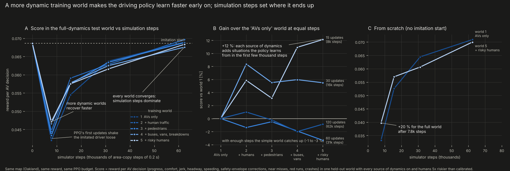
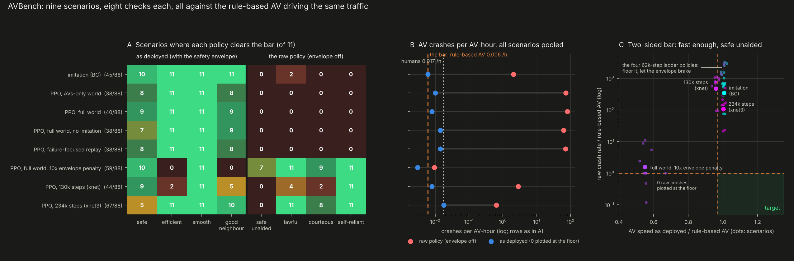
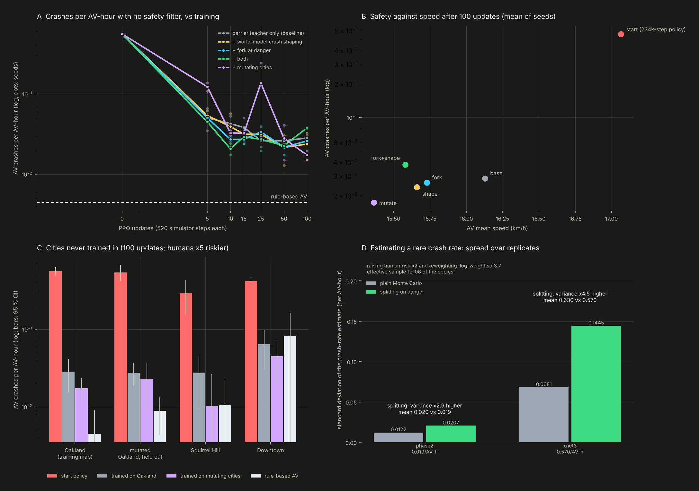
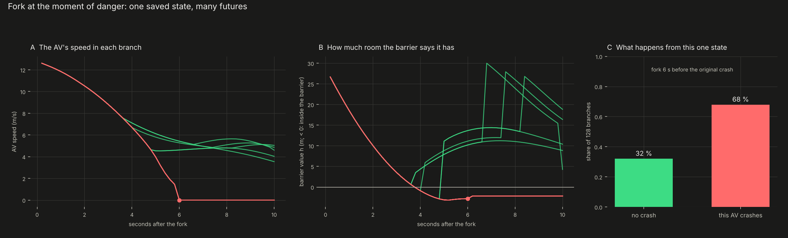
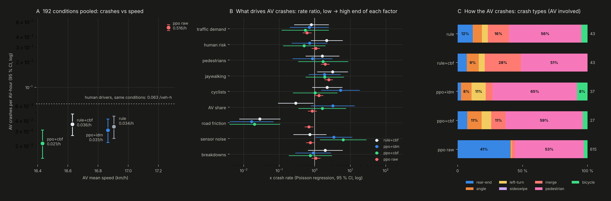

# Experiments: training, scaling laws, AVBench, making the simulator teach harder

The controlled experiments on the teacher (the simulator) and the student (the driver). Every one is a set of jobs of 5 minutes or less on 4 CPU cores. Moved from the README.

## Does a more dynamic world train a better driver?



**The experiment (`avrl/ladder.py`).** Five training worlds on the same Oakland map. Each adds one source of
dynamics to the one before:

1. AVs alone on light-traffic streets;
2. careful human drivers around 25 % AVs;
3. pedestrians;
4. buses, double-parked vans and breakdowns;
5. risky humans, with demand, AV share and risk randomised per copy.

Every policy starts from the same imitation of the rule-based AV and gets the same PPO budget. Every checkpoint is
scored in one held-out test world with all of it switched on (humans 5x riskier than calibrated). The score is the
training reward per AV decision: progress, comfort, jerk, headway, speeding, safety-envelope corrections, near
misses, red runs and crashes.

**How to read it:**

- **A, the learning curves.** PPO's first updates shake the imitated driver loose (the dip). Then every world climbs
  back, and the more dynamic worlds climb back first.
- **B, the same data at fixed budgets.** At 15 updates (7,800 simulator steps) the gain over the empty-streets world
  grows rung by rung, to **+12 % for the full world**. At 30 updates every richer world is still 5-8 % ahead. From
  31,000 steps on, the curves meet within 3 %.
- **C, the world as the only teacher** (no imitation start). The full world is **+20 % ahead after 7,800 steps**. By
  62,000 steps both reach about 0.070.

**What it means.** Dynamics buy *sample efficiency*: each pedestrian, bus, breakdown and red runner is a situation the
policy learns from in its first few thousand steps. Where the policy ends up is set by the number of simulation
steps. Two things explain this:

- **The observation.** Pedestrians, buses, signals and right of way all reach the policy as a stop target, a leader
  or an arrival time, so a skill learned from one transfers to the others.
- **The safety envelope** absorbs the rest.

## Scaling laws


**World models (`dwm/scaling.py`).** The models are trained on 2.8 M AV decisions logged in the Oakland simulator
(1 s of history, 3 s of future at 5 Hz), each predicting 5 control points. Error is CRPS on speed and gap at
1/2/3 s relative to a physics model, on held-out vehicles. Fits are error = a·x^(-b) in log-log space:

| architecture | exponent vs training steps | exponent vs simulated data |
|---|---|---|
| flow matching, MLP | 0.153 (R² 0.94) | 0.074 (R² 0.63) |
| MLP 128x2 | 0.171 (R² 0.94) | 0.021 (R² 0.93) |
| MLP 256x3 | 0.113 (R² 0.91) | 0.047 (R² 0.93) |
| transformer 64x2 | 0.014 (R² 0.21) | 0.019 (R² 0.60) |

**How to read it:**

- **Compute (A).** The MLPs and flow matching follow clean power laws (b = 0.11-0.17, R² > 0.9). The small MLP has
  the steepest compute law because it starts furthest behind. The transformer is the fastest early learner: best of
  all at 250 steps. It is flat after that (b = 0.01) at this size.
- **Data (B).** Capacity decides how much a model gains from more simulation. The 1M-parameter MLP's data exponent
  (0.047) is **more than twice** the 0.2M MLP's (0.021). The small model is capacity-bound; the large one keeps
  improving across the whole range.
- **Projection.** By its fitted law, the large MLP reaches the physics model's error at about 4,400 steps on 200 k
  windows. Longer runs on all 740 k windows go well past it: 0.70 after 18,200 steps, 0.72 with the DCT basis after
  14,500.

**The driving policy (C).** The score rises as a power law in simulation steps, with nearly the same exponent from
the empty-streets world and the full world (b = 0.76 and 0.77). Same law, different offset early on.

## Active learning: which simulated data teaches fastest?


**The experiment (`avrl/active.py`).** A grid of 54 scenarios on the Oakland map: demand (0.7, 1, 1.35) x human risk
(1, 5, 15x calibrated) x pedestrian rate (0.3, 1, 2x) x AV share (25, 60 %). Every 5 PPO updates each of the 8
simulated copies of the area is assigned a scenario by one of four rules. All start from the same imitation policy,
get 62,400 simulator steps, and are scored in the held-out test world of the dynamics ladder.

| rule | 7.8 k steps | 15.6 k | 31.2 k | 62.4 k |
|---|---|---|---|---|
| uniform (domain randomisation) | 0.0460 | 0.0569 | 0.0619 | **0.0700** |
| prioritised level replay, \|advantage\| | 0.0444 | 0.0573 | 0.0623 | 0.0685 |
| failure-focused replay (hard brakes, near misses, crashes per AV-hour) | 0.0444 | 0.0573 | **0.0635** | 0.0694 |
| uniform + critic warm-up (policy held for 10 updates) | 0.0427 | 0.0526 | 0.0596 | 0.0677 |

**How to read it:**

- **A.** Failure-focused replay leads at mid-budget (+2.6 % at 31 k steps) and finishes level with uniform sampling.
  Level replay tracks uniform throughout. Holding the policy while the critic warms up costs steps and never catches up.
- **B, the reason.** Measured by the policy's own learning signal, the *least* informative scenario still carries
  73 % of the signal of the most informative one. Every corner of this world still teaches. When the signal is this
  flat, uniform sampling is already near-optimal, so selection rules can only reorder the data.
- **What this means for "more data, faster".** At this stage the lever is *volume* of dynamic simulation, not
  selection. This matches the dynamics ladder (richer worlds help early, steps dominate later) and the RL power law
  (b ≈ 0.77). Selection should start to pay once the policy has mastered the common cases and the signal concentrates
  on rare ones. The failure score already spreads out much more than the advantage does (orange points in B).

## AVBench: the bar the learned driver has to clear



**Why a benchmark, not the training score.** The test-world score used above is the training reward, and every
learned AV drives under a safety filter. A policy that floors it and lets the filter do the braking still scores well.
AVBench (`avrl/bench.py`) asks the questions a deployment review would ask. Every policy is run three times: under the
IDM envelope it was trained with (as deployed), under the control barrier function, and with no filter at all (what RL
actually learned).

**Eleven scenarios:**

- nominal Oakland traffic;
- rush hour (demand ×1.45);
- red runners (60 % of humans willing, up to 3 s into the red);
- inattentive humans (pull out without looking, zone out);
- jaywalkers (2.5× pedestrians, 40 % crossing against the signal);
- blockages (breakdowns, double-parked vans);
- 80 % AVs;
- cyclists (15 % of trips);
- a wet road (friction 0.5);
- two neighbourhoods never seen in training, Squirrel Hill and Downtown.

**The bar.** The rule-based AV drives the *same* traffic (same warm state, same random numbers), so every difference
is the policy's. Eight checks per scenario, 88 in all; a scenario is *overcome* when all eight pass:

| as deployed (with the envelope) | the raw policy (no filter) |
|---|---|
| **safe**: AV crashes per AV-hour <= the rule-based AV's | **safe unaided**: AV crashes per AV-hour <= the rule-based AV's |
| **efficient**: AV speed >= 97 % of the rule-based AV's | **lawful**: red-light runs <= the rule-based AV's |
| **smooth**: hard brakes per AV-hour <= the rule-based AV's | **courteous**: near misses at junctions per AV-hour <= the rule-based AV's |
| **good neighbour**: human drivers' speed >= 99 % of theirs next to rule-based AVs | **self-reliant**: the envelope cuts the command in < 5 % of AV time |

**Results** (all scenarios pooled, ~500 AV-hours per policy and filter):

| policy | checks passed (of 88) | crashes /AV-h: envelope | barrier function | no filter | AV km/h | hard brakes /AV-h |
|---|---|---|---|---|---|---|
| **rule-based AV (the bar)** | 88 | 0.006 | 0.008 | 0.006 | 16.4 | 17.3 |
| **PPO + barrier teacher (phase 2)** | **67, 2 scenarios overcome** | **0.004** | | **0.044** | 15.7 | 2.7 |
| PPO + barrier teacher, speed + jaywalkers (phase 3) | 61 | 0.004 | | **0.028** | 15.3 | 2.5 |
| PPO, 234k steps (xnet3), the starting point | 67 | 0.018 | 0.012 | 0.64 | 16.4 | 3.5 |
| PPO, full world, 10× envelope penalty | 59 | 0.002 | 0.000 | 0.009 | 9.0 | 2.9 |
| imitation (BC) | 45 | 0.006 | 0.006 | 2.1 | 16.4 | 6.7 |
| PPO, 130k steps (xnet) | 44 | 0.008 | 0.008 | 2.8 | 15.7 | 2.3 |
| PPO, 62k steps, four ladder / active-learning recipes | 38-40 | 0.008-0.014 | 0.004-0.018 | 63-80 | 16.3-16.6 | 4.1-5.1 |

**How to read it:**

- **Training with the barrier function as a teacher cut unaided crashes 15×** (next section). It overcame the first
  two scenarios (red runners, blockages), and as deployed it is safer than the rule-based AV (0.004 vs 0.006).
- **Before that, no policy overcame a scenario.** The 234k-step policy passes 67 of 88 checks.
  It is smooth (5× fewer hard brakes), lawful and self-reliant everywhere, and as fast as the rule-based AV. It fails
  *safe unaided* in every scenario (0.64 crashes/h with no filter) and *safe* as deployed in 6 of 11: 9 crashes in
  500 AV-hours against the rule-based AV's 3. The IDM envelope only caps acceleration, so it can't stop a bad junction
  entry. The barrier function, which also vetoes unsafe entries and merges, brings that to 6.
- **Short training learns to lean on the filter.** The 62k-step policies crash 63-80 times per AV-hour with no
  filter. The mix includes about 190 angle, 50 left-turn, 140 merge and 300-470 bicycle crashes each, besides
  rear-ends and pedestrians. They learned to accelerate and let the envelope brake: reward hacking of the safety
  layer, invisible to the training score (all four score ~0.070).
- **The bar has two sides (C).** A 10× envelope penalty almost removes unaided crashes (0.009/h). But it drives at
  55 % of the rule-based speed and fails *efficient* and *good neighbour* in all 11 scenarios.
- **Hardest scenarios:** rush hour and jaywalkers, then Downtown.

```bash
python -m avrl.bench run            # all scenarios, only policies not yet scored (~3 min per scenario)
python -m avrl.bench report         # -> results/bench/leaderboard.md
python -m avrl.bench plot           # -> docs/img/avbench.png
```

To score a new policy, add its checkpoint to `POLICIES` in `avrl/bench.py` and run the three commands again.

## Training the driver to need no filter (`avrl/unaided.py`)

The barrier function as a teacher. The reward charges what the barrier *would* have done, whether or not it is
filtering:

- every m/s² it would take off the commanded acceleration;
- every metre the AV is inside the barrier;
- every junction entry or merge it would have vetoed.

Starting from the 234k-step policy, 100 PPO updates per phase (about 4 minutes each):

| phase | training | AVBench checks (of 88) | scenarios overcome | crashes /AV-h, no filter | as deployed | AV km/h |
|---|---|---|---|---|---|---|
| start | the 234k-step policy | 67 | 0 | 0.64 | 0.018 | 16.4 |
| 1 | barrier filtering, its interventions charged | 66 | 1 | 0.044 | 0.004 | 15.7 |
| **2** | **no filter, the same charges** | **67** | **2** | **0.044** | **0.004** | 15.7 |
| 3 | + progress weight 0.05, half the copies full of jaywalkers | 61 | 0 | 0.028 | 0.004 | 15.3 |
| rule-based AV | the bar | 88 | 11 | 0.006 | 0.006 | 16.4 |

- **Unaided crashes fell 15-23×** (0.64 → 0.044 → 0.028 per AV-hour, about 500 AV-hours each), with less hard
  braking than the starting policy (2.7 vs 3.5 per AV-hour) and a sixth of the rule-based AV's (17.3).
- **The first two scenarios fully overcome**: red runners and blockages, all eight checks.
- **What still fails is mostly speed.** The policy drives at 95-96 % of the rule-based AV's speed, and *efficient*
  wants 97 %. Unaided safety fails where the rule-based AV had zero crashes in a scenario's ~45 AV-hours and the
  policy had one or two. Jaywalkers stay the hardest (0.09-0.27 per AV-hour).
- **Three things that did not work**, each one step on the way:
  - *Charging every moment inside the barrier, and every acceleration above its bound.* A car stopped 2 m behind
    another is technically inside the barrier, so the policy learned to hang back in queues and moved off slowly. AVs
    drove at 9 km/h and slowed the humans behind them. Charging only a moving AV fixed it.
  - *A cruise term* (per m/s below the limit on open road) made the policy slower, not faster.
  - *Phase 3's extra speed weight* didn't raise speed; the jaywalker copies made it safer but more hesitant.

```bash
python -m avrl.unaided 1 && python -m avrl.unaided 2      # ~4 min each
python -m avrl.bench run && python -m avrl.bench report   # score the new policies
```

## Making the simulator teach harder



Four additions to the simulator itself, each aimed at how fast or how well a policy learns. Every policy starts from the
234k-step PPO driver (0.56 crashes per AV-hour with no filter), trains for 100 updates (52k simulator steps) with no
safety filter and the barrier function as the teacher, 2 seeds per variant. Each is scored with no filter in the
ladder's test world (humans 5× riskier, 25 % AVs): ~460 AV-hours per policy in Oakland (180-470 in the other worlds), from the same warm states and the
same random numbers (3 replicates × 16 copies × 5 simulated minutes; 95 % intervals about ±0.01 per AV-hour).

| | idea | what it adds to the simulator | result |
|---|---|---|---|
| 6 | **Mutating cities** | every copy of the area is a different city: speed limits, signal plans, demand and pedestrian hot spots, closed streets with rerouting (`xnet/mutate.py`) | **the clearest win**: fewer crashes in all four worlds and in 8 of 8 (seed, world) pairs |
| 1 | **Fork at the moment of danger** | the pre-update state of copies that met trouble is saved; half the batch is replayed from saved states with new random numbers (`avrl/fork.py`) | reaches the plateau slightly sooner in one seed of two; the same plateau |
| 3 | **Crash-risk shaping** | the latent world model's crash head as a reward-shaping potential (`wmplan/risk.py`) | within noise of the baseline |
| 10 | **Rare-event estimation** | splitting on danger, to measure crash rates with fewer AV-hours (`avlab/split.py`) | unbiased, but a larger spread than plain Monte Carlo |

**Mutating cities (6).** Every ten updates each copy gets a different city from a pool of 48, built by `mutate(net, geo,
seed)`: district-wide speed-limit factors and 12 % of links slowed to 45-70 %, signal cycles of 50-110 s with uneven green
splits and random offsets, lognormal hot spots in where trips start, where they go and where pedestrians cross, and 4 % of
the streets closed, with the routing recomputed around them. The geometry stays fixed, so every array keeps its shape and the
copies still run in one `vmap`. Scored at 100 updates (mean of 2 seeds), with the rule-based AV and the starting policy for
reference:

| world | start policy | trained on Oakland | **trained on mutating cities** | change | rule-based AV |
|---|---|---|---|---|---|
| Oakland (the training map) | 0.559 | 0.028 | **0.017** | -39 % | 0.0045 |
| held-out mutated Oakland cities | 0.540 | 0.027 | **0.023** | -17 % | 0.0089 |
| Squirrel Hill (never trained in) | 0.294 | 0.028 | **0.010** | -63 % | 0.0105 |
| Downtown (never trained in) | 0.417 | 0.064 | **0.045** | -30 % | 0.082 |

It costs a little speed (15.4 against 16.1 km/h in Oakland, 4-8 % in every world) and the middle of training is rougher:
0.12 crashes per AV-hour after 5 updates, and one seed spiked to 0.24 at update 25 right after a change of cities.
At 100 updates it is the best policy in every world, and in Squirrel Hill it matches the rule-based AV.

**Fork at the moment of danger (1).** The whole simulator state is one pytree, so a fork is a copy. The figure below takes
one saved state from 6 s before a real crash and replays it as 128 branches with different random numbers: 68 % end in the
crash, 32 % do not.



In training, half the copies (2 saved states × 2 branches) are overwritten every update with saved states, ranked by how much
trouble they met. Crashes per AV-hour with no filter, by number of PPO updates (mean of 2 seeds, and their range):

| variant | 5 | 10 | 15 | 25 | 50 | 100 |
|---|---|---|---|---|---|---|
| barrier teacher only | 0.051 (0.035-0.066) | 0.043 (0.033-0.053) | 0.038 (0.026-0.050) | 0.026 | 0.026 | 0.028 |
| + fork at danger | 0.051 (0.048-0.053) | 0.027 (0.026-0.028) | 0.027 (0.024-0.031) | 0.034 | 0.022 | 0.026 |
| + crash-risk shaping | 0.054 (0.046-0.062) | 0.039 (0.022-0.057) | 0.032 (0.030-0.033) | 0.032 | 0.022 | 0.024 |
| + both | 0.045 (0.044-0.046) | 0.021 (0.018-0.024) | 0.029 (0.024-0.035) | 0.027 | 0.023 | 0.038 |
| + mutating cities | 0.123 (0.109-0.138) | 0.033 (0.030-0.035) | 0.032 (0.028-0.037) | 0.137 | 0.028 | **0.017** |

Forking looks faster between 10 and 15 updates (0.027 against 0.040), mostly through one seed (0.053 down to 0.028 at 10
updates; the other seed 0.033 down to 0.026), and every variant sits on the same ~0.025 plateau from 25 updates on. The barrier teacher already makes crashes very learnable in this
world: the first five updates remove 90 % of them.

**Crash-risk shaping (3).** The latent model's crash head separates the steps before a crash from the rest by 40×
(potential -0.24 against -0.006 per step), and the shaping r' = r + γφ(s') - φ(s) leaves the optimal policy unchanged
(`tests/test_dynamics.py` checks that it telescopes). It did not change what the policy learned beyond the seed-to-seed spread.

**Rare-event estimation (10).** The first idea was to raise the human risk rates in each copy and reweight by the likelihood
ratio. That cannot work in a whole city: one 5-minute run draws thousands of independent decisions (is this driver a red
runner, does that one look), and the likelihood ratio is their product. Doubling `p_red` gives log-weights with a standard
deviation of 3.7, an effective sample of 10⁻⁶ of the copies. So `avlab/split.py` uses importance splitting: every 3 s the 16
copies are resampled by how dangerous they look (a Poisson regression on the world model's crash risk, how many AVs are close
to their barrier, near misses), and a copy cloned *k* times carries 1/*k* of the weight. It is unbiased for any importance
function (`tests/test_dynamics.py`), and in the simulator it agrees with plain Monte Carlo (0.0205 against 0.0193 per
AV-hour over 16 replicates; 0.63 against 0.57 over 8 on the crashy starting policy). But it has a *larger* spread: standard
deviation 0.0207 against 0.0122 and 0.145 against 0.068, and the sharper the importance, the worse (0.25, 0.27 and 0.35 against
0.11 for plain). Crashes here cascade (a wreck blocks a lane and causes more) and come from many small independent
hazards, so a copy's danger predicts the next 3 s only weakly. What did pay: compiling each world once and starting every
policy from the same warm states, which makes an estimate cost ~50 s and the comparisons paired.

```bash
python -m avrl.fork train mutate 0 && python -m avrl.fork train fork+shape 0     # ~5 min each; results/dyn/<variant>_s<seed>/
python -m avrl.dyn_eval base fork shape fork+shape mutate -- oakland             # score with the estimator; results/dyn/eval.json
python -m avlab.split validate results/unaided/phase2/policy.npz oakland 16      # splitting vs plain Monte Carlo
python -m avrl.dyn_plot && python -m avrl.fork_viz                               # the charts
```

## Speed, and a GPU training script

[docs/SPEED.md](SPEED.md) compares `xnet` with CARLA, MetaDrive, Nocturne, SUMO/CityFlow, GPUDrive and Waymax in
vehicle-steps per second (CARLA ~10 k, GPUDrive 2.3 M, this repo 0.75 M on 4 CPU threads, 6-13 M projected for one A100).

`python -m avrl.gpu_train` runs PPO with the copies sharded over every device (`jax.shard_map`, gradients averaged with
`pmean`), and the learner trains on the valid AV rows only (`Config.compact`; 86 % of the old rows were padding).
Measured on the 4-thread CPU (4 forced host devices): a PPO update went from 1.97 s to 0.81 s with packing alone, and the
whole trainer from ~210 to ~1,100 area-steps/s. Trained 100 updates (3 min, 32 copies) from the 234k-step policy with no
safety filter, it reached 0.011 crashes per AV-hour in Oakland (3 replicates, 95 % CI -0.001 to 0.022; one seed) against
0.026-0.031 for the 8-copy trainer after the same 100 updates, at the same speed (15.7 vs 16.1 km/h). That is a hint that more
copies per update help, not a measured effect. **No GPU was available: the GPU rows are projections**; run
`python -m avrl.gpu_train --preset gpu --bench` on a card to measure.

## Crashes at junctions, in merges and with cyclists

The area simulator now has cyclists and a richer crash model:

- **Cyclists** (`p_bike`, 3 % of trips by default) ride in the lane at about 20 km/h. Cars queue behind them and
  overtake: on the other lane, or on the opposing lane of a two-way street.
- **Close passes.** Aggressive or distracted human drivers sometimes clip the cyclist they overtake. This is the most
  common real-world cause of cyclist crashes.
- **Seven crash types, with who was involved:**
  - rear-end, angle, left-turn, sideswipe;
  - *merge*: a rear-end within 3 s of a lane change, or two moves joining one lane inside a junction;
  - pedestrian;
  - *bicycle*: any crash involving a cyclist.

  Each is counted overall and with an AV involved (`AV_CRASH` metrics).
- **Physical stopping.** A vehicle told to stop at a line is only held there if it could physically stop at the
  road's maximum braking. Too fast, and it overruns into the junction with whatever conflicts follow. Before this, a
  reckless policy was clamped to a stop at every red line, which hid junction crashes. Very short links between two
  heads of one split junction are still held as one.
- **The AV's merges** now follow its gap-acceptance output, like its junction entries. A bad policy can cut in and
  cause merge crashes.
- **Road friction and AV sensor noise** are behaviour knobs: `friction` caps braking at 9 m/s² × friction, and
  `perception_noise` puts a multiplicative error on every gap the AV perceives.

**The control barrier function** (`xnet.sim.SHIELD = "cbf"`) is a second safety filter next to the IDM envelope. It
keeps three barriers non-negative:

- **braking distance:** h = gap − d0 − τv − (v² − v_lead²)/2b, enforced as ḣ ≥ −αh on the commanded acceleration,
  against the leader, the stop target and the speed limit;
- **junction entry:** time-to-conflict of traffic with priority − time to clear − margin ≥ 0, which vetoes the entry;
- **merging:** the car cut in front of can stay behind at 3 m/s², which vetoes the merge.

It filters any AV, rule-based or learned. A reckless test policy (full throttle, accepting every gap) crashes dozens
of times in 4 minutes without it and at most twice with it (`tests/test_safety.py`).

## Planning in a latent world model (`wmplan/`)


An AV that plans merges and junctions by unrolling a learned latent representation of its scene into the future:

- **Model:** an encoder to a 48-d latent, action-conditioned latent dynamics, and decoders for the safety margins, the
  reward and the probabilities of a crash, a near miss and a red-light run. Trained on 800 k logged decisions,
  including 666 crashes.
- **Planner:** every 0.2 s, for every AV, it searches 32 smooth 2.4 s plans of acceleration and gap acceptance in
  latent space (cross-entropy method, PPO policy as the prior) and executes the best.

The model predicts the AV's speed 3 s ahead with 64 % less error than holding the scene still. It ranks crashes with
AUROC 0.954 and red-light runs with 0.9999. **Without any safety filter, planning halves the crash rate of the policy
it starts from** (0.26 vs 0.57 per AV-hour, about 23 AV-hours each, in a hard Oakland world). With the barrier
function, every driver has 0 crashes. Details: [wmplan/README.md](../wmplan/README.md).

## How the AV performs under hundreds of conditions (`avlab/`)



A stress lab: 192 Latin-hypercube conditions over nine factors (demand, human risk, pedestrians, jaywalking,
cyclists, AV share, road friction, sensor noise, breakdowns), each a vmapped copy of Oakland. Five drivers per
condition (about 1,300 AV-hours each), plus two unseen neighbourhoods and a friction × sensor-noise grid. Findings:

- **PPO under the barrier function is the safest configuration.** It has 0.021 crashes per AV-hour (95 % CI
  0.014-0.031): a third of the human drivers' rate in the same conditions and 38 % below the rule-based AV, with 4.5×
  fewer hard brakes.
- **Road friction dominates:** from snow to dry roads, crashes fall 20-50×. Below friction ~0.45 every driver crashes,
  with or without the barrier, whose braking assumption (6 m/s²) snow can't meet. That's the edge of the operating
  domain.
- **Sensor noise hurts only the learned driver** (3.5-6×). **Pedestrians are the main way the AV crashes** (51-65 %).
- **Downtown's dense grid doesn't transfer:** every AV configuration crashes more than the humans there.

Details: [avlab/README.md](../avlab/README.md).
