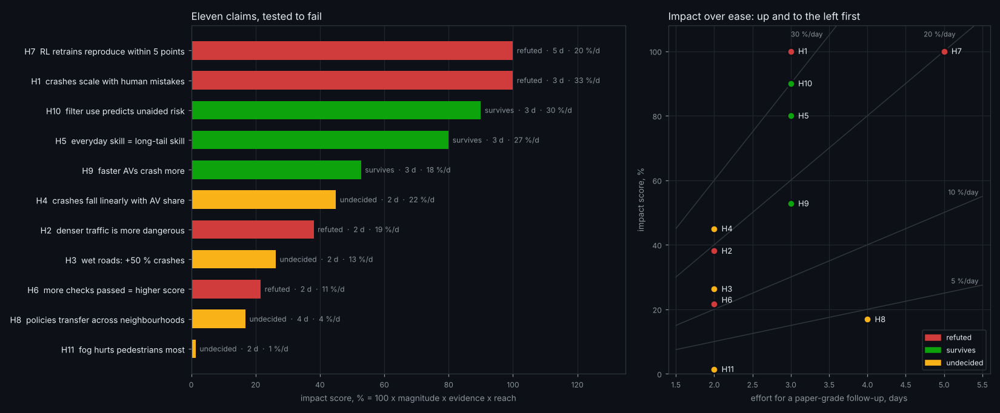

# Eleven claims, tested to fail

Plausible claims about driving, AVs and AV research, each written down *before* its test with a prediction that could fail, then
tested on av_world's data. Four were refuted, three survived and four are undecided. The findings are about **this simulator** and
its calibrated drivers. Where a result says something about the real world, that is a hypothesis for real data, not a conclusion.

```bash
python examples/hypotheses_sims.py   # the simulations: 11 settings x 48 copies x 10 simulated min (~25 min, 4 CPU cores)
python examples/hypotheses.py        # every test below (~45 s) -> results/examples/hypotheses.json, docs/img/hypotheses.png
```



## The table

| | claim | prediction (how it could fail) | data and test | result | verdict |
|---|---|---|---|---|---|
| H1 | Crash rate is proportional to how often humans make mistakes | elasticity $b = 1$ in $\log\lambda = a + b\log r$ | mistake rates (red-light running, not looking, distraction) x1, 3, 10, 30; 192 copies, 14,976 vehicle-hours; Poisson regression, Wald test of $b=1$ | $b = 0.16\ [0.01, 0.30]$: **30x the mistakes, 1.6x the crashes** | **refuted** ($p_{Holm} < 10^{-28}$) |
| H2 | Denser traffic is more dangerous per vehicle-hour | $b > 0$ in $\log\lambda = a + b \log(\text{demand})$ | demand x0.5-2; 192 copies, 18,960 vehicle-hours; one-sided Wald | $b = -0.39\ [-0.79, 0.01]$ per vehicle-hour; per vehicle-km $b = 0.07\ [-0.34, 0.47]$ | **refuted**: per hour the rate *falls* (7.7 to 4.7 per 1,000 h) as speed falls (19.6 to 10.6 km/h) |
| H3 | Wet roads (friction 0.6) raise the crash rate by at least 50 % | rate ratio $\ge 1.5$ | 48 + 48 copies; exact conditional rate ratio; minimum detectable ratio at 80 % power 1.99 | $RR = 1.44\ [0.87, 2.42]$; icy (0.3): $24.6\ [16.8, 37.2]$ | undecided: underpowered for a 1.5x effect, while icy roads are a cliff |
| H4 | Crashes fall in a straight line as the AV share grows | no curvature: a quadratic term adds nothing | AV-share sweep (0-100 %, 80 copies each, 11,934 vehicle-hours); LRT | $\chi^2_1 = 0.89$; 100 % vs 0 % AVs $RR = 0.46\ [0.21, 0.95]$ | undecided: 5 points can reject a shape but not confirm one |
| H5 | Doing well on everyday traffic and on long-tail incidents is the same skill | Spearman $\rho \ge 0.8$, core vs long-tail score | 15 drivers x 18 AVBench scenarios; permutation p, bootstrap CI | $\rho = 0.96\ [0.82, 1.00]$ | **survives** |
| H6 | A driver that passes more safety checks gets a higher overall score | $\rho > 0$ *and* the top scorer passes the most checks | 15 drivers | $\rho = 0.82\ [0.45, 0.96]$, but the top scorer (rule-based, 77.2) passes 104 checks against the best 123 | **refuted** by a counterexample: the score rewards comfort and progress that the checks do not |
| H7 | Retraining the same RL recipe reproduces its score within 5 points | most scenario scores within ±5 points | 3 recipes trained twice (CPU, GPU) x 18 scenarios; paired differences | mean $-3.4\ [-13.1, 6.2]$, but per-scenario SD 36 points and only 41 % within ±5 | **refuted**: one training run is not a result |
| H8 | Policies trained in Oakland transfer to other neighbourhoods unchanged | score(Squirrel Hill, Downtown) − score(Oakland) = 0 | 15 drivers; Wilcoxon signed-rank, bootstrap CI | $-18.8\ [-33.6, -5.4]$ points | undecided after the Holm correction ($p = 0.0125$, $p_{Holm} = 0.075$); the interval excludes 0 |
| H9 | Faster AVs crash more (a speed-safety trade-off) | $\rho > 0$, progress vs unaided crash rate | 165 driver-scenario pairs | $\rho = 0.38\ [0.23, 0.50]$ | **survives** |
| H10 | How often the safety filter steps in predicts how unsafe the policy is without it | $\rho > 0.5$, filter share vs unaided crash rate | 165 driver-scenario pairs | $\rho = 0.86\ [0.81, 0.90]$ | **survives** |
| H11 | Fog hurts the detection of pedestrians and cyclists more than of vehicles | larger relative drop in detection rate for VRUs | sensor model on 12 AVs' trips (2,858 VRU object-frames), fog 0.7 vs clear; cluster bootstrap over AVs | VRU −38 % vs vehicles −35 %: $+3\ [-3, +8]$ points | undecided: at most an 8-point difference |

## The math

**Crash counts.** Copy $i$ of a setting has $k_i$ crashes in $t_i$ vehicle-hours. The model is
$k_i \sim \text{Poisson}(\lambda_i t_i)$ with $\log \lambda_i = x_i^\top\beta$. It is fitted by iteratively reweighted least squares with
offset $\log t_i$. Dispersion is $\hat\phi = \frac{1}{n-p}\sum_i (k_i - \hat\mu_i)^2/\hat\mu_i$ (1.10 for H1, 0.93 for H2), and the
covariance is scaled by $\max(\hat\phi, 1)$ (quasi-Poisson). The 95 % intervals are $\hat\beta \pm 1.96\,\text{se}$.

**Elasticity (H1, H2).** With $x = \log r$, the slope $b$ is the elasticity: multiplying $r$ by $c$ multiplies the crash rate by $c^b$.
H1's $b = 0.16$ means 30x the mistakes gives $30^{0.16} = 1.7$x the crashes, against 30x if crashes were proportional to mistakes.
The crash types say why. Red-light crashes do scale (1 to 11, an elasticity of about 0.7). But most crashes are left-turn, pedestrian,
merge and rear-end crashes, which come from gap acceptance and pedestrian behaviour, not from those three mistake rates.

**Exposure (H2).** The same counts give opposite answers depending on the denominator. Per vehicle-hour the rate falls with density,
because congested traffic spends hours going nowhere. Per vehicle-km it is flat ($b = 0.07$, interval $[-0.34, 0.47]$). A crash rate
without its exposure is not a result.

**Two rates (H3).** Conditional on $n = k_1 + k_2$, $k_1 \sim \text{Binomial}(n, \frac{t_1 RR}{t_1 RR + t_2})$, so a Clopper-Pearson interval
for the binomial share maps to an exact interval for $RR$. The one-sided test of $RR \ge 1.5$ uses the same binomial. The minimum
detectable ratio at 80 % power is $\exp\left((z_{.975} + z_{.80})\sqrt{1/k_1 + 1/k_2}\right) = 1.99$ with 40 and 28 crashes. That is
why a true 1.44x effect cannot be confirmed here: it needs about 4x the copies.

**Shape (H4).** This is a likelihood-ratio test of $\log\lambda = a + b s$ against $a + b s + c s^2$: $D_0 - D_1 \sim \chi^2_1$.

**Rank correlations (H5, H6, H9, H10).** Spearman $\rho$. The p-value comes from 20,000 permutations of one ranking (5,000 for the
165-pair tests). The 95 % interval is a percentile bootstrap over drivers or driver-scenario pairs. H5 and H10 predict a *size*
($\rho \ge 0.8$, $\rho > 0.5$), so the interval is what decides them.

**Paired differences (H7, H8).** These use Wilcoxon signed-rank tests and a bootstrap interval of the mean. H7's claim is about the
spread, so it is decided by the share of scenarios within ±5 points and the standard deviation, not by the mean.

**Multiplicity.** All 11 p-values are corrected together with Holm's step-down method, which controls the family-wise error at 5 %.
H8 is the one claim the correction changes, from significant to undecided.

## Impact over ease

Each claim also points to a follow-up study. To rank them:

$$\text{Impact \%} = 100 \times M \times E \times R, \qquad \text{priority} = \frac{\text{Impact \%}}{\text{effort (days)}}$$

* $M$, **magnitude** $= \min(1, \text{effect \%}/50)$, where a 50 % change, $\rho^2 = 0.5$ or 25 points counts fully.
* $E$, **evidence** $= 1$ if the verdict is decided (at the corrected level, or by a counterexample) and $0.5$ if undecided.
* $R$, **reach**: the share of this repository's research questions the answer bears on. This is a judgement, stated below so it can
  be argued with.
* **Effort**: days to turn the result into a paper-grade follow-up on a CPU, plus one GPU day for H7. Also a judgement.

| rank | claim | verdict | M | E | R | impact % | effort (days) | impact per day | the follow-up |
|---|---|---|---|---|---|---|---|---|---|
| 1 | H1 mistakes vs crashes | refuted | 1.00 | 1 | 1.0 | **100** | 3 | **33** | attribute crashes to mechanisms (Shapley values over the Behaviour knobs): which mistakes actually make crashes? |
| 2 | H10 filter use predicts unaided risk | survives | 1.00 | 1 | 0.9 | 90 | 3 | **30** | filter dependence as a deployment metric: when does a filtered policy's record overstate its own safety? |
| 3 | H5 everyday = long-tail skill | survives | 1.00 | 1 | 0.8 | 80 | 3 | 27 | a 3-scenario core subset that predicts the 18-scenario score: a cheaper benchmark |
| 4 | H4 AV-share curve shape | undecided | 1.00 | 0.5 | 0.9 | 45 | 2 | 23 | 9 shares x 3x the copies: is there a threshold, or diminishing returns? |
| 5 | H7 RL reproducibility | refuted | 1.00 | 1 | 1.0 | **100** | 5 | 20 | 10 seeds per recipe on a GPU, with confidence intervals on every leaderboard row |
| 6 | H2 density and exposure | refuted | 0.48 | 1 | 0.8 | 38 | 2 | 19 | report every crash rate per hour, per km and per junction entry, and show where they disagree |
| 7 | H9 speed-safety trade-off | survives | 0.75 | 1 | 0.7 | 53 | 3 | 18 | a policy family indexed by one speed knob: the frontier's slope and its kinks |
| 8 | H3 wet roads | undecided | 0.88 | 0.5 | 0.6 | 26 | 2 | 13 | a friction dose-response (1.0 to 0.3) with 4x the copies: where does the cliff start? |
| 9 | H6 checks vs score | refuted | 0.31 | 1 | 0.7 | 22 | 2 | 11 | a Pareto view of score against checks: what the rule-based AV does that learned policies do not |
| 10 | H8 transfer across neighbourhoods | undecided | 0.38 | 0.5 | 0.9 | 17 | 4 | 4 | train on a mix of three neighbourhoods: does the gap close, and at what cost at home? |
| 11 | H11 fog and pedestrians | undecided | 0.06 | 0.5 | 0.5 | 1 | 2 | 0.7 | per-class sensor curves under fog, rain and night with 10x the egos |

**What to do first:** H1 and H10. Both are decided, both bear on every safety number in the repository, and both take about three
days. H7 has the same impact but costs more. Its message is already actionable: every leaderboard row should carry a seed interval.

## How each claim could have gone the other way

* **H1** would have survived with $b$ near 1. Red-light crashes alone come close (about 0.7). The aggregate does not, because the
  three scaled mistakes cause a minority of crashes.
* **H2** would have survived if crashes per vehicle-hour had risen with demand. They fell in every step from x1 upward.
* **H5** would have been refuted if a driver tuned to everyday traffic had collapsed on the incidents. None did: the ranking is
  nearly identical.
* **H6** needed only one counterexample, and the leaderboard's top entry is one.
* **H10** would have been refuted at $\rho < 0.5$. The lower bound of its interval is 0.81.

## Limits

* H1-H3 are properties of the simulator's crash mechanisms. Real data would test the same predictions; this page does not claim
  real-world elasticities.
* H5-H10 use the leaderboard's 15 complete drivers. They are not independent: several share a recipe. The bootstrap treats them as
  exchangeable.
* H4 reuses the AV-share sweep: 5 aggregate points, with no copy-level dispersion estimate.
* The reach weights and effort estimates are judgements. They are stated in `examples/hypotheses.py` (`FOLLOW_UP`) so the ranking
  can be recomputed with different ones.
