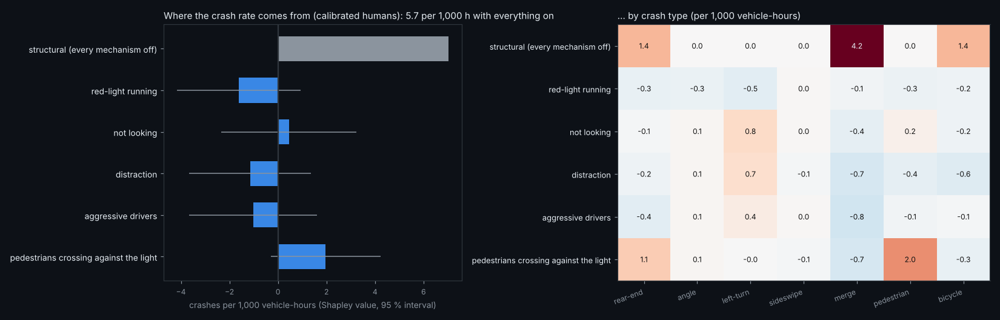
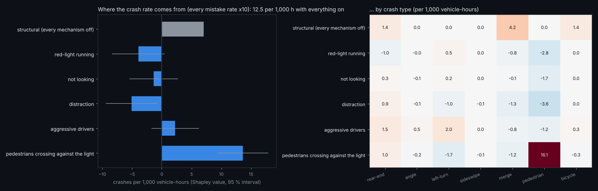
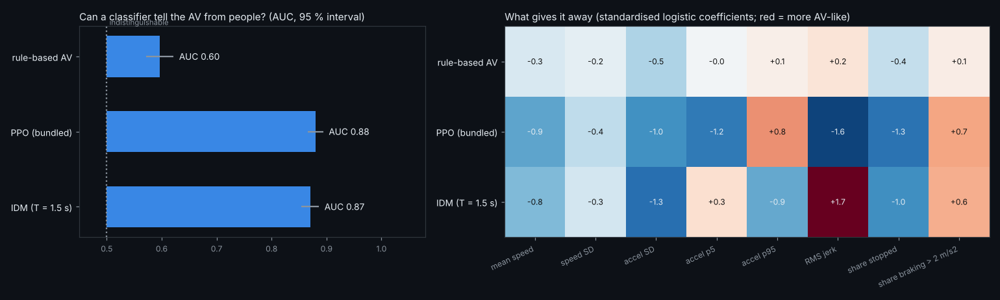
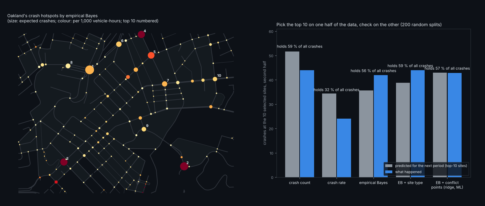
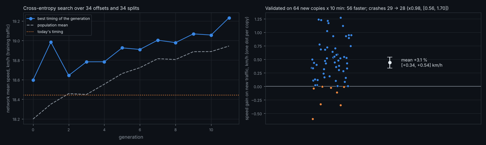

# Five ideas, built: crash attribution, a black box, an AV Turing test, hotspots, green waves

Five additions in `avlab/`, each a separate module that only *reads* the simulator (or runs it unchanged): nothing in `xnet/` was
touched, so nothing got slower. Each has a one-line command, a quick mode, a test in `tests/test_ideas.py`, and its result here,
including where it did not come out the way I expected.

| idea | command | time | the result in one line |
|---|---|---|---|
| 1. Crash attribution | `python -m avlab.attribution [--amplify 10]` | ~20-30 min each | calibrated world: no single mistake measurably moves the crash rate; with every mistake x10, pedestrians crossing against the light add +13.6 ± 3.9 per 1,000 h and nothing else does |
| 2. Black box | `av-world blackbox --area oakland [--av]` | ~1 min | finds a crash, writes the investigator's report (who, where, speeds, light, braking, human factors) and a zoomed GIF |
| 3. AV Turing test | `python -m avlab.turing` | ~2 min | from speed and acceleration alone, the bundled PPO policy is spotted with AUC 0.88, the rule-based AV with 0.60 |
| 4. Hotspots | `python -m avlab.hotspots` | ~6 min | empirical Bayes with site types picks a top 10 holding 62 % of next-period crashes (raw counts 60 %, rates 30 %); raw counts over-predict their top 10 by 17 % |
| 5. Green wave | `python -m avlab.greenwave` | ~25 min | +3.0 % network speed on new traffic [+0.28, +0.59 km/h], 27 of 32 copies faster; crashes 11 → 17, not significant but a warning |

---

## 1. Crash attribution: which human mistakes make the crashes?

> **Fix round** ([FIXES.md](FIXES.md#6-is-distractions-negative-shapley-value-real-or-an-exposure-effect)): the negative value for distraction below was a fluke. Its ~80 episodes took part in 3 crashes, not the 59 the value implies, and with robust (overdispersion-aware) errors and a Holm correction it is not significant. Only pedestrians crossing against the light survive.


The hypotheses page found that 30x the human mistakes gives only 1.6x the crashes (H1). This asks the follow-up: of the crash rate,
how much does each mistake mechanism cause, and how much is left when every one of them is switched off?

```
players  = [red-light running, not looking, distraction, aggressive drivers, pedestrians crossing against the light]
for every subset S of players (2^5 = 32 worlds):
    world(S) = calibrated humans, with the mechanisms in S on (x amplify) and the others set to 0
    v(S)     = crashes / vehicle-hours over 24 copies x 5 min of that world      # one vmapped run, every copy its own world
for each player i:                                                               # exact Shapley value, no sampling of orders
    phi_i = sum over S without i of |S|! (n-|S|-1)! / n! * (v(S + i) - v(S))
    var_i = sum over S of c_{i,S}^2 * k_S / t_S^2                                 # each v(S) an independent Poisson rate
check: sum_i phi_i == v(all) - v(none)                                           # efficiency (tested)
the same per crash type -> which mechanism feeds which kind of crash
```



**Calibrated world** (24 copies x 5 min per world, 768 copies, 23,000 vehicle-hours, 118 crashes): with everything on the rate is
5.7 per 1,000 vehicle-hours; with every mechanism off it is 7.0 (5 crashes, so an interval of roughly 2.3 to 16). No Shapley value is
distinguishable from zero: every 95 % interval includes 0. Switching off red-light running, not looking, distraction, aggressive drivers and
pedestrians crossing against the light changes nothing measurable. The crashes are *structural*: merges, rear-ends in queues,
cyclists. This confirms H1 from the other side.

**Every mistake x10** (`--amplify 10`, 369 crashes), to see which mechanism matters once they are frequent:



| mechanism (x10) | Shapley value, per 1,000 vehicle-hours | 95 % | mostly via |
|---|---|---|---|
| pedestrians crossing against the light | **+13.6** | ±3.9 | pedestrian crashes (+16.1) |
| aggressive drivers | +2.3 | ±3.9 | left-turn and rear-end |
| not looking | −1.4 | ±3.9 | |
| red-light running | −3.9 | ±3.9 | fewer pedestrian crashes |
| distraction | **−5.1** | ±3.8 | fewer pedestrian and merge crashes |

The positive one was expected. The negative one was not: in this simulator, amplified distraction *lowers* the crash rate. A
plausible mechanism is that distracted and red-running drivers clear crosswalks and merges at different moments from the
pedestrians and mergers they would otherwise meet. That is a hypothesis for the black box to check, not a finding. Shapley values
average over interactions, and a negative value is what an interaction looks like when it removes crashes another mechanism would
have caused.

## 2. Black box: the incident report, written automatically

> **Fix round:** a car that just crossed a junction now shows the light it came through (and its turn), not the light at the far end of its link; pedestrian crashes say whether WALK was shown when the pedestrian started.


```
run 8 copies in 20 s chunks; after each chunk compare the crash counters with the snapshot before it
on the first copy that crashed: rewind to the snapshot, replay that chunk + 8 s one step at a time, recording every state
k = first recorded step whose crash counter went up;  types = which counters moved
involved = slots whose wreck timer switched on at step k
for each involved vehicle, over the 5 s before impact:
    kind (car / bus / van / cyclist / AV), where (link or junction + turn), the light on its approach at that moment
    speed 3 s before and at impact, peak braking, when it first braked harder than 3 m/s^2
    human factors set at impact: ran the red, distracted, turns without looking, aggressive, brake pulse, AV blackout / phantom,
    broken down, slippery road
write report.md (summary + table), report.json, and a GIF zoomed 45 m around the crash from 8 s before to 5 s after
```


The report reads the flags the crash model itself uses, so "contributing" means "this flag was set on this vehicle at impact", not a
guess. Example (Oakland, everyday traffic, seed 0):

Oakland with the `red_light_runner` scenario, seed 2 (`results/blackbox/`, with the GIF):

> **Rear-end crash: a car (12 km/h) and a car (40 km/h), closing at 28 km/h. Contributing: entered on red.**
> 
> Time 108.2 s into the run; crash type: rear-end.
> 
> | | kind | where | light on approach | speed 3 s before | at impact | peak braking | braked hard | contributing |
> |---|---|---|---|---|---|---|---|---|
> | 1 | car | on link 500 (199 m long, 1 m along) | green | 1 km/h | 12 km/h | -0.6 m/s² | no | - |
> | 2 | car | inside junction 217, turning left | red | 36 km/h | 40 km/h | -7.4 m/s² | 2.8 s before | entered on red |

## 3. The AV Turing test

> **Fix round** ([FIXES.md](FIXES.md#9-driving-like-people-the-av-turing-test-attempted-twice)): re-weighting the reward made the PPO policy *more* recognisable; an adversarial human-likeness reward (`python -m avlab.humanlike`) brought its AUC to 0.875 against 0.911 for a no-bonus control and, unexpectedly, made it much safer (nominal 97.4 vs 17.2; fewer unaided crashes in 10 of 11 scenarios).


People predict each other. An AV that is safe but moves unlike anyone else is a surprise to the drivers around it, and AV fleets
report being rear-ended for exactly that. This measures how recognisable a driver is from its motion alone.

```
run 4 copies of Oakland for 6 min with 30 % AVs driven by the policy under test; keep per step: speed, applied accel, alive, AV, car
cut every slot's record into trips (a new trip when its start time changes); keep cars with >= 30 s of driving
features per trip: mean speed, speed SD, accel SD, accel p5, accel p95, RMS jerk, share stopped, share braking > 2 m/s^2
standardise; L2 logistic regression by Newton's method
AUC by 4-fold cross-validation with folds by copy (no trip is scored by a model that saw its own traffic), Mann-Whitney statistic
95 % interval: bootstrap over trips;  coefficients on all trips: what gives the AV away
```



| driver | AUC [95 %] | AV trips / human trips | what gives it away |
|---|---|---|---|
| rule-based AV | **0.60** [0.57, 0.62] | 706 / 1,642 | little: it is the simulator's own car-following driver, the same family of model the humans use |
| PPO (bundled) | 0.88 [0.87, 0.89] | 702 / 1,648 | it is *too smooth*: RMS jerk 1.9 m/s³ against the humans' 2.8, and it brakes harder than 2 m/s² 1.7x as often (2.7 % of the time vs 1.6 %) |
| IDM, T = 1.5 s | 0.87 [0.85, 0.89] | 703 / 1,660 | jerkier (3.7 m/s³) and slower (4.6 vs 5.4 m/s mean) |

The learned policy is safe on the benchmark and yet trivially recognisable: smooth, then sudden. That is a measurable, trainable
target (an imitation term on these eight statistics), and a metric the leaderboard does not have yet.

## 4. Hotspots: rank the dangerous junctions, and test the ranking

> **Fix round** ([FIXES.md](FIXES.md#8-hotspots-a-calibrated-empirical-bayes)): with conflict-point covariates, a ridge fit and maximum-likelihood dispersion, judged on 200 paired splits, empirical Bayes is calibrated (prediction bias +2.3 ± 2.9 % against +19.7 % for raw counts) but still does not pick a better top 10 than the counts. The numbers below are the first version's.


```
site(track) = the junction a track is in, or the junction at the end of the link it is on
one jitted scan over 128 copies x 20 min: per step, per site:
    crashes  += 1 if any vehicle's wreck timer switched on there        (segment_sum over the site of each slot, capped at 1)
    exposure += vehicle-seconds on the site's tracks
repeat 20 times: split the copies in random halves A and B
    on A: naive   = crash count;  rate = crashes / vehicle-hours
          SPF     log mu = a + b log(exposure) [+ signalised + log(1 + movements)]    Poisson regression across sites
          alpha   = sum((y - mu)^2 - mu) / sum(mu^2)                                    negative-binomial overdispersion
          EB      = w mu + (1 - w) y,  w = 1 / (1 + alpha mu)                          Hauer's empirical Bayes
    pick each method's top-10 sites; on B: the share of all crashes they hold, and predicted vs observed counts
```



150 crashes in 128 copies x 20 min, at 41 of Oakland's 313 junctions: risk is concentrated. The SPF with site types is
$\log\mu = -3.69 + 0.70\log E + 1.88\,\text{signalised} - 0.45\log(1 + \text{movements})$, with overdispersion
$\alpha = 1.39$. Mean over 20 random splits (SD in brackets):

| method | top-10 hold of next-period crashes | predicted for the top 10 | observed | rank correlation, all sites |
|---|---|---|---|---|
| crash count | 59.9 % (3.7) | 51.9 | 44.2: **over-predicts by 17 %** (regression to the mean) | 0.56 |
| crash rate | 30.3 % (5.4) | 34.3 | 22.4: picks quiet sites with one unlucky crash | 0.56 |
| empirical Bayes, exposure only | 56.2 % (6.5) | 35.8 | 41.5: under-predicts by 14 % | 0.42 |
| **empirical Bayes + site type** | **62.1 %** (4.9) | 38.5 | 45.8: under-predicts by 16 % | 0.43 |

Regression to the mean shows exactly as the textbook says: the raw-count top 10 always "improve" next period. Empirical Bayes
with site types finds the best top 10, but only by 2 points, within the split-to-split SD. It also *over*-corrects. In this city the
dangerous sites are structurally dangerous (a few merges and turns), so shrinking them toward the average for their traffic costs
more than it saves. In real crash data, with more random noise per site, the balance usually tips further toward EB. The tool
reports both, so the choice is visible.

## 5. Green wave: retime every light in the city

> **Fix round** ([FIXES.md](FIXES.md#7-a-green-wave-that-cannot-buy-speed-with-clearance)): with 64 validation copies the crash increase below disappears (29 → 28, ×0.98) and the speed gain holds (+3.1 %, 56 of 64 copies). An offsets-only search (no green changes length) gives +1.1 % with crashes 29 → 24.


```
parameters  = for each of Oakland's 34 signals: offset in [0, 70) s and split (first axis green) in [15, 50] s     -> 68 numbers
warm 4 copies of the city once under today's timing (demand x1.2); every candidate starts from these same states (common random numbers)
score(timing) = network mean speed over 4 min, all candidates x copies in ONE vmapped batch:
                the signal arrays (node_offset, node_g0) are batched, everything else in the network is shared
cross-entropy method: Gaussian per parameter, mean = today's timing, sd = cycle / 4 (offsets), 6 s (splits)
    12 generations: draw 24 timings (the current mean always included), score, refit to the best 6 with smoothing 0.7
validate on NEW traffic: 32 fresh seeds x 10 min, today's timing vs the best found, paired by seed
    speed gain with a paired 95 % interval and a Wilcoxon test; trips; crash rate ratio (exact) so a faster city is not a deadlier one
```



Search: the best timing per generation rose from 18.44 km/h (today) to 19.23 km/h (+4.3 %) on the training traffic.

Validation on 32 new copies (new seeds), paired: **+3.0 % network mean speed** (+0.44 km/h, 95 % interval [+0.28, +0.59]), 27 of
32 copies faster, Wilcoxon $p = 1.4\times10^{-5}$, and +1.9 % trips completed. The gain shrank from 4.3 % to 3.0 % on new traffic,
the expected optimism of a search scored on one set of seeds, and it survived.

Crashes went from 11 to 17: a rate ratio of 1.57 with an exact 95 % interval of [0.69, 3.70]. That is not significant, but it is not
nothing either. Faster arrivals at junctions can mean harder conflicts. Before using a timing like this, rerun the validation with
`--revalidate` and more copies; the next step is to score on speed *and* crashes. The optimiser does not know crashes exist, which
is exactly why the validation counts them.

---

### What was not changed

`xnet/` (the simulator), `avrl/`, the benchmark and every existing result are untouched. The modules use only public pieces:
`X.step`, `X.reset`, `X.Sim`, the State fields, `examples/_common.run_copies`, and (green wave) a batched copy of two arrays of the
network dict. The tests run in ~1 min.
