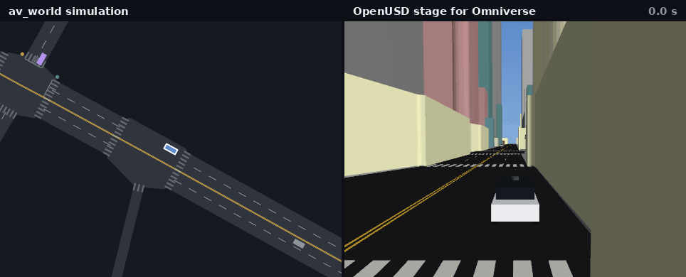
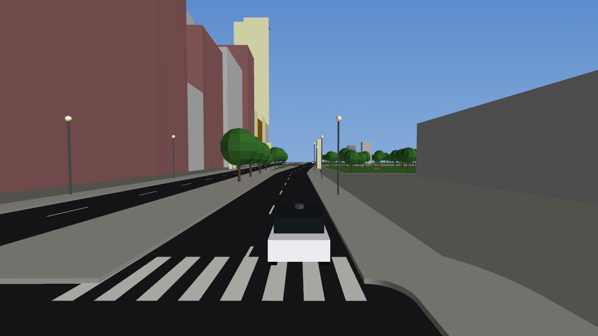
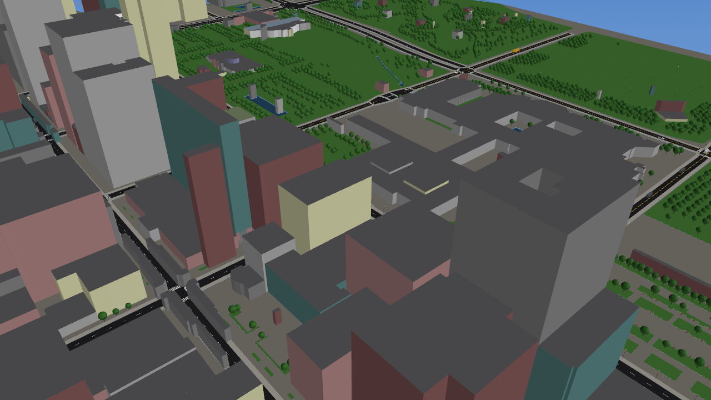
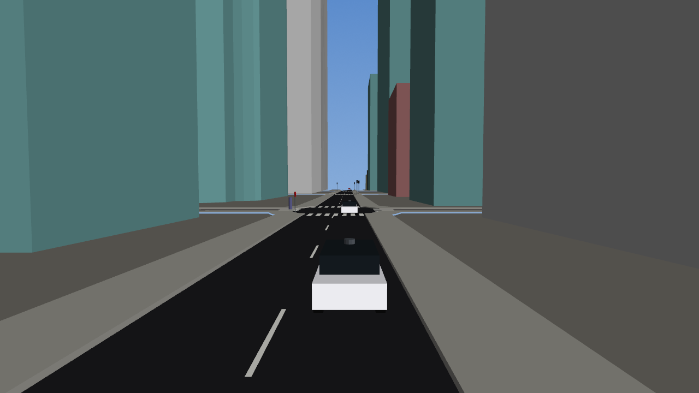
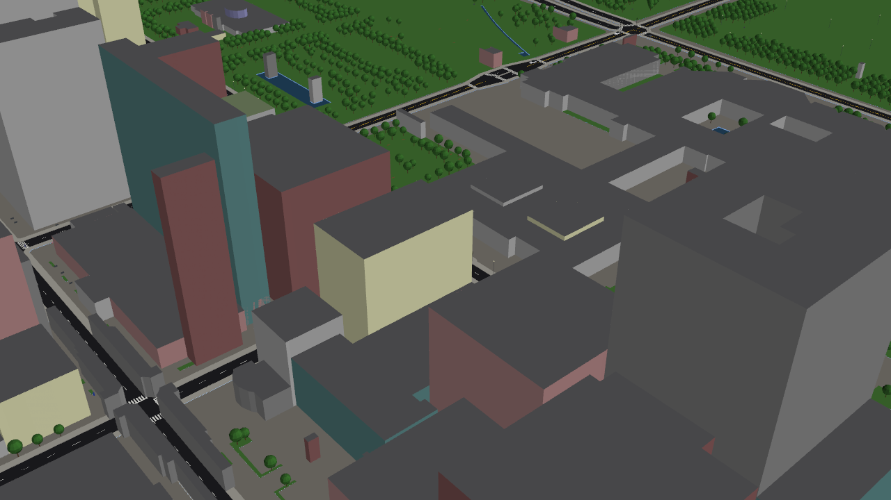

# Handing scenes to NVIDIA's simulation stack (Omniverse, NuRec, Cosmos)

`xnet/nvidia.py`, `av-world export-nvidia`. The NVIDIA DRIVE simulation stack takes scenes in two forms this repository can now produce:

* **OpenUSD**, the scene description format of NVIDIA Omniverse;
* **structured control inputs for driving world models** in the style of Cosmos: a camera-view rendering of the HD map and the other agents'
  3-D boxes, frame by frame, which a world model turns into photoreal video, novel viewpoints or variations.

What av_world contributes is the part those tools are hungriest for: **long-tail trajectories**. The simulator makes the rare situations
(dart-outs from behind buses, red-light runners, sensor blackouts, tight cut-ins, the famous-incident scenarios, the counterfactuals of real
Argoverse 2 scenes), and this exporter turns any of them into a USD stage and a control video.

```bash
av-world export-nvidia out --area chicago --scenario bus_dartout --seconds 20     # a simulated long-tail scene in the Chicago Loop
av-world export-nvidia out --av2 data/av2/<scenario_id>                           # a real Argoverse 2 log, through the same exporter
av-world export-nvidia out --area chicago --fetch                                 # + the city in 3-D from open map data (downloads it once)
```
```
out/scene.usda          the city (roads, sidewalks, markings, buildings, trees, furniture) and every agent as an animated prim
out/preview_*.png       street-level and aerial renders of the stage (when pyvista can render offscreen)
out/compare.gif         the av_world view and the 3-D stage side by side, following an AV (automatic; --no-clip to skip)
out/scene.json          the trajectories (xnet.carla_export format; also replayable in CARLA)
out/control/            frame_XXXX.png, control.mp4, camera.json (intrinsics, per-frame camera pose)
out/meta.json           source, area, scenario and its knobs, the events in the run (crash types, tail tags), the ego
```


*The ego's front camera in the Chicago Loop as it moves off from a junction (dart-out scenario): lane boundaries in white, crosswalks in
yellow, other agents as 3-D boxes coloured by class (blue cars, green AVs, yellow buses, white vans, pink cyclists, red pedestrians).*

## A real city around the roads, not a test track

The first version of the stage was lane strips and boxes: it looked like a test track. `xnet/scene3d.py` now fuses open map data with the
simulator's road network into a 3-D city, so the same long-tail scene plays out between the buildings, trees and street furniture that are
really there.



*Midtown Manhattan, one simulated AV (white, roof lidar; blue with a white outline on the left) for 8 s. Left: the av_world view of
the scene. Right: the exported OpenUSD stage from a chase camera. Same frames, same signal states (the lights turn on both sides at once),
same vehicles.*

**Every export makes this clip automatically.** `export-nvidia` writes `out/compare.gif` next to the stage. It follows the ego if the ego
crashed (the long-tail moment is the point). Otherwise it picks the AV and 8 s window that make the most watchable clip: most distance
covered, with traffic around. It needs pyvista with an offscreen OpenGL; without one, the clip is skipped and `meta.json` says so.
`--no-clip` turns it off. From Python, `nvidia.compare_clip(net, geo, info, scene, world, ego_id, "clip.gif")` renders any scene.

The clip renders in about 15 s. The static city is loaded into the renderer once, and only the agents and the signal lights are redrawn per
frame (`scene3d.Renderer`). Without Overture layers for an area (or for an Argoverse 2 log, which has no geographic frame), the world is
still built from the simulator's own network: road surface, sidewalks, markings, signals and stop signs, just no buildings or trees.



*Chicago Loop, from behind the AV (white, roof lidar) about to cross a zebra crossing. The buildings are Overture footprints extruded to their
mapped heights, the trees and lamps are mapped ones; Grant Park is on the right.*





*Midtown Manhattan: 2,880 of 2,939 buildings in the box carry a mapped height, so the canyon is real.*

| layer | from | how |
|---|---|---|
| buildings | Overture `buildings` (largely OpenStreetMap, plus Microsoft/Google footprints) | footprint extruded from `min_height` to `height`, else floors x 3.4 m, else 10 m; mapped facade and roof colours where present; trimmed where a footprint overlaps the carriageway |
| road surface | the simulator's own network | one asphalt surface including junction boxes, so the cars drive exactly on what is drawn |
| sidewalks, curbs | derived | a 3 m band, 15 cm high, around the carriageway, with curb faces |
| markings | the simulator's network | dashed lane dividers, double yellow on two-way streets, stop lines, zebra crosswalks where the simulator has pedestrian crossings |
| ground | Overture `base` land use and water | parks and grass green, water (the Chicago River, the Charles) sunk 0.4 m, the rest concrete |
| furniture | Overture `base` land and infrastructure | mapped trees, street lamps, benches, hydrants, bollards, bins, bike racks, post boxes as instanced prototypes |
| signals, stop signs | the simulator | a signal pole and head at every approach the simulator signalises, a sign wherever it puts a stop, so what you see is what the simulated drivers obey |
| vehicles | proxy geometry | body, cabin or glasshouse and four wheels per class; AVs carry a roof lidar; pedestrians are capsules |

| city (bundled box) | buildings | with mapped height | trees | lamps | signal heads | triangles | build |
|---|---|---|---|---|---|---|---|
| Chicago Loop | 1,030 | 632 | 4,778 | 567 | 357 | 153k | 2.3 s |
| Midtown Manhattan | 2,939 | 2,880 | 846 | 150 | 164 | 196k | 2.8 s |
| Boston Back Bay | 3,130 | 3,026 | 1,989 | 859 | 223 | 203k | 7.2 s |

```bash
python -m xnet.scene3d fetch chicago new_york boston       # Overture's public S3 bucket, no account, ~1-2 min per city -> data/scene3d/
```
Any named area works, and so does an OpenStreetMap import (its bounding box and origin come from `info`). Without the data the export falls
back to the plain road meshes and says so in `meta.json`.



*An independent check: the same frame rendered by reading `scene.usda` back with OpenUSD's own library (`scene3d.render_usd`), not from
memory. It matches the preview, so what is in the file is what is shown. A Chicago stage is 14 MB as `.usda` text, 5 MB as `.usdc`, and
opens in 0.2 s.*

**Why not Google's photoreal 3-D tiles?** They would look better, but they need an API key and their terms restrict use to
Google-approved display, not export into another simulator's scene. Overture is open (ODbL / CDLA), so the stage can be shared and trained on.


## The USD stage

```
/World                     Xform, customData: generator, source, area, scenario, ego ...
  /Looks/<material>        UsdPreviewSurface materials (asphalt, sidewalk, paint, facade colours, glass, foliage ...)
  /Environment/<layer>     Mesh per layer: road_surface, sidewalks, curbs, markings, grass, water, ground, facade_*, roof*   (with a world)
  /Furniture/<kind>        PointInstancer of a prototype (tree, street_lamp, bench, traffic_signal, stop_sign ...)          (with a world)
  /Roads/lanes             Mesh: a quad strip for every lane of every link and every path through a junction (z = 0)
  /Roads/lane_boundaries   BasisCurves (linear): both edges of every lane
  /Roads/crosswalks        Mesh
  /Agents/<class>_<id>     Xform: xformOp:translate and xformOp:rotateZ time samples, visibility time samples (invisible outside its life)
                           customData: agent_class (car | av | bus | van | bike | ped), is_av, crashed
      /box                 Cube scaled to length x width x height, displayColor by class (without a world)
      /body, /cabin, /wheel_*, /lidar   proxy parts on the ground plane (with a world)
stage: metersPerUnit = 1, upAxis = Z, timeCodesPerSecond = 1 / dt (5 for simulator scenes), one time code per frame
```

## The control video

A pinhole camera 1.6 m above the road, 1.5 m ahead of the ego's centre, looking along its heading, 90 degree horizontal field of view, 640 x
360. Lines are clipped at a 0.5 m near plane and culled beyond 80 m. `camera.json` holds the intrinsic matrix and every frame's camera pose in
the scene frame, so the frames can be registered with the USD stage or a reconstruction.

## How it fits a synthetic-data pipeline

```
simulate or search for the rare event          avlab.famous, avlab.tail_qd (MAP-Elites), avlab.tail_novelty, avlab.tail_counterfactual
        |
export: USD stage + control video + meta        xnet.nvidia.export
        |
render / generate                               Omniverse sensor simulation on the USD stage, or a world model conditioned on the control video
        |
train and test perception and planning on the rare cases, with labels from meta.json and the trajectories
```

## What was checked, and what was not

* **Checked:** the USD stage opens in OpenUSD's own library (`pip install usd-core`; `tests/test_nvidia.py` reads back the up axis, frame rate,
  agent positions at a given time code and the road mesh); the camera projection and clipping are unit-tested; the export runs on simulator
  scenes and on real Argoverse 2 scenes.
* **Not checked:** loading in Omniverse, NuRec or Cosmos. None was available in this environment, so compatibility rests on following
  the public OpenUSD schema and on the documented idea of map-and-box conditioning, not on a run of NVIDIA's tools. The control video's exact
  colours, camera rig and resolution will need matching to whichever model is used; they are parameters (`nvidia.Camera`, `COLOR`).
* **Real layout, not photoreal.** The city is the mapped one (footprints, heights, trees, lamps, signals), but it is untextured: flat
  facades with no windows, one tree and one lamp model, flat roofs, no terrain (the ground is a plane), no parked cars. Missing heights fall
  back to floors x 3.4 m or 10 m (39% of Chicago's buildings in the box have no mapped height). The photoreal pass is still for the NVIDIA
  side (Omniverse materials, or a world model conditioned on this), and the stage gives it the right geometry to start from.
  `tests/test_scene3d.py` checks the fusion on synthetic layers (heights, the tree on the road dropped, the stage opening in OpenUSD).
* A 20 s Chicago scene without the city is a 3.5 MB `.usda` (text), with it 14 MB; convert to binary `.usdc` with `usdcat` if size matters.
