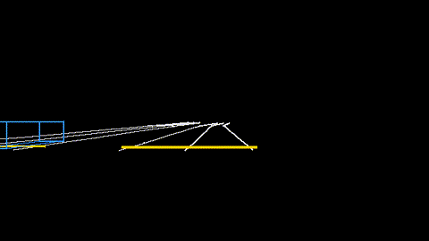

# Handing scenes to NVIDIA's simulation stack (Omniverse, NuRec, Cosmos)

`xnet/nvidia.py`, `av-world export-nvidia`. The NVIDIA DRIVE simulation stack takes scenes in two forms this repository can now produce:

* **OpenUSD**, the scene description format of NVIDIA Omniverse;
* **structured control inputs for driving world models** in the style of Cosmos: a camera-view rendering of the HD map and the other agents'
  3-D boxes, frame by frame, which a world model turns into photoreal video, novel viewpoints or variations.

What av_world contributes is the part those tools are hungriest for: **long-tail trajectories**. The simulator makes the rare situations
(dart-outs from behind buses, red-light runners, sensor blackouts, tight cut-ins, the famous-incident scenarios, the counterfactuals of real
Argoverse 2 scenes), and this exporter turns any of them into a USD stage and a control video.

```bash
av-world export-nvidia out --area chicago --scenario bus_dartout --seconds 20     # a simulated long-tail scene in the Chicago Loop
av-world export-nvidia out --av2 data/av2/<scenario_id>                           # a real Argoverse 2 log, through the same exporter
```
```
out/scene.usda          roads (lane meshes, lane-boundary curves, crosswalks) and every agent as an animated prim
out/scene.json          the trajectories (xnet.carla_export format; also replayable in CARLA)
out/control/            frame_XXXX.png, control.mp4, camera.json (intrinsics, per-frame camera pose)
out/meta.json           source, area, scenario and its knobs, the events in the run (crash types, tail tags), the ego
```



*The ego's front camera in the Chicago Loop as it moves off from a junction (dart-out scenario): lane boundaries in white, crosswalks in
yellow, other agents as 3-D boxes coloured by class (blue cars, green AVs, yellow buses, white vans, pink cyclists, red pedestrians).*

## The USD stage

```
/World                     Xform, customData: generator, source, area, scenario, ego ...
  /Roads/lanes             Mesh: a quad strip for every lane of every link and every path through a junction (z = 0)
  /Roads/lane_boundaries   BasisCurves (linear): both edges of every lane
  /Roads/crosswalks        Mesh
  /Agents/<class>_<id>     Xform: xformOp:translate and xformOp:rotateZ time samples, visibility time samples (invisible outside its life)
                           customData: agent_class (car | av | bus | van | bike | ped), is_av, crashed
      /box                 Cube scaled to length x width x height, displayColor by class
stage: metersPerUnit = 1, upAxis = Z, timeCodesPerSecond = 1 / dt (5 for simulator scenes), one time code per frame
```

## The control video

A pinhole camera 1.6 m above the road, 1.5 m ahead of the ego's centre, looking along its heading, 90 degree horizontal field of view, 640 x
360. Lines are clipped at a 0.5 m near plane and culled beyond 80 m. `camera.json` holds the intrinsic matrix and every frame's camera pose in
the scene frame, so the frames can be registered with the USD stage or a reconstruction.

## How it fits a synthetic-data pipeline

```
simulate or search for the rare event          avlab.famous, avlab.tail_qd (MAP-Elites), avlab.tail_novelty, avlab.tail_counterfactual
        |
export: USD stage + control video + meta        xnet.nvidia.export
        |
render / generate                               Omniverse sensor simulation on the USD stage, or a world model conditioned on the control video
        |
train and test perception and planning on the rare cases, with labels from meta.json and the trajectories
```

## What was checked, and what was not

* **Checked:** the USD stage opens in OpenUSD's own library (`pip install usd-core`; `tests/test_nvidia.py` reads back the up axis, frame rate,
  agent positions at a given time code and the road mesh); the camera projection and clipping are unit-tested; the export runs on simulator
  scenes and on real Argoverse 2 scenes.
* **Not checked:** loading in Omniverse, NuRec or Cosmos. None was available in this environment, so compatibility rests on following
  the public OpenUSD schema and on the documented idea of map-and-box conditioning, not on a run of NVIDIA's tools. The control video's exact
  colours, camera rig and resolution will need matching to whichever model is used; they are parameters (`nvidia.Camera`, `COLOR`).
* **No photoreal assets, no sensor models, no neural reconstruction.** The stage has boxes and flat road meshes; the realism has to come from
  the NVIDIA side. What this adds is behaviour: who does what, when, including the rare things.
* A 20 s Chicago scene is a 3.5 MB `.usda` (text); convert to binary `.usdc` with `usdcat` if size matters.
