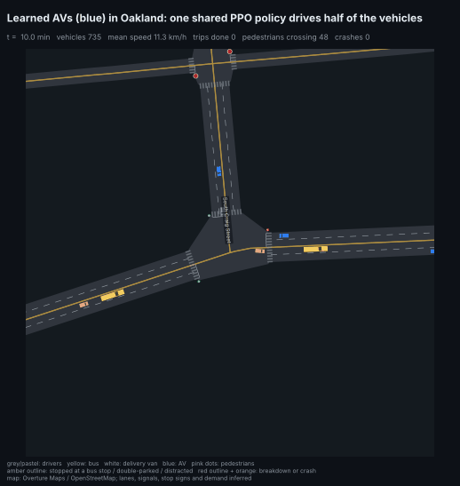
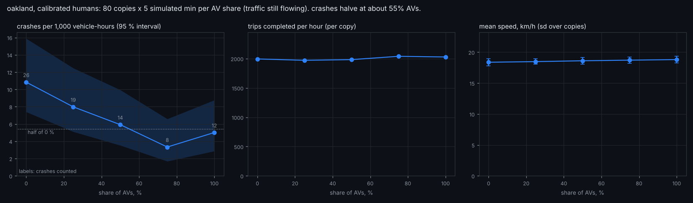
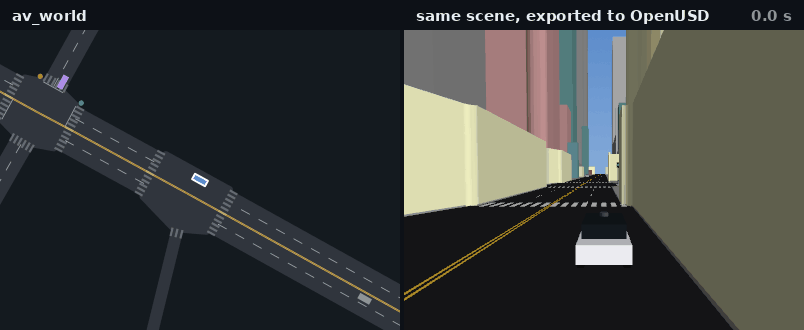

# av_world

**A city-scale driving world in pure JAX, calibrated to real crash statistics, with the research stack built on it and an unusually
honest account of what it can and cannot do.**

[**Website**](https://haggler3.github.io/av_world/) · [**Start here: notebook**](notebooks/01_start_here.ipynb) · [**Notebooks**](https://haggler3.github.io/av_world/notebooks.html) · [**3-D scenes**](https://haggler3.github.io/av_world/scenes.html) · [**Browser viewer**](https://haggler3.github.io/av_world/viewer/index.html) · [What you can test](docs/TESTING.md) · [Docs index](#guides)



**AVBench leaderboard**: 18 scenarios (11 core + 7 long-tail incidents) x 8 checks with fixed bars the rule-based AV can fail
([full leaderboard](results/bench/leaderboard.md), [what the numbers mean](docs/METRICS.md)):

| policy | checks passed (of 144) | av_world score: core | long-tail |
|---|---|---|---|
| PPO + barrier teacher, then no filter (phase 2) | **123** | 50.3 | 30.5 |
| PPO + barrier teacher, speed + jaywalkers (phase 3) | 120 | 56.8 | **40.9** |
| PPO + barrier teacher (phase 1) | 115 | 42.9 | 22.1 |
| rule-based AV | 104 | **77.2** | 39.0 |
| PPO, full world, 10x envelope penalty | 104 | 49.2 | 25.9 |
| PPO, 234k steps (no barrier teacher) | 76 | 6.1 | 5.4 |

*Caveat ([FIXES.md](docs/FIXES.md#14-the-leaderboard-does-not-reproduce-across-hardware)): these were computed on a GPU; on a CPU single-scenario scores move by up to ±75 points and core means by up to ~8, so read only the means and the ranking.* The learned policies pass more checks, but the rule-based AV keeps the best core score: unaided, they crash 1.3-1.6x as often.
Retraining one recipe moves scores by up to 10 points.

**Latent world-model planners**, on the 3 junction-heavy scenarios they were benchmarked on (nominal, red runners, inattentive):

| driver | checks passed (of 24) | av_world score | crashes /AV-h, no filter | red runs /100 km |
|---|---|---|---|---|
| PPO + barrier teacher, then no filter (phase 2) | **23** | 77.9 | 0.033 | 0 |
| rule-based AV | 18 | **78.2** | **0.008** | 0 |
| PPO + barrier teacher, speed + jaywalkers (phase 3) | 22 | 63.8 | 0.025 | 0 |
| latent planner v2 (ensemble model, phase 3 as prior) | 17 | 46.0 | 0.039 | 0 |
| latent planner v1 (234k-step PPO as prior) | 8 | 0.8 | 0.471 | 4.5-5.4 |

v2 fixed v1's red-light runs but does not beat the policy it plans around. Training the policy inside the model (v3) did not
either. Forked at the policy's own crash moments, the converged plan averts 18 % of them, against 75 % for simply braking
harder ([GIFs, the test and why](wmplan/README.md)).

## Install

```bash
pip install -e .                 # the simulator, PPO, AVBench, figures (jax, numpy, scipy, matplotlib, shapely, pyarrow, optax)
pip install -e ".[all]"          # everything below; or pick: dev, easy, torch, perception, notebooks, usd, web
av-world doctor --smoke          # checks every package against its minimum version, then runs a 15 s end-to-end simulation
av-world doctor --fix            # installs what is missing or too old (add --extras easy,torch to include optional groups)
```

If `pip` and `python` are different interpreters (the doctor warns and names the right one), install and run with the same one:
`python3 -m pip install -e ".[dev]"` then `python3 -m pytest`, `python3 -m avlab.<tool>`.

| extra | adds | needed for |
|---|---|---|
| `dev` | pytest | the tests |
| `easy` | pandas, gymnasium, pettingzoo | `av_world.easy` tables, Gymnasium and PettingZoo environments |
| `torch` | torch, onnx, stable-baselines3 | PyTorch / ONNX export, Stable-Baselines3 |
| `perception` | pyvista, vtk | `av-world export-perception`, 3-D previews (renders on a CPU) |
| `notebooks` | jupyterlab, nbformat, nbclient, ipykernel | the notebooks |
| `usd` | usd-core | OpenUSD export |
| `web` | playwright | screenshots of the website |

The versions the tests were last run with are in `requirements-lock.txt` (Python 3.13); `pyproject.toml` has conservative minimums,
not each one tested. GPU: `pip install "jax[cuda12]"`.

## Try it in five minutes

**Easy mode** ([docs/EASY.md](docs/EASY.md)): the common jobs in one line each (new: a crash log, a TEB planner and Lean proofs, [in plain words](docs/EASY.md#new-tools-in-plain-words-november-2026)), plus bridges to Gymnasium, PettingZoo,
Stable-Baselines3, PyTorch, ONNX and pandas.

```python
from av_world import easy, compat
run = easy.simulate("oakland", minutes=5, av_share=0.3); run.summary(); run.show()

@easy.driver                                     # your own driver, in metres, seconds and m/s^2
def two_second_rule(car):
    jnp = easy.jnp
    follow = jnp.where(car.has_lead & (car.lead_gap < 2 * car.speed + 4), -2 * car.brake_needed_for_lead - 1, 3.0)
    stop = jnp.where(car.has_stop & (car.stop_gap < 2 * car.speed + 8), -2 * car.brake_needed_for_stop - 1, 3.0)
    return jnp.minimum(jnp.minimum(follow, stop), jnp.where(car.speed < car.desired_speed, 1.2, -0.5))

easy.compare({"mine": two_second_rule, "IDM": easy.drivers.idm()})   # scored on AVBench next to the leaderboard
policy = easy.train(updates=25)                  # PPO;  env = compat.GymEnv("oakland") for SB3 / CleanRL
```

```bash
av-world watch oakland                      # the city driving live in your terminal
av-world blackbox --area oakland            # find a crash, write the incident report and a zoomed GIF
python examples/av_share_sweep.py           # how many AVs until crashes halve? (~7 min)
python examples/gridlock.py                 # the fundamental diagram of a whole city (~6 min)
python examples/my_policy.py                # your own driver in 15 lines, scored on AVBench
```
Results and figures: [examples/](examples/README.md).

**Notebooks** ([notebooks/](notebooks/README.md), committed executed, a few minutes each on a CPU or in Colab):

| | notebook | what you do | |
|---|---|---|---|
| 01 | [Start here](notebooks/01_start_here.ipynb) | a five-minute tour of the whole repository | [Colab](https://colab.research.google.com/github/haggler3/av_world/blob/main/notebooks/01_start_here.ipynb) |
| 02 | [The RL environment](notebooks/02_rl_environment.ipynb) | observations, actions, rewards, custom reward weights | [Colab](https://colab.research.google.com/github/haggler3/av_world/blob/main/notebooks/02_rl_environment.ipynb) |
| 03 | [Training with PPO](notebooks/03_ppo_training.ipynb) | train, plot the curves, fine-tune with your reward, score on AVBench | [Colab](https://colab.research.google.com/github/haggler3/av_world/blob/main/notebooks/03_ppo_training.ipynb) |
| 04 | [Perception export](notebooks/04_perception_export.ipynb) | cameras, 3-D boxes and sensor detections for any scenario | [Colab](https://colab.research.google.com/github/haggler3/av_world/blob/main/notebooks/04_perception_export.ipynb) |
| 05 | [AVBench and metrics](notebooks/05_avbench_and_metrics.ipynb) | the leaderboard, the checks, tuning a driver against them | [Colab](https://colab.research.google.com/github/haggler3/av_world/blob/main/notebooks/05_avbench_and_metrics.ipynb) |
| 06 | [Easy mode](notebooks/06_easy_mode.ipynb) | `av_world.easy` and `compat`: simulate, drivers, compare, train, Gymnasium + SB3, PyTorch, ONNX | [Colab](https://colab.research.google.com/github/haggler3/av_world/blob/main/notebooks/06_easy_mode.ipynb) |



## What it is

* **`xnet`**, an area simulator built from open map data (Pittsburgh's Oakland, Squirrel Hill and Downtown, Midtown Manhattan, the Chicago Loop, central Boston, any OpenStreetMap city, Argoverse 2 / Waymo maps):
  car following, lane changes, zipper merges, right of way at every conflict point, signals, pedestrians, cyclists, buses, breakdowns, road
  friction, seven crash types, a control-barrier-function safety filter. About 395 simulated seconds per second for 8 copies of a ~380-vehicle area
  on 4 CPU cores, and it shards across devices.
* **Human drivers calibrated to published crash data by crash type** (`xworld`, `pgh`): a world with the mistakes real people make.
* **A research stack on top**: multi-agent PPO (`avrl`), AVBench, latent world models and a planner (`dwm`, `wmplan`), a stress lab (`avlab`).
* **Software and hardware in the loop**: drive any AV from your own controller over TCP, in lockstep (60x real time) or at wall-clock pace with
  deadlines and fallbacks ([SIL_HIL.md](docs/SIL_HIL.md)).
* **NVIDIA-ready export**: any simulated long-tail scene or real Argoverse 2 log as an OpenUSD stage (Omniverse) and a camera-view
  map-and-box control video of the kind driving world models such as Cosmos are conditioned on, set in the real city: buildings at their
  mapped heights, trees, lamps and signals fused from open map data (Overture / OpenStreetMap) ([NVIDIA.md](docs/NVIDIA.md)).
  Every export also renders this side-by-side clip, and `--find-crash` hunts down an AV crash to film
  ([more scenes](https://haggler3.github.io/av_world/scenes.html)):

  
* **Long-tail tooling**: sensor faults, aimed human mistakes, dart-outs, famous-incident scenarios, a real-log importer, CARLA export, and
  five methods for teasing novel long-tail data out of the simulator ([report](docs/LONG_TAIL_METHODS.md)).

```bash
pip install .                       # data and a trained starting policy are bundled
av-world info && av-world bench     # simulated seconds per wall-clock second on this machine
```
```python
import av_world
env = av_world.make("oakland", n_envs=8)           # or an OpenStreetMap file, or "city.npz"
state = env.reset(seed=0, warm_s=60)
state, traj = env.rollout(state, policy=None, steps=200)     # None: the rule-based AV
print(env.metrics(state)["av_crash"])
```

## What we found, including what did not work

**Eleven plausible claims, tested to fail** ([docs/HYPOTHESES.md](docs/HYPOTHESES.md)): 30x the human mistakes gives only 1.6x the crashes
(elasticity 0.16), denser traffic is *less* dangerous per vehicle-hour but not per km, one RL training run does not reproduce
(per-scenario SD 36 points), and how often the safety filter steps in predicts unaided risk (rho = 0.86). Each claim is ranked by
impact over the effort of a follow-up.

| question | answer | where |
|---|---|---|
| Can a policy drive with no safety filter if the barrier function teaches it? | Yes, mostly: unaided AV crashes fell 15-23x (0.64 to 0.03-0.04 per AV-hour). On AVBench's fixed bars (18 scenarios, 7 of them long-tail incidents) the best passes 123 of 144 checks against the rule-based AV's 104, but the rule-based AV keeps the best core score (77.2 vs 56.8): unaided, the learned policies still crash 1.3-1.6x as often. | [Metrics](docs/METRICS.md#results), [Experiments](docs/EXPERIMENTS.md#training-the-driver-to-need-no-filter-avrlunaidedpy) |
| Is one training run enough to rank policies? | **No.** Retraining the barrier-teacher phases with the same recipe moved them by up to 10 av_world points and 8-15 of 144 checks, about the size of most gaps between policies. | [Metrics](docs/METRICS.md#results) |
| Does planning in a latent world model beat the policy it starts from? | Partly: 0.47 unaided crashes per AV-hour against 0.64 for its PPO prior, but 15-60x the barrier-taught policies. Its model ranks crashes well (AUROC 0.96) but predicts the stop-line gap worse than holding it constant. | [Metrics](docs/METRICS.md#results) |
| Does a more varied world teach better? | Mutating cities did: 8 of 8 (seed, world) pairs had fewer crashes, 17-63 % fewer. Fork-at-danger and world-model crash shaping did not help. | [Experiments](docs/EXPERIMENTS.md) |
| Does a GPU-style trainer help? | Packing the learner's rows and sharding copies: PPO ~5x faster on CPU. On one NVIDIA L4: a PPO phase 2x faster than on CPU (95 s vs 195 s), a latent-planner benchmark run about 5x (under 2 min vs ~10). | [Speed](docs/SPEED.md) |
| Does the leaderboard drift because of rounding? | **Probably not.** Nudging every car by 1 mm/s changes no AVBench score (0.01 points on average) and no twin city drifts in 10 minutes; a different random stream moves the rule-based AV's score by 15 points on average. Per-scenario scores are samples, not constants. | [Daily log](docs/DAILY.md) |
| Does crash rate follow a power of speed? | **Yes, steeply (and a higher limit buys little).** Scaling every Oakland limit: crash rate ~ limit^4.5 (95 % interval 3.4-5.7); +30 % limit gives +4 % mean speed and 4.2x the crashes, mostly pedestrian crashes. One kicked car can re-route a city: in the one twin that diverged, 54 s doubling time, first spread through a junction rather than a queue. | [Daily log](docs/DAILY.md) |
| Where is the friction cliff? | **Not a cliff: a bend near 0.7 (see the pooled row below).** Earlier reading: Crash rate ~ friction^-3 (SE 0.19), flat from dry to 0.6 (8.8 to 13.8 per 1000 vehicle-h) then 3.5x at 0.45 and 13x at 0.3 vs 0.6; a half-AV city's dry-road advantage (rate ratio 0.55) is not significant and disappears at 0.6 and below. A 4-scenario subset of AVBench predicts the board's mean to ~5 points, but selection on 15 drivers overfits. | [Daily log](docs/DAILY.md) |
| What is behind the friction cliff? | **Not rear-end crashes, and not a clean step.** On a finer grid (0.7 to 0.4) rear-end crashes are 6 % of crashes at friction <= 0.5; merge, pedestrian and (from 0.5) bicycle crashes grow, and the rate climbs steadily (8.6 to 71 per 1000 vehicle-h) with no significant hinge. A half-AV city has a steeper speed-limit slope (7.1 vs 4.4) but not significantly. | [Daily log](docs/DAILY.md) |
| Do AVs strike fewer road users than humans on the same roads? | **On slick roads yes, at high speed no.** In a half-AV Oakland, AV pedestrian+bicycle strikes per vehicle-hour are 0.33x the humans' at friction 0.4 (28 of 139, interval 0.21-0.50) but 0.91x at a x1.3 speed limit (0.53-1.56); 0.32x at friction 1.0 on only 10 events. Pooling both friction runs (152 copies): flat from 1.0 to 0.7, then ~friction^-3.5; a bend near 0.7, not a cliff (hinge p 0.003 in sample; confirmed out of sample on 2026-11-11, see the next row). | [Daily log](docs/DAILY.md) |
| Is the friction knee real? | **Yes, it replicates.** A pre-registered test on a fresh random stream (180 new copies, hinge fixed at 0.7 before the run): flat from friction 1.0 to 0.7, then an extra slope of 3.4 (SE 1.3, one-sided p 0.004, Holm 0.012), the same size as in the old runs. The old pooled hinge also survives a bootstrap correction for having searched six positions (p 0.010). The speed-limit curve has no knee (p 0.54): a plain power law, limit^4.5. | [Daily log](docs/DAILY.md) |
| Why a knee at 0.7? | **Not where braking starts to hit the road's limit.** Braking at the friction cap is rare (0.15 % of moving car-steps when dry) and grows smoothly as mu^-2.1, with no bend at 0.7. But half the human cars in crashes (55 of 110) braked at the cap in the second before, against ~1 % of moving cars. | [Daily log](docs/DAILY.md) |
| Is the knee the stop-line rule? Can a fleet read the road's friction? | **No; yes.** On a fresh stream (96 copies), cars that are told to stop but cannot (friction-caused overruns) rise smoothly, 4 to 90 per 100,000 moving car-steps from 0.85 to 0.4, with no bend at 0.7, and only 1 of 132 crash-involved cars at friction <= 0.6 was in one within 2 s, against 77 of 132 braking at the cap. The blind-commitment rule is off above 0.44 by construction. Read from braking alone, the road's friction is within 0.05 after 10 s of one city (exact braking) or 20 s with 0.3 m/s^2 sensor noise, in every copy at every friction. | [Daily log](docs/DAILY.md) |
| Does an AV that knows the road's friction crash less? Does the knee hold on every stream? | **Not shown; yes, pooled.** An IDM AV whose headway grows as 1/friction had 31 % fewer AV-involved crashes at friction 0.4 in a half-AV Oakland (rate ratio 0.69, 95 % 0.33-1.41, Holm p 0.96) for 9 % less speed; also cutting speed by sqrt(friction) did no better (0.78) and cost 26 % of speed. Most AV crashes on ice were merges (13 of 21), which a longer headway does not reach. (A 2026-11-09 run, now merged into `main`, found the opposite for speed with the rule-based AV, 0.12x; see the log.) Pooling three random streams (428 copies), the knee at 0.7 holds (extra slope 2.9, 95 % 1.7-4.1) and the streams do not differ significantly (p 0.49), but the newest stream alone is weak (p 0.12). | [Daily log](docs/DAILY.md) |
| Does gap caution fix the AV's merges on ice? Is the knee on a fourth stream? | **Mostly; pooled yes, located no.** At friction 0.4 in a half-AV Oakland (40 copies per cell), asking the AV to accept only longer gaps cut its merge crashes 22 -> 6 (rate ratio 0.27, 95 % 0.09-0.69) and all its crashes to 0.54x (0.30-0.95, p 0.024, Holm 0.097: short of the pre-registered bar) for 3 % of speed; a longer headway on top added little. A fourth random stream (96 copies) puts 0.7 below 0.6 but shows no knee on its own; pooled over four streams (524 copies) the knee holds (extra slope 2.8, 1.6-3.9; streams do not differ, p 0.45), and the best hinge moves to 0.6. | [Daily log](docs/DAILY.md) |
| Does gap caution hold on a fresh stream? Where is the knee? | **Same direction, bar missed; somewhere in 0.56-0.84.** A pre-registered re-test on a new random stream (40 copies per cell, friction 0.4): gap-cautious AVs had 0.63x the AV crashes (95 % 0.36-1.07, p 0.076) and 0.44x the merge crashes for 2 % of speed; pooled with the first stream after the fact, 0.58 (0.39-0.86). At friction 0.6 always-on caution did not help (9 vs 3 crashes, n.s.). The friction curve is convex (p 2e-5) and a kink fits slightly better than a smooth curve (p 0.037), but every hinge from 0.56 to 0.84 fits about as well (bootstrap 0.58-0.96). | [Daily log](docs/DAILY.md) |
| Does gap caution hold with 3x the copies? Where exactly is the knee? | **Smaller than first seen; near 0.65.** A pre-registered test with 120 copies per cell on a third random stream: gap-cautious AVs had 0.81x the AV crashes at friction 0.4 (95 % 0.58-1.12, p 0.20, failed); the estimate shrank on each new stream (0.54, 0.63, 0.81), and pooled after the fact it is 0.70 (0.55-0.90) for 2.5 % of speed. A fifth stream at the empty frictions is flat from 0.75 to 0.65 (41 vs 40 crashes), as a knee near 0.64 predicts; the hinges that fit narrow from 0.56-0.84 to 0.57-0.72, and a kink beats a smooth curve (p 0.014). | [Daily log](docs/DAILY.md) |
| Is patchy ice worse than the same mean friction everywhere? | **Yes, 3.3x.** New: friction that varies by street (`xnet.sim.patch_links`, `Behaviour.patch_friction`; off by default, bit-identical and no slower when off). Ice (0.4) on random streets covering half of Oakland's length, dry elsewhere, gave 32 crashes per 1000 vehicle-h against 9.7 at friction 0.7 everywhere (rate ratio 3.34, 95 % 2.20-5.21, p 4e-10, pre-registered). That is about what a mix of the all-ice and all-dry cities predicts (0.84x, 0.67-1.07): the risk is the time spent on ice. | [Daily log](docs/DAILY.md) |
| Where do patchy-ice crashes happen? | **On the ice: 12x.** New: a per-crash event log (`avlab.crashlog`: time, place, impact speed, role and link of every crash, plus vehicle-hours per street; the simulator is unchanged and its counters match the log in every copy). With ice on half of Oakland's streets, a vehicle-hour on an icy street had 12.2x the crash rate of one on a dry street (95 % 5.4-34.1, p 5e-17, pre-registered), and those icy streets crashed as often as in an all-ice city (1.01x, 0.75-1.37). Spillover onto dry streets is suggestive only (6 vs 0 crashes, Holm p 0.063). | [Daily log](docs/DAILY.md) |
| When is the AV's braking barrier sound? (formal) | **Only on friction >= 2/3, proved in Lean 4.** The barrier in `xnet.sim.cbf_bound` assumes 6 m/s^2 of braking; the road gives 9 x friction. `formal/AvFormal/Barrier.lean` proves the filter can always be obeyed iff friction >= 2/3, and below that gives the speed above which it asks for impossible braking (27, 9, 4.5 m/s at 0.6, 0.5, 0.4). At friction 0.4 AVs spend 85 % of moving time above it, but the friction-aware fix (b = 9 x friction) did not change AV crashes (0.98, 95 % 0.62-1.53, pre-registered, failed): the barrier rarely binds. | [Formal](formal/README.md), [Daily log](docs/DAILY.md) |
| Does a Timed Elastic Band plan better than IDM? | **Faster and smoother with the safety envelope; unsafe without it.** New planner `avlab.teb` (1-D TEB, Levenberg-Marquardt, in the policy slot). With the envelope, TEB AVs were 10 % faster than IDM (+1.68 km/h, 95 % 1.50-1.85, p 5e-16), with 23 % fewer hard brakes and 43 % less jerk; crashes too few to judge (5 vs 3). Unaided they crash 0.4-2.3 per AV-hour and score ~1 on AVBench (IDM 70, rule-based 67): the envelope cut TEB's command in 12 % of AV time. Pre-registered success needed both speed and safety: failed. | [Daily log](docs/DAILY.md) |
| Does sensor noise break the AV, and does the envelope save it? | **Missed detections do; the envelope does.** New: `avlab.sensornoise`, a perception error model in the policy slot (range error, leader-speed error, missed detections; the envelope still sees the truth). Unaided, an IDM AV that misses its leader in 15 % of steps crashed 453x as often as with clean sensors (95 % 177-1665), mostly rear-ending a stopped leader it creeps into; range error (+-20 %) or speed error (+-1 m/s) alone did nothing measurable. With the envelope on, severe noise left crashes at 3 vs 1842 (0.0014x, 95 % 0.0003-0.0041, pre-registered, succeeded) for no loss of speed, but the envelope stepped in 19x as often. | [Daily log](docs/DAILY.md) |
| Do missed detections that come in runs matter, and does a tracker fix them? | **Runs matter; a short tracker fixes only the independent kind.** New: `avlab.tracker`, memory for AV policies in the policy slot (no `xnet/` change): Markov (bursty) misses and a tracker that predicts a lost leader for a while. Unaided IDM AVs, 15 % of steps missed: misses in 1 s runs crashed 7.95x as often as independent misses (95 % 7.48-8.45). A 1 s hold cut independent-miss crashes from 1293 to 2 (0.0014x, 95 % 0.0002-0.0051, pre-registered, succeeded) but bursty ones only to 0.56x; a 2 s hold, 0.22x. | [Daily log](docs/DAILY.md) |
| How much perception latency can the AV take, and does prediction fix it? | **Up to 0.6 s; prediction fixes most of the rest.** New: `avlab.latency`, a delayed view of the leader in the policy memory (no `xnet/` change), with constant-velocity forward prediction. Unaided IDM AVs: 0.6 s delay changed little (10 vs 5 crashes), 1.0 s gave 435x the clean rate. Prediction cut 1.0 s crashes from 1832 to 41 (0.019x, 95 % 0.013-0.026, pre-registered, succeeded), but at 2.0 s still 55x clean. | [Daily log](docs/DAILY.md) |
| Does predicting the leader's acceleration fix long perception delays? | **No clear effect.** New: `Latency(accel=True)` in `avlab.latency`, constant-acceleration forward prediction. At 2.0 s delay AV crashes 236 vs 272 with constant-velocity prediction (RR 0.87, 95 % 0.73-1.04, p 0.11, pre-registered, failed), at 1.4 s 78 vs 73, with 24 % more hard brakes; braking leaders are not the main source of the long-delay crashes. | [Daily log](docs/DAILY.md) |
| Where do the crashes under a long perception delay come from? | **From a view of the leader that is too optimistic.** New: `avlab.latencyattr`, which labels every AV step by how its delayed view compares with the truth (read-only, `xnet/` untouched). At 2.0 s delay with constant-velocity prediction, steps where the shown gap is over 2 m too large are 2.7 % of AV time but 38 % of AV crashes (104 of 272; 18x the rate when the view is right, 95 % 13.7-24.4). A leader the AV cannot see yet: 3.5x (2.2-5.4, pre-registered, succeeded), but only 26 crashes. 36 % of crashes happen while the view is right. | [Daily log](docs/DAILY.md) |
| What if the AV can see only a few metres (fog, night)? | **It crashes unless it treats the edge of sight as an obstacle.** New: `avlab.visibility`, a sight limit on the AV's leader with an optional phantom stopped obstacle at the sight edge (no `xnet/` change). Blind beyond 14 m, IDM AVs crashed ~250x as often as with clear sight and barely slowed; at 8 m the phantom cut crashes from 2064 to 5 (0.0016x, 95 % 0.0005-0.0038, pre-registered, succeeded) at half the speed. | [Daily log](docs/DAILY.md) |
| Can a short-range sensor with no delay make up for a slow main view? | **Yes, almost fully.** New: `avlab.reflex`, a zero-delay sensor that sees the leader within R metres, fused with the 2.0 s delayed view by taking the smaller gap (no `xnet/` change). With R = 10 m, AV crashes fell from 272 to 7 (RR 0.025, 95 % 0.010-0.053, p 2e-72, pre-registered, succeeded), and the AV was faster (14.13 vs 13.67 km/h). 10 m is not distinguishable from clean sensors (7 vs 5 crashes, RR 1.39, 0.38-5.55); 20 m gave 0 crashes. | [Daily log](docs/DAILY.md) |
| Can a learned behaviour model drive a whole city? | **Not by imitation alone; one DAgger round mostly fixes it.** New: `dwm.simagents`, a next-token model of every vehicle's acceleration (32 tokens, as in MotionLM and SMART), run in closed loop and scored with a WOSAC-style realism metric against the simulator's humans. It predicts held-out steps well (93 % top-1) but in closed loop its errors compound: 3875 crashes in 678 vehicle-hours against 2 for the real drivers, and it scored below the IDM rule (0.104 vs 0.113; pre-registered, failed). Labelling the states it visits with the rule's action (DAgger, post hoc) cut crashes to 11 and restored speed (15.2 vs 15.5 km/h), but the kinematic metric fell, so a realism metric needs a collision term. | [World models](docs/WORLD_MODELS.md#3-learned-sim-agents-for-a-whole-city-dwmsimagentspy-2026-11-27) |
| How do failures compare across cities, and can other AV tools use them? | **Rates differ 7-fold between cities, and wet roads raise them everywhere.** New: `avlab.failurelog` cuts every crash into an 11 s, 10 Hz scenario in one schema, under the same settings in all 11 city areas, and `avlab.failure_export` writes it as Waymo Open Motion (proto JSON and TFRecord), Argoverse 2, ScenarioNet, GPUDrive, CommonRoad, OpenSCENARIO + OpenDRIVE, CARLA, BEV tensors and Parquet. The dataset has 889 scenarios from 21,543 vehicle-hours, 260 of them with an AV. Every scenario passed the checks run on it: Waymo's protos, the `av2` API, MetaDrive's sanity check and CommonRoad's reader. Dry crash rates run from 5.9 per 1000 vehicle-hours (Chicago Loop) to 43.1 (downtown Los Angeles); wet roads give 2.74x (95 % 2.36-3.19). | [Failure logs](docs/FAILURE_LOGS.md) |
| Can it estimate a 1-in-a-million crash probability? | **No.** The estimator is unbiased (checked on a random walk) but the learned guide predicts too weakly to beat plain Monte Carlo. | [Long tail](docs/LONG_TAIL.md) |
| Do famous incidents come out of the simulator? | **Mechanisms yes, incidents no**: fidelity 0.2-0.6 by feature count; pedestrian impacts 24 mph against Tempe's 43; everyday near-misses 4-6x thinner than real Argoverse 2 traffic. | [Incident audit](docs/INCIDENT_AUDIT.md) |
| Does training on famous-event scenarios help? | Not shown: two seeds, 0.077 / 0.172 for the mix against 0.084 / 0.093 for ordinary training. They are good *tests*: ~0 crashes in ordinary traffic, 0.25-0.4 per AV-hour in the jaywalker and glare scenarios. | [Famous events](docs/FAMOUS_EVENTS.md) |
| Does the simulator predict real traffic? | Its drivers are about 2x worse than constant velocity at predicting Argoverse 2 vehicles (17 m vs 9 m at 5 s): not calibrated to real driving. | [Data import](docs/DATA_IMPORT.md) |
| Five ways to make novel long-tail data | Drivers fitted to real logs match real hard braking (48 vs 43 per hour) but still under-tailgate 8x; MAP-Elites finds a broader failure catalogue than random search (7 vs 5 kinds), though elites regress on re-runs; novelty mining makes data 3x richer in crashes; counterfactuals on real scenes give a few new failures; go-explore did not beat plain simulation. | [Long-tail methods](docs/LONG_TAIL_METHODS.md) |

## Guides

| | |
|---|---|
| [docs/EASY.md](docs/EASY.md) | easy mode for beginners (`av_world.easy`) and compatibility with Gymnasium, PettingZoo, SB3, PyTorch, ONNX, pandas, CARLA, OpenUSD |
| [docs/DAILY.md](docs/DAILY.md) | the daily research log: each day's ideas, pseudocode, results and a running what-to-try-next list (latest, 2026-11-23: AV sight distance and a phantom obstacle) |
| [docs/RESULTS_INDEX.md](docs/RESULTS_INDEX.md) | every tracked `results/` directory, the docs and code that use it, orphans and broken links (`python -m avlab.resultsindex`) |
| [docs/FIXES.md](docs/FIXES.md) | the fix round: every open question and weak result from the last rounds, what was changed, and what happened (two fixes failed) |
| [docs/IDEAS.md](docs/IDEAS.md) | five tools with pseudocode: crash attribution (Shapley), a black box that writes incident reports, an AV Turing test, empirical-Bayes hotspots, a green-wave signal optimiser |
| [docs/HYPOTHESES.md](docs/HYPOTHESES.md) | eleven plausible claims about driving and AV research, each tested to fail, with the statistics and an impact-per-effort ranking |
| [docs/BEV.md](docs/BEV.md) | camera BEV perception: a CPU-sized BEVFormer on rendered av_world cities, traced front to back |
| [docs/TESTING.md](docs/TESTING.md) | What AV behaviour you can test, the knobs, metrics and suites, how to plug in your stack, and the limits |
| [docs/METRICS.md](docs/METRICS.md) | AVBench: fixed bars the rule-based AV can fail, the scorecard and av_world score, results on 18 scenarios ([leaderboard](results/bench/leaderboard.md)) |
| [docs/NVIDIA.md](docs/NVIDIA.md) | OpenUSD stages and Cosmos-style control videos from long-tail scenes, side-by-side clips, filming crashes |
| [docs/SIL_HIL.md](docs/SIL_HIL.md) | software / hardware in the loop: protocol, modes, timing, measured latency |
| [docs/CITIES.md](docs/CITIES.md) | eight cities beyond Pittsburgh (New York, Chicago, Boston, San Francisco, Phoenix, Austin, Los Angeles, Paris): what was built, what is real and what is inferred |
| [docs/LONG_TAIL_METHODS.md](docs/LONG_TAIL_METHODS.md) | five methods for novel long-tail data, with pseudocode and results |
| [docs/INCIDENT_AUDIT.md](docs/INCIDENT_AUDIT.md) | does the long tail that matters come out of the simulator? |
| [docs/FAMOUS_EVENTS.md](docs/FAMOUS_EVENTS.md) | ten famous failure patterns as scenarios; do they help training? |
| [docs/DATA_IMPORT.md](docs/DATA_IMPORT.md) | Argoverse 2 and Waymo import; how well the simulator predicts real logs |
| [docs/JUNCTIONS.md](docs/JUNCTIONS.md) | the intersection detector for imported maps, with pseudocode |
| [docs/LONG_TAIL.md](docs/LONG_TAIL.md) | overview of the long-tail tooling: OSM import, CARLA export, sensor faults, adversary, rare events |
| [docs/EXPERIMENTS.md](docs/EXPERIMENTS.md) | dynamics ladder, scaling laws, active learning, AVBench, unaided training, mutating cities |
| [docs/RL.md](docs/RL.md), [docs/WORLD_MODELS.md](docs/WORLD_MODELS.md), [docs/METHODS.md](docs/METHODS.md) | the RL stack, the world models (including learned sim agents for a whole city), the methods |
| [docs/FAILURE_LOGS.md](docs/FAILURE_LOGS.md) | cross-comparable failure logs from 11 city areas, exported to Waymo (JSON + TFRecord), Argoverse 2, ScenarioNet, GPUDrive, CommonRoad, OpenSCENARIO + OpenDRIVE, CARLA, BEV tensors and Parquet |
| [docs/WORLD_MODELS_RESEARCH.md](docs/WORLD_MODELS_RESEARCH.md) | a cited map of world-model research (Dreamer to Genie 3, GAIA, Cosmos, SMART, WOSAC) and where av_world sits in it |
| [docs/SIMULATORS.md](docs/SIMULATORS.md) | simulator internals, calibration against crash data, running everything, limitations, code layout |
| [docs/SPEED.md](docs/SPEED.md) | speed against CARLA, GPUDrive, Waymax and others (CPU and one NVIDIA L4 measured, larger GPUs projected) |
| [docs/RESEARCH_CONTEXT.md](docs/RESEARCH_CONTEXT.md) | comparison with other simulators and current research |
| [docs/ROADMAP.md](docs/ROADMAP.md), [docs/HISTORY.md](docs/HISTORY.md) | what is next; how the repository came about |

## Repository map

| package | what it is |
|---|---|
| `av_world/` | the pip package: `make()` environment, the `av-world` command, the SIL/HIL plugin, bundled maps and start policy |
| `xnet/` | the area simulator, road network builder, the extra cities, the NVIDIA exporter, OSM and log importers, junction detector, CARLA export, sensor model |
| `xworld/`, `pgh/` | the calibrated intersection simulator; 10,205 mined Pittsburgh intersections |
| `avrl/` | PPO, AVBench, ladder, unaided training, famous-event training, multi-device trainer |
| `bev/` | camera BEV perception: 6-camera rig, rendered data, BEVFormer-tiny's backbone ported to JAX, MiniBEVFormer, nuScenes-style metrics |
| `dwm/`, `wmplan/` | diffusion / flow world models with scaling laws; latent world model and planner |
| `avlab/` | stress lab, friction tools (knee, tomography, friction-aware AV, gap caution, four-stream knee, patchy ice), simulator timing (`avlab.speedcheck`), per-crash event log (`avlab.crashlog`), twin-run chaos test and trace, speed-limit sweep, tail scenarios, incident audit, adversary, rare events, the five long-tail methods |
| `tests/` | 80+ tests: dynamics, safety, importers, junctions, sensor model, estimators |
| `docs/` | guides, the GitHub Pages site and the browser viewer |
| `results/` | the JSON behind every number in the docs |

Everything runs in jobs of about ten minutes on 4 CPU cores. `export JAX_DEFAULT_PRNG_IMPL=unsafe_rbg` makes random numbers much cheaper on CPU.
Data sources and licences: [docs/SIMULATORS.md](docs/SIMULATORS.md#layout) (Overture Maps / OpenStreetMap, published crash-rate tables);
Argoverse 2 is CC BY-NC-SA 4.0 and is downloaded on demand, never redistributed.
