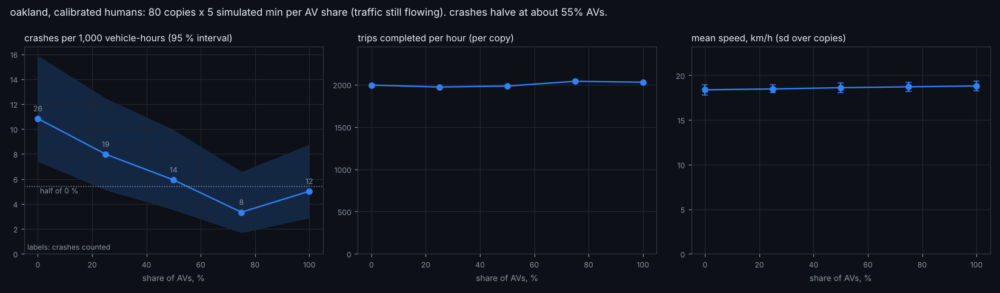
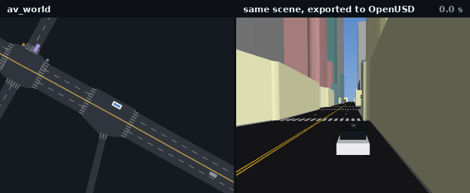

# av_world

**A city-scale driving world in pure JAX, calibrated to real crash statistics, with the research stack built on it and an unusually
honest account of what it can and cannot do.**

[**Website**](https://haggler3.github.io/av_world/) · [**Start here: notebook**](notebooks/01_start_here.ipynb) · [**Notebooks**](https://haggler3.github.io/av_world/notebooks.html) · [**3-D scenes**](https://haggler3.github.io/av_world/scenes.html) · [**Browser viewer**](https://haggler3.github.io/av_world/viewer/index.html) · [What you can test](docs/TESTING.md) · [Docs index](#guides)


**AVBench leaderboard**: 18 scenarios (11 core + 7 long-tail incidents) x 8 checks with fixed bars the rule-based AV can fail
([full leaderboard](results/bench/leaderboard.md), [what the numbers mean](docs/METRICS.md)):

| policy | checks passed (of 144) | av_world score: core | long-tail |
|---|---|---|---|
| PPO + barrier teacher, then no filter (phase 2) | **123** | 50.3 | 30.5 |
| PPO + barrier teacher, speed + jaywalkers (phase 3) | 120 | 56.8 | **40.9** |
| PPO + barrier teacher (phase 1) | 115 | 42.9 | 22.1 |
| rule-based AV | 104 | **77.2** | 39.0 |
| PPO, full world, 10x envelope penalty | 104 | 49.2 | 25.9 |
| PPO, 234k steps (no barrier teacher) | 76 | 6.1 | 5.4 |

The learned policies pass more checks, but the rule-based AV keeps the best core score: unaided, they crash 1.3-1.6x as often.
Retraining one recipe moves scores by up to 10 points.

**Latent world-model planners**, on the 3 junction-heavy scenarios they were benchmarked on (nominal, red runners, inattentive):

| driver | checks passed (of 24) | av_world score | crashes /AV-h, no filter | red runs /100 km |
|---|---|---|---|---|
| PPO + barrier teacher, then no filter (phase 2) | **23** | 77.9 | 0.033 | 0 |
| rule-based AV | 18 | **78.2** | **0.008** | 0 |
| PPO + barrier teacher, speed + jaywalkers (phase 3) | 22 | 63.8 | 0.025 | 0 |
| latent planner v2 (ensemble model, phase 3 as prior) | 17 | 46.0 | 0.039 | 0 |
| latent planner v1 (234k-step PPO as prior) | 8 | 0.8 | 0.471 | 4.5-5.4 |

v2 fixed v1's red-light runs but does not beat the policy it plans around. Training the policy inside the model (v3) did not
either. Forked at the policy's own crash moments, the converged plan averts 18 % of them, against 75 % for simply braking
harder ([GIFs, the test and why](wmplan/README.md)).

## Try it in five minutes

**Easy mode** ([docs/EASY.md](docs/EASY.md)): the common jobs in one line each, plus bridges to Gymnasium, PettingZoo,
Stable-Baselines3, PyTorch, ONNX and pandas.

```python
from av_world import easy, compat
run = easy.simulate("oakland", minutes=5, av_share=0.3); run.summary(); run.show()

@easy.driver                                     # your own driver, in metres, seconds and m/s^2
def two_second_rule(car):
    jnp = easy.jnp
    follow = jnp.where(car.has_lead & (car.lead_gap < 2 * car.speed + 4), -2 * car.brake_needed_for_lead - 1, 3.0)
    stop = jnp.where(car.has_stop & (car.stop_gap < 2 * car.speed + 8), -2 * car.brake_needed_for_stop - 1, 3.0)
    return jnp.minimum(jnp.minimum(follow, stop), jnp.where(car.speed < car.desired_speed, 1.2, -0.5))

easy.compare({"mine": two_second_rule, "IDM": easy.drivers.idm()})   # scored on AVBench next to the leaderboard
policy = easy.train(updates=25)                  # PPO;  env = compat.GymEnv("oakland") for SB3 / CleanRL
```

```bash
av-world watch oakland                      # the city driving live in your terminal
python examples/av_share_sweep.py           # how many AVs until crashes halve? (~7 min)
python examples/gridlock.py                 # the fundamental diagram of a whole city (~6 min)
python examples/my_policy.py                # your own driver in 15 lines, scored on AVBench
```
Results and figures: [examples/](examples/README.md).

**Notebooks** ([notebooks/](notebooks/README.md), committed executed, a few minutes each on a CPU or in Colab):

| | notebook | what you do | |
|---|---|---|---|
| 01 | [Start here](notebooks/01_start_here.ipynb) | a five-minute tour of the whole repository | [Colab](https://colab.research.google.com/github/haggler3/av_world/blob/main/notebooks/01_start_here.ipynb) |
| 02 | [The RL environment](notebooks/02_rl_environment.ipynb) | observations, actions, rewards, custom reward weights | [Colab](https://colab.research.google.com/github/haggler3/av_world/blob/main/notebooks/02_rl_environment.ipynb) |
| 03 | [Training with PPO](notebooks/03_ppo_training.ipynb) | train, plot the curves, fine-tune with your reward, score on AVBench | [Colab](https://colab.research.google.com/github/haggler3/av_world/blob/main/notebooks/03_ppo_training.ipynb) |
| 04 | [Perception export](notebooks/04_perception_export.ipynb) | cameras, 3-D boxes and sensor detections for any scenario | [Colab](https://colab.research.google.com/github/haggler3/av_world/blob/main/notebooks/04_perception_export.ipynb) |
| 05 | [AVBench and metrics](notebooks/05_avbench_and_metrics.ipynb) | the leaderboard, the checks, tuning a driver against them | [Colab](https://colab.research.google.com/github/haggler3/av_world/blob/main/notebooks/05_avbench_and_metrics.ipynb) |
| 06 | [Easy mode](notebooks/06_easy_mode.ipynb) | `av_world.easy` and `compat`: simulate, drivers, compare, train, Gymnasium + SB3, PyTorch, ONNX | [Colab](https://colab.research.google.com/github/haggler3/av_world/blob/main/notebooks/06_easy_mode.ipynb) |



## What it is

* **`xnet`**, an area simulator built from open map data (Pittsburgh's Oakland, Squirrel Hill and Downtown, Midtown Manhattan, the Chicago Loop, central Boston, any OpenStreetMap city, Argoverse 2 / Waymo maps):
  car following, lane changes, zipper merges, right of way at every conflict point, signals, pedestrians, cyclists, buses, breakdowns, road
  friction, seven crash types, a control-barrier-function safety filter. About 395 simulated seconds per second for 8 copies of a ~380-vehicle area
  on 4 CPU cores, and it shards across devices.
* **Human drivers calibrated to published crash data by crash type** (`xworld`, `pgh`): a world with the mistakes real people make.
* **A research stack on top**: multi-agent PPO (`avrl`), AVBench, latent world models and a planner (`dwm`, `wmplan`), a stress lab (`avlab`).
* **Software and hardware in the loop**: drive any AV from your own controller over TCP, in lockstep (60x real time) or at wall-clock pace with
  deadlines and fallbacks ([SIL_HIL.md](docs/SIL_HIL.md)).
* **NVIDIA-ready export**: any simulated long-tail scene or real Argoverse 2 log as an OpenUSD stage (Omniverse) and a camera-view
  map-and-box control video of the kind driving world models such as Cosmos are conditioned on, set in the real city: buildings at their
  mapped heights, trees, lamps and signals fused from open map data (Overture / OpenStreetMap) ([NVIDIA.md](docs/NVIDIA.md)).
  Every export also renders this side-by-side clip, and `--find-crash` hunts down an AV crash to film
  ([more scenes](https://haggler3.github.io/av_world/scenes.html)):

  
* **Long-tail tooling**: sensor faults, aimed human mistakes, dart-outs, famous-incident scenarios, a real-log importer, CARLA export, and
  five methods for teasing novel long-tail data out of the simulator ([report](docs/LONG_TAIL_METHODS.md)).

```bash
pip install .                       # data and a trained starting policy are bundled
av-world info && av-world bench     # simulated seconds per wall-clock second on this machine
```
```python
import av_world
env = av_world.make("oakland", n_envs=8)           # or an OpenStreetMap file, or "city.npz"
state = env.reset(seed=0, warm_s=60)
state, traj = env.rollout(state, policy=None, steps=200)     # None: the rule-based AV
print(env.metrics(state)["av_crash"])
```

## What we found, including what did not work

**Eleven plausible claims, tested to fail** ([docs/HYPOTHESES.md](docs/HYPOTHESES.md)): 30x the human mistakes gives only 1.6x the crashes
(elasticity 0.16), denser traffic is *less* dangerous per vehicle-hour but not per km, one RL training run does not reproduce
(per-scenario SD 36 points), and how often the safety filter steps in predicts unaided risk (rho = 0.86). Each claim is ranked by
impact over the effort of a follow-up.

| question | answer | where |
|---|---|---|
| Can a policy drive with no safety filter if the barrier function teaches it? | Yes, mostly: unaided AV crashes fell 15-23x (0.64 to 0.03-0.04 per AV-hour). On AVBench's fixed bars (18 scenarios, 7 of them long-tail incidents) the best passes 123 of 144 checks against the rule-based AV's 104, but the rule-based AV keeps the best core score (77.2 vs 56.8): unaided, the learned policies still crash 1.3-1.6x as often. | [Metrics](docs/METRICS.md#results), [Experiments](docs/EXPERIMENTS.md#training-the-driver-to-need-no-filter-avrlunaidedpy) |
| Is one training run enough to rank policies? | **No.** Retraining the barrier-teacher phases with the same recipe moved them by up to 10 av_world points and 8-15 of 144 checks, about the size of most gaps between policies. | [Metrics](docs/METRICS.md#results) |
| Does planning in a latent world model beat the policy it starts from? | Partly: 0.47 unaided crashes per AV-hour against 0.64 for its PPO prior, but 15-60x the barrier-taught policies. Its model ranks crashes well (AUROC 0.96) but predicts the stop-line gap worse than holding it constant. | [Metrics](docs/METRICS.md#results) |
| Does a more varied world teach better? | Mutating cities did: 8 of 8 (seed, world) pairs had fewer crashes, 17-63 % fewer. Fork-at-danger and world-model crash shaping did not help. | [Experiments](docs/EXPERIMENTS.md) |
| Does a GPU-style trainer help? | Packing the learner's rows and sharding copies: PPO ~5x faster on CPU. On one NVIDIA L4: a PPO phase 2x faster than on CPU (95 s vs 195 s), a latent-planner benchmark run about 5x (under 2 min vs ~10). | [Speed](docs/SPEED.md) |
| Can it estimate a 1-in-a-million crash probability? | **No.** The estimator is unbiased (checked on a random walk) but the learned guide predicts too weakly to beat plain Monte Carlo. | [Long tail](docs/LONG_TAIL.md) |
| Do famous incidents come out of the simulator? | **Mechanisms yes, incidents no**: fidelity 0.2-0.6 by feature count; pedestrian impacts 24 mph against Tempe's 43; everyday near-misses 4-6x thinner than real Argoverse 2 traffic. | [Incident audit](docs/INCIDENT_AUDIT.md) |
| Does training on famous-event scenarios help? | Not shown: two seeds, 0.077 / 0.172 for the mix against 0.084 / 0.093 for ordinary training. They are good *tests*: ~0 crashes in ordinary traffic, 0.25-0.4 per AV-hour in the jaywalker and glare scenarios. | [Famous events](docs/FAMOUS_EVENTS.md) |
| Does the simulator predict real traffic? | Its drivers are about 2x worse than constant velocity at predicting Argoverse 2 vehicles (17 m vs 9 m at 5 s): not calibrated to real driving. | [Data import](docs/DATA_IMPORT.md) |
| Five ways to make novel long-tail data | Drivers fitted to real logs match real hard braking (48 vs 43 per hour) but still under-tailgate 8x; MAP-Elites finds a broader failure catalogue than random search (7 vs 5 kinds), though elites regress on re-runs; novelty mining makes data 3x richer in crashes; counterfactuals on real scenes give a few new failures; go-explore did not beat plain simulation. | [Long-tail methods](docs/LONG_TAIL_METHODS.md) |

## Guides

| | |
|---|---|
| [docs/EASY.md](docs/EASY.md) | easy mode for beginners (`av_world.easy`) and compatibility with Gymnasium, PettingZoo, SB3, PyTorch, ONNX, pandas, CARLA, OpenUSD |
| [docs/HYPOTHESES.md](docs/HYPOTHESES.md) | eleven plausible claims about driving and AV research, each tested to fail, with the statistics and an impact-per-effort ranking |
| [docs/BEV.md](docs/BEV.md) | camera BEV perception: a CPU-sized BEVFormer on rendered av_world cities, traced front to back |
| [docs/TESTING.md](docs/TESTING.md) | What AV behaviour you can test, the knobs, metrics and suites, how to plug in your stack, and the limits |
| [docs/METRICS.md](docs/METRICS.md) | AVBench: fixed bars the rule-based AV can fail, the scorecard and av_world score, results on 18 scenarios ([leaderboard](results/bench/leaderboard.md)) |
| [docs/NVIDIA.md](docs/NVIDIA.md) | OpenUSD stages and Cosmos-style control videos from long-tail scenes, side-by-side clips, filming crashes |
| [docs/SIL_HIL.md](docs/SIL_HIL.md) | software / hardware in the loop: protocol, modes, timing, measured latency |
| [docs/CITIES.md](docs/CITIES.md) | New York, Chicago and Boston: what was built, what is real and what is inferred |
| [docs/LONG_TAIL_METHODS.md](docs/LONG_TAIL_METHODS.md) | five methods for novel long-tail data, with pseudocode and results |
| [docs/INCIDENT_AUDIT.md](docs/INCIDENT_AUDIT.md) | does the long tail that matters come out of the simulator? |
| [docs/FAMOUS_EVENTS.md](docs/FAMOUS_EVENTS.md) | ten famous failure patterns as scenarios; do they help training? |
| [docs/DATA_IMPORT.md](docs/DATA_IMPORT.md) | Argoverse 2 and Waymo import; how well the simulator predicts real logs |
| [docs/JUNCTIONS.md](docs/JUNCTIONS.md) | the intersection detector for imported maps, with pseudocode |
| [docs/LONG_TAIL.md](docs/LONG_TAIL.md) | overview of the long-tail tooling: OSM import, CARLA export, sensor faults, adversary, rare events |
| [docs/EXPERIMENTS.md](docs/EXPERIMENTS.md) | dynamics ladder, scaling laws, active learning, AVBench, unaided training, mutating cities |
| [docs/RL.md](docs/RL.md), [docs/WORLD_MODELS.md](docs/WORLD_MODELS.md), [docs/METHODS.md](docs/METHODS.md) | the RL stack, the world models, the methods |
| [docs/SIMULATORS.md](docs/SIMULATORS.md) | simulator internals, calibration against crash data, running everything, limitations, code layout |
| [docs/SPEED.md](docs/SPEED.md) | speed against CARLA, GPUDrive, Waymax and others (CPU and one NVIDIA L4 measured, larger GPUs projected) |
| [docs/RESEARCH_CONTEXT.md](docs/RESEARCH_CONTEXT.md) | comparison with other simulators and current research |
| [docs/ROADMAP.md](docs/ROADMAP.md), [docs/HISTORY.md](docs/HISTORY.md) | what is next; how the repository came about |

## Repository map

| package | what it is |
|---|---|
| `av_world/` | the pip package: `make()` environment, the `av-world` command, the SIL/HIL plugin, bundled maps and start policy |
| `xnet/` | the area simulator, road network builder, the extra cities, the NVIDIA exporter, OSM and log importers, junction detector, CARLA export, sensor model |
| `xworld/`, `pgh/` | the calibrated intersection simulator; 10,205 mined Pittsburgh intersections |
| `avrl/` | PPO, AVBench, ladder, unaided training, famous-event training, multi-device trainer |
| `bev/` | camera BEV perception: 6-camera rig, rendered data, BEVFormer-tiny's backbone ported to JAX, MiniBEVFormer, nuScenes-style metrics |
| `dwm/`, `wmplan/` | diffusion / flow world models with scaling laws; latent world model and planner |
| `avlab/` | stress lab, tail scenarios, incident audit, adversary, rare events, the five long-tail methods |
| `tests/` | 80 tests: dynamics, safety, importers, junctions, sensor model, estimators |
| `docs/` | guides, the GitHub Pages site and the browser viewer |
| `results/` | the JSON behind every number in the docs |

Everything runs in jobs of about ten minutes on 4 CPU cores. `export JAX_DEFAULT_PRNG_IMPL=unsafe_rbg` makes random numbers much cheaper on CPU.
Data sources and licences: [docs/SIMULATORS.md](docs/SIMULATORS.md#layout) (Overture Maps / OpenStreetMap, published crash-rate tables);
Argoverse 2 is CC BY-NC-SA 4.0 and is downloaded on demand, never redistributed.
