# av_world

**A city-scale, crash-calibrated driving world in pure JAX, and the research stack built on it: multi-agent RL,
generative world models, scaling laws and controlled experiments on what makes a simulator a good teacher.**

[**Live site**](https://haggler3.github.io/av_world/) ·
[**Explore the Pittsburgh simulations in your browser**](https://haggler3.github.io/av_world/viewer/) ·
[Methods](docs/METHODS.md) · [RL](docs/RL.md) · [World models](docs/WORLD_MODELS.md)


| package | what it is |
|---|---|
| `xnet/` | a whole neighbourhood (Oakland, Squirrel Hill, Downtown Pittsburgh) built from open map data: car following, lane changes, zipper merges, right of way at every conflict point, signals and stop signs, pedestrians, cyclists, buses, double-parked vans, breakdowns, road friction, rerouting around congestion; seven crash types (rear-end, angle, left-turn, sideswipe, merge, pedestrian, bicycle); a control barrier function safety filter. **~380x real time** for 8 copies of the whole area on 4 CPU cores |
| `xworld/` | a batched intersection simulator whose human drivers reproduce **published crash rates by crash type** (rear-end, angle, left-turn, sideswipe) |
| `pgh/` | 10,205 real Pittsburgh intersections auto-mined from OpenStreetMap (Overture Maps), simulated as-is |
| `avrl/` | multi-agent PPO (one shared policy drives every AV in the area), **AVBench** (11 scenarios x 8 checks against the rule-based AV, with the IDM envelope, a control barrier function, or no filter), the dynamics ladder, active scenario selection, a Rust export of the corridor driver ([docs/RL.md](docs/RL.md)) |
| `dwm/` | diffusion and flow-matching world models of the traffic around an AV, trained on simulator logs, with scaling laws across architectures |
| `wmplan/` | a latent world model of the AV's scene and a planner that searches in it: merges and junction entries chosen by imagining the next 2.4 s |
| `avlab/` | a stress lab: hundreds of conditions at once, Poisson regressions of what drives AV crashes, crash-type breakdowns, the operating-domain map |
| `docs/viewer/` | a browser replay of whole-area simulations: zoom anywhere, follow any AV, jump to crashes, red-light runs and breakdowns |

```bash
pip install -e . && python -m pgh.fetch && export JAX_DEFAULT_PRNG_IMPL=unsafe_rbg && python -m pytest -q tests
```

Every experiment in this README is a set of jobs of 5 minutes or less on 4 CPU cores.

## What this does that common tools don't

The driving-simulation field has split into two camps. **Log-replay simulators** (Waymax, GPUDrive, nuPlan) replay
short recorded snippets and are as realistic as their logs, but cannot create situations the logs don't contain.
**Self-play simulators** (Gigaflow) scale to billions of kilometres, but every agent is the same policy, so the
world never contains a distracted human or a red-light runner. av_world sits in between: a **synthetic, open-ended
city whose human drivers are calibrated to real crash statistics**, so the policy learns among the mistakes real
humans make, at the rates they make them.

| | av_world | Waymax | GPUDrive | Gigaflow | MetaDrive | CARLA | SUMO |
|---|---|---|---|---|---|---|---|
| Framework | JAX | JAX | C++/CUDA (Madrona) | GPU batch sim | Python / Panda3D | Unreal | C++ |
| Scenes | whole neighbourhoods from any OSM map, unbounded duration | ~9 s logged snippets (WOMD) | ~9 s logged snippets (WOMD) | procedural maps | procedural + imported | hand-built towns | any OSM map |
| Other road users | calibrated human drivers, pedestrians, buses, vans, breakdowns | logs or IDM | logs or the policy | the policy (self-play) | rule-based traffic | traffic manager | car-following models |
| Crashes | modelled and **calibrated by crash type** | detected | detected | detected | detected | detected | collision-free by default |
| Signals, stop signs, right of way | full conflict-point model | logged light states | from logs | yes | partial | yes | yes |
| RL + world models + scaling laws in one repo | **yes** | sim + baselines | sim + baselines | not released | sim + baselines | sim | sim |
| Runs on a laptop CPU | **380x real time** | yes | GPU-focused | multi-GPU | yes | GPU | yes |

**What's distinctive here:**

1. **Calibrated risk, not just traffic.** Red runners, drivers who don't look, distraction and breakdowns are tuned
   so crash rates *by type* match published intersection data. Most simulators are either collision-free by
   default (SUMO) or inherit whatever their logs contain.
2. **The simulator itself is the experimental variable.** The dynamics ladder switches sources of dynamics on one at
   a time and measures what each buys the learner. Active scenario selection asks which simulated data teaches
   fastest. These are questions about the *teacher*, not the student.
3. **Sim → policy → generative world model → scaling laws in one codebase.** The same logs train PPO and the
   diffusion world models, so the scaling laws for policy and model can be compared directly.
4. **Any city, from open data.** `pgh/` mines 10,205 Pittsburgh intersections automatically; `xnet/` turns a
   bounding box into a simulated neighbourhood.
5. **Inspectable.** Every run can be replayed in the [browser viewer](https://haggler3.github.io/av_world/viewer/):
   key moments are indexed, so you can jump straight to each crash, red run or breakdown.

## Where this sits in current research

- **Scale beats hand-tuning.** Gigaflow ([Cusumano-Towner et al., ICML 2025](https://arxiv.org/abs/2502.03349))
  trained one self-play policy on 1.6 billion km and set the state of the art on CARLA, nuPlan and Waymax without
  ever seeing human data. Here: the same bet at laptop scale, plus calibrated humans as the hard part of the world.
- **Throughput is the bottleneck.** GPUDrive ([Kazemkhani et al., ICLR 2025](https://arxiv.org/abs/2408.01584))
  reaches over a million steps per second on a GPU. `xnet` is jitted end to end with fixed shapes, so the same code
  moves to a GPU.
- **Scaling laws for driving.** Waymo ([Baniodeh et al., 2025](https://waymo.com/research/scaling-laws-of-motion-forecasting-and-planning))
  found power laws in compute for motion forecasting and planning. This repo fits the same laws for policy score vs
  simulator steps and for world-model error vs compute and data, across four architectures.
- **Generative world models.** GAIA-2 ([Wayve, 2025](https://arxiv.org/abs/2503.20523)) generates multi-camera
  driving video with latent diffusion. `dwm/` applies diffusion and flow matching to the traffic state itself: 3 s
  futures in 0.06 ms.
- **Data-driven simulation in JAX.** Waymax ([Gulino et al., NeurIPS 2023](https://arxiv.org/abs/2310.08710)) made
  log-replay simulation differentiable and batched. `xnet` keeps that interface style (pure `step`, vmapped worlds)
  but generates its own traffic.
- **Adaptive curricula.** Prioritised level replay ([Jiang et al., 2021](https://arxiv.org/abs/2010.03934)) selects
  training environments by learning potential. Here it is tested against uniform scenario sampling on a 54-scenario
  grid of the same city.

## Does a more dynamic world train a better driver?


**The experiment (`avrl/ladder.py`).** Five training worlds on the same Oakland map. Each adds one source of
dynamics to the one before:

1. AVs alone on light-traffic streets;
2. careful human drivers around 25 % AVs;
3. pedestrians;
4. buses, double-parked vans and breakdowns;
5. risky humans, with demand, AV share and risk randomised per copy.

Every policy starts from the same imitation of the rule-based AV and gets the same PPO budget. Every checkpoint is
scored in one held-out test world with all of it switched on (humans 5x riskier than calibrated). The score is the
training reward per AV decision: progress, comfort, jerk, headway, speeding, safety-envelope corrections, near
misses, red runs and crashes.

**How to read it:**

- **A, the learning curves.** PPO's first updates shake the imitated driver loose (the dip). Then every world climbs
  back, and the more dynamic worlds climb back first.
- **B, the same data at fixed budgets.** At 15 updates (7,800 simulator steps) the gain over the empty-streets world
  grows rung by rung, to **+12 % for the full world**. At 30 updates every richer world is still 5-8 % ahead. From
  31,000 steps on, the curves meet within 3 %.
- **C, the world as the only teacher** (no imitation start). The full world is **+20 % ahead after 7,800 steps**. By
  62,000 steps both reach about 0.070.

**What it means.** Dynamics buy *sample efficiency*: each pedestrian, bus, breakdown and red runner is a situation the
policy learns from in its first few thousand steps. Where the policy ends up is set by the number of simulation
steps. Two things explain this:

- **The observation.** Pedestrians, buses, signals and right of way all reach the policy as a stop target, a leader
  or an arrival time, so a skill learned from one transfers to the others.
- **The safety envelope** absorbs the rest.

## Scaling laws

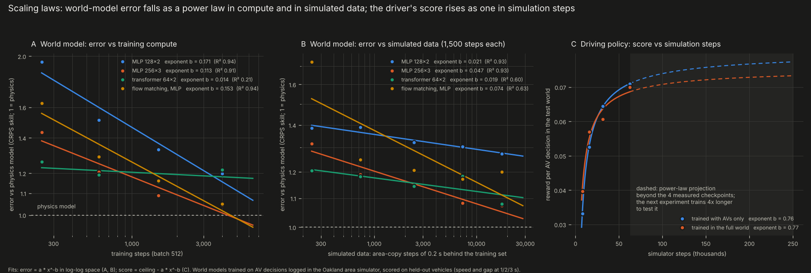

**World models (`dwm/scaling.py`).** The models are trained on 2.8 M AV decisions logged in the Oakland simulator
(1 s of history, 3 s of future at 5 Hz), each predicting 5 control points. Error is CRPS on speed and gap at
1/2/3 s relative to a physics model, on held-out vehicles. Fits are error = a·x^(-b) in log-log space:

| architecture | exponent vs training steps | exponent vs simulated data |
|---|---|---|
| flow matching, MLP | 0.153 (R² 0.94) | 0.074 (R² 0.63) |
| MLP 128x2 | 0.171 (R² 0.94) | 0.021 (R² 0.93) |
| MLP 256x3 | 0.113 (R² 0.91) | 0.047 (R² 0.93) |
| transformer 64x2 | 0.014 (R² 0.21) | 0.019 (R² 0.60) |

**How to read it:**

- **Compute (A).** The MLPs and flow matching follow clean power laws (b = 0.11-0.17, R² > 0.9). The small MLP has
  the steepest compute law because it starts furthest behind. The transformer is the fastest early learner: best of
  all at 250 steps. It is flat after that (b = 0.01) at this size.
- **Data (B).** Capacity decides how much a model gains from more simulation. The 1M-parameter MLP's data exponent
  (0.047) is **more than twice** the 0.2M MLP's (0.021). The small model is capacity-bound; the large one keeps
  improving across the whole range.
- **Projection.** By its fitted law, the large MLP reaches the physics model's error at about 4,400 steps on 200 k
  windows. Longer runs on all 740 k windows go well past it: 0.70 after 18,200 steps, 0.72 with the DCT basis after
  14,500.

**The driving policy (C).** The score rises as a power law in simulation steps, with nearly the same exponent from
the empty-streets world and the full world (b = 0.76 and 0.77). Same law, different offset early on.

## Active learning: which simulated data teaches fastest?

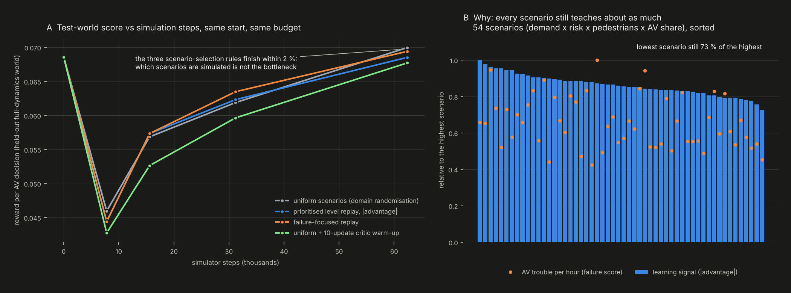

**The experiment (`avrl/active.py`).** A grid of 54 scenarios on the Oakland map: demand (0.7, 1, 1.35) x human risk
(1, 5, 15x calibrated) x pedestrian rate (0.3, 1, 2x) x AV share (25, 60 %). Every 5 PPO updates each of the 8
simulated copies of the area is assigned a scenario by one of four rules. All start from the same imitation policy,
get 62,400 simulator steps, and are scored in the held-out test world of the dynamics ladder.

| rule | 7.8 k steps | 15.6 k | 31.2 k | 62.4 k |
|---|---|---|---|---|
| uniform (domain randomisation) | 0.0460 | 0.0569 | 0.0619 | **0.0700** |
| prioritised level replay, \|advantage\| | 0.0444 | 0.0573 | 0.0623 | 0.0685 |
| failure-focused replay (hard brakes, near misses, crashes per AV-hour) | 0.0444 | 0.0573 | **0.0635** | 0.0694 |
| uniform + critic warm-up (policy held for 10 updates) | 0.0427 | 0.0526 | 0.0596 | 0.0677 |

**How to read it:**

- **A.** Failure-focused replay leads at mid-budget (+2.6 % at 31 k steps) and finishes level with uniform sampling.
  Level replay tracks uniform throughout. Holding the policy while the critic warms up costs steps and never catches up.
- **B, the reason.** Measured by the policy's own learning signal, the *least* informative scenario still carries
  73 % of the signal of the most informative one. Every corner of this world still teaches. When the signal is this
  flat, uniform sampling is already near-optimal, so selection rules can only reorder the data.
- **What this means for "more data, faster".** At this stage the lever is *volume* of dynamic simulation, not
  selection. This matches the dynamics ladder (richer worlds help early, steps dominate later) and the RL power law
  (b ≈ 0.77). Selection should start to pay once the policy has mastered the common cases and the signal concentrates
  on rare ones. The failure score already spreads out much more than the advantage does (orange points in B).

## AVBench: the bar the learned driver has to clear


**Why a benchmark, not the training score.** The test-world score used above is the training reward, and every
learned AV drives under a safety filter. A policy that floors it and lets the filter do the braking still scores well.
AVBench (`avrl/bench.py`) asks the questions a deployment review would ask. Every policy is run three times: under the
IDM envelope it was trained with (as deployed), under the control barrier function, and with no filter at all (what RL
actually learned).

**Eleven scenarios:**

- nominal Oakland traffic;
- rush hour (demand ×1.45);
- red runners (60 % of humans willing, up to 3 s into the red);
- inattentive humans (pull out without looking, zone out);
- jaywalkers (2.5× pedestrians, 40 % crossing against the signal);
- blockages (breakdowns, double-parked vans);
- 80 % AVs;
- cyclists (15 % of trips);
- a wet road (friction 0.5);
- two neighbourhoods never seen in training, Squirrel Hill and Downtown.

**The bar.** The rule-based AV drives the *same* traffic (same warm state, same random numbers), so every difference
is the policy's. Eight checks per scenario, 88 in all; a scenario is *overcome* when all eight pass:

| as deployed (with the envelope) | the raw policy (no filter) |
|---|---|
| **safe**: AV crashes per AV-hour <= the rule-based AV's | **safe unaided**: AV crashes per AV-hour <= the rule-based AV's |
| **efficient**: AV speed >= 97 % of the rule-based AV's | **lawful**: red-light runs <= the rule-based AV's |
| **smooth**: hard brakes per AV-hour <= the rule-based AV's | **courteous**: near misses at junctions per AV-hour <= the rule-based AV's |
| **good neighbour**: human drivers' speed >= 99 % of theirs next to rule-based AVs | **self-reliant**: the envelope cuts the command in < 5 % of AV time |

**Results** (all scenarios pooled, ~500 AV-hours per policy and filter):

| policy | checks passed (of 88) | crashes /AV-h: envelope | barrier function | no filter | AV km/h | hard brakes /AV-h |
|---|---|---|---|---|---|---|
| **rule-based AV (the bar)** | 88 | 0.006 | 0.008 | 0.006 | 16.4 | 17.3 |
| PPO, 234k steps (xnet3) | **67** | 0.018 | 0.012 | 0.64 | 16.4 | 3.5 |
| PPO, full world, 10× envelope penalty | 59 | 0.002 | 0.000 | 0.009 | 9.0 | 2.9 |
| imitation (BC) | 45 | 0.006 | 0.006 | 2.1 | 16.4 | 6.7 |
| PPO, 130k steps (xnet) | 44 | 0.008 | 0.008 | 2.8 | 15.7 | 2.3 |
| PPO, 62k steps, four ladder / active-learning recipes | 38-40 | 0.008-0.014 | 0.004-0.018 | 63-80 | 16.3-16.6 | 4.1-5.1 |

**How to read it:**

- **No policy overcomes a scenario yet, and the bar is real.** The best policy, at 234k steps, passes 67 of 88 checks.
  It is smooth (5× fewer hard brakes), lawful and self-reliant everywhere, and as fast as the rule-based AV. It fails
  *safe unaided* in every scenario (0.64 crashes/h with no filter) and *safe* as deployed in 6 of 11: 9 crashes in
  500 AV-hours against the rule-based AV's 3. The IDM envelope only caps acceleration, so it can't stop a bad junction
  entry. The barrier function, which also vetoes unsafe entries and merges, brings that to 6.
- **Short training learns to lean on the filter.** The 62k-step policies crash 63-80 times per AV-hour with no
  filter. The mix includes about 190 angle, 50 left-turn, 140 merge and 300-470 bicycle crashes each, besides
  rear-ends and pedestrians. They learned to accelerate and let the envelope brake: reward hacking of the safety
  layer, invisible to the training score (all four score ~0.070).
- **The bar has two sides (C).** A 10× envelope penalty almost removes unaided crashes (0.009/h). But it drives at
  55 % of the rule-based speed and fails *efficient* and *good neighbour* in all 11 scenarios.
- **Hardest scenarios:** rush hour and jaywalkers, then Downtown.

```bash
python -m avrl.bench run            # all scenarios, only policies not yet scored (~3 min per scenario)
python -m avrl.bench report         # -> results/bench/leaderboard.md
python -m avrl.bench plot           # -> docs/img/avbench.png
```

To score a new policy, add its checkpoint to `POLICIES` in `avrl/bench.py` and run the three commands again.

## Crashes at junctions, in merges and with cyclists

The area simulator now has cyclists and a richer crash model:

- **Cyclists** (`p_bike`, 3 % of trips by default) ride in the lane at about 20 km/h. Cars queue behind them and
  overtake: on the other lane, or on the opposing lane of a two-way street.
- **Close passes.** Aggressive or distracted human drivers sometimes clip the cyclist they overtake. This is the most
  common real-world cause of cyclist crashes.
- **Seven crash types, with who was involved:**
  - rear-end, angle, left-turn, sideswipe;
  - *merge*: a rear-end within 3 s of a lane change, or two moves joining one lane inside a junction;
  - pedestrian;
  - *bicycle*: any crash involving a cyclist.

  Each is counted overall and with an AV involved (`AV_CRASH` metrics).
- **Physical stopping.** A vehicle told to stop at a line is only held there if it could physically stop at the
  road's maximum braking. Too fast, and it overruns into the junction with whatever conflicts follow. Before this, a
  reckless policy was clamped to a stop at every red line, which hid junction crashes. Very short links between two
  heads of one split junction are still held as one.
- **The AV's merges** now follow its gap-acceptance output, like its junction entries. A bad policy can cut in and
  cause merge crashes.
- **Road friction and AV sensor noise** are behaviour knobs: `friction` caps braking at 9 m/s² × friction, and
  `perception_noise` puts a multiplicative error on every gap the AV perceives.

**The control barrier function** (`xnet.sim.SHIELD = "cbf"`) is a second safety filter next to the IDM envelope. It
keeps three barriers non-negative:

- **braking distance:** h = gap − d0 − τv − (v² − v_lead²)/2b, enforced as ḣ ≥ −αh on the commanded acceleration,
  against the leader, the stop target and the speed limit;
- **junction entry:** time-to-conflict of traffic with priority − time to clear − margin ≥ 0, which vetoes the entry;
- **merging:** the car cut in front of can stay behind at 3 m/s², which vetoes the merge.

It filters any AV, rule-based or learned. A reckless test policy (full throttle, accepting every gap) crashes dozens
of times in 4 minutes without it and at most twice with it (`tests/test_safety.py`).

## Planning in a latent world model (`wmplan/`)

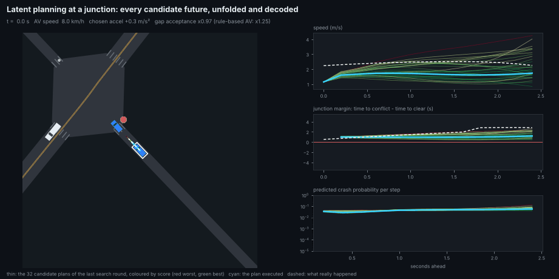

An AV that plans merges and junctions by unrolling a learned latent representation of its scene into the future:

- **Model:** an encoder to a 48-d latent, action-conditioned latent dynamics, and decoders for the safety margins, the
  reward and the probabilities of a crash, a near miss and a red-light run. Trained on 800 k logged decisions,
  including 666 crashes.
- **Planner:** every 0.2 s, for every AV, it searches 32 smooth 2.4 s plans of acceleration and gap acceptance in
  latent space (cross-entropy method, PPO policy as the prior) and executes the best.

The model predicts the AV's speed 3 s ahead with 64 % less error than holding the scene still. It ranks crashes with
AUROC 0.954 and red-light runs with 0.9999. **Without any safety filter, planning halves the crash rate of the policy
it starts from** (0.26 vs 0.57 per AV-hour, about 23 AV-hours each, in a hard Oakland world). With the barrier
function, every driver has 0 crashes. Details: [wmplan/README.md](wmplan/README.md).

## How the AV performs under hundreds of conditions (`avlab/`)


A stress lab: 192 Latin-hypercube conditions over nine factors (demand, human risk, pedestrians, jaywalking,
cyclists, AV share, road friction, sensor noise, breakdowns), each a vmapped copy of Oakland. Five drivers per
condition (about 1,300 AV-hours each), plus two unseen neighbourhoods and a friction × sensor-noise grid. Findings:

- **PPO under the barrier function is the safest configuration.** It has 0.021 crashes per AV-hour (95 % CI
  0.014-0.031): a third of the human drivers' rate in the same conditions and 38 % below the rule-based AV, with 4.5×
  fewer hard brakes.
- **Road friction dominates:** from snow to dry roads, crashes fall 20-50×. Below friction ~0.45 every driver crashes,
  with or without the barrier, whose braking assumption (6 m/s²) snow can't meet. That's the edge of the operating
  domain.
- **Sensor noise hurts only the learned driver** (3.5-6×). **Pedestrians are the main way the AV crashes** (51-65 %).
- **Downtown's dense grid doesn't transfer:** every AV configuration crashes more than the humans there.

Details: [avlab/README.md](avlab/README.md).

## What's next

1. **Pass AVBench unaided.** Start from the 234k-step policy and train with the barrier function's vetoes and
   corrections as a penalty, annealed toward zero, or distil the latent planner into it. Target: all 88 checks.
2. **Amortise the planner.** Train the policy on the planner's choices in imagined rollouts (Dreamer / TD-MPC style),
   so the deployed driver keeps the planner's foresight at the policy's speed.
3. **Close the operating-domain gaps the lab found:** low friction (make the barrier's braking assumption adapt to
   the road), sensor noise (train with it), and Downtown's grid (train across neighbourhoods).
4. **Scale the simulation.** The power laws are fitted up to 62 k simulator steps (RL) and 18 k (world-model data).
   Next: 4-16× longer runs on a GPU, where JAX should push `xnet` well past 380× real time.
5. **Close the loop with Rust.** Port the 28-feature observation to `small_av_world`, so the city-area policy runs in
   the Rust AV stack the way the corridor driver does.

## The simulators

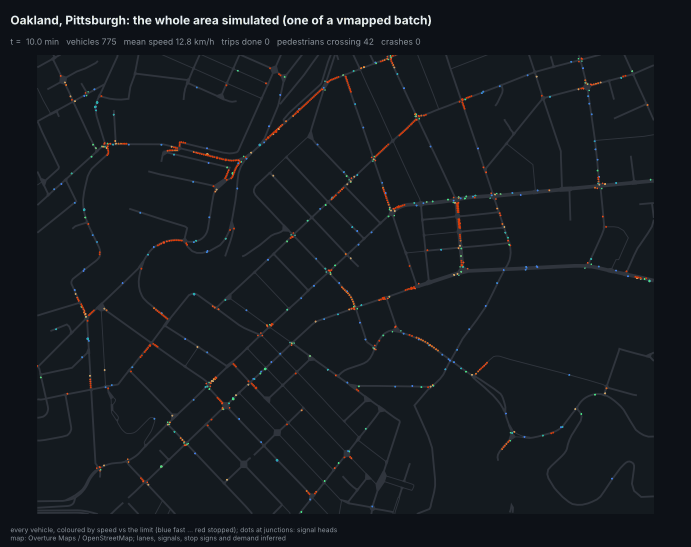

*All of Oakland, Pittsburgh (2.4 x 1.8 km, 313 junctions, 75 km of directed lanes) simulated as one area: every vehicle coloured
by its speed relative to the limit. Below, the same run around Forbes Ave & S Craig St.*

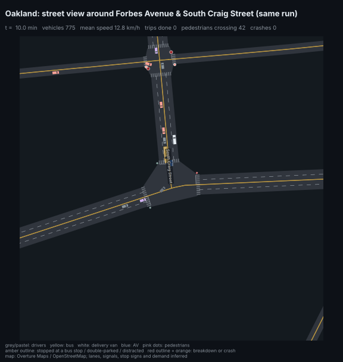

## A whole area: Oakland, Pittsburgh (`xnet/`)

`xnet/network.py` turns the Overture / OpenStreetMap roads inside a bounding box into a network. Roads are cut at the
area's edge, and those cut points become entries and exits. Junctions closer than 30 m are joined into one, as real
traffic simulators do. Lanes, signals, stop signs and demand are inferred from road class, as for the single
intersections below.

| | Oakland |
|---|---|
| junctions / directed links | 313 / 622 (68 links with 2 lanes, 76 one-way; Fifth and Forbes are the one-way pair); 74 entries and 74 exits at the area's edge |
| paths through junction boxes | 1,253, with 1,891 conflict points (crossing or merging into the same lane) |
| control (inferred) | 34 signals (2 phases; approaches whose straight or right-turn paths cross never share a phase), 276 stop-controlled approaches (two-way and all-way stops) |
| crosswalks | 608 |

`xnet/sim.py` moves every vehicle every 0.2 s. Vehicles live on *tracks*: a lane of a link, or a path through a box.

| | |
|---|---|
| **following** | IDM toward whichever is nearest: the leader on the same track, the last car on the next one or two tracks (across a box or a short link), a stop line, a bus stop, a parked van, a wreck |
| **lanes** | mandatory lane changes to reach the turn lane; discretionary ones to pass a slow or stopped car; **zipper merges** where a lane ends (the driver alongside holds back to let one in); passing a stopped car on a single-lane street via the opposing lane when it is clear |
| **junctions** | every move has a priority: signal phase or major road, then straight > right > left, then a fixed tie-break. A driver checks the box (cars before each conflict point) and the cars arriving on higher-priority moves, looking up to three links upstream along their routes. At stop signs, the first to stop goes first. Permissive left turners clear at the change to red. "Don't block the box": enter only if there is room after it |
| **pedestrians** | at signals they start in a 10 s WALK interval; elsewhere when no car is close. A share cross against the signal or into a short gap. Drivers yield to crosswalks up to two links ahead |
| **other road users** | buses (3 %) stop 15-35 s at stops on arterials; delivery vans (5 %) double-park 1-3 min; breakdowns block a lane for 5-15 min; crashed cars stay as wrecks for 2-5 min |
| **risky drivers** | the calibrated knobs from `xworld/calibrate.py`: late red-light running, not looking, not signalling, distraction, aggressive gaps; AVs never do any of these |
| **routing** | next-hop tables to 64 destinations (map exits and inner blocks), re-solved every 5 simulated minutes from measured link speeds; trips that cannot reach their destination leave by the nearest exit |

**Results** (`python -m xnet.experiment`: 8 copies of Oakland x 1 simulated hour each, moderate demand, about 480,000
junction entries and 43,000 trips per world):

| | clean world | calibrated risky drivers (x18.5, scaled back) | 3 % of pedestrians violating |
|---|---|---|---|
| trips finished / mean trip | 40,767 / 8.1 min | 40,498 / 8.1 min | 40,995 / 7.9 min |
| mean speed | 11.2 km/h | 11.2 km/h | 11.6 km/h |
| gridlock teleports (stuck 4 min) | 492 (1.1 % of trips) | 528 | 421 |
| lane changes / passes on the opposing lane | 47,641 / 19,570 | 47,211 / 19,761 | 46,950 / 19,211 |
| bus and delivery stops / pedestrian crossings | 10,799 / 112,172 | 10,748 / 112,503 | 10,626 / 117,348 |
| crashes in the run | 18 (10 rear-end, 7 left-turn, 1 pedestrian) | 31 | 22 |
| **crashes per million junction entries** | **37 (model artefacts)** | **+1.5 over clean** (0.9 rear-end, 0.3 angle, 0.1 sideswipe, 0.1 pedestrian) | **+8 over clean** (pedestrian) |

**Read these with care:**

- **The clean world is not crash-free.** It has 37 crashes per million junction entries from the model itself, all
  at Pittsburgh's irregular junctions: odd geometry, very short links, merged junctions. Getting it this low (from
  567 crashes in the first 10-minute run) took about twenty fixes, listed in the commit history. The single-intersection
  world below is crash-free when clean.
- **Driver crash rates are reported as the excess over that baseline**, the same way the calibration subtracts its
  clean baseline. The driver-caused rate, 1.5 per million entries, is the same order as the single-intersection
  calibration (0.62) and the published 0.78. But it rests on only 13 extra crashes (about ±40 %).
- **The pedestrian violation rate (3 %) is a guess, not calibrated.**

**Speed:** 8 copies of Oakland, with about 600 vehicles each in 1,024 vehicle slots, run at about **380x real time in
total** on 4 CPU cores. That is about 8 simulated hours in 75 s, 2.1x faster than the first version. Profiling the
compiled step found where the time went:

- **Vehicle slots:** cost is linear in slots, and 1,024 is enough for a moderate hour.
- **"Last car on a track" lookups:** these were three binary searches per step. They are now one scatter of each
  track's rearmost car.
- **Free slots:** found with `nonzero` instead of a full sort.
- **Conflict lists:** trimmed to the widest one actually used (10 instead of 16).

Results are identical to before at the same slot count.

**Driving AVs with a learned policy:** `xnet.sim.step(..., rl=(policy_fn, key))` lets a policy drive every AV. The
policy reads a 28-feature observation and returns an acceleration command, capped by a classical safety envelope, and a
gap-acceptance scale. The step also returns the transition (reward, valid, done) for training.
[`av_world_rl`](https://github.com/haggler3/av_world_rl) trains such a policy with multi-agent PPO
(`pip install -e .` here first).

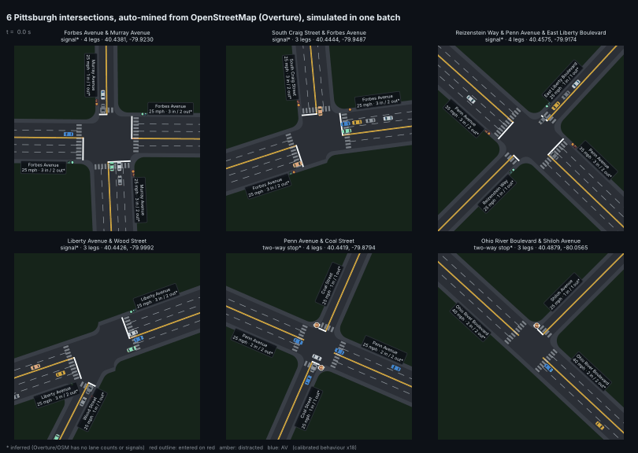

*Single intersections: six real Pittsburgh intersections, auto-mined from OpenStreetMap, simulated together in one vmapped batch. Pink,
green, grey: human drivers; blue: AVs. Starred values (lanes, signal or stop control) are inferred: the open map data
has no lane counts or signal locations.*

## Real intersections from OpenStreetMap: Pittsburgh

`pgh/` reads Pittsburgh's road network from [Overture Maps](https://overturemaps.org/), an open map built largely from
OpenStreetMap, straight from its public S3 bucket. It then mines every intersection and turns each into a simulator layout.

| | |
|---|---|
| road segments read | 69,155 (drivable: trunk to residential; ramps, service roads and paths left out) |
| junctions with 3+ drivable legs | 12,946 |
| **intersections kept** | **10,205** (2,929 four-leg, 7,276 three-leg); dropped: 5+ legs, legs that don't fit four approach slots within 35 degrees, legs shorter than 25 m, junctions closer than 25 m to another (divided roads, offset T pairs) |
| from the map | leg bearings, street names, road class, one-way direction, speed limits (where mapped), distance to the next junction |
| **inferred** (not in the open data) | lanes (trunk and primary roads: 2 per direction, plus a left-turn bay at signals; others: 1), control (**signal** if both crossing roads are tertiary or above and one is secondary or above, 397 intersections; otherwise a **two-way stop** for the lower-class road, 9,808), demand by road class (average hour: trunk 600 to residential 60 vehicles/h per approach), speed (Pittsburgh's 25 mph default where no limit is mapped) |

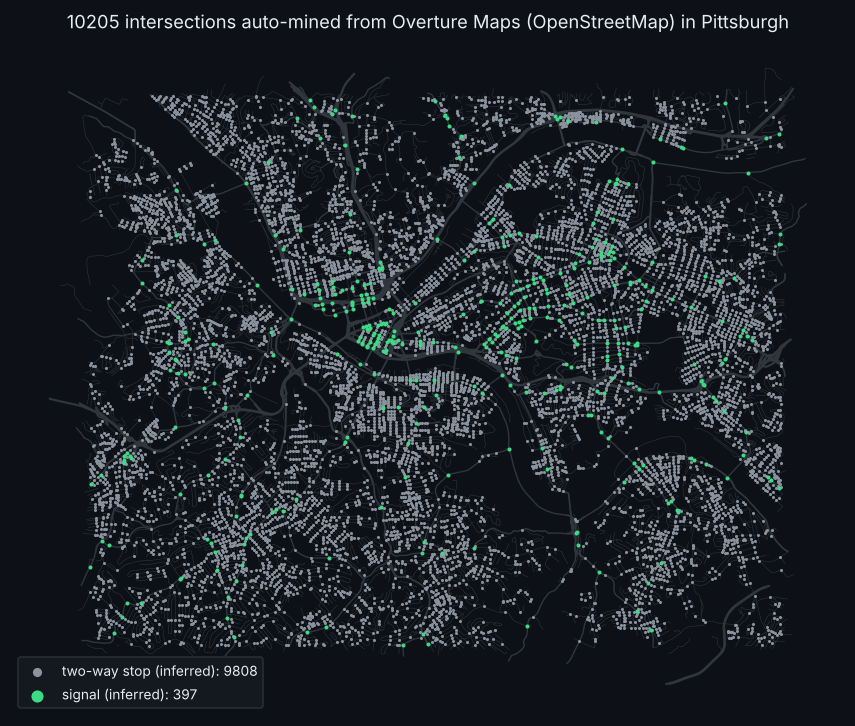

Each intersection keeps its real geometry: legs at their real bearings, one-way legs, T-junctions, 1-3 lanes per
direction. Turning paths are curves sized to the turn. The stop-line distance clears the crossing roads, and conflict
points are computed from the actual paths. Signal timing splits the green by demand. At two-way stops, minor-road
drivers stop, then go when the gap is clear; of two drivers waiting on crossing paths, the first to stop goes first.

| | |
|---|---|
| 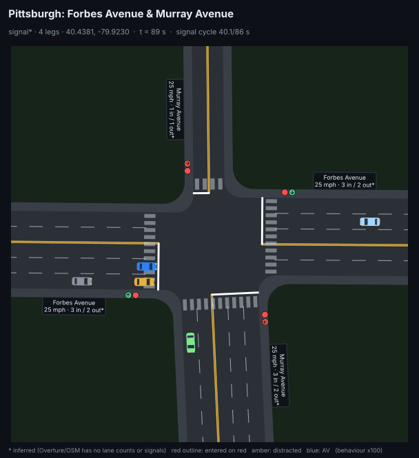 | 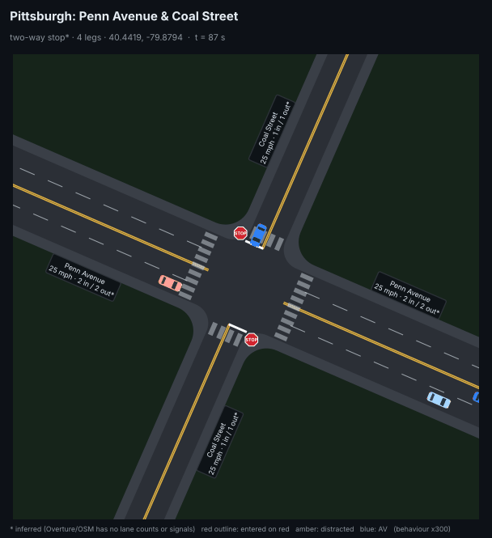 |
| Forbes Ave & Murray Ave (Squirrel Hill), inferred signal | Penn Ave & Coal St, inferred two-way stop |
| 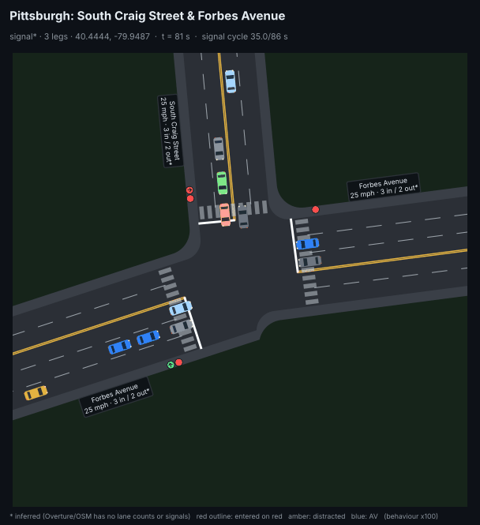 | 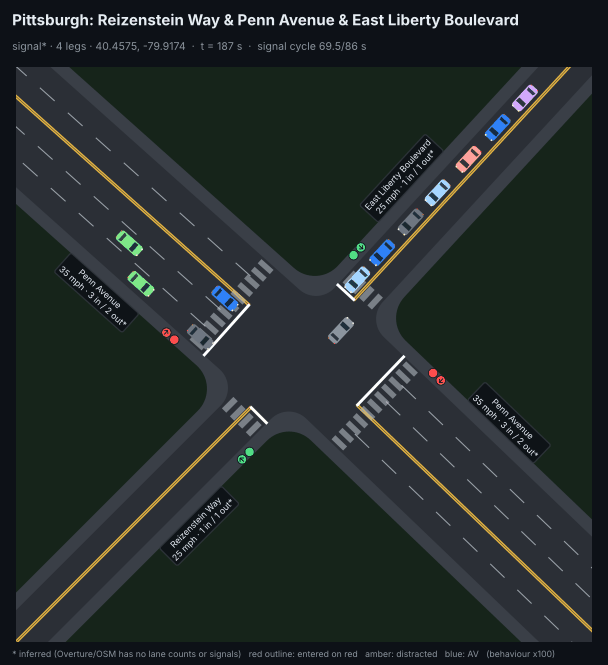 |
| S Craig St & Forbes Ave (Oakland), a signalised T | Penn Ave & East Liberty Blvd, a skewed signalised crossing |

*The crash clips amplify risky behaviour (x100 at signals, x300 at stop signs) so that a crash happens within 24 s.
One more clip: [Ohio River Blvd & Shiloh Ave](docs/pgh_ohio_river_boulevard_shiloh_avenue.gif), a two-way-stop T.*

**Checks on the real layouts:** with risky behaviour switched off, 1,024 Pittsburgh intersections (all 397 inferred
signals plus 627 stop-controlled) run 20 minutes each with **zero crashes**. All of them flow: even the worst gets 60 %
of its demand through. Getting there took fixing several problems, all of them found on real Pittsburgh geometry:

* skewed T-junctions set the stop line 47 m back;
* two cars merging into one exit were counted as a rear-end while still 35 m apart;
* on narrow two-lane streets, opposing protected left turns crossed each other;
* two left-turners facing each other each waited for the other, a gridlock in about 5 % of four-leg intersections.

**Crash survey** (`python -m pgh.survey`): 2,048 intersections (all inferred signals plus a random 1,651 stop-controlled),
30 simulated minutes each, ran in 9 minutes. That is 433,000 entering vehicles with the calibrated behaviour. It saw 2
crashes, 0.25 per million entering vehicles after scaling. **That is too few to rank intersections or compare
signal and stop control** (90 % interval 0.04-0.8). It would need roughly 20x more simulated traffic, which is possible
on a GPU.

## What is simulated

| | |
|---|---|
| **Roads** | any 3- or 4-leg layout: real bearings, 1-3 lanes in and out per leg, one-way legs; per approach up to 4 paths (left, two through, right) through the box, with every point where two paths cross or merge |
| **Control** | signals: per road a protected left phase where there are left-turn bays, then through with permissive lefts, 3 s yellow, 1-2 s all-red, right turn on red; two-way stop: the major road never stops, minor-road drivers stop fully and go when clear |
| **Driving** | IDM car following; lane changes to reach the turn lane; yellow decided once at onset; gap acceptance for permissive lefts, right on red and stop signs; start-up lost time; drivers look before going on a fresh green; **evasive braking** after a 0.7-1.5 s reaction time when a car crosses their path |
| **Risky behaviour** | late red-light running; not looking before turning or changing lanes; not signalling (the driver cut in front of reacts late); distraction (1.5-3 s without reacting); aggressive gap acceptance |
| **Crashes** | rear-end (same lane), angle and left-turn (crossing paths in the box), sideswipe (merges, lane changes), detected from car bodies |
| **AVs** | a share of vehicles that always look and signal, never run reds, are never distracted, accept larger gaps and react in 0.3 s |

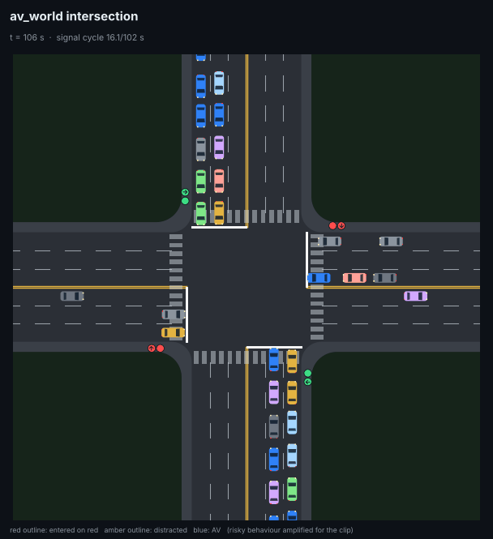

*The default intersection: 4 legs, 3 lanes each way (left-turn bay, through, through or right). Red outline: entered on red;
amber: distracted right now. Risky behaviour amplified x100 for the clip.*

## Calibrated to real crash data

Crashes are rare, so `xworld/calibrate.py` probes each behaviour on its own at an amplified level. It measures crashes
per million entering vehicles (MEV) per unit of that behaviour, and fits the behaviour rates to the targets with bounded least
squares. A verification run then applies all the calibrated behaviours together. It amplifies them as much as possible while keeping every
probability below 1 (x18.5), then scales the rates back down. Calibration uses the default intersection.

| (urban signalised 4-way intersection) | simulated | published |
|---|---|---|
| **crashes per million entering vehicles** | **0.62** (fit 0.74) | **0.78** (Massachusetts statewide signalised average); 1.26 (generic intersection safety table) |
| rear-end share | 50 % (fit 50 %) | 36 % (HSIS, Michigan + Minnesota, 4-leg signalised) |
| angle share | 21 % (fit 13 %) | 20.3 % (Minnesota), 25.8 % (California) |
| left-turn share | 29 % (fit 26 %) | ~15 % (assumed; not in the sources found) |
| red-light-running share of crashes | 21 % | 16-20 % (HSIS, four states) |
| red-light runs per 1000 entering vehicles | 0.60 | 3.9 (Melbourne, 15 intersections; studies range ~1-19) |

The verification run had 14 crashes, so the rate is uncertain by about ±30 % and the shares by about ±13 points. **The
crash rate and mix match; red-light-run frequency is still 6x too low.** Each simulated red run is more likely to end in
a crash than a real one, so matching the crash data leaves too few red runs. Making red running realistic took three
mechanisms: runners only enter in the first 0.3 s of red, start-up lost time, and drivers who look before going on
green. It is still the main open gap.

**Read the calibrated behaviour rates as effective rates, not observed frequencies.** The fit gives:

* 5.1 % late red-light runners;
* not looking in about 1 in 89,000 drivers;
* very rare distraction.

In the model a distraction is a complete 1.5-3 s blackout and a non-looker never checks; real lapses are far more
common but much milder. Stop-sign running and pedestrians are not modelled, which matters most at the stop-controlled
Pittsburgh intersections.

## AV share

Same calibrated world (default intersection), AVs replacing human drivers (runs amplified x18.5, rates scaled back):

| AV share | 0 % | 25 % | 50 % | 100 % |
|---|---|---|---|---|
| crashes per MEV | 0.62 | 0.75 | 0.62 | 0 |
| crashes in the run | 14 | 17 | 14 | 0 |

With 14-17 crashes per run, **0-50 % AVs are not distinguishable**. Only an all-AV fleet clearly removes crashes, and that
follows from how the model is built: every crash needs a human error, and these AVs make none. The AV here is a simple
careful-driver model. The next step is to drive the AVs with the learned policy from
[`av_world_rl`](https://github.com/haggler3/av_world_rl), so that the result is measured, not assumed, and to run much
longer on a GPU.

## Speed

`python -m xworld.bench` on 4 CPU cores (default intersection, 700 vehicles/h per approach):

| intersections in parallel | intersection-hours per second | entering vehicles per second |
|---|---|---|
| 256 | 1.5 | 2,800 |
| 1024 | 1.9 | 3,600 |
| 2048 | 1.9 | 3,600 |

About 8 minutes per million entering vehicles on CPU. Supporting any layout per intersection cost about 14 % of the
speed of the earlier fixed-layout version (2.2 intersection-hours per second).

The whole step is one jitted function with fixed shapes, and per-intersection layouts are just batched arrays, so
running thousands of *different* real intersections costs the same as thousands of copies of one. It should be much
faster on a GPU.

## Run it

```bash
pip install -r requirements.txt
export JAX_DEFAULT_PRNG_IMPL=unsafe_rbg        # much cheaper random numbers on CPU

python -m xworld.calibrate                     # probes, fit, verification (~15 min) -> results/calibration.json
python -m xworld.calibrate av                  # crash rate vs AV share -> results/av_sweep.json
python -m xworld.render --out docs/intersection.gif
python -m xworld.bench
python -m pytest -q tests

python -m pgh.fetch                            # Pittsburgh roads from Overture's public S3 (~1 min) -> data/
python -m pgh.mine                             # mine intersections -> data/pgh_intersections.json, docs/pgh_map.png
python -m pgh.survey                           # calibrated crash survey over 2,048 intersections -> results/pgh_survey.json
python -m pgh.gifs                             # labelled GIFs -> docs/pgh_*.gif

python -m xnet.experiment                      # whole area: clean / risky drivers / pedestrians (~9 min) -> results/xnet_oakland.json
python -m xnet.render                          # whole-area overview and street-view GIFs -> docs/xnet_oakland_*.gif
python -m pytest -q tests/test_xnet.py
```

For another city, change `BBOX` in `pgh/fetch.py`. For another area of Pittsburgh, add a bounding box to `AREAS` in
`xnet/network.py` (`squirrel_hill` and `downtown` are there) and pass its name.

In code:

```python
import jax
from xworld import sim as S
from pgh import layouts as P

beh = S.Behaviour(p_red=0.05, p_av=0.3)                      # any behaviour mix, any AV share
metrics, state = S.run_batch(jax.random.PRNGKey(0), n_envs=1024, seconds=600, beh=beh)   # default intersection
print(S.summary(metrics))                                    # crashes per MEV by type, red runs, lane changes

its = P.load()[:512]                                         # 512 mined Pittsburgh intersections, one per env
lay = S.stack([P.build(i)[1] for i in its])
m, _ = S.run_batch(jax.random.PRNGKey(0), len(its), 600, beh, lay=lay, per_env=True)   # [512, metrics]

from xnet import network as NW, sim as X
net, geo, info = NW.build("oakland")                         # the whole area
sim = X.Sim(net, n_envs=8, beh=X.Behaviour(demand=1.0, p_av=0.2))
sim.run(3600)                                                # one hour, 8 copies, rerouting every 5 min
print(X.summary(sim.st.m))
```

## Limitations

* Lanes, signal locations and demand at the real intersections are inferred from road class, not observed (marked * in
  the GIFs). Signal plans are generic, not Pittsburgh's actual timings.
* The area simulator has a residual crash rate of its own (37 per million junction entries, above); paths through a
  junction are fixed curves, and vehicles do not swerve; at most 2 lanes per direction; no parking manoeuvres, cyclists
  or grades (Pittsburgh's hills).
* Only 3- and 4-leg intersections; no roundabouts or all-way stops; no pedestrians, cyclists, trucks, grades or
  single-vehicle crashes (about 16 % of real crashes are outside the four modelled types).
* Arrivals that find the entry occupied are dropped (8-15 % of demand at the Pittsburgh intersections); rates are per
  vehicle that actually entered.
* Lane changes are instantaneous; vehicles follow fixed paths through the box.
* Calibration uses one target set from a few sources, on the default intersection; red-light-run frequency is 6x below
  observations (above).

## Layout

```
xworld/geometry.py   any 3-/4-leg layout: lanes, paths, conflict points, lane/move tables (CANON = default 4-way)
xworld/sim.py        the batched simulator; Layout = one intersection's tables + control plan (stack to vmap)
xworld/calibrate.py  calibration to crash data, verification, AV sweep
xworld/render.py     top-down GIFs with car sprites, signals, stop signs and street labels
xworld/bench.py      throughput
pgh/fetch.py         Pittsburgh roads from Overture Maps (public S3)
pgh/mine.py          intersection mining and attribute inference
pgh/layouts.py       mined intersection -> Geometry + Layout
pgh/survey.py        calibrated crash survey over many real intersections
pgh/gifs.py          labelled Pittsburgh GIFs
xnet/network.py      a whole map area: links, lanes, junction boxes, moves, conflict points, control, crosswalks, routing
xnet/sim.py          the batched area simulator (following, lane changes, merges, right of way, pedestrians, buses, ...)
xnet/experiment.py   clean / risky drivers / pedestrians in one area
xnet/render.py       overview and street-view GIFs
avrl/xppo.py         multi-agent PPO in xnet (one shared policy drives every AV); xeval.py, xviz.py
avrl/ladder.py       the dynamics ladder (training worlds of increasing dynamics, scored in one test world); ladder_plot.py
avrl/bench.py        AVBench: 11 scenarios x 8 checks vs the rule-based AV, envelope / barrier function / no filter; bench_plot.py
wmplan/              latent world model (data.py, model.py), CEM planner (planner.py), evaluate.py, viz.py, plot.py
avlab/               condition sweeps (sweep.py), statistics (analyze.py), charts (plot.py)
avrl/active.py       active scenario selection: uniform vs level replay vs failure-focused replay; active_plot.py
xnet/export_web.py   recordings + maps for the browser viewer (docs/viewer/)
docs/index.html      the project site (GitHub Pages from /docs)
avrl/env.py, ppo.py  the corridor driver (small_av_world), export.py: weights and parity vectors for Rust
dwm/                 diffusion / flow world models; DWM_SOURCE=city | xnet; xnet_data.py (logs from the area simulator)
dwm/scaling.py       scaling laws across architectures (compute, simulated data); scaling_plot.py
tests/               geometry, conflict-free signal plans, zero crashes without risky behaviour (default and
                     real-world-like layouts), behaviour -> crash type, determinism; area network consistency,
                     routes, flow, distraction -> rear-ends, determinism
results/             calibration.json, av_sweep.json, pgh_survey.json, xnet_oakland.json, ladder/, active/, bench/, avlab/, wmplan/, scaling/, xnet*/ (policies), dwm/, final/
```

Sources: [Overture Maps](https://docs.overturemaps.org/) (transportation theme, release 2026-09-23.1;
© OpenStreetMap contributors, ODbL),
[Massachusetts crash rate data](https://www.mass.gov/service-details/intersection-and-roadway-crash-rate-data-for-analysis),
[intersection safety course (C04-039)](https://www.cedengineering.com/userfiles/C04-039%20-%20Intersection%20Safety%20-%20US.pdf),
[FHWA HSIS signalised intersection study](https://www.fhwa.dot.gov/publications/research/connectedvehicles/11040/004.cfm),
[IHSDM crash type defaults](https://ihsdm.org/public/html/user/cpm/cpm_em.9.html),
[SWOV: red light running (Melbourne observations)](https://swov.nl/en/publicatie/red-light-running).
