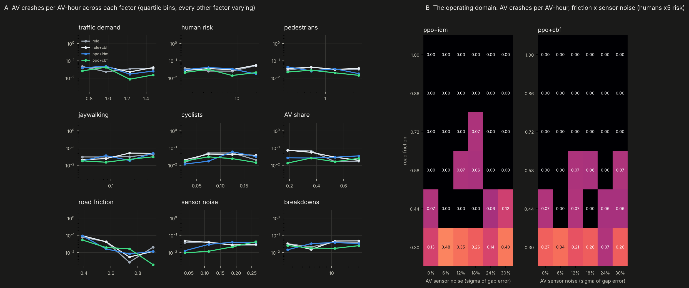

# avlab: how the AV performs under hundreds of conditions

AVBench (`avrl/bench.py`) is a fixed exam: 11 scenarios × 8 pass/fail checks. avlab is the stress lab around it. It
samples the whole space of conditions, runs every driver through all of them on identical traffic, and fits models that
say **what** makes the AV crash, **how** it crashes and **where its operating domain ends**.

## The experiment

Nine factors, sampled by Latin hypercube. Each sample is one vmapped copy of the area, so 192 different worlds run in
one batch:

| factor | range | what it changes |
|---|---|---|
| traffic demand | 0.6 - 1.6 × | volume, queues spilling back through junctions |
| human risk | 1 - 30 × (log) | red runners, drivers who pull out without looking, distraction, close passes of cyclists |
| pedestrians | 0.3 - 3 × (log) | crossing volume |
| jaywalking | 3 - 50 % (log) | pedestrians crossing against the signal or into a short gap |
| cyclists | 0 - 20 % of trips | slow riders in the lane, overtaking, close passes |
| AV share | 10 - 80 % | how often the AV meets copies of itself |
| road friction | 0.3 - 1.0 | snow ~0.3, wet ~0.6, dry 1: the hardest possible braking is 9 m/s² × friction |
| sensor noise | 0 - 30 % | multiplicative error on every gap the AV perceives |
| breakdowns | 1 - 50 × (log) | lanes blocked by broken-down vehicles |

Five drivers, each starting from the same warm state of every condition with the same random numbers:

| configuration | driver | safety filter |
|---|---|---|
| `rule` | the rule-based AV (IDM, gap acceptance) | none |
| `rule+cbf` | the rule-based AV | control barrier function |
| `ppo+idm` | PPO, 234k steps | the IDM envelope it was trained with |
| `ppo+cbf` | PPO, 234k steps | control barrier function |
| `ppo raw` | PPO, 234k steps | none |

The control barrier function (`xnet.sim.cbf_bound`) keeps three barriers non-negative:

- **braking distance:** h = gap − d0 − τv − (v² − v_lead²)/2b, so the AV can always stop behind an obstacle braking
  like it is braking now;
- **junction entry:** time-to-conflict of traffic with priority − time to clear − margin ≥ 0;
- **merging:** the car the AV cuts in front of can stay behind it at 3 m/s².

It assumes a dry-road b = 6 m/s². That assumption is exactly where it breaks (below).

Oakland: 192 conditions × 150 s, about **1,300 AV-hours per configuration**. Two unseen neighbourhoods, Squirrel Hill
and Downtown: 64 conditions each. Plus a 6 × 6 friction × sensor-noise grid with 4 seeds per cell.

## Results


**Oakland, all conditions pooled** (exact Poisson 95 % intervals):

| configuration | AV crashes /AV-h | per 100k AV-km | AV km/h | hard brakes /AV-h | human drivers' crashes /veh-h, same conditions |
|---|---|---|---|---|---|
| rule | 0.034 (0.025-0.045) | 200 | 16.9 | 75 | 0.063 |
| rule+cbf | 0.036 (0.027-0.048) | 218 | 16.6 | 75 | 0.069 |
| ppo+idm | 0.031 (0.022-0.042) | 182 | 16.9 | 18 | 0.063 |
| **ppo+cbf** | **0.021 (0.014-0.031)** | **131** | 16.4 | **17** | 0.064 |
| ppo raw | 0.516 (0.477-0.556) | 2,986 | 17.3 | 5.5 | 0.061 |

- **The learned driver under the barrier function is the safest configuration.** It has 0.021 crashes per AV-hour:
  a third of the human drivers' rate in the same conditions, 38 % below the rule-based AV, with 4.5× fewer hard brakes.
  The model rates it safer than the humans around it in **96 %** of the 192 conditions (rule-based AV: 81 %).
- **The barrier helps the learned driver and not the rule-based one.** The rule-based AV already brakes like the
  barrier would. PPO drives closer to the edge, so the barrier has something to catch: 0.031 → 0.021.
- **Pedestrians are the dominant way the AV crashes:** 51-65 % of AV crashes in every filtered configuration. Most
  are jaywalkers stepping out inside the stopping distance. Merge crashes come next for the rule-based AV (16-28 %).
  Without a filter, PPO's crashes are rear-ends (41 %) and pedestrians (53 %).

**What drives AV crashes** (B; Poisson regression over all nine factors, rate ratio from the low to the high end of a factor):

- **Road friction dominates everything.** Going from snow to dry cuts the crash rate 20-50× for every filtered driver
  (rate ratio 0.02-0.05). It matters far less for the raw policy (0.69), which crashes on dry roads anyway.
- **Sensor noise hurts only the learned driver:** 3.5× (envelope) and 6.3× (barrier) from no noise to 30 %. The
  rule-based AV is insensitive (0.86). The policy never saw noisy gaps in training, and the barrier acts on the noisy
  gaps too.
- **Jaywalking** raises every driver's crash rate 1.7-3.2×. **More AVs** make the rule-based AV much safer (0.14×:
  fewer humans to be hit by), while the learned driver doesn't benefit.



**The operating domain** (right): crashes per AV-hour over friction × sensor noise, with humans 5× riskier. Above
friction 0.58 nearly every cell is 0. At **0.3 (snow) every driver crashes 0.07-0.48 times per AV-hour**, with or
without the barrier. That is the edge of the operating domain, and the reason is visible in the barrier itself: it
assumes 6 m/s² of braking, and snow allows 2.7. The four conditions the model rates most dangerous for `ppo+cbf` all
have friction 0.31-0.43 and sensor noise above 22 %.

**Unseen neighbourhoods:**

| map | rule | rule+cbf | ppo+idm | ppo+cbf | ppo raw | humans |
|---|---|---|---|---|---|---|
| Oakland (training map, 192 conditions) | 0.034 | 0.036 | 0.031 | **0.021** | 0.52 | 0.063 |
| Squirrel Hill (64) | 0.055 | **0.042** | 0.065 | **0.042** | 0.42 | 0.051 |
| Downtown (64) | 0.127 | 0.102 | 0.112 | **0.101** | 0.75 | 0.070 |

Squirrel Hill mostly transfers. With the barrier function, both drivers are below the humans' rate (0.042 vs 0.051-0.055);
without it, both are slightly above (0.055 and 0.065), within the intervals. **Downtown does not transfer.** In its dense
one-way grid, every AV configuration crashes more than the human drivers around it (0.10-0.13 vs 0.07). That's the
clearest target for the next round of training.

```bash
python -m avlab.sweep warm oakland                  # sample and warm 192 conditions (~3 min)
python -m avlab.sweep run oakland rule              # one configuration (~2 min): rule, rule+cbf, ppo+idm, ppo+cbf, "ppo raw"
python -m avlab.sweep warm squirrel_hill            # and downtown; then run each configuration
python -m avlab.sweep grid                          # friction x sensor-noise grid (~5 min)
python -m avlab.analyze                             # -> results/avlab/report.md, summary.json
python -m avlab.plot                                # -> docs/img/avlab_overview.png, avlab_conditions.png
```
