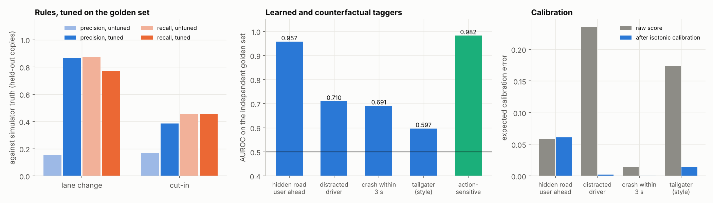
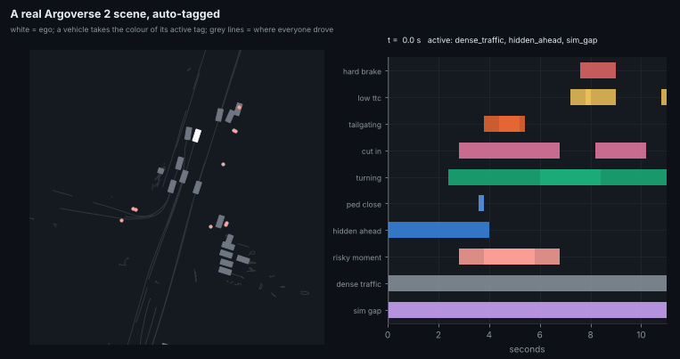
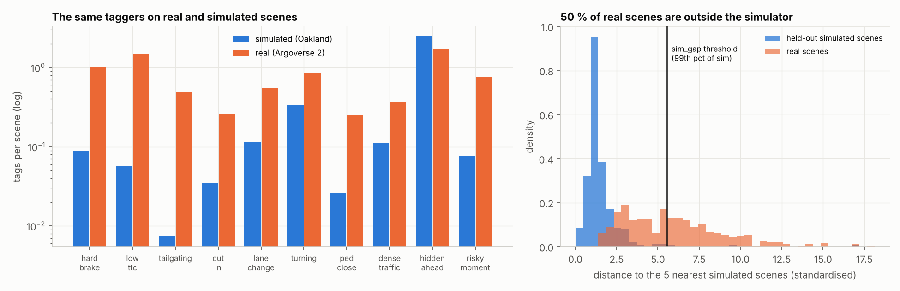
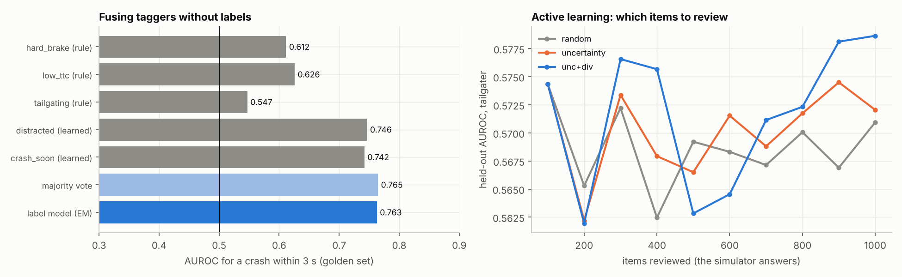
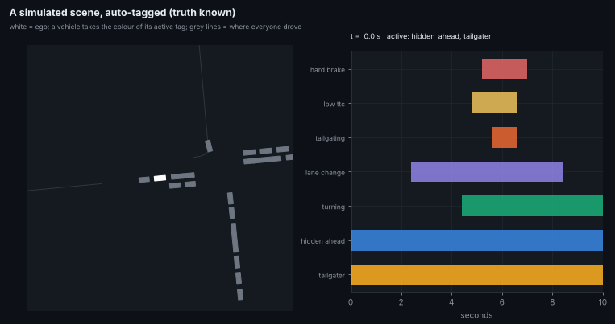
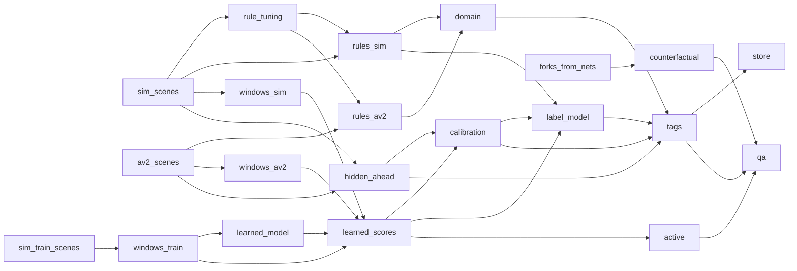

# Scene auto-tagger: labels nobody can annotate, taught by the simulator

Fleets record far more driving than anyone can label, so data teams tag scenes automatically. They mine "cut-ins at night",
"pedestrian hidden behind a bus" or "near-misses" for training and test sets. Two problems make that hard:

* **Rules see only kinematics.** A rule can find a hard brake. It cannot find a distracted driver or a road user nobody saw.
* **Learned taggers need labels.** Nobody can label from video what a driver was thinking or what was behind the truck.

This simulator holds every hidden trait and cause in its state, can fork the world, and exports simulated runs and real Argoverse 2 logs in **one
scene format**. The auto-tagger trains its hidden-state taggers on simulator truth. It applies them to real logs, and it says where it should not be
trusted.

```bash
av-world tag run                                  # build or refresh every stage (cached: only stale stages rerun)
av-world tag query "cut_in & hidden_ahead" --overlap
av-world tag similar av2:0d5d8930-2bc9-4d54-a542-f3d39d090e90
av-world tag report
```
```python
from av_world import easy
easy.tag.query("low_ttc & !sim_gap", source="av2")   # [(scene_id, overlap windows)]
easy.tag.tags("av2")                                 # the tag table (pandas)
```

## Results

The full pipeline took about 11 minutes on a 4-core CPU. A rerun after a change takes seconds, because only stale stages run.

**Data**
* **Golden set:** an independent simulated recording of 1,504 scenes with full truth. Copies 0–5 tune; copies 6–7 report.
* **Training:** a separate dense recording, for the learned taggers.
* **Real:** 400 Argoverse 2 scenes.





| tagger | measured against simulator truth (held-out) | verdict |
|---|---|---|
| lane change (rule) | precision **0.15 → 0.87**, recall 0.88 → 0.77, after tuning on the golden set | curves and junctions were false lane changes until tuned |
| cut-in (rule) | precision 0.17 → 0.38, recall 0.45 (11 true events) | still weak: geometry without lanes |
| turning (rule) | precision 0.86, recall 0.51 | misses wide, slow turns |
| hidden road user ahead (occlusion net N6) | AUROC **0.957**; at the 0.9-precision threshold: precision 0.85, recall 0.70 | strong; precision below target (correlated calibration frames) |
| distracted driver (learned) | AUROC 0.710 | **never emitted**: no threshold reaches 0.9 precision, so the tagger abstains |
| crash within 3 s (learned) | AUROC 0.691 (base rate 0.08 %) | never emitted |
| tailgater style (learned) | AUROC 0.597; emitted at precision 0.91 for 1.3 % of tailgaters | emits rarely, but correctly |
| action-sensitive moment (counterfactual) | AUROC **0.982** from the critic's spread, against 0.876 from its risk alone | strong, simulated runs only |
| calibration | expected calibration error 0.24 → 0.002 (distracted), 0.17 → 0.014 (tailgater) | scores become frequencies |

* **Fusion (label model).** For "crash within 3 s", Dawid–Skene EM reaches AUROC 0.763, the majority vote 0.765, and the best single tagger
  0.746. Fusing helps a little over any one tagger, but EM does no better than voting here. It also reports that the rule taggers carry almost
  no signal about crashes 3 s ahead (estimated sensitivity 0.02), while the learned ones do.
* **Active learning.** After 1,000 reviewed items the tailgater head reaches AUROC 0.579 with uncertainty + diversity, 0.572 with uncertainty and
  0.571 at random. The strategies are indistinguishable here: the head is too small for review to move it much.



* **Real traffic is busier and harder than the simulation.** Per scene, Argoverse 2 has:
  * 11× the hard brakes of simulated Oakland;
  * 26× the low-TTC moments;
  * 70× the tailgating.
* **50 % of real scenes fall outside the simulator's range** (1.1 % of held-out simulated scenes do). The leading reasons, as median z-scores:
  * more tracked objects: +4.2, which partly reflects that Argoverse 2 also tracks parked and distant objects;
  * harder accelerations: 98th percentile +3.6;
  * acceleration spread: +2.0;
  * more pedestrians: +1.7;
  * more tailgating: +1.5.

  This repeats from the tagging side what the SBI posterior found: the simulator's drivers are gentler than real ones. Sim-trained tags on those
  scenes carry the `sim_gap` warning.
* **Search works across sources.** `cut_in & hidden_ahead`, with time overlap, finds 19 real scenes in which a car cuts in while someone is
  hidden ahead.






## First principles

1. **A tag is a claim about an interval of a scene, made by a tagger, with a confidence.** Everything downstream works on that one record:
   search, fusion, calibration, review and drift. So the record carries its provenance (tagger, version, status), and a scene-level tag is an interval
   that spans the scene.
2. **Labels from simulator truth carry no human noise, but they do carry a domain gap.** The pipeline therefore measures the gap scene by scene
   (`sim_gap`). A sim-trained tag on a scene the simulator could not have produced is not trusted.
3. **A score is not a probability.** Calibration (isotonic) turns scores into frequencies. A threshold chosen for a precision bound turns
   frequencies into decisions with a guarantee. What falls between "sure" and "no" goes to a person.
4. **Taggers that agree tell you their accuracy.** Without any labels, agreement patterns between independent taggers identify each tagger's
   sensitivity and specificity (Dawid-Skene). That is how industrial weak supervision works.
5. **Human time is the scarce resource.** Review the items that teach the model most (uncertain, and unlike the ones already reviewed), not random
   ones.
6. **Every stage is a pure function of its inputs and config.** So the pipeline is a DAG with content-addressed caching: change one threshold and
   only the stages downstream of it rerun.

## The engineering DAG



`autotag/dag.py` is about 100 lines. A stage is `@stage(name, deps, config)` on a pure function.

```
key(stage)  = sha256(name, config, [key(d) for d in deps], source code of the function)
run(target):
    for s in topological_order(target):               # depth-first over deps
        if cache/<s>-<key(s)>.pkl exists: load it
        else: out = s.fn(*[value(d) for d in s.deps], **s.config); save it
```

**Pros**
* Only stale stages rerun: a new threshold reruns `calibration → tags → store → qa` in seconds, not the 3-minute simulation.
* A result can always be traced to the exact config and code that made it.
* `av-world tag explain` shows what is fresh.

**Cons**
* Pickled outputs are tied to Python and numpy versions.
* The cache grows until it is cleaned.
* There is no parallel execution of independent branches. Each stage already uses all four cores, so this costs little here, but it would matter
  on a cluster, where Dagster, Airflow or Ray would replace this file.

---

## The ten methods

Every method below has its stage in the DAG, pseudocode, and pros and cons.

### 1. One scene format and a versioned tag record (`scenes.py`, `schema.py`; stages `sim_scenes`, `av2_scenes`, `store`)

```
scene = {x, y, yaw, v, alive: [vehicles, frames] on a 0.2 s grid; kind, length, av; ego; pedestrians px, py; truth (sim only)}
from_av2(dir):  read_av2 → av2_to_scene(every 2nd frame) → dense arrays
from_sim(rec):  record the city (nets.collect) → every 10 s and AV: the window's vehicles within 80 m → same arrays + hidden truth
Tag = (scene_id, source, name, level, agent, t_start, t_end, confidence, tagger, version, status)
```

**Pros**
* Every tagger runs unchanged on real and simulated data; that is what makes sim-to-real evaluation possible.
* The flat table scales to millions of tags in one parquet file.

**Cons**
* Real logs carry only what the AV perceived, while simulated scenes see everything. That asymmetry is itself what `hidden_ahead` exploits.
* Lanes are not in the scene format, so lane-based rules use geometry instead.

### 2. Kinematic rules (`rules.py`; stages `rules_sim`, `rules_av2`)

```
for each vehicle i, frame t:  leader(i,t) = nearest j with x_ij > 0, |y_ij| < 1.8 m, |heading_ij| < 35°   (in i's frame)
gap = x_ij - (L_i + L_j)/2;  headway = gap / v_i;  TTC = gap / (v_i - v_j) when closing
hard_brake:  v(t) - v(t + 1 s) > 4 m/s from above 3 m/s
tailgating:  headway < 0.8 s for ≥ 1 s above 3 m/s           low_ttc: TTC < 1.5 s, closing > 0.5 m/s, gap < 25 m
cut_in:      j becomes i's leader within 15 m and 2 s earlier was 2.5-6 m to the side, parallel, while i went straight
lane_change: lateral move > threshold within 3 s, heading back within tolerance, total swing small (not a curve)
turning: |Δheading| > 60° within 4 s      queued: stopped ≥ 2 s behind a stopped car      ped_close: > 3 m/s within 4 m of a pedestrian
```

**Pros**
* Transparent, instant, with no training.
* The same numbers as the incident statistics measured on real logs (`avlab.incidents`).

**Cons**
* Geometry stands in for lanes, so curves and junctions produce false lane changes and cut-ins until the thresholds are tuned (method 10).
* Rules cannot see anything hidden.

### 3. Learned taggers from simulator truth (`learned.py`; stages `windows_train`, `learned_model`, `learned_scores`, `hidden_ahead`)

```
features(i, t) = (v, a, has_leader, gap, closing speed, leader accel, |yaw rate|, vehicles within 20 m)     # trajectories only
window = features over the last 5 s (25 frames)
labels from the simulator at the window's end:
    distracted  = dist_t > 0         tailgater = IDM headway T < 1.25 s       crash_soon = a crash within 3 s
train a causal dilated CNN (shifted copies + matmul) on a separate, dense recording; up-weight rare positives
hidden_ahead = occlusion net N6 from the ego's view (visible road users only) → P(someone hidden 25 m ahead in the lane)
```

**Pros**
* Tags that cannot exist otherwise: nobody can annotate "distracted" or "hidden" from a log, but the simulator knows.
* Trained on a recording separate from the golden set, so the evaluation is honest.

**Cons**
* The labels are only as realistic as the simulator's drivers, and the domain check exists for exactly this reason.
* A hidden state with no behavioural signature in 5 s cannot be learned, and the scores say so.

### 4. Calibration, a precision threshold and abstention (`calibrate.py`; stage `calibration`)

```
g = isotonic fit (pool-adjacent-violators) of truth on score, on held-out calibration copies
t_emit   = min t such that WilsonLower95(precision of {g(s) ≥ t}) ≥ 0.9        # emit: status "auto"
t_review = min t such that WilsonLower95(precision) ≥ 0.5                       # review band: status "review"
tag = auto if g(s) ≥ t_emit; review if t_review ≤ g(s) < t_emit; nothing otherwise
```

**Pros**
* Confidences mean frequencies: the expected calibration error drops by an order of magnitude.
* A tag that cannot reach the precision target is not emitted at all, rather than emitted badly.
* The review band sends exactly the uncertain items to people.

**Cons**
* The guarantee assumes calibration and new data come from the same distribution. Windows from one scene are correlated, so the effective sample is
  smaller than its count and the bound is optimistic: the held-out precision of `hidden_ahead` came out below its target (see Results).
* It says nothing about real logs, where the domain check has to take over.

### 5. The domain check: `sim_gap` (`domain.py`; stage `domain`)

```
f(scene) = 17 numbers: density, speeds, acceleration spread and tails, pedestrians, the rate of each kinematic tag
z = (f - mean_sim) / sd_sim;      d(scene) = mean distance to its 5 nearest simulated scenes in z
threshold = 99th percentile of d on held-out simulated scenes;   tag sim_gap if d > threshold; explain by the largest |z|
```

**Pros**
* It flags exactly the real scenes where sim-trained tags should not be trusted, and says why (which statistics).
* It is also a mining tool: the scenes the simulator cannot produce are the next things to build.

**Cons**
* kNN in 17 dimensions is cheap, but the result depends on the choice of features and the standardisation.
* A scene can sit inside the simulated range on these 17 numbers and still be unrealistic in other ways.

### 6. Search and similarity (`search.py`; stage `store`)

```
query("cut_in & hidden_ahead & !sim_gap"):   recursive-descent parse → predicate over each scene's set of tag names
overlap mode: intersect the time intervals of the positive tags; keep scenes where the intersection is not empty
embedding(scene) = [scene features, log(1 + count of each tag)];  similar(id) = top-k cosine in the standardised space
```

**Pros**
* Boolean queries cover most mining requests.
* Overlap mode answers "while", not just "and".
* Similarity search finds more of a rare scene from one example.

**Cons**
* The embedding is hand-built; a learned scene encoder (wm2 agent tokens) would capture interaction structure better.
* The search is brute force (fine to about 10⁶ scenes; beyond that, use an ANN index).

### 7. Counterfactual tags (`counterfactual.py`; stage `counterfactual`)

```
from the exact forks (nets/forks.py): action_sensitive = the AV's true 4 s outcome differs between its 5 actions (other dice fixed)
tagger for new moments: spread = max_a Q(o, a) - min_a Q(o, a) of the interventional risk critic (N2)
```

**Pros**
* A label that exists only because the world can be forked with every other die held fixed. It marks the moments where the AV's choice matters,
  which are the most valuable moments for training and testing a planner.

**Cons**
* It needs the AV's 28 observation features, so it tags simulated runs and any stack that logs them, not Argoverse 2.
* It is only as good as the critic.

### 8. Weak-supervision label model (`labelmodel.py`; stage `label_model`)

```
labelling functions per window: hard_brake, low_ttc, tailgating (rules, last 2 s), distracted, crash_soon (learned, top 2 % of scores)
Dawid-Skene EM, started from the majority vote:
    M: a_j = Σ q_i[v_ij=1] / Σ q_i,   b_j = Σ (1-q_i)[v_ij=0] / Σ (1-q_i),   π = mean q
    E: q_i = π Π a_j^[v=1](1-a_j)^[v=0] / (… + (1-π) Π (1-b_j)^[v=1] b_j^[v=0])
risky_moment = q ≥ 0.5;   check: AUROC of q against simulator truth, against majority vote and the best single tagger
```

**Pros**
* Fuses taggers without any labels.
* Estimates every tagger's accuracy, which is itself a quality report.
* New taggers plug in as one more column.

**Cons**
* It assumes the taggers are independent given the truth, and rules computed from the same gap and speed are not.
* With rare positives, EM can settle on "always negative". It is started from the majority vote for that reason, and checked against the
  simulator.

### 9. Active learning (`active.py`; stage `active`)

```
pool = calibration windows, test = golden set; the simulator answers as the reviewer
repeat 10 rounds: fit the head (logistic on the network's logit + 12 summary features) on the reviewed items
    random:        100 at random
    uncertainty:   the 100 with p closest to 0.5
    unc+div:       the 500 most uncertain → k-centre greedy picks 100 spread out in feature space
record held-out AUROC against the number reviewed
```

**Pros**
* Strategies are compared with a perfect reviewer before any person's time is spent.
* Diversity guards against re-asking near-duplicates.

**Cons**
* The head here is small, so how much the strategies differ depends on the tag (see Results).
* With a person instead of the simulator, label noise enters, and the loop needs a review interface and a verdict store. Neither is built here
  (`status` already has "confirmed" and "rejected").

### 10. Golden-set QA, rule tuning and drift (`pipeline.py`; stages `rule_tuning`, `qa`)

```
golden set = an independent simulated recording with full truth (copies 0-5 tune, 6-7 report)
rule_tuning: grid over lane-change and cut-in thresholds → best F1 against truth on copies 0-5
qa: event-level precision / recall for rules (interval overlap ±1 s); AUROC, precision and recall at threshold, ECE before / after for learned tags;
    domain share; tag rates per scene, real vs simulated (drift)
```

**Pros**
* Every number in this page is recomputed by `av-world tag run` after any change, against labels that are exact.
* Rule thresholds are chosen by data, not by hand.

**Cons**
* The golden set is simulated: its truth is exact, but it inherits the simulator's blind spots.
* Real-data quality still needs a small human-labelled set, which the review queue (method 9) is meant to build.

## Extend it

A new kinematic tag is one block in `rules.tag_scene` plus a line in `schema.ONTOLOGY`. A new learned tag is one more label column in
`learned.windows`. The DAG reruns only what depends on the change.
