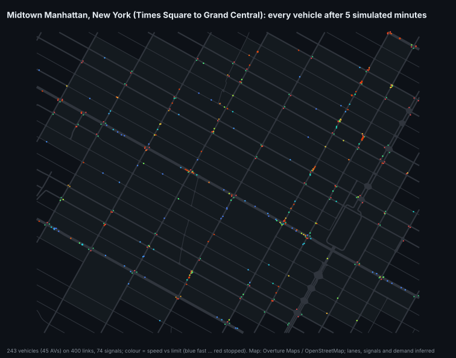
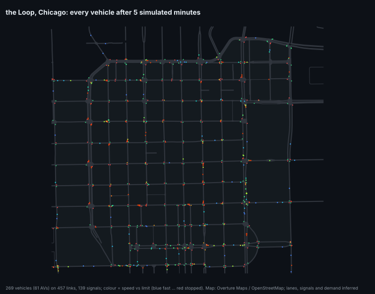
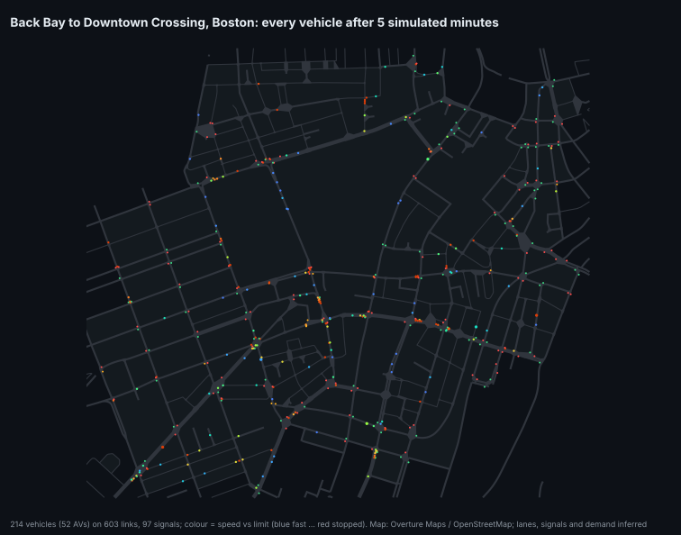
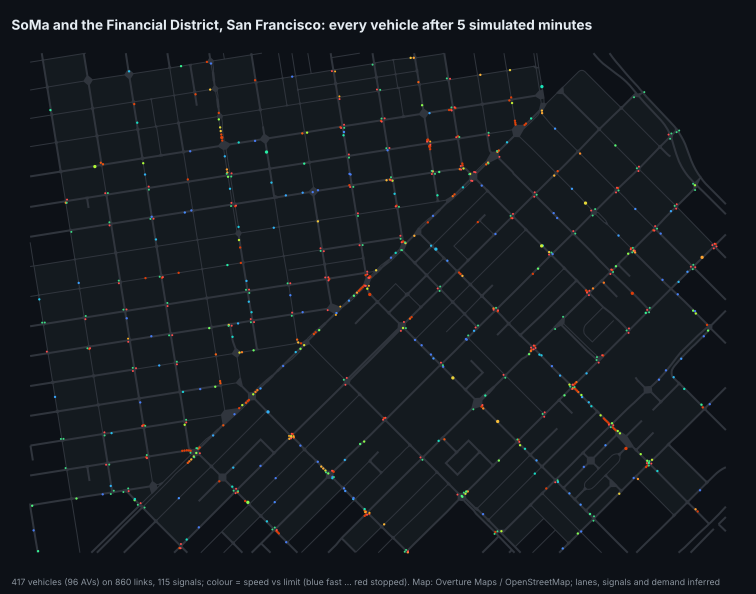
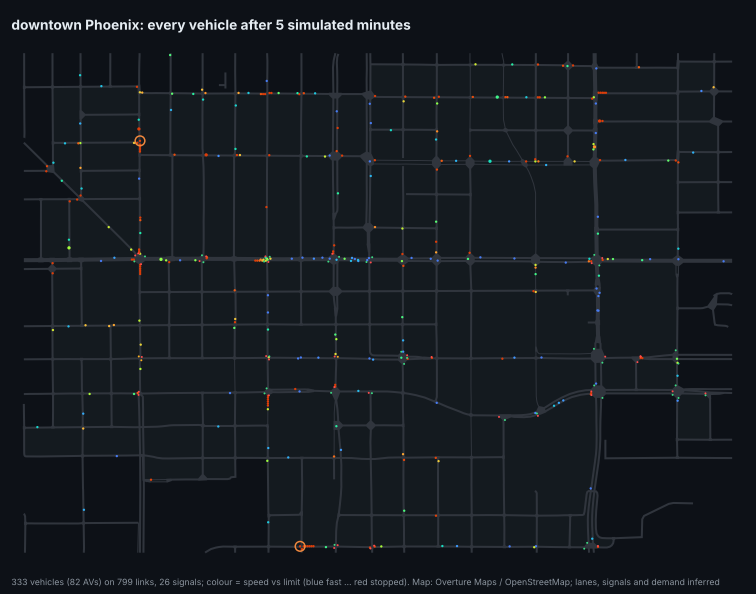
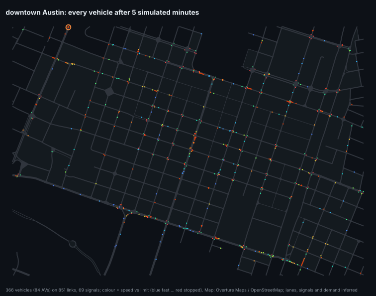
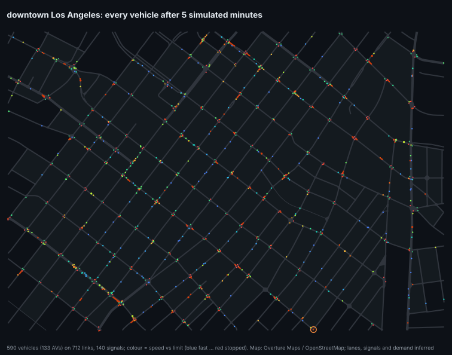
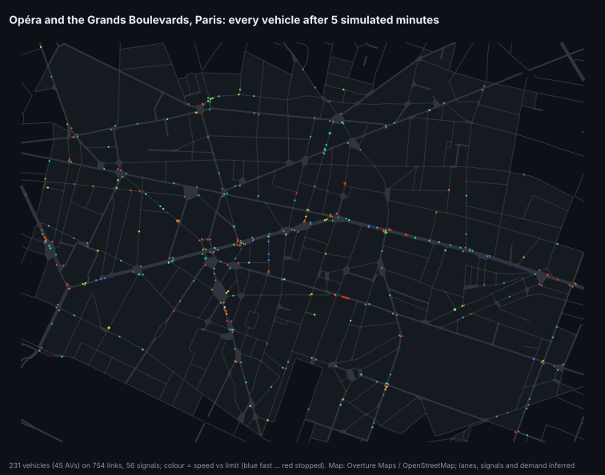

# More cities: New York, Chicago, Boston, San Francisco, Phoenix, Austin, Los Angeles, Paris

Eight more cities, built the same way as the Pittsburgh areas: road segments from [Overture Maps](https://docs.overturemaps.org/) (built
largely from OpenStreetMap), lanes, signals, stop signs, crosswalks and demand inferred from road class, and the junction model, routing and
calibrated human behaviour of the area simulator. Each is a central box about the size of the Oakland area (roughly 2.5 km x 1.7 km).
San Francisco, Phoenix, Austin and Los Angeles are where robotaxis operate today; Paris is the first city outside the US. The trimmed map
files (130-200 kB each) ship with the package, so nothing needs downloading.

Each city records the Overture release its map came from (`CITIES[name]["release"]`): New York, Chicago and Boston from 2026-09-23.1 (no
longer on Overture's bucket, so their bundled files are kept as they are), the five newer cities from 2026-11-18.0.

```python
import av_world
env = av_world.make("new_york", n_envs=8)    # or chicago, boston, san_francisco, phoenix, austin, los_angeles, paris
```
```bash
av-world export-carla manhattan --area new_york --seconds 60       # OpenDRIVE map + trajectories + replay script for CARLA
av-world sil --area chicago --egos 1                               # drive an AV in the Loop from your own controller (SIL_HIL.md)
python -m xnet.cities survey                                       # every city -> results/cities/survey.json
python -m xnet.cities survey paris austin                          # just these -> results/cities/survey_paris_austin.json
python -m xnet.cities fetch paris && python -m xnet.cities bundle paris   # refresh one map from Overture (its recorded release)
python -m xnet.cities snapshots paris                              # docs/img/city_paris.png
```

The two tables below use the same settings: 8 copies of each city, 300 s warm-up, then 600 s measured (1.3 area-hours), calibrated humans
and 25 % rule-based AVs. The first table is `results/cities/survey.json`; the second is `results/cities/survey_more_cities.json`, run on a
machine that was also running another job using about two of the four cores, so its simulated-seconds-per-second row is lower than the
first table's for that reason and the two rows should not be compared.

| | Midtown Manhattan | Chicago Loop | Back Bay to Downtown Crossing, Boston | Oakland, Pittsburgh (reference) |
|---|---|---|---|---|
| area (west, south, east, north) | -73.997, 40.748, -73.972, 40.763 | -87.640, 41.874, -87.618, 41.889 | -71.078, 42.345, -71.055, 42.360 | -79.968, 40.436, -79.940, 40.452 |
| directed links / paths through junctions | 400 / 990 | 457 / 1,127 | 603 / 1,281 | 622 / 1,253 |
| signalised junctions / crosswalks | 74 / 699 | 139 / 716 | 97 / 926 | 34 / 608 |
| km of lanes | 81.5 | 78.7 | 63.9 | 81.5 |
| vehicles on the network (mean) | 279 | 379 | 309 | 574 |
| mean speed | 17.9 km/h | 15.2 km/h | 13.0 km/h | 14.3 km/h |
| simulated s per wall-clock s (8 copies, 4 CPU cores) | 667 | 604 | 648 | 668 |
| crashes in 1.3 area-hours (calibrated humans, 25 % rule-based AVs) | 3 (merge 2, pedestrian 1) | 7 (pedestrian 4, rear-end 2, merge 1) | 13 (pedestrian 6, angle 5, left-turn 1, merge 1) | 4 (pedestrian 2, rear-end 1, left-turn 1) |

| | SoMa and Financial District, San Francisco | downtown Phoenix | downtown Austin | downtown Los Angeles | Opéra and Grands Boulevards, Paris |
|---|---|---|---|---|---|
| area (west, south, east, north) | -122.417, 37.779, -122.389, 37.795 | -112.087, 33.442, -112.060, 33.458 | -97.756, 30.260, -97.730, 30.276 | -118.264, 34.039, -118.236, 34.055 | 2.321, 48.863, 2.355, 48.879 |
| directed links / paths through junctions | 860 / 1,828 | 799 / 2,037 | 851 / 2,067 | 712 / 1,733 | 754 / 1,473 |
| signalised junctions / crosswalks | 115 / 1,172 | 26 / 863 | 69 / 989 | 140 / 813 | 56 / 1,230 |
| km of lanes | 99.4 | 107.0 | 106.1 | 117.0 | 71.8 |
| vehicles on the network (mean) | 619 | 473 | 511 | 875 | 318 |
| mean speed | 12.3 km/h | 16.2 km/h | 15.8 km/h | 14.1 km/h | 14.5 km/h |
| simulated s per wall-clock s (8 copies, shared machine, see above) | 320 | 316 | 323 | 423 | 417 |
| crashes in 1.3 area-hours (calibrated humans, 25 % rule-based AVs) | 11 (rear-end 5, pedestrian 3, angle 1, left-turn 1, merge 1) | 6 (pedestrian 6) | 24 (rear-end 11, pedestrian 10, left-turn 3) | 44 (rear-end 20, pedestrian 15, merge 5, left-turn 3, angle 1) | 9 (left-turn 3, merge 3, pedestrian 3) |










## What is and is not real here

* **Real:** the street geometry, which streets are one-way, the road classes, and speed limits where the map has them. Manhattan's rotated
  grid of one-way streets and Chicago's Loop grid come out as they are.
* **Inferred, not observed:** lanes per road, which junctions have signals, signal timings, and traffic demand. Demand comes from road
  class, the same rule as Pittsburgh, so Midtown carries fewer cars here (about 280 on the network) than it does at a real rush hour, and the
  pedestrian volumes are generic. Boston's irregular junctions produce more angle crashes than the grids; with 1.3 simulated hours per city
  the crash counts are small, and the differences between cities are not significant. Los Angeles stands out (875 vehicles, 44 crashes):
  most of its downtown streets are mapped as primary or secondary roads, so the class-based rule gives it the most demand and the most
  lane-kilometres; that is a consequence of the rule, not a measurement of Los Angeles traffic.
* **Phoenix's signals are undercounted.** Signals are guessed where a secondary-or-higher road crosses a tertiary-or-higher one, and many
  downtown Phoenix streets (1st, 2nd and 3rd Streets, Adams, Madison, Jackson, Fillmore) are mapped as residential, so the builder finds
  26 signalised junctions where the real grid is signalised almost every block; the rest get stop signs.
* **Speed limits** are read in either unit (the map stores mph or km/h). Where a road has no mapped limit the builder assumes the US
  default of 25 mph (40 km/h); mapped limits cover 29-69 % of the four newer US cities' segments and 98 % of Paris's (almost all 30 km/h).
* **Paris** builds and simulates with no changes to the builder: Overture uses the same road classes everywhere, and Paris drives on the
  right like the simulator. What is not French: signal timing, gap acceptance and pedestrian behaviour are the US-calibrated ones, there
  is no priorité à droite at unsignalised junctions (the minor road stops, as in the US), and multi-leg places such as the Place de l'Opéra get
  the same two-phase signal plan as any other junction. Left-hand-traffic cities (London, Tokyo) are not included:
  the simulator assumes right-hand traffic.
* Two lanes per direction at most (Manhattan's avenues have more), no bus lanes, bike lanes, turn restrictions or parking.
