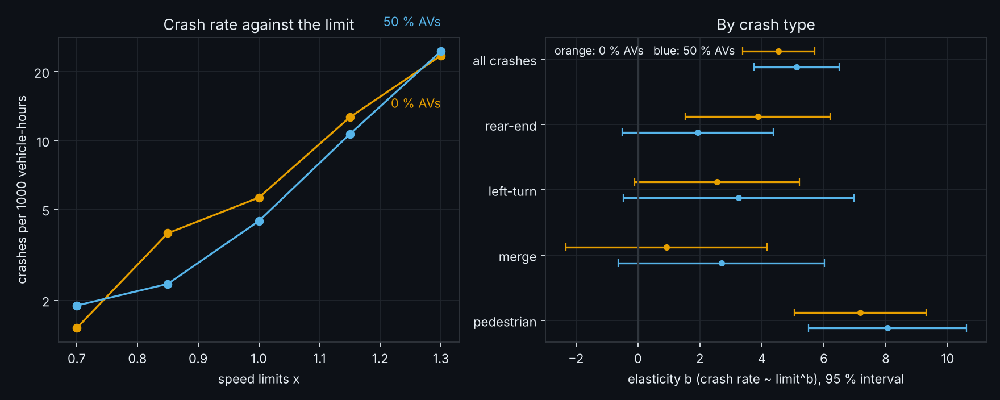
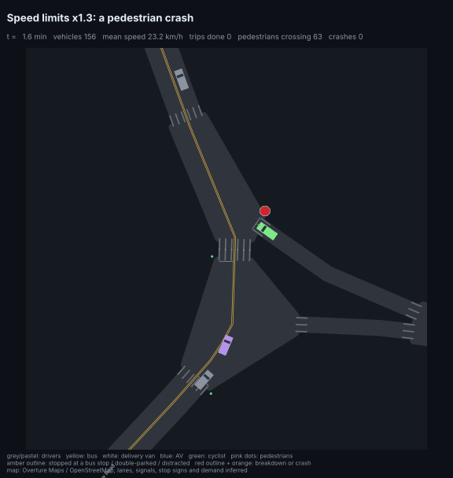
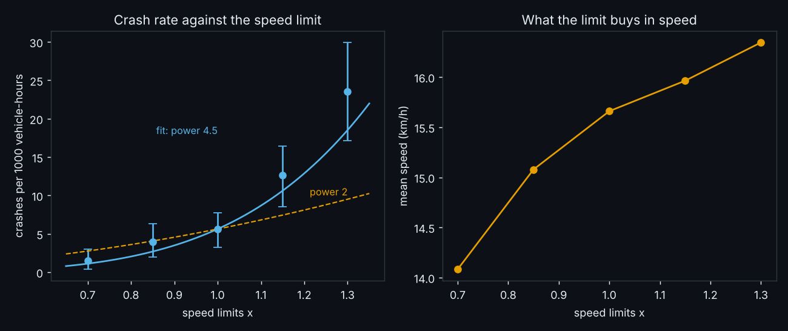
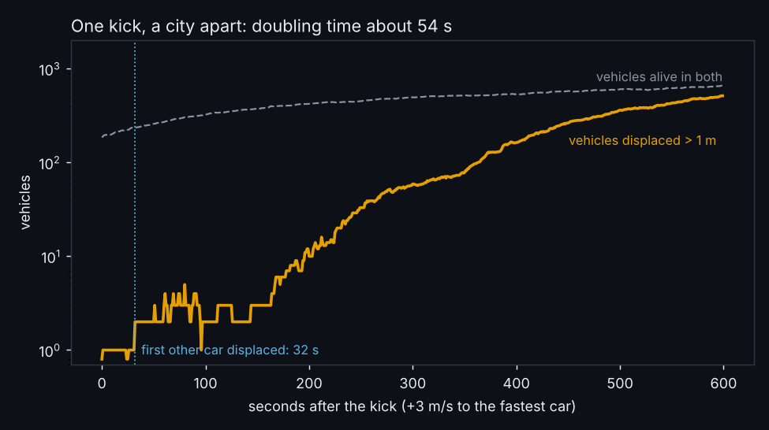
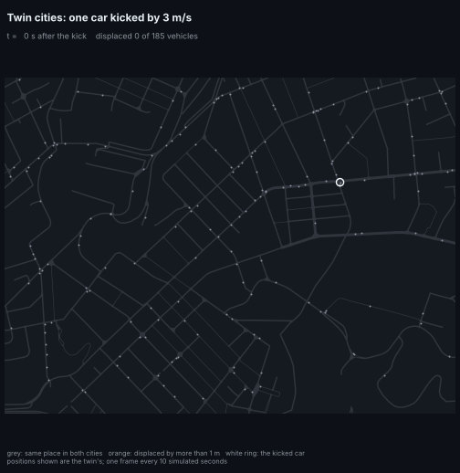
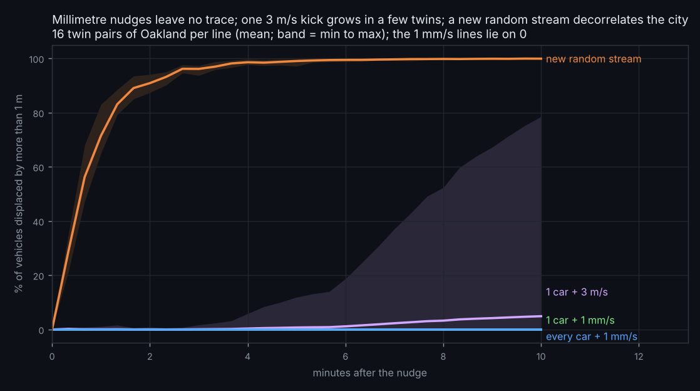
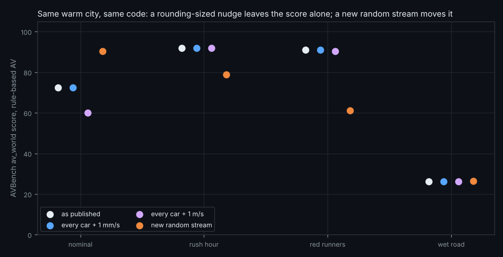
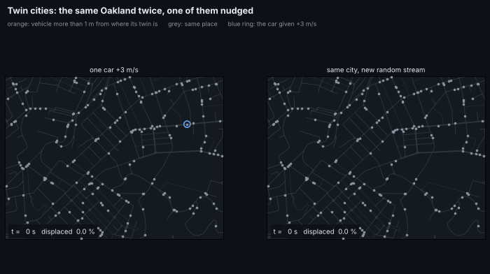

# Daily research log

One entry per day, newest first. Each entry: the ideas kept, the pseudocode, the result, the figures, and what to try next. The
search behind each day's choice (candidates, probes, scores) is in `results/daily/<date>/search.json`.

## What to try next (running list)

1. **Check which random stream the L4 leaderboard used** (carried over). Re-score the rule-based AV on CPU with `unsafe_rbg` and compare with the stored GPU row.
2. **Seeds with intervals on every leaderboard row** (carried over): `avlab.twins.bench` with `restream=1..N`, ~45 min, split over days.
3. **Is the junction-box handoff the cause of the twin divergence in general?** Only 1 of 16 single-car kicks diverged, and a 1 m/s kick to every car is "displaced" at once under the 1 m rule, so this needs a different displacement threshold (for example a decision change: another track or a turn) before it can be counted over many kicks.
4. Settle H4's curve shape and H3's wet-road threshold (GPU-sized data).
5. **Why do the rule-based AVs not reduce pedestrian crashes?** Pedestrian crashes at x1.3 were 38 (0 % AVs) and 41 (about 45 % AVs). Read a few with `avlab.blackbox` (`types=("pedestrian",)`): does the AV's envelope brake for a pedestrian who steps out without WALK, or only for one already in the crosswalk? Then try a 100 % AV city (`python -m avlab.speedlimit --p-av 1.0`, ~12 min) and a pedestrian-yield knob.
6. **Weight crashes by impact speed** to compare with Nilsson's fatal exponent 4 (needs the impact speed recorded, which the counters do not keep).
7. **More power for the AV x limit interaction**: the 95 % interval of the difference of two elasticities is about +-1.8 here; 4x the copies would halve it.

---

## 2026-11-05 - Does a city with AVs pay less for a higher speed limit? (No measurable difference)

**Ideas kept** (from 12 candidates; [search](../results/daily/2026-11-05/search.json)): (1) repeat the speed-limit sweep with about half of the cars AVs and compare the
crash-rate elasticity, overall and by crash type (next step 5 of yesterday, merged with step 6's by-type question); (2) a zoomed black-box GIF of a
pedestrian crash at x1.3 limits. Prior art: the power model (Nilsson; Elvik) is for human traffic, and a 2025 review of speed and crash
models says mixed-traffic effects on it are neglected ([ITF, speed changes and crash risk](https://www.itf-oecd.org/sites/default/files/docs/speed-changes-crash-risk.pdf)); a standard web search found nothing on AV share and the exponent, so as far as I can tell this has not been measured.

### Pseudocode (what the code does)

```
avlab/speedlimit.py --p-av 0.5   (the saved 0 % run is unchanged)
    for scale in 0.7 0.85 1.0 1.15 1.3:   net["link_v"] *= scale;  32 copies, calibrated humans with Behaviour.p_av = 0.5 (rule-based AV under its envelope),
                                          warm 120 s, count 600 s; record crashes, vehicle-hours, by crash type
avlab/speedshare.py
    b, se   = quasi-Poisson regression of crashes on log(scale), offset log vehicle-hours, per copy, for each world
    per type: the same on the 5 scale totals, SE x sqrt(dispersion of the all-types fit)   (per-copy type counts are not stored)
    z = (b_0 - b_50) / sqrt(se_0^2 + se_50^2); two-sided p; Holm correction over the 5 comparisons (all types + 4 types with crashes at >= 3 scales)
    --gif: hunt (blackbox.hunt, new `types` filter) for a pedestrian crash with all limits x1.3, replay it, zoomed GIF
```

### Prediction, written before the full run

P1: with half the cars AVs, the elasticity is lower than 4.5 by at least 1 (the difference significant at 95 %), because AV share halves crashes in the AV-share sweep and AVs keep a longer headway. (Quick probe at x0.7 showed no visible AV effect, 5 against 4 crashes, but that is a few crashes.)

### Result

| limit | crashes, 0 % AVs | crashes, ~45 % AVs | rate per 1000 vehicle-h, 0 % | rate, ~45 % |
|---|---|---|---|---|
| x0.70 | 4 | 5 | 1.5 | 1.9 |
| x0.85 | 10 | 6 | 3.9 | 2.4 |
| x1.00 | 14 | 11 | 5.6 | 4.4 |
| x1.15 | 31 | 26 | 12.6 | 10.7 |
| x1.30 | 57 | 59 | 23.5 | 24.6 |

(AV share measured on a probe run: 41-47 % of the alive vehicles are AVs through the 12 minutes; buses, vans and cyclists are never AVs.)



**P1 failed.** Elasticity 4.5 (SE 0.6) with no AVs and **5.1 (SE 0.7)** with about half: the difference is -0.6 (p = 0.53), so the data cannot tell the two
apart and the point estimate goes the wrong way. The interval of the difference is roughly +-1.8, so an effect of 1 or less is not excluded.
By crash type (totals-based SEs, Holm over 5 comparisons, all adjusted p = 1.0): pedestrian 7.2 (SE 1.1) against 8.1 (SE 1.3); rear-end 3.9 against 1.9 (the one hint of an AV effect: p = 0.26 unadjusted); left-turn and merge are too sparse.
Pedestrian crashes at x1.3 are 38 against 41: the AVs do not remove the crashes that carry the speed effect. At the standard limit the AVs have fewer crashes (14 to 11), which is within the noise of yesterday's AV-share sweep. `results/speedlimit/speedshare.json`, `results/speedlimit/speedlimit_av50.json`.



The GIF is one pedestrian crash with every limit x1.3 (102 s in; a car at 57 km/h three seconds before, 37 km/h at impact after braking at -9 m/s^2, hitting a pedestrian who started crossing without WALK). One example, not a sample.

**Tests**: `tests/test_daily_1105.py` (Holm, the elasticity fit recovers a known power, the comparison detects a real difference and not an absent one). Health check at the start: `tests/test_ideas.py tests/test_easy.py tests/test_examples.py` 27 passed, 1 skipped.

---

## 2026-11-04 - A power law for speed limits, and anatomy of a diverging twin

**Ideas kept** (from 14 candidates; [search](../results/daily/2026-11-04/search.json)): (1) scale every speed limit of Oakland and fit the crash
rate's power of the limit (next step 5 of yesterday); (2) trace the one twin that diverged after a 3 m/s kick, to find how the
disturbance spreads (next step 3). Prior art: Nilsson's power model puts the exponent at 2 for injury crashes, 3 for serious
and 4 for fatal ones, and later work (Elvik 2009, 2013) finds lower, speed-dependent exponents
([Elvik, TOI](https://toi.brage.unit.no/toi-xmlui/bitstream/11250/2602719/2/Elvik_10.1016_j.aap.2012.07.012.pdf),
[ITF](https://www.itf-oecd.org/sites/default/files/docs/speed-changes-crash-risk.pdf); I did not retrieve the exact 2009 values).
Perturbation growth in car-following models is classic traffic physics (e.g. [chaos in traffic flow models](https://arxiv.org/pdf/chao-dyn/9812006)).

### Pseudocode (what the code does)

```
1. avlab/speedlimit.py   for scale in 0.7 0.85 1.0 1.15 1.3:
                           net["link_v"] *= scale                 # a copy of the net dict; xnet/ is untouched
                           32 copies of Oakland, calibrated humans, warm 120 s, count 600 s -> crashes, vehicle-hours, vehicle-km
                         quasi-Poisson regression (offset log vehicle-hours) of crashes on log(scale), per copy
2. avlab/twintrace.py    copy 9 of the 16-copy twin experiment; warm 120 s; kick the fastest car of the twin by +3 m/s
                         run both for 600 s in 1 s steps, recording alive / track / arc position / speed per slot
                         displaced = alive in both and (|ds| > 1 m or another track); first[v] = first second displaced
                         parent(v) = nearest already-displaced vehicle on v's track within 30 m, else none
                         doubling time = 1 / slope of log2(#displaced) over the stretch where it goes from 4 to half its maximum
```

### Predictions, written before the full runs

* P1 (speed limits): the crash rate rises with the limit with elasticity b >= 2 (lower 95 % bound above 0), although mean speed rises less than the limit because the city is congested. (Quick probe: mean speed 18.6 -> 22.8 km/h for x0.7 -> x1.3.)
* P2 (twin): the kick spreads first through car following: the first other vehicle displaced is on the kicked car's track. (The doubling time came from the first full run, so it is not a prediction.)

### Results

| limit | crashes | vehicle-h | crashes per 1000 vehicle-h | mean speed (km/h) | trips finished |
|---|---|---|---|---|---|
| x0.70 | 4 | 2646 | 1.5 | 14.1 | 13,124 |
| x0.85 | 10 | 2545 | 3.9 | 15.1 | 14,143 |
| x1.00 | 14 | 2489 | 5.6 | 15.7 | 14,626 |
| x1.15 | 31 | 2452 | 12.6 | 16.0 | 14,931 |
| x1.30 | 57 | 2425 | 23.5 | 16.3 | 15,226 |



**P1 held.** Crash rate against the limit: elasticity **b = 4.5** (SE 0.6; 95 % interval 3.4 to 5.7, dispersion 1.0), well above 2
and consistent with 4. A 30 % higher limit raises mean speed by 4 % (15.7 to 16.3 km/h) and finished trips by 4 %, but crashes per
vehicle-hour by 4.2x. Pedestrian crashes carry most of it: 5 at x1.0 and 38 at x1.3 (of 14 and 57 crashes in total). Caveats:
the counts are small (116 crashes in all), one network (Oakland), crashes are all severities (Nilsson's 2 to 4 are for injury classes),
and the fit against measured mean speed (b = 10.3, SE 1.9) is not comparable because mean speed barely moves in a congested city.
`results/speedlimit/speedlimit.json`.





**P2 failed.** After the kick the first other vehicle is displaced at 32 s, *not* on the kicked car's track: the kicked car was in a
junction box, and the displaced car was on another track (1.6 m and 1.7 m/s off; the code does not say which rule fired, so "a conflict or gap-acceptance effect" is a reading, not a measurement). The second, at 51 s, is
off by 140 m, which is a different decision (a turn or a gap), not a slow drift; 3 cars are displaced at 60 s, 59 at 300 s, 514 of 656
at 600 s, a doubling time of **54 s**. Of 571 displaced vehicles, 126 had a displaced vehicle within 30 m on their own track, 445 did not:
the spread is mostly through junctions and discrete decisions, not through queues. One twin, one kick: this explains one divergence,
not all. `results/twintrace/trace.json`.

**Tests**: `tests/test_daily_1104.py` (Poisson fit recovers a known elasticity, displacement and parent logic on toy data).

---

## 2026-11-03 - Twin cities: is the simulator chaotic, and what moved the leaderboard?

**Ideas kept** (from 16 candidates; [search](../results/daily/2026-11-03/search.json)): (1) twin-run test of sensitive dependence on initial
conditions; (2) its child: AVBench scores of the rule-based AV under the same nudges. Both test one explanation from
[FIXES.md](FIXES.md#14-the-leaderboard-does-not-reproduce-across-hardware): "floating-point differences flip rare events".
Prior art: sensitive dependence is the definition of chaos (Lorenz 1963); traffic models with car following are known to be
stable or unstable depending on parameters (string stability of IDM, e.g. Treiber and Kesting, *Traffic Flow Dynamics*, 2013); the
non-determinism of GPU numerics is documented for deep learning (e.g. Nagarajan et al., *Deterministic implementations for reproducibility in deep reinforcement learning*, 2018). (No web search was run today: the search tools were not used; these are cited from memory and should be checked before quoting.)

### Pseudocode (what `avlab/twins.py` does)

```
A. for each of 16 seeds: warm Oakland (calibrated humans) 120 s; twin = a copy of the state
   nudge the twin: one car +1 mm/s | one car +3 m/s (the fastest car) | every car +1 mm/s | the simulator's random key re-keyed (fold_in)
   run both 600 s in 20 s steps (same code, same everything else)
   displaced(t) = share of vehicles alive in both whose arc position differs by > 1 m (or on another track)
   at the end: same crash count? same trips finished?
B. rule-based AV on AVBench scenarios nominal, rush hour, red runners, wet road (8 copies, 300 s warm, 180 s scored), from the
   leaderboard's warm state, under: as published | every car +1 mm/s | every car +1 m/s | the state's random key re-keyed
   (avrl.bench.runner got `kick`, `restream`, `seed`, `key_seed`; defaults reproduce the leaderboard run exactly)
```

### Predictions, written before the full runs (after a 4-copy probe, so P1 was already half-known)

* P1: nudges of 1 mm/s (one car or every car) displace < 1 % of vehicles at 10 min, and >= 90 % of twins keep the same crash count and trips; the same nudges change no AVBench score by more than 1 point.
* P2: a new random stream decorrelates the city (> 50 % displaced within 1 min, the same crash count in < 60 % of twins) and moves AVBench scores by >= 10 points on average.

### Result

| nudge | displaced at 1 / 5 / 10 min | twins with any displacement | same crash count | same trips |
|---|---|---|---|---|
| one car + 1 mm/s | 0 / 0 / 0 % | 0 of 16 | 16 / 16 | 16 / 16 |
| every car + 1 mm/s | 0.02 / 0 / 0 % | 0 of 16 | 16 / 16 | 16 / 16 |
| one car + 3 m/s | 0.1 / 0.7 / 4.9 % | **1 of 16** (79 % of its vehicles) | 16 / 16 | 15 / 16 |
| new random stream | **71 / 99 / 99.9 %** | 16 of 16 | 7 / 16 | 0 / 16 |



AVBench, rule-based AV, one run each from the leaderboard's warm state (`results/twins/bench.json`):

| scenario | as published | every car +1 mm/s | every car +1 m/s | new random stream |
|---|---|---|---|---|
| nominal | 72.5 | 72.5 | 60.1 | 90.3 |
| rush hour | 92.0 | 92.0 | 91.9 | 78.8 |
| red runners | 91.0 | 91.0 | 90.4 | 61.2 |
| wet road | 26.2 | 26.2 | 26.1 | 26.5 |
| mean absolute change | | 0.01 | 3.3 | **15.3** |





(The GIF shows seed 0, where the +3 m/s twin stays in step: the 1-in-16 divergence is not that one.)

**Both predictions held.** The simulator is **not chaotic at rounding scale**: a nudge of a thousandth of a metre per second to
every car leaves no vehicle displaced by a metre in ten minutes and no AVBench score changed (0 of 16 twins diverged: 95 % upper
bound 21 %). A large kick to one car does cascade sometimes (1 of 16, 95 % interval 1-28 %), so sensitive dependence exists, but
rarely. A different random stream changes everything, and moves a rule-based AV's scenario score by 15 points on average
(+17.9, −13.2, −29.7, +0.3), the same size as the CPU-versus-GPU drift in FIXES.md #14 (core means moved 8; single scenarios up to 75).
A 1 m/s kick to every car, far above rounding, moved one scenario (nominal) by 12 points and the others by under 1.

**What it means.** Per-scenario scores are draws from a wide distribution, not constants, and a hardware change matters through
whatever re-rolls the random stream, not through rounding. That is consistent with the drift but does not prove its cause: the
GPU run's generator was not recorded (next step 1). The practical rule is the one already in the README: read means over scenarios
and rankings, and put an interval on any single score.

**What failed.** The first version of the "new random stream" condition changed `key_seed`, which only reaches a *learned* policy;
the rule-based AV and the humans draw from the simulator state's own key, so the four scores came back identical and the condition
did nothing. It was caught by the null result, fixed with `restream` (re-keying the state), and rerun; only the fixed numbers are
reported above. Limits: 16 twin pairs and one AVBench run per cell (a single scenario score is itself a draw), one city, one nudge
location rule (the fastest car), and "displaced" uses a 1 m threshold, so sub-metre differences are not counted.

Commands: `python -m avlab.twins` (~3 min), `python -m avlab.twins --bench` (~10 min), `python -m avlab.twins --plot`; test: `tests/test_twins.py`.
