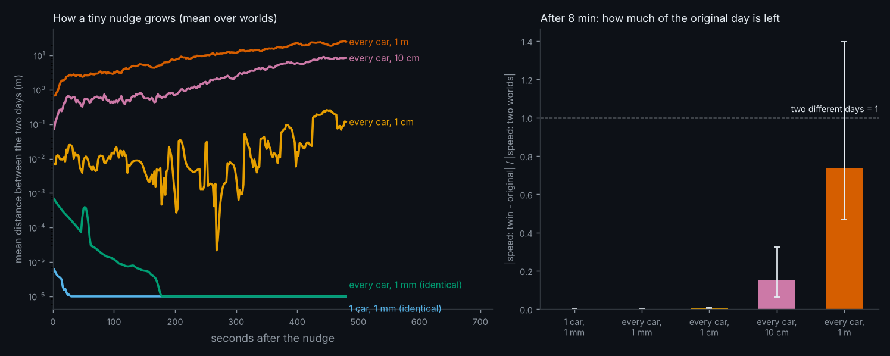
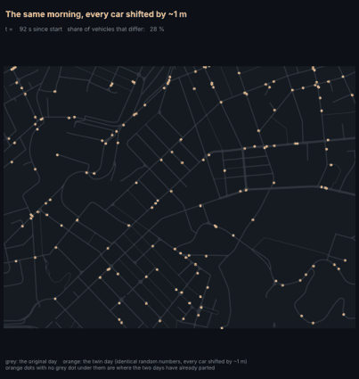
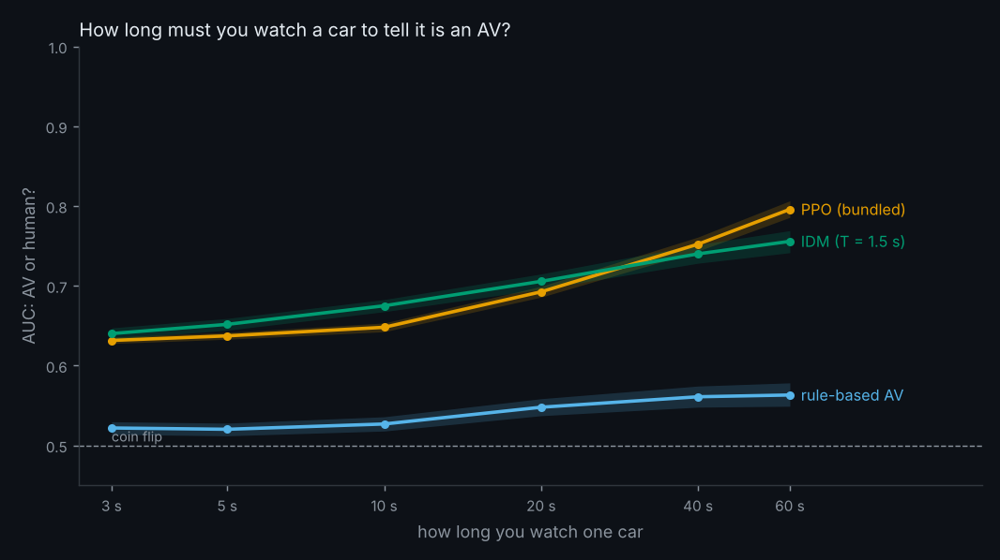

# Daily research log

One entry per day, newest first. Each entry lists the ideas kept, the pseudocode, the result and what to try next. The search over
candidate ideas is in `results/daily/<date>/search.json`, the falsifiable predictions in `results/daily/<date>/prediction_*.md`.

## 2026-11-02: the butterfly effect, and how long you must watch a car

Health check at the start: `tests/test_ideas.py`, `test_easy.py`, `test_examples.py` passed (27 passed, 1 skipped).

### 1. How big a nudge changes the day? (`python -m avlab.butterfly`, ~6 min)

Why: [FIXES.md #14](FIXES.md#14-the-leaderboard-does-not-reproduce-across-hardware) found that AVBench scores re-roll on other hardware. If the simulator
were chaotic, a floating-point difference would be enough.

```
for 10 worlds (own key each): warm up 90 s
    make twins of the state: one car moved by eps, or every live car moved by eps * N(0,1) metres; eps in {0 (control), 1 mm ... 1 m}
run all twins 8 min with the same random numbers (same key)
every 2 s: diverged = share of slots, alive in either run, whose alive flag / track / position (> 1 m) differ;  spread = mean |ds|
end: |speed(twin) - speed(original)| / |speed(world a) - speed(world b)|  ("memory ratio": 0 = same day, 1 = unrelated day)
```

Prediction 1 (the simulator is chaotic: a 1 mm nudge to one car reaches >10 % divergence in 5 min) was **falsified** by the quick run:
the nudge never grew. Prediction 2 was written after that, before the full run (see `prediction_butterfly.md`): there is a threshold,
at or below 1 cm nothing happens (memory ratio < 0.05), at ~1 m the day changes (ratio > 0.5, crash count changed in at least half the worlds).

| nudge (8 min, 10 worlds) | mean distance at the end | worlds with 10 % of vehicles diverged | memory ratio [95 %] | crash count changed |
|---|---|---|---|---|
| 1 car, 1 mm | 0 | 0 / 10 | 0.000 | 0 / 10 |
| every car, 1 mm | 1.7e-9 m | 0 / 10 | 0.000 | 0 / 10 |
| every car, 1 cm | 0.12 m | 1 / 10 | 0.003 [0.00, 0.01] | 0 / 10 |
| every car, 10 cm | 8.5 m | 9 / 10 (median 157 s) | 0.15 [0.06, 0.33] | 3 / 10 |
| every car, 1 m | 25 m | 10 / 10 (median 2 s) | 0.74 [0.47, 1.40] | 5 / 10 |

Prediction 2 holds (0.003 < 0.05; 0.74 > 0.5; 5 of 10 is "at least half"). The result in two sentences: **the simulator damps
nudges of a millimetre (they vanish, to float precision) and is sensitive from about 10 cm, so the 1e-5 relative differences between a CPU and a GPU
would not by themselves change a day; the drift of FIXES #14 must come from somewhere else** (different random streams between library
versions, or rare discrete events decided by a threshold), which this test cannot tell apart. Limits: 10 worlds, mean 0.5 crashes per
world in 8 minutes, so the crash column has little power; one network (Oakland); only positions were nudged.

 

Prior art: the literature on car-following stability finds that small perturbations dissipate in stable regimes (e.g. [arXiv 2106.15863](https://arxiv.org/pdf/2106.15863));
I found no paper measuring sensitivity to initial conditions in a full-city microsimulator.

### 2. How long must you watch a car to know it is an AV? (`python -m avlab.watchtime`, ~15 min)

```
record 4 copies x 8 min of the city (30 % AVs); keep car trips >= 60 s  (~2,800 trips per driver)
for window w in {3, 5, 10, 20, 40, 60} s: cut every trip into non-overlapping windows; 8 kinematic features per window (as avlab.turing)
logistic regression, 4-fold cross-validation by copy -> AUC; 95 % interval by resampling whole trips
```

Prediction (`prediction_watchtime.md`): PPO < 0.70 at 3 s and > 0.85 at 60 s, rising at every step; rule-based AV < 0.65 everywhere;
IDM above PPO at 3 s. **Three of four held; the 60 s value did not** (0.80, not 0.85; the whole-trip AUC of 0.88 uses longer trips).

| window | rule-based AV | bundled PPO | IDM (T = 1.5 s) |
|---|---|---|---|
| 3 s | 0.522 [0.514, 0.530] | 0.632 [0.628, 0.636] | 0.640 [0.633, 0.647] |
| 10 s | 0.527 [0.518, 0.536] | 0.648 [0.642, 0.653] | 0.675 [0.668, 0.683] |
| 60 s | 0.563 [0.549, 0.578] | 0.796 [0.786, 0.807] | 0.756 [0.741, 0.769] |

Result in two sentences: a few seconds of driving already give a weak signal for PPO and IDM (AUC 0.63-0.64), and recognisability keeps rising up to a
minute; the rule-based AV is never better than 0.56, so it is practically invisible by these eight features. The intervals resample trips but
the windows of a trip share a world, so they are somewhat too narrow.



Prior art: Maresca et al., [Are you a robot? Detecting autonomous vehicles from behavior analysis (ICRA 2024)](https://arxiv.org/abs/2403.09571), report that
performance depends on history length, with real driving data.

### What changed in the repo
`avlab/butterfly.py`, `avlab/watchtime.py`, `tests/test_daily.py` (3 tests); `results/butterfly/`, `results/watchtime/`, `results/daily/2026-11-02/`;
`docs/img/butterfly.{png,gif}`, `docs/img/watchtime.png`. Nothing in `xnet/` changed.

### What to try next (running list)
1. Find what does re-roll a score across platforms: run the butterfly twins with the *speed* and the gap-acceptance random draws nudged, and with a
   different JAX version's random stream; the nudge test says positions alone are not it.
2. Butterfly with more worlds (50+) on a crash-dense scenario, so the crash column has power; locate the 1 cm - 10 cm threshold precisely.
3. Watch time with richer features (stop-and-go counts, headway to the leader) and a sequence model; does the rule-based AV stay invisible?
4. Trip-level discriminator for the human-like reward ([FIXES.md #9](FIXES.md#9-driving-like-people-the-av-turing-test-attempted-twice)).
5. Seeds per AVBench scenario with intervals (a GPU job).
