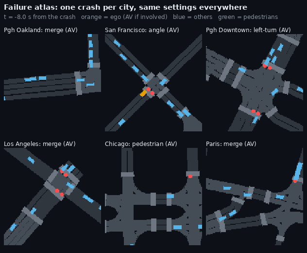
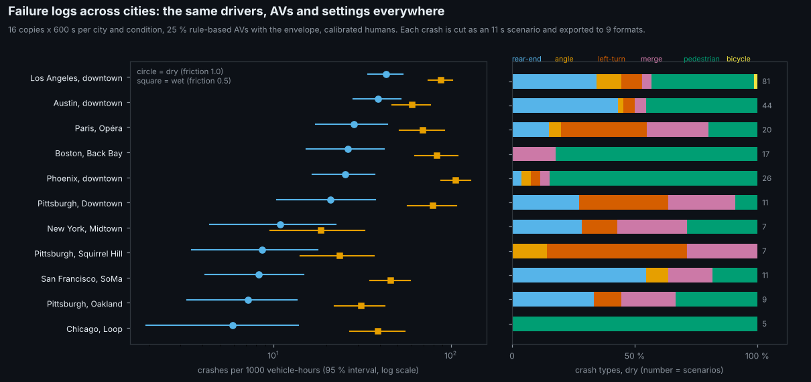

# Failure logs across cities, exported to common AV tools

Every crash in a city run becomes an 11 s scenario. All cities run under the same settings, and all scenarios share one schema
and one time window. Each scenario is exported to the formats that common AV training and testing tools read. Crash rates have
exposure as the denominator, so cities can be compared.

```bash
python -m avlab.failurelog --cities all --cond dry wet      # simulate 11 city areas x 2 conditions, cut every crash (~17 min, 4 CPU cores)
python -m avlab.failure_dataset index                        # cross-city index and rate table -> results/failures/
python -m avlab.failure_dataset export --formats all         # every scenario in every format -> data/failures_export/
python -m avlab.failure_dataset export --formats waymo av2 --per-city 5 --cities paris austin
python -m avlab.failure_dataset figures                      # docs/img/failures_rates.png, docs/img/failures_atlas.gif
```

```python
from avlab import failurelog as F, failure_export as FX
sc = F.load("data/failures/dry/paris/<id>.json.gz")          # canonical scenario (dict)
FX.export(sc, "out/", formats=["waymo", "commonroad", "bev"])
```

A small sample pack is kept in git: `results/failures/sample/` holds three scenarios (San Francisco, Paris and Oakland, dry) in every
format, plus their canonical files. The full dataset (889 scenarios, about 0.9 GB in all formats) is rebuilt by the commands
above. The OpenSCENARIO and CARLA files point to `data/failures_export/maps/<city>.xodr`, which
`python -m avlab.failure_dataset maps` writes (OpenDRIVE files are several MB per city, so they are not kept in git).



## What "cross-comparable" means here

* **Same world settings everywhere.** Calibrated human drivers and 25 % rule-based AVs with the safety envelope. Each city gets
  16 copies and 600 s after a 120 s warm-up. The two conditions are dry (friction 1.0) and wet (friction 0.5).
* **Same cut.** The window is [crash − 8 s, crash + 3 s] at 10 Hz, 111 steps, with the crash at index 80. It is interpolated
  linearly from the simulator's 5 Hz. The cut keeps every vehicle within 60 m of the crash at some step, pedestrians crossing
  within 60 m, and the map within 120 m.
* **Same taxonomy.** The event type uses the simulator's crash types (`xnet.sim.CRASH_NAMES`). It is rebuilt per event from the
  simulator's crash masks with the simulator's rules: pedestrian strike; a cyclist involved gives bicycle; a rear-end after a
  lane change in the last 3 s gives merge; a junction hit gives merge (shared exit), left-turn (a left-turning path) or angle;
  a lane-change contact gives sideswipe. Per run, these counts are compared with the simulator's own counters
  (`type_mismatch` in `rates.json`).
* **Rates with exposure.** Rates are crashes per 1000 vehicle-hours and AV-involved crashes per 1000 AV-hours, each with an
  exact Poisson 95 % interval (`results/failures/rates.json`, `rates.md`).
* **Ego.** The ego is the AV in the crash if there is one, otherwise the first vehicle in it. Every format marks the ego as its
  self-driving car (Waymo `sdc_track_index`, AV2 track `"AV"`, the CommonRoad planning problem, and so on).

## Formats

| key | for | written as | window | checked how |
|---|---|---|---|---|
| canonical | this repo; the source of every other format | `<id>.json.gz` (schema `av_world.failure/1`, see `avlab/failurelog.py`) | 111 steps | tests |
| `waymo` | Waymo Open Motion Dataset tooling, Waymax | `Scenario` proto as proto3 JSON | 91 steps, current index 10 | parsed strictly by `google.protobuf.json_format` into `scenario_pb2.Scenario`, compiled from Waymo's published `scenario.proto` and `map.proto` (lidar and camera token fields removed); read back with `xnet.avdata.waymo_to_dict` |
| `waymo_tfrecord` | the same, as WOMD files | one TFRecord shard per city and condition | 91 steps | standard TFRecord framing with masked CRC32C (no TensorFlow needed); read back and CRC-checked in tests. Needs a compiled `scenario_pb2` (from `waymo-open-dataset`) |
| `av2` | Argoverse 2 motion forecasting | `<id>/scenario_<id>.parquet` + `log_map_archive_<id>.json` | 110 steps, 50 observed | loaded by the official `av2` 0.3.1 API (`load_argoverse_scenario_parquet`, `ArgoverseStaticMap.from_json`) for 20 scenarios; also read back with `xnet.avdata.read_av2` in the tests |
| `scenarionet` | ScenarioNet and MetaDrive | `ScenarioDescription` dict, pickled | 111 steps | 40 scenarios pass MetaDrive's own `ScenarioDescription.sanity_check(valid_check=True)` (source from `metadrive` main, run with a one-line stub for its `norm` helper) |
| `gpudrive` | GPUDrive and Nocturne | JSON with `objects`, `roads` (lanes, road edges, crosswalks) and `tl_states` | 91 steps | written to match GPUDrive's own Waymo converter (`data_utils/process_waymo_files.py`: -1e4 for invalid states, Waymax map element ids, `mark_as_expert` on the colliding vehicles); not loaded in GPUDrive. Its converter skips scenes with traffic lights, and most of these have them |
| `commonroad` | CommonRoad (planning benchmarks) | XML 2020a: lanelets, dynamic obstacles, and a planning problem for the ego | 111 steps | opened with the official `commonroad-io` 2026.1 reader |
| `openscenario` | esmini, CARLA ScenarioRunner, other ASAM tools | OpenSCENARIO 1.0 `.xosc` with one `FollowTrajectoryAction` per agent, plus OpenDRIVE 1.4 `maps/<city>.xodr` | 111 steps | well-formed XML; not run in esmini or CARLA here |
| `carla` | CARLA replay | `xnet.carla_export` scene JSON + replay script + city `.xodr` | 111 steps | the replay script is tested against a stand-in of the CARLA API in `tests/test_carla_export.py` |
| `bev` | raster models (images and tensors) | `[T, 8, 128, 128]` uint8 `.npz` (lanes, junction paths, crosswalks, red stop lines, vehicles, ego, pedestrians, speed) + GIF | 2 Hz, 64 m square around the crash | tests |
| `table` | pandas, Parquet, SQL | long table, one row per agent and step | 111 steps | tests |

Coordinates are local metres (x east, y north), centred on each city. Every file carries the origin's latitude and longitude, and
the canonical scenario carries the crash's latitude and longitude.

**What the formats lose.** Waymo and GPUDrive keep 1 s of history (their convention). AV2 keeps 5 s, and CommonRoad and
OpenSCENARIO keep all 8 s. Lane boundaries are the centre line offset by ±1.8 m, and road edges are the outer edge of each
road's lane block. There are no lane markings, elevation or turn restrictions. Signal states exist only where the simulator has
signals, and stop signs are not exported. In OpenSCENARIO, agents that enter the window late wait at their first position
until their trajectory starts. Pedestrians walk at constant speed along a crossing leg; the struck one is held at its last
position in the crash step.

## Results

`results/failures/rates.json`, `rates.md`, `index.parquet` (one row per scenario), `validation.json`.

**The dataset.** 889 scenarios: 238 dry and 651 wet, cut from 904 simulator crash events. 15 fell at the start or end of a run.
They come from 21,543 vehicle-hours over 11 city areas and 2 conditions, and 260 of them involve an AV. By type: pedestrian 421,
rear-end 181, merge 127, left-turn 60, angle 57, bicycle 43. The rebuilt types differ from the simulator's own counters by 21
in total (sum of absolute differences over all types and runs), and 15 of those are the uncut edge crashes.

**Every scenario passed every check that was run on it** (`validation.json`): 889 of 889 for the strict Waymo proto parse, the
official `av2` loaders, MetaDrive's sanity check, CommonRoad's reader, and well-formed OpenSCENARIO XML.

**Cities differ 7-fold on dry roads.** Crash rates run from 5.9 per 1000 vehicle-hours in the Chicago Loop (95 % 1.9-13.8) to
43.1 in downtown Los Angeles (34.2-53.6). The type mix differs as well. Pedestrian strikes dominate Phoenix (22 of 26),
Boston (14 of 17) and Chicago (5 of 5); left-turn and merge crashes dominate Paris and Pittsburgh's Downtown and Squirrel Hill.
These differences come from road geometry and inferred control under one behaviour model (see Limits).

**Wet roads raise crashes in every city.** Pooled over cities, wet roads give 2.74 times the dry rate (95 % 2.36-3.19,
p 3e-45). By city, after a Holm correction over the 11 tests:

| city | wet / dry rate ratio (95 %) | Holm p |
|---|---|---|
| Chicago, Loop | 6.61 (2.56-21.68) | 1.9e-05 |
| San Francisco, SoMa | 5.55 (2.89-11.69) | 9.1e-09 |
| Pittsburgh, Oakland | 4.35 (2.07-10.20) | 5.5e-05 |
| Phoenix, downtown | 4.20 (2.72-6.72) | 1.8e-12 |
| Pittsburgh, Downtown | 3.77 (1.91-8.12) | 0.00011 |
| Boston, Back Bay | 3.19 (1.82-5.87) | 5.5e-05 |
| Pittsburgh, Squirrel Hill | 2.73 (1.10-7.70) | 0.056 |
| Paris, Opéra | 2.45 (1.43-4.34) | 0.0025 |
| Los Angeles, downtown | 2.04 (1.55-2.69) | 6.1e-07 |
| New York, Midtown | 1.71 (0.62-5.12) | 0.36 |
| Austin, downtown | 1.55 (1.05-2.32) | 0.056 |

New York's ratio is not significant (12 vs 7 crashes). Austin's and Squirrel Hill's miss the Holm bar (both 0.056).

| city | condition | veh-h | crashes | per 1000 veh-h (95 %) | AV crashes | per 1000 AV-h (95 %) | median impact km/h | rear-end / angle / left-turn / sideswipe / merge / pedestrian / bicycle |
|---|---|---|---|---|---|---|---|---|
| downtown Los Angeles | dry | 1879 | 81 | 43.1 (34.2-53.6) | 27 | 65.6 (43.2-95.5) | 23.3 | 28 / 8 / 7 / 0 / 3 / 34 / 1 |
| downtown Austin | dry | 1130 | 44 | 39.0 (28.3-52.3) | 14 | 57.5 (31.4-96.5) | 21.9 | 19 / 1 / 2 / 0 / 2 / 20 / 0 |
| Opéra and the Grands Boulevards, Paris | dry | 703 | 20 | 28.4 (17.4-43.9) | 7 | 45.1 (18.1-93.0) | 29.8 | 3 / 1 / 7 / 0 / 5 / 4 / 0 |
| Back Bay to Downtown Crossing, Boston | dry | 646 | 17 | 26.3 (15.3-42.1) | 2 | 14.2 (1.7-51.3) | 24.6 | 0 / 0 / 0 / 0 / 3 / 14 / 0 |
| downtown Phoenix | dry | 1020 | 26 | 25.5 (16.7-37.4) | 4 | 18.4 (5.0-47.1) | 34.1 | 1 / 1 / 1 / 0 / 1 / 22 / 0 |
| Downtown, Pittsburgh | dry | 523 | 11 | 21.0 (10.5-37.6) | 3 | 27.4 (5.7-80.1) | 22.1 | 3 / 0 / 4 / 0 / 3 / 1 / 0 |
| Midtown Manhattan, New York (Times Square to Grand Central) | dry | 640 | 7 | 10.9 (4.4-22.5) | 3 | 21.9 (4.5-64.0) | 20.1 | 2 / 0 / 1 / 0 / 2 / 2 / 0 |
| Squirrel Hill, Pittsburgh | dry | 810 | 7 | 8.7 (3.5-17.8) | 2 | 11.9 (1.4-43.0) | 23.4 | 0 / 1 / 4 / 0 / 2 / 0 / 0 |
| SoMa and the Financial District, San Francisco | dry | 1326 | 11 | 8.3 (4.1-14.8) | 4 | 13.9 (3.8-35.6) | 20.1 | 6 / 1 / 0 / 0 / 2 / 2 / 0 |
| Oakland, Pittsburgh | dry | 1254 | 9 | 7.2 (3.3-13.6) | 2 | 7.4 (0.9-26.7) | 18.0 | 3 / 0 / 1 / 0 / 2 / 3 / 0 |
| the Loop, Chicago | dry | 846 | 5 | 5.9 (1.9-13.8) | 2 | 10.8 (1.3-39.2) | 35.6 | 0 / 0 / 0 / 0 / 0 / 5 / 0 |
| downtown Phoenix | wet | 1018 | 109 | 107.1 (88.0-129.2) | 31 | 143.4 (97.4-203.6) | 36.2 | 5 / 1 / 2 / 0 / 9 / 86 / 6 |
| downtown Los Angeles | wet | 1878 | 165 | 87.8 (75.0-102.3) | 52 | 126.8 (94.7-166.3) | 25.7 | 33 / 19 / 10 / 0 / 27 / 68 / 8 |
| Back Bay to Downtown Crossing, Boston | wet | 644 | 54 | 83.9 (63.0-109.4) | 15 | 107.8 (60.3-177.8) | 27.6 | 4 / 2 / 1 / 0 / 11 / 36 / 0 |
| Downtown, Pittsburgh | wet | 529 | 42 | 79.3 (57.2-107.2) | 15 | 136.4 (76.3-224.9) | 27.7 | 4 / 7 / 10 / 0 / 11 / 9 / 1 |
| Opéra and the Grands Boulevards, Paris | wet | 705 | 49 | 69.5 (51.5-91.9) | 10 | 64.4 (30.9-118.4) | 29.3 | 8 / 1 / 5 / 0 / 15 / 17 / 3 |
| downtown Austin | wet | 1126 | 68 | 60.4 (46.9-76.6) | 21 | 86.5 (53.5-132.2) | 20.1 | 23 / 1 / 2 / 0 / 6 / 35 / 1 |
| SoMa and the Financial District, San Francisco | wet | 1325 | 61 | 46.0 (35.2-59.1) | 18 | 62.8 (37.2-99.2) | 23.1 | 20 / 8 / 1 / 0 / 4 / 23 / 5 |
| the Loop, Chicago | wet | 845 | 33 | 39.1 (26.9-54.9) | 10 | 54.0 (25.9-99.2) | 27.4 | 8 / 3 / 0 / 0 / 2 / 16 / 4 |
| Oakland, Pittsburgh | wet | 1250 | 39 | 31.2 (22.2-42.6) | 10 | 37.2 (17.8-68.4) | 23.5 | 5 / 0 / 0 / 0 / 8 / 16 / 10 |
| Squirrel Hill, Pittsburgh | wet | 804 | 19 | 23.6 (14.2-36.9) | 3 | 18.0 (3.7-52.7) | 21.5 | 3 / 2 / 2 / 0 / 3 / 5 / 4 |
| Midtown Manhattan, New York (Times Square to Grand Central) | wet | 644 | 12 | 18.6 (9.6-32.6) | 5 | 36.3 (11.8-84.7) | 16.3 | 3 / 0 / 0 / 0 / 6 / 3 / 0 |




## Limits

* The cities are maps from Overture Maps. Lanes, signals, signal timing and demand are inferred from road class, and the
  drivers are calibrated to US crash data ([CITIES.md](CITIES.md)). A difference between cities is a difference in road
  geometry and inferred control under one behaviour model, not a measurement of each city's real traffic.
* One random stream per city and condition. The AV is the simulator's rule-based AV; plug your own policy in through
  `av_world.make(...)` and the same cut applies.
* Crashes in the first 8 s or the last 3 s of a run cannot be cut (the window would leave the run). They are counted in
  `lost_at_edges` in `rates.json`.
* Checked with the tools' own code: Waymo (official protos), Argoverse 2 (official `av2` API), CommonRoad (`commonroad-io`) and
  ScenarioNet (MetaDrive's sanity check). Not run in their simulators: GPUDrive, OpenSCENARIO (esmini, CARLA) and the CARLA
  replay. The validation packages are not dependencies of this repository.
