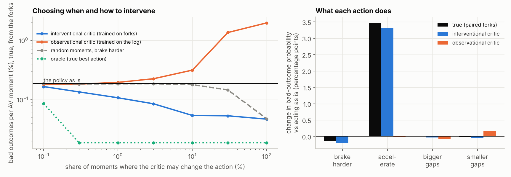
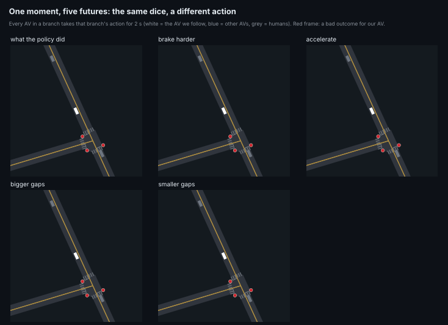
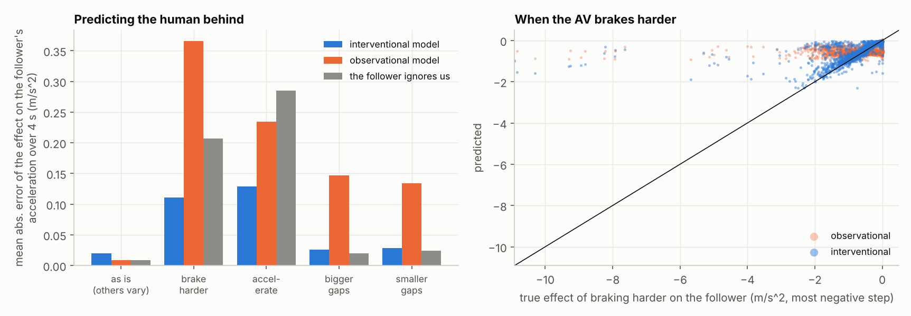
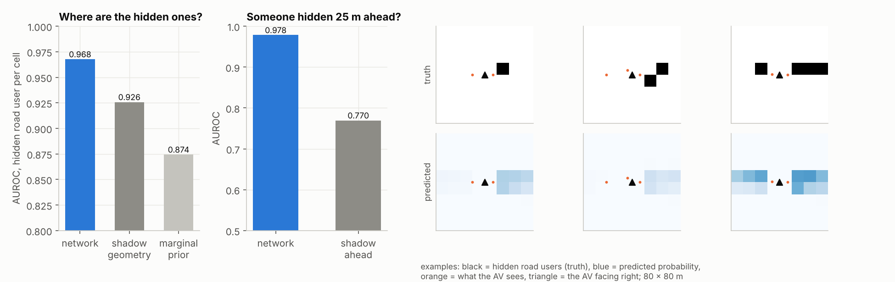
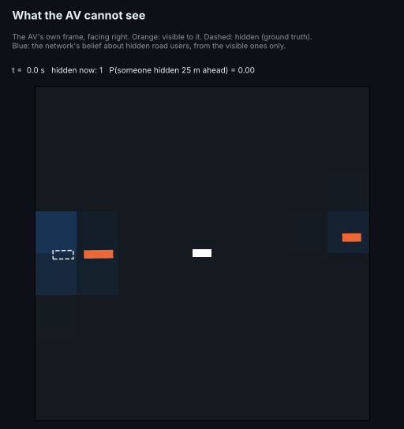
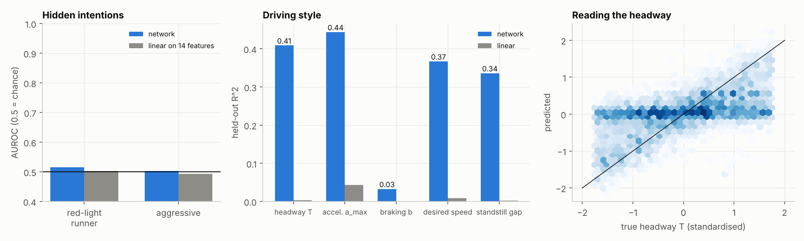
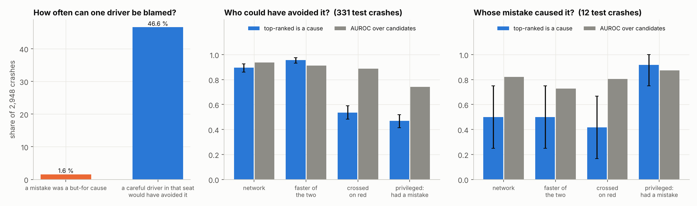
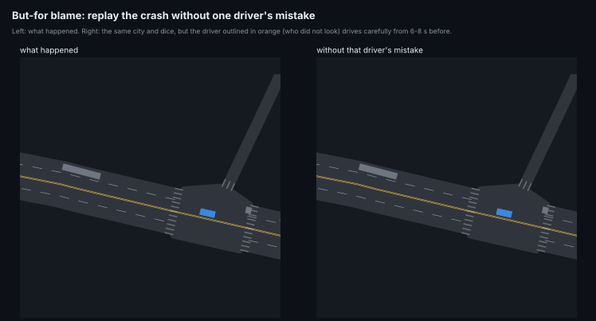
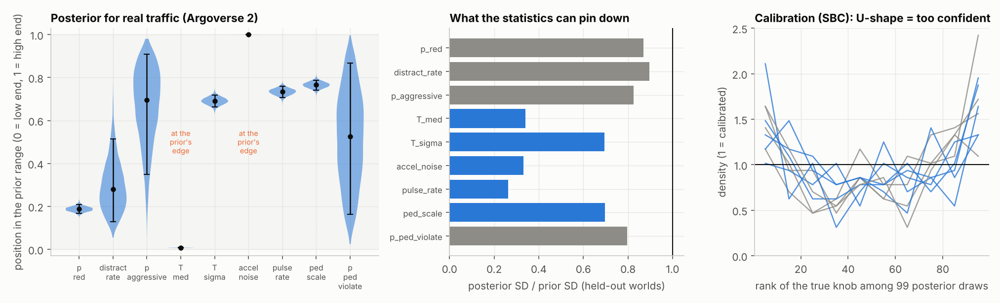

# Neural nets only this simulator can train

PPO and next-step world models can be trained in any simulator. These six networks need three things that only a simulator with *this*
design has:

* **Ground-truth hidden state.** Every driver's traits are in the state: red-light runner, headway, comfortable braking, distraction.
* **Exact interventions.** A fork is a copy of one pytree. With identity-keyed common random numbers (`Behaviour.crn = 1`), its branches
  differ only in what we change.
* **Many worlds with known knobs, plus a real anchor.** The knobs are known for every simulated world, and there are 400 Argoverse 2 scenes to point them at.

Every number below comes from a run in this repository (`results/nets/`). Every network has a baseline; intervals are 95 % bootstrap over held-out copies or rows.

**Train and use them:** `av-world nets list`, `av-world nets train NAME --quick`, `easy.nets.load(NAME)`. The step-by-step guide is [TRAINING_NETS.md](TRAINING_NETS.md).

| | network | the question | result |
|---|---|---|---|
| N2 | interventional risk critic | which action makes this moment safe? | at a 10 % intervention budget, bad outcomes −71 % (0.186 % → 0.054 %); the same network trained on the log makes them **worse** (0.314 %) |
| N7 | social response | what will the human behind me do if I brake? | effect error 0.11 m/s² vs 0.21 (assume nothing) and 0.37 (trained on the log) |
| N6 | occlusion belief | where are the road users I cannot see? | AUROC 0.968 per cell vs 0.926 from shadow geometry; someone hidden 25 m ahead: 0.978 vs 0.770 |
| N1 | mind reader | what kind of driver is that? | headway R² 0.41, accel 0.44, desired speed 0.37 (linear: ≈ 0); red-runner and aggressive: **chance** |
| N5 | but-for blame | who caused this crash? | a mistake is a but-for cause in only 1.6 % of 2,948 crashes; a careful driver in one seat would have avoided 46.6 %; ranking AUROC 0.938 |
| N4 | amortised inference | which knobs explain real traffic? | posterior draws land 2.24 SD from real statistics (CEM point fit 2.60, prior 3.50); three real statistics lie outside every simulated world |

---

## How the data was made fast enough on 4 CPU cores

| change | measured |
|---|---|
| one jitted `lax.scan` that steps the copies and reduces each state to a feature slab (`nets/collect.record`), instead of a Python loop copying the state to the host | ×1.4 over the old full-state loop (the old loop's per-step cost was mostly the copy) |
| the 4 cores as 4 XLA devices (`--xla_force_host_platform_device_count=4`), copies under `pmap` | ×2.07 on 32 copies |
| forks as batch: K branches of a moment are K vmapped copies, one compile for all | 560,124 AV forks × 6 branches (4 s each) in 238 s |
| causal convolution as shifted copies + one matmul, not XLA's CPU convolution | ×60 per training step (4.9 s → 0.06 s) |
| caching every dataset to `.npz`, so retraining never re-simulates | |

The plan predicted ×10–30 from on-device recording; the measured gain was ×1.4. Batched forks and 4 devices carried the speed-up.

---

## N2 Interventional risk critic (`nets/forks.py`, `nets/counterfactual.py`)

**Data.** The city is a 5×-risk Oakland with 25 % AVs driven by the phase-3 policy and no safety filter. Every 4 s, all 32 copies fork into 6 branches. In branches 0–4 every AV takes one of 5 actions for 2 s: as is, brake harder, accelerate, bigger gaps, smaller gaps. A Latin square over AVs (AV *i* in branch *b* gets action (b + hᵢ) mod 5) gives each AV all five actions without the AVs around it all doing the same thing. Branch 5 is unperturbed, so it is the log. The outcome, over the next 4 s, is a crash, a near miss, or the AV moving more than 1 m inside its control-barrier safety margin. In total that is 560,124 AV-moments × 6 futures.

$$Q(o,a)=P(\text{bad in 4 s}\mid o,\ \mathrm{do}(a)),\qquad \mathcal L=\sum_{(o,a)}\mathrm{BCE}\big(Q(o,a),\,y_{o,a}\big)+0.1\,\mathrm{Huber}(\hat m,m)$$

Both critics are 3-member MLP ensembles on (28 observation features, action), with the same steps. The **interventional** critic is trained on every state with all 5 actions. The **observational** critic is trained on the log: each state with only the action the policy took.





| choosing the action on 138,879 held-out AV-moments | bad outcomes | at risky moments |
|---|---|---|
| the policy as is | 0.186 % [0.171, 0.202] | 4.9 % |
| random action | 0.876 % | 23.2 % |
| observational critic, argmin | **1.966 %** [1.867, 2.070] | 52.0 % |
| interventional critic, argmin | **0.047 %** [0.039, 0.055] | 1.2 % |
| oracle (true best action) | 0.019 % | 0.5 % |

**Confounding, measured.** The observational critic thinks accelerating is as safe as acting as is: its predicted effect is −0.02 points, against a true +3.5 points from the forks. In the log the policy accelerates where it is safe to, so acceleration looks harmless. The interventional critic gets the effect right (+3.3 points), and its Δ-risk predictions correlate 0.74 with the true paired Δ; the observational critic's correlate −0.01.

Argmin alone mostly picks "brake harder", which is safe but slow. The fairer test gives each critic a **budget** of moments at which it may change the action, spent where it predicts the largest risk reduction:

| budget | 0.1 % | 1 % | 10 % | 30 % |
|---|---|---|---|---|
| interventional | 0.166 % | **0.107 %** (−42 %) | **0.054 %** (−71 %) | 0.053 % |
| observational | 0.181 % | 0.195 % | 0.314 % | 1.351 % |
| random moments, brake harder | 0.186 % | 0.184 % | 0.179 % | 0.145 % |
| oracle | 0.086 % | 0.019 % | 0.019 % | 0.019 % |

**Limits.** The Latin square perturbs the other AVs too, so one AV's label includes the fixed-offset actions of its neighbours. Branch 0 measures that, and its bad rate is the same as the log's. The policy is the phase-3 policy, without the safety filter.

## N7 How the human behind answers (`nets/response.py`)

The data is the same forks, restricted to the 168,342 AV-moments with a human driver directly behind. Shared dice make the follower's paired difference the causal effect of the AV's action:

$$\delta_k(t)=a_{\text{follower}}(t\mid \mathrm{do}(a_k))-a_{\text{follower}}(t\mid\text{nobody perturbed}),\qquad t=0.2\ldots3.8\text{ s}$$

The interventional model $R(o,f,a_k)\to\delta_k$ is trained on the forks. The observational model learns $F(o,f,u)\to a_{\text{follower}}$ from the log, and its effect estimate is $F(u+d_k)-F(u)$. The zero baseline assumes the follower ignores us.



| action | interventional | observational | zero | correlation on the hardest braking (int / obs) |
|---|---|---|---|---|
| brake harder | **0.110** | 0.365 | 0.207 | **0.47** / 0.13 |
| accelerate | **0.129** | 0.235 | 0.285 | 0.15 / 0.01 |
| bigger gaps | 0.026 | 0.147 | **0.020** | |
| smaller gaps | 0.029 | 0.134 | **0.024** | |

All values are mean absolute error of the 4 s effect, in m/s². Where the action does change the follower (braking and accelerating), the interventional model halves the error; where it barely does (gap acceptance), predicting nothing is better and the model's noise shows. The observational model is worse than predicting nothing for every action.

## N6 Seeing through the bus (`nets/occlusion.py`)

**Labels.** Every vehicle's position is known, so for each AV we can label who is hidden. A road user is hidden if the sight line to its centre crosses another vehicle's footprint, within 40 m (a slab test on oriented boxes, `seg_hits_box`).

**Input.** Only what the AV sees: the visible road users in its frame.

**Output.** A deep-set network outputs an 8 × 8 grid over 80 × 80 m of P(a hidden road user here), plus P(someone is hidden within 25 m ahead in my lane corridor). The dataset is 219,468 AV views.





| | AUROC per cell | Brier |
|---|---|---|
| network | **0.968** | **0.0135** |
| shadow geometry (cell frequency given whether a visible vehicle shadows it) | 0.926 | 0.0165 |
| marginal frequency per cell | 0.874 | 0.0176 |

For someone hidden 25 m ahead, the network's AUROC is 0.978 against 0.770 from the shadow alone. It has learned that a queue ahead usually continues behind its first car.

**Limits.** In this simulator pedestrians are crossing processes on crosswalk legs, not positioned agents, so this covers vehicles and cyclists only.

## N1 The mind reader (`nets/mindreader.py`)

**Data.** 625 k windows of 10 s (0.4 s steps) from every human car in 16 copies of 5×-risk Oakland. Each window holds speed, acceleration, gap, closing speed, distance to the line, the light, the speed limit and lane changes.

**Network.** Three causal dilated convolutions (kernel 5, dilation 1, 2, 4), mean and last-step pooling, and heads for each hidden trait.

**Baseline.** A linear model on 14 hand features. Split by copy.



| trait | network | linear |
|---|---|---|
| IDM headway T | **R² 0.41** | 0.00 |
| comfortable acceleration a_max | **0.44** | 0.04 |
| desired-speed factor | **0.37** | 0.01 |
| standstill gap s0 | **0.34** | 0.00 |
| comfortable braking b | 0.03 | 0.00 |
| red-light runner (26 % of drivers) | AUROC 0.52 | 0.50 |
| aggressive (20 %) | AUROC 0.50 | 0.49 |

**Reading it.** Ten seconds of ordinary driving reveal a driver's style, but not their intentions. A red-light runner behaves exactly like everyone else until a light turns. Braking style shows only when the driver has to brake, which ordinary windows rarely contain. The red-run-in-3-s hazard is not reported: only 29 windows contained one.

## N5 But-for blame (`nets/blame.py`)

**Data.** In the stress world (`avlab.paired.STRESS`, 25 % AVs) every two-vehicle crash is rewound 6–8 s and replayed in 17 branches with shared dice:

* **base:** the crash as it happened.
* **one per nearby driver with that driver's mistakes off:** red-light running, not looking, aggressive gap acceptance, signal ignoring, a distraction in progress.
* **one per nearby driver driving carefully:** mistakes off, headway at least 1.8 s, standstill gap at least 2.5 m.

A driver is a but-for cause if the crash does not happen in its branch. The dataset is 2,948 crashes with up to 8 candidates each.

**Network.** Set attention over the candidates, using what an investigator could see in the replay: speeds, accelerations, a red crossing, lane changes, distance to the crash point, and which two collided. The hidden mistakes are not inputs.





| | mistake was a cause | a careful driver avoids it |
|---|---|---|
| crashes with such a driver | **1.6 %** | **46.6 %** |
| a collided vehicle is one | 0.6 % | 26.4 % |
| a bystander is one | 0.0 % | 0.5 % |
| network: top-1 / AUROC | 0.50 / 0.82 (12 test crashes) | 0.89 / **0.94** (331 test crashes) |
| "the faster of the two": top-1 / AUROC | 0.50 / 0.73 | **0.95** / 0.91 |
| privileged "had a mistake on" | 0.92 / 0.87 | 0.47 / 0.74 |

**Reading it.** In this simulator, crashes almost never hinge on a single mistake. Half of them hinge on someone's ordinary driving style, almost always one of the two that collided. For "who could have avoided it", the faster of the two vehicles is a strong rule, and it beats the network at naming one driver (top-1 0.95 vs 0.89). The network ranks everyone better (AUROC 0.94 vs 0.91). Knowing who made a mistake is a poor guide to who could have prevented the crash (top-1 0.47). With 12 test crashes, the mistake question is too small to conclude anything.

## N4 Amortised inference of real driving (`nets/sbi.py`)

**Data.** 1,024 worlds, each with its own knob vector $\theta$ drawn uniformly from a box: p_red, log distraction rate, p_aggressive,
T_med, T_sigma, acceleration noise, brake-pulse rate, log pedestrian volume, p_ped_violate. Each world gets 60 s of one copy of
Oakland, summarised by six statistics that can also be measured on the 400 Argoverse 2 scenes (with the code that produced
`results/incidents/real.json`):

* hard brakes per hour;
* the share of time with a headway under 0.8 s;
* the share with a TTC under 2 s;
* the share with a TTC under 1 s;
* median moving speed;
* the SD of moving acceleration.

**Network.** A mixture-density network in the logit space of the box:

$$q(\theta\mid s)=\sum_{c=1}^{4}\pi_c(s)\,\mathcal N\!\big(\mathrm{logit}\,u;\ \mu_c(s),\,\mathrm{diag}\,\sigma_c^2(s)\big),\qquad u=\frac{\theta-\theta_{\min}}{\theta_{\max}-\theta_{\min}},\qquad \mathcal L=-\mathbb E\log q(\theta\mid s)$$

It is trained on 896 worlds, each repeated 8 times with noise of 0.1 SD on the statistics, with a floor of −2.5 on log σ.
The first version had 8 components and no floor, and it collapsed onto training worlds: held-out NLL 814 against 38 now.



**What the statistics pin down.** On held-out worlds, the posterior's SD as a share of the prior's:

| knob | share |
|---|---|
| pulse rate | 0.26 |
| acceleration noise | 0.33 |
| T_med | 0.34 |
| T_sigma | 0.69 |
| pedestrian volume | 0.70 |
| p_ped_violate | 0.80 |
| p_aggressive | 0.83 |
| p_red | 0.87 |
| distraction rate | 0.90 |

The car-following knobs are identified. The mistake rates (red running, distraction, aggressiveness) are nearly invisible in these
statistics, which is the same finding as the mind reader's, from the other side.

**Calibration.** Simulation-based calibration ranks are U-shaped (χ² 11–39 against 16.9 at 95 %, 9 bins). The posterior is somewhat
too confident. Report its intervals as optimistic.

**Real traffic.** Three real statistics lie outside the range of *every* simulated world: tight following, TTC under 1 s, and the
acceleration SD. The posterior for the real data therefore piles onto the edge of the box: T_med at its 0.6 s floor, acceleration
noise at its 1.0 ceiling. Its tight intervals there are extrapolation, not knowledge. This is misspecification. Within this prior, the
simulator's IDM drivers cannot follow as closely, or brake as late, as real ones. `docs/LONG_TAIL_METHODS.md` reached the same
conclusion with a point fit.

**Posterior-predictive check.** Mean absolute distance of the six statistics from the real ones, in SDs of the simulated worlds, over
32 fresh copies:

| knobs | distance |
|---|---|
| posterior draws | **2.24** [2.17, 2.33] |
| the CEM point fit of `avlab/tail_calibrate` | 2.60 [2.51, 2.68] |
| prior draws | 3.50 [3.34, 3.66] |

Once trained, the posterior takes one forward pass, against minutes of simulation for the point fit. The CEM fit was tuned to four of
these six statistics, so the comparison favours the posterior somewhat.


## Reproduce

```bash
python -m nets.forks 150 && python -m nets.counterfactual && python -m nets.response     # N2, N7   (~4 min + 6 min)
python -m nets.mindreader                                                                # N1       (~5 min)
python -m nets.occlusion                                                                 # N6       (~5 min)
python -m nets.blame 20                                                                  # N5       (~14 min)
python -m nets.sbi 1024                                                                  # N4       (~25 min)
python scripts/make_nets_figures.py && python scripts/make_nets_gifs.py
pytest tests/test_nets.py
```
