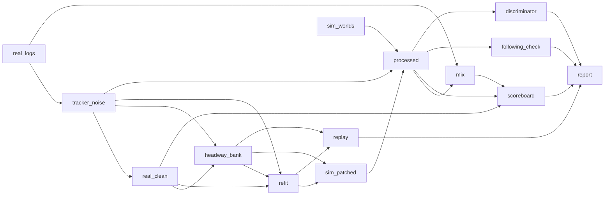

# Closing the sim-to-real gap: what is different, where, and the patch

Every earlier comparison said the simulator's human drivers are too gentle compared with real Argoverse 2 (AV2) logs:

- **Incident audit:** the everyday tail is 4–6× too thin, and tight following is about 40× too rare.
- **Cross-entropy tail fit:** stuck at the edges of its search box.
- **Posterior over the simulator's knobs:** three real statistics lie outside every simulated world.
- **Auto-tagger:** flags half the real scenes as `sim_gap`.

This package (`realism/`) asks *why* before patching. A difference between a real log and a simulated run can come from three places:

1. **The sensor.** A real log's speeds come from a tracker; the simulator's are exact.
2. **The scene.** Real logs are recorded where the AV drove, at the density it met, out to the range its sensors reach.
3. **The drivers.** This is the only part a driver model should be patched for.

The pipeline measures each part, removes the first two by construction, and then fits the drivers.

```bash
av-world realism run            # the cached DAG (about an hour on 4 CPU cores the first time; --quick about 10 min)
av-world realism report         # the gap, step by step
python -c "from av_world import easy; beh = easy.realism.preset()"   # patched human drivers for xnet
```

RESULTS_PLACEHOLDER

## First principles

**One extractor, both sources.** Every statistic comes from the same code on the shared scene format: 0.2 s, with leaders found
geometrically (same lane, heading within 35°). The statistics are the tail rates of the incident audit (hard brakes, headway < 0.8 s,
TTC < 2 s and < 1 s) and six distributions (speed, acceleration over a step and over a second, jerk, headway, 1/TTC). Distances are
Wasserstein-1 in units of the real interquartile range; tail rates are compared as sim/real with a bootstrap over scenes. **gap** is
the mean |log ratio| of the four tails (capped at log 20) plus the mean W1 of the six distributions. It is 0 when the two sources are
indistinguishable by these numbers.

**Sensor model, fitted from the logs alone.** Write the observed speed as `y = v + e`. Let the driver's acceleration be an
Ornstein–Uhlenbeck process (sd `sa`, time constant `tau`) and the tracker's error an AR(1) process (sd `sm`, lag-one correlation `rho`
per step). Then the velocity structure function is

```
D(h) = E[(y(t+h) - y(t))^2] = 2 sa^2 tau^2 (h/tau - 1 + exp(-h/tau))  +  2 sm^2 (1 - rho^k),   h = k dt
```

A smooth driver contributes about h² at short lags, and the sensor contributes a jump that saturates within a few steps. Fitting the
four numbers to D(1..15) of non-spiky tracks separates the two. The AV's own track comes from localisation, not the tracker, and serves
as a control: its fit should, and does, show almost no sensor term.

**Parity, both ways.** `clean(real)` removes spikes with a Hampel filter, then runs a Rauch–Tung–Striebel smoother under exactly the
fitted model. `corrupt(sim)` adds the fitted AR(1) error, spikes at the measured rate and position jitter. Comparing
`clean(real)` with `clean(corrupt(sim))` processes both sides identically, so any remaining difference is driving.

**Field of view.** Simulated scenes keep the road users within 80 m of the ego; real scenes are cropped the same way.

**Scene mix against density.** Reweighting simulated scenes by a classifier density ratio p(real | context) / p(sim | context) works
only where the two context distributions overlap. Its effective sample size tells you when they do not. Then the simulator has to
*produce* the context: more demand.

**Car following is structural before it is parametric.** IDM's acceleration is `amax [1 - (v/v0)^4 - (s*/s)^2]`. At equilibrium
the gap is `s*/sqrt(1 - (v/v0)^4)`, which grows without bound as a follower nears its desired speed. Urban followers mostly drive near
v0, so the simulator's followers hang back whatever their T. IDM+ (Schakel et al., 2010) takes `amax min(1 - (v/v0)^4, 1 - (s*/s)^2)`,
whose equilibrium gap is `s* = s0 + vT` at every speed.

**Deconvolution through the simulator.** A driver's T shows in a log only blurred: gaps are often unconstrained, and s0 adds s0/v.
Rather than invert that blur analytically, treat the simulator as the measurement model. Start a trait table at
`T = observed p10 headway - offset`, simulate, and shift every quantile of T by `real quantile - simulated quantile`. Repeat. This
fixed point is the quantile version of iterative unfolding. The fit is checked on simulated scenes, where every driver's T is known.

**Smooth residuals without state.** The OU residual is drawn as random Fourier features, `sqrt(2/K) Σ cos(w_k t + φ_k)` with w_k
from a Cauchy distribution of scale 1/tau (Bochner's theorem: a Lorentzian spectrum has the covariance exp(-|Δt|/tau)). The w and
φ come from a hash of the driver's id, so the residual needs no `State` field and every driver keeps the same residual in every world
(common random numbers).

**Classifier two-sample test.** A network trained to tell real vehicles from simulated ones turns "is it realistic?" into one AUROC.
Permutation importance names the feature that gives the simulator away.

## The engineering DAG



Each stage is a pure function of its inputs and its config, cached under
`results/realism/cache/<stage>-<sha256(name, config, input keys, source)>.pkl` by the same runner as the auto-tagger (`autotag/dag.py`).
Changing the refit's search box reruns the refit and everything below it; the 400 real scenes and their cleaning are not touched.

```
for stage in topological_order(target):
    key = hash(stage.name, stage.config, [key[d] for d in stage.deps], source(stage.fn))
    out[stage] = load(cache/stage-key) if cached else save(stage.fn(*[out[d] for d in stage.deps]))
```

| stage | does | output |
|---|---|---|
| `real_logs` | 400 AV2 scenes on the 0.2 s grid, cropped to 80 m around the AV | scenes |
| `tracker_noise` | spike rate, structure-function fit (other road users and the ego), parked-car jitter | sensor model |
| `real_clean` | Hampel filter and RTS smoother on every real track | scenes |
| `sim_worlds` | stored drivers, the earlier tail fit, IDM+ only: one compiled run, one behaviour per city copy, common random numbers | scenes |
| `headway_bank` | deconvolution of the per-driver p10 headway: 2 iterations, each a simulation | trait table [2000, 4] |
| `refit` | cross-entropy search over 7 knobs, 8 candidates per generation, each driving its own city copy | knobs and history |
| `sim_patched` | the patched drivers, plus the stored drivers at the refit's density | scenes |
| `processed` | for every world: raw, through the sensor, and through the sensor then cleaned | scenes |
| `mix` | scene-context density ratio and its effective sample size | weights |
| `scoreboard` | every world against real: raw, sensor, clean, clean plus mix; the where-table | json |
| `following_check` | per-driver p10 headways, population fits, the fitter's own check against simulator truth | json |
| `discriminator` | classifier two-sample test per world | AUROC, importances |
| `replay` | log replay of 30 real scenes, stored against patched drivers against constant velocity | errors per horizon |
| `report` | `results/realism/scoreboard.json`, `preset.json`, `bank.npy` | files |

**DAG pros:** a rerun touches only stale stages; every number in this page traces back to one cached stage; quick mode uses a separate
cache. **Cons:** stages pickle whole scene lists (the cache is a few hundred MB), and the CEM's simulations are inside a stage, so
changing a figure never reruns them but changing the refit box reruns about 30 minutes of work.

## The ten methods

### 1. Distribution scoreboard (`stats.py`; stage `scoreboard`)

```
measure(scene):  per moving non-ego vehicle-frame: v, a, a1, jerk, headway, 1/TTC, contexts; tail counts; D(k) sums
scoreboard(R, S):
    tails: sim/real rate; CI from resampling scenes on both sides
    dists: W1(real, sim) / IQR(real)
    gap = mean(min(|log ratio|, log 20)) + mean(W1)
```

**Pros:** one number to minimise and one table to read; the bootstrap says which differences are real. **Cons:** a fixed list of
statistics. Anything not on it (lateral behaviour, gap acceptance at junctions) can still be wrong.

### 2. Where (`stats.where_table`)

```
for speed bin x leader present x turning:
    W1 of acceleration, share of time with headway < 0.8 s, headway W1, real share against sim share of the samples
```

**Pros:** shows whether a gap is everywhere or in one regime. **Cons:** context is what the shared format can show; no junction or
lane-type labels for real scenes, so "turning" stands in for junctions.

### 3. Measurement parity (`measure.py`; stages `tracker_noise`, `real_clean`, `processed`)

```
D = structure(non-spiky real tracks);  (sm, rho, sa, tau) = argmin |log D_model - log D|
clean(real)   = RTS(Hampel(y); F = [[1, dt, 0], [0, e^(-dt/tau), 0], [0, 0, rho]],  y = v + e)
corrupt(sim)  = v + AR1(sm, rho) + spikes(rate, empirical sizes);  x, y + N(0, jitter)
crop(real)    = road users within 80 m of the ego at the middle frame
```

**Pros:** removes the part of the gap no driver model should chase; the ego track is a built-in control; it works in both directions,
so the result can be bracketed. **Cons:** the noise model is stationary and the same for every object. Real tracker noise grows with
range and occlusion. Smoothing also removes some real high-frequency driving.

### 4. Scene-mix reweighting (`mix.py`; stage `mix`)

```
c = (median moving speed, local density, standing share, moving vehicles, turning share)
p = logistic(real vs sim | c);  w_sim = clip(p / (1 - p) x n_sim / n_real, 0.05, 20), normalised
ess = (Σw)^2 / Σw^2
```

**Pros:** separates "different city" from "different drivers" without simulating anything. **Cons:** it can only reweight
contexts the simulator produces. Here it cannot (see the results), which is itself the finding that led to the density patch.

### 5. Classifier two-sample test (`discriminator.py`; stage `discriminator`)

```
units = moving vehicles (>= 5 s), 13 summary features each
split scenes in half; MLP(64, 64) on balanced training units; AUROC on the held-out half (bootstrap CI)
importance(f) = AUROC - AUROC(feature f shuffled)
```

**Pros:** no statistic has to be chosen in advance; the importances tell you what to fix next. **Cons:** a classifier wins on any
difference, including ones nobody cares about. An AUROC far from 0.5 says "different", not "different in a way that matters for the
AV".

### 6. Car-following fits (`following.py`; stage `following_check`)

```
episodes: one follower behind one leader for >= 4 s
per episode: least squares of IDM on a = dv/dt  -> (T, s0, amax, b, v0), R^2
two-stage: pooled s = s0 + vT on steady frames;  per driver T_i = median((s - s0) / v)
check: the same fitter on simulated scenes, where T is known (Spearman)
```

**Pros:** looks straight at the mechanism. **Cons:** the honest result is negative. Per-episode IDM parameters are not identified
from 4–10 s of urban driving, even on perfect simulated data. That is why the bank is built by deconvolution (method 7), not from
these fits.

### 7. Headway bank by deconvolution, plus IDM+ (`following.deconvolve`, `xnet/sim.py`; stage `headway_bank`)

```
r = per-episode p10 headway in clean real logs;  T_q = quantiles(r) - 0.8
repeat 2x:  bank = sample(T_q);  s = p10 headways of clean(corrupt(simulate(IDM+, bank)));  T_q += quantiles(r) - quantiles(s)
simulator: Behaviour(bank=share) draws (T, s0, amax, b) from the table at spawn; idm_plus=1 uses min(free, interaction)
```

**Pros:** fits exactly what the logs show (each driver's closest following) through the simulator itself, so every blur, including
unconstrained gaps, is in the loop. IDM+ removes the structural reason followers hang back. **Cons:** only T is deconvolved; s0, amax
and b keep the simulator's own spread. Two iterations cost two simulations.

### 8. Smooth acceleration residual (`xnet/sim.py: ou_residual`)

```
e_i(t) = ou_sigma x sqrt(2/K) Σ_k cos(w_ik t + φ_ik),  w_ik ~ Cauchy(0, 1/ou_tau),  φ_ik ~ U(0, 2π)   (hashed from the driver's id)
a_i += e_i(t) while not distracted
```

**Pros:** correlated in time like real throttle and brake modulation (white noise is not); no state; CRN-safe. **Cons:** K = 8
features give a Gaussian-ish but not exactly Gaussian process; the residual ignores the scene (it does not grow near leaders).

### 9. Refit (`refit.py`; stage `refit`)

```
knobs = (demand, v0_scale, ou_sigma, ou_tau, pulse_rate, bank share, s0_scale);  idm_plus = 1
CEM: 3 generations x 8 candidates; each candidate drives its own city copy in one vmapped run (common random numbers)
loss = scoreboard gap of clean(corrupt(sim)) against clean(real)
```

**Pros:** every knob is fitted on the same scoreboard the report uses; candidates differ by their knobs, not by their dice.
**Cons:** 24 evaluations of 3 simulated minutes each is a small budget, and the loss is noisy at that size; the result is a good point,
not a posterior.

### 10. Realism gates and log replay (`tests/test_realism.py`, `replay.py`; stage `replay`)

```
gates: patched gap < default gap; tight following and TTC < 1 s move toward real; hard brakes within 2x; discriminator AUROC drops
replay: seed 30 real scenes, roll out 5 s with stored or patched drivers (traits redrawn from the bank), compare with the log and
        with constant velocity
```

**Pros:** regressions fail CI; replay checks prediction, not just statistics. **Cons:** the gates read the last full run's file. They
guard the result, not the code that would produce a new one. Replay error is dominated by things the patch does not touch (routes,
signals).

## Extend it

- **A new statistic:** add it to `stats.measure` and `DISTS`; it joins the scoreboard, the refit loss and the where-table.
- **A new knob:** add a `Behaviour` field (default off) and a `SPACE` entry in `refit.py`.
- **A new world to compare:** add it to `pipeline.WORLDS`.
