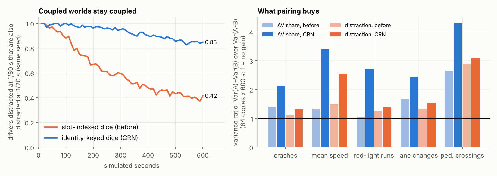
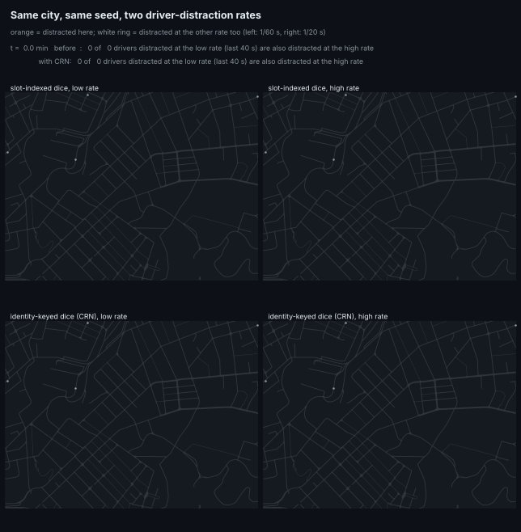
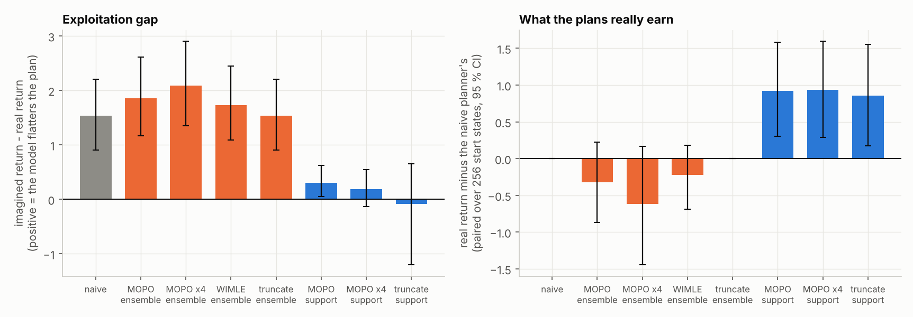
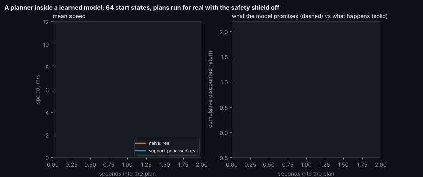
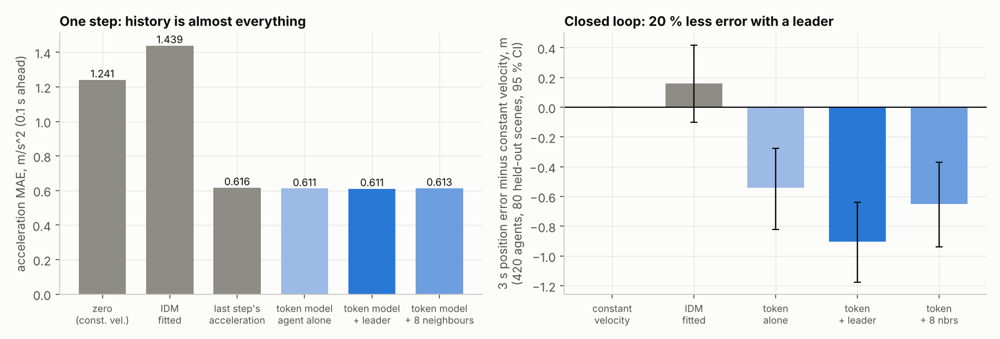
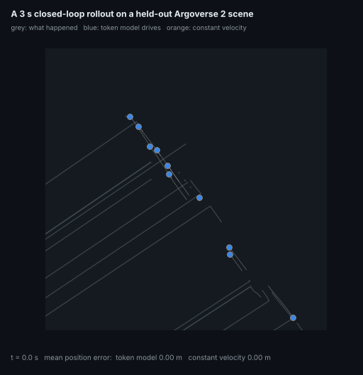
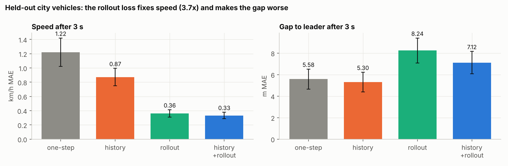
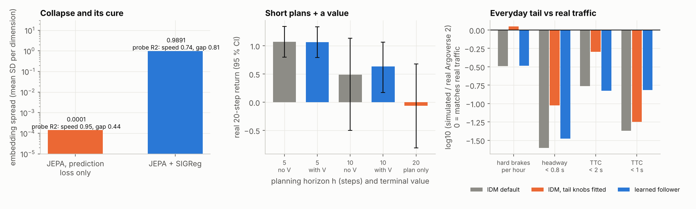

# World-model upgrades: ten ideas, built and measured

Ten ideas came out of a survey of world-model research (Waymo/Genie 3, NVIDIA OmniDreams, Dreamer 4, V-JEPA 2 and LeWorldModel, SMART,
WIMLE and the model-uncertainty literature), each rated for return against effort. This page is what happened when they were built.
Every number below comes from a result file under `results/` that a command in the last section regenerates; every module has tests.

| # | idea | verdict | the number |
|---|---|---|---|
| 1 | identity-keyed common random numbers | **works, modestly** | coupling after 600 s: 0.85 vs 0.42; variance ratio 1.3-3.4 (2.1 on crashes for AV share) |
| 2 | conservative imagination | **works, with the right signal** | exploitation gap 1.54 -> 0.19-0.31 with a distance-from-data penalty; ensemble disagreement does not help |
| 3 | per-road-user agent tokens | **small gain, not beyond the leader** | 3 s error -0.90 m vs constant velocity with a leader token; 8 neighbours -0.65 m |
| 4 | multi-step rollout loss + history | **mixed** | 3 s speed error 1.22 -> 0.33 km/h; 3 s gap error 5.6 -> 7.1 m (worse) |
| 5 | learned human drivers | **learned from real data; modest realism gain in the sim** | tail loss vs real traffic 9.83 -> 8.15, TTC < 1 s 8x more frequent; hard braking unchanged |
| 6 | RL fine-tuning for realism | **not built** | conditional on 5 giving a strong base; it gave +1 % one-step skill over persistence |
| 7 | Gaussian-regularised (SIGReg) latent | **works as a collapse guard** | embedding spread 1e-4 -> 0.99; probe R2 mixed |
| 8 | learned terminal value for the planner | **no measurable gain** | h = 5: -0.003 [-0.006, -0.001]; h = 10: +0.15 [-0.31, 0.82] |
| 9 | diffusion crash-risk guide for splitting | **not built** (rated skip) | |
| 10 | pixel-space generative world model | **not built** (rated skip) | |

Everything is off by default: `Behaviour.crn = 0` and `Behaviour.learned = 0` reproduce every stored result bit for bit
(`tests/test_crn.py::test_crn_off_is_the_old_simulator`).

---

## 1. Identity-keyed common random numbers

**The problem.** Most questions in this repository are differences between two worlds (a policy, an AV share, a risk knob) in a rare outcome.
Write the outcome of world $\theta$ on copy $\omega$ as $Y(\theta,\omega)$. The estimate of $\Delta=\mathbb E\,Y(\theta_1)-\mathbb E\,Y(\theta_0)$ from $n$ copies has variance

$$\operatorname{Var}(\hat\Delta)=\frac{\sigma_0^2+\sigma_1^2-2\rho\,\sigma_0\sigma_1}{n},\qquad R=\frac{\sigma_0^2+\sigma_1^2}{\operatorname{Var}(Y_1-Y_0)}\overset{\sigma_0=\sigma_1}{=}\frac1{1-\rho}.$$

$R$ is how many times fewer copies a paired design needs. Everything depends on the correlation $\rho$ between the worlds.

**Why the old pairing was weak.** The simulator drew its dice per *slot*: `u = uniform(key, (8N, ...))`, one number per array position. A new vehicle takes the first free slot, so
once one world has a crash, a wreck or a different departure, the same slot holds different vehicles in the two worlds, and "driver in slot 413 is distracted" is a different driver.
Coupling decays to independence at the first divergence.

**The change.** Each vehicle gets a persistent id, the index of the spawn attempt that created it, $\mathrm{uid}=\text{tick}\cdot 24+\text{attempt}$ (assigned at the attempt, not at success,
so a vehicle that is blocked in one world keeps its identity in the other). Every per-vehicle uniform becomes a hash of (step seed, uid, stream):

$$U_{i,t,s}=2^{-24}\left\lfloor h\big(h(\mathrm{uid}_i\cdot c_1+s\cdot c_2+1)\oplus \mathrm{seed}_t\big)/2^{8}\right\rfloor,$$

with $h$ the `lowbias32` integer hash. The step seed depends on the key chain only, never on the world.

**Monotone thinning.** Every mistake is a test $U_{i,t,s}<\lambda\,\Delta t$ (distraction, red running, not looking, brake pulses, close passes). With $U$ shared, raising the rate
only *adds* events: $\{U<\lambda_0\Delta t\}\subseteq\{U<\lambda_1\Delta t\}$ for $\lambda_0\le\lambda_1$, and the two worlds differ in a fraction $(\lambda_1-\lambda_0)\Delta t$ of
vehicle-steps instead of an independent-draw fraction $\approx(\lambda_0+\lambda_1)\Delta t$. Marginally nothing changes: each triple is uniform and distinct triples are independent, so every
world has exactly its old law (`tests/test_crn.py` checks uniformity, stream independence, and that the hash depends on identity only).





**Result.** Distraction at 1/60 s against 1/20 s, 8 copies, 600 s: of the drivers distracted in the low-rate world, the share also distracted in the high-rate world is
**0.85 with CRN against 0.42 without** (a perfect nesting is 1; what is left is the real divergence of the traffic). Variance ratio $R$ on 64 copies x 600 s:

| comparison | outcome | before | with CRN |
|---|---|---|---|
| 25 % AVs vs none | crashes | 1.40 | **2.13** |
| | mean speed | 1.33 | **3.40** |
| | red-light runs | 1.06 | **2.72** |
| | lane changes | 1.67 | 2.45 |
| | pedestrian crossings | 2.66 | **4.30** |
| distraction x2 | crashes | 1.11 | 1.31 |
| | mean speed | 1.50 | 2.53 |
| | red-light runs | 1.26 | 1.40 |
| | lane changes | 1.34 | 1.53 |
| | pedestrian crossings | 2.88 | 3.09 |

(`before` is already paired by seed and warm state.) The gain is real but far from unlimited: crashes cascade, so $\rho$ stays modest. It does not touch the GPU/CPU drift of
[FIXES.md #14](FIXES.md), which is floating-point, not dice.

---

## 2. Conservative imagination: price the model's mistakes

**The problem.** `wmplan/v3.py` trained a policy inside the learned model and it exploited the model. This is the winner's curse: if $\hat J(a)=J(a)+\varepsilon(a)$ with
$\mathbb E\,\varepsilon(a)=0$ for every fixed $a$, the optimiser's choice $a^\star=\arg\max\hat J$ has $\mathbb E\,\varepsilon(a^\star)>0$, and the bias grows with how far the search reaches
into regions where $\operatorname{Var}\varepsilon$ is large. Four objectives, as functions of the imagined rewards $r_t$ and a per-step uncertainty $s_t$:

$$J_{\text{naive}}=\sum_t\gamma^t r_t,\quad J_{\text{MOPO}}=\sum_t\gamma^t(r_t-\lambda s_t),\quad J_{\text{WIMLE}}=\sum_t\gamma^t w_t r_t,\ w_t=e^{-\sum_{j\le t}s_j/\tau},\quad J_{\text{trunc}}=\sum_{t<T^\star}\gamma^t r_t,\ T^\star=\min\{t:s_t>s_{\max}\}.$$

MOPO's guarantee is $J(\pi)\ge\hat J(\pi)-\lambda\,\mathbb E[u]$ when $u$ bounds the model error; it is only as good as $u$.

**Two uncertainty signals.** *Ensemble disagreement*: the SD of the 3 members' predicted change. *Distance from the data*: $s_t=\max\{0,\;d(x_t,\mathcal R)/q-1\}$ with $x_t=(o_t,u_t)$ the model's input,
$\mathcal R$ a reference set of 2,000 training inputs, $d$ the nearest-neighbour distance and $q$ the median nearest-neighbour distance of held-out training inputs.

**Experiment** (`wmplan/conservative.py`). An ensemble is fitted to 20,000 transitions of a cautious, noisy controller in the corridor environment; a cross-entropy planner picks 2 s open-loop plans from 256 real states for a greedy task (distance
valued 25x); the plans run in the real environment with the safety shield off. Reward on both sides is the same function of the observation, so imagined minus real is model error alone.





| planner | imagined | real | gap [95 % CI] | real minus naive [95 % CI, paired] |
|---|---|---|---|---|
| naive | 1.47 | -0.07 | 1.54 [0.90, 2.21] | |
| MOPO, ensemble | 1.47 | -0.39 | 1.85 [1.17, 2.61] | -0.32 [-0.93, 0.24] |
| MOPO x4, ensemble | 1.41 | -0.68 | 2.09 [1.32, 2.93] | -0.62 [-1.43, 0.17] |
| WIMLE, ensemble | 1.44 | -0.29 | 1.73 [1.08, 2.48] | -0.22 [-0.68, 0.23] |
| truncate, ensemble | 1.47 | -0.07 | 1.54 [0.93, 2.26] | 0 (never triggers) |
| **MOPO, support** | 1.17 | **0.86** | **0.31 [0.06, 0.64]** | **+0.92 [0.30, 1.58]** |
| **MOPO x4, support** | 1.05 | **0.87** | **0.19 [-0.11, 0.54]** | **+0.93 [0.28, 1.66]** |
| truncate, support | 0.71 | 0.79 | -0.08 [-1.14, 0.72] | +0.85 [0.15, 1.58] |

**Result.** The exploitation is real (the naive plan promises +1.47 and earns -0.07), and the three ensemble-based remedies do nothing: the members agree almost everywhere
(mean spread 0.025, against 0.026 on the training data), so $s_t$ cannot see the plans leaving the data. A model can predict well *and* all its copies can be wrong together. A 2026 preprint on model uncertainty as a risk signal (arXiv 2607.16591) reports the same failure; I read only its
search-result summary, not the paper. A distance-from-data signal prices the same plans correctly and cuts the gap by 80-90 %, with the real return up by 0.9.
Limits: one fitted model, one task, open-loop 2 s plans; the data-poor regime (20 k transitions) was chosen so that exploitation exists.

---

## 3 and 5. An agent-token world model, and human drivers learned from real logs

**Model** (`wm2/`). Tokens: the agent itself (kind, speed, last acceleration, last yaw rate) and its 8 nearest neighbours within 30 m expressed in its own frame (position, relative velocity, heading
difference, kind; parked objects included). Two pre-norm attention blocks with a padding mask, then a head on the self token:

$$X^{(\ell+1)}=X^{(\ell)}+\operatorname{softmax}\!\Big(\tfrac{QK^\top}{\sqrt{d_h}}+M\Big)V,\qquad (\mu_a,\mu_\omega,\log\sigma_a,\log\sigma_\omega)=\mathrm{head}(X^{(L)}_{\text{self}}),$$

trained by Gaussian negative log-likelihood on $a=(|v_{t+1}|-|v_t|)/\Delta t$ and $\omega=\mathrm{wrap}(h_{t+1}-h_t)/\Delta t$. Because every neighbour is expressed in the agent's frame, the features are invariant to the world's
orientation and origin (`test_features_do_not_depend_on_world_orientation`). Variants differ only in which neighbours the self token may attend to: **none**, **leader** (nearest ahead in lane), **all**.
Data: 400 Argoverse 2 scenarios, 136,500 training and 33,232 test samples (split by scenario).





| one step, held-out scenes (acceleration MAE, m/s^2) | all samples | with a leader |
|---|---|---|
| zero (constant velocity) | 1.241 | 1.278 |
| IDM, parameters fitted to this data | 1.439 | 1.793 |
| last step's acceleration (persistence) | 0.616 | 0.602 |
| token model, agent alone | 0.611 | 0.600 |
| token model, + leader | 0.611 | 0.596 |
| token model, + 8 neighbours | 0.613 | 0.597 |

| closed loop, 3 s, every tracked agent driven (420 agents, 80 scenes) | final position error, m | minus constant velocity [95 % CI] |
|---|---|---|
| constant velocity | 4.20 | |
| IDM, fitted | 4.36 | +0.16 [-0.12, 0.42] |
| token, agent alone | 3.66 | -0.54 [-0.81, -0.27] |
| token, + leader | **3.30** | **-0.90 [-1.15, -0.64]** |
| token, + 8 neighbours | 3.55 | -0.65 [-0.94, -0.37] |

**Reading it honestly.** One step ahead, the previous acceleration is nearly everything: persistence is within 1 % of every learned model, and IDM with its best parameters is *worse* than predicting zero.
Over 3 s of closed-loop driving the learned models cut the error by 13-21 %, and the leader token is what helps; the eight-neighbour model is worse than the leader-only one, which with 136 k samples is overfitting, not a property of
agent tokens (idea 3 as rated, a gain beyond the leader, is not shown at this data scale).

**In the simulator** (`xnet.sim.set_learned_follower`, `Behaviour.learned = 1`): a human driver on a car-following gap takes its acceleration from the leader-variant model (mean plus the model's own spread);
stop lines, parked vehicles and courtesy gaps stay IDM. Scored with the statistics that `avlab.incidents.scene_metrics` measures on Argoverse 2 (3 replicates of 60 s in Oakland):

| | hard brakes /h | headway < 0.8 s | TTC < 2 s | TTC < 1 s | loss vs real |
|---|---|---|---|---|---|
| real (Argoverse 2) | 43.2 | 1.85 % | 1.05 % | 0.350 % | |
| IDM default | 14.0 | 0.037 % | 0.173 % | 0.0053 % | 9.83 |
| IDM, four tail knobs fitted to these rates | 48.2 | 0.165 % | 0.521 % | 0.0104 % | 6.24 |
| **learned follower** (nothing fitted to these rates) | 14.1 | 0.052 % | 0.147 % | **0.0449 %** | **8.15** |
| learned follower + fitted knobs | 49.5 | 0.079 % | 0.208 % | 0.0666 % | 6.22 |

The learned follower brings close approaches (TTC < 1 s) up 8x and the aggregate loss from 9.8 to 8.1 without being told these statistics, but it does not produce the hard braking (that is what the fitted pulse knob does), and
combined with the fitted knobs it is no better than they are alone. Idea 5 delivers a data-trained human that is more realistic than IDM at close following; it does not close the gap to real traffic.

---

## 4. A world model that looks back and trains on its own rollouts

`avrl/wm_multistep.py`: input the last $H$ (observation, action) pairs, and train on $K$ steps of the model's own soft predictions fed back as inputs (teacher-forced on the logged actions):

$$\mathcal L=\frac{\sum_{k<K}\gamma^k\,\ell\big(\hat o_{t+k+1},\,o_{t+k+1}\big)}{\sum_{k<K}\gamma^k},\qquad \hat o_{t+k+1}=f\big(\hat o_{t+k},\dots,\hat o_{t+k-H+1};u_{t+k},\dots\big).$$

With one-step training the model never sees its own errors, and a linearised error obeys $e_{k+1}\approx A\,e_k+\varepsilon$, so it grows like $\|A\|^k$; the rollout loss trains $f$ on the distribution it is used on. $(H,K)=(1,1)$ is the old model, so the four corners of $\{1,3\}\times\{1,10\}$ are an ablation.
Held-out city vehicles (city logs of `small_av_world`), open-loop MAE after 3 s, 600 windows each:



| | speed, km/h | gap to leader, m | speed (following windows) | gap (following) |
|---|---|---|---|---|
| one-step (old) | 1.22 | 5.58 | 0.93 | 5.80 |
| history only | 0.87 | 5.30 | 0.92 | 5.40 |
| rollout loss only | 0.36 | 8.24 | 0.41 | 11.26 |
| history + rollout | **0.33** | 7.12 | **0.37** | 9.26 |

**Result.** The rollout loss removes 73 % of the 3 s speed error and *raises* the gap error by 27-94 %. The Huber loss on all continuous features, weighted equally, trades the gap (hard to predict from the
policy's 22 features) for the speed; the gap is the quantity a planner needs most near a leader. Re-weighting per feature was not tried. Use this model for speed; do not use it for gaps without a different loss.

---

## 7. A Gaussian regulariser instead of tricks (SIGReg)

A joint-embedding model $z=f(o)$, $\hat z'=g(z,u)$ minimises $\|g(f(o),u)-f(o')\|^2$, which a constant $f$ minimises perfectly. The regulariser pushes embeddings towards $\mathcal N(0,I)$, tested on random projections with the Epps-Pulley statistic

$$\mathrm{EP}(x)=N\!\int\!\big|\hat\varphi(t)-e^{-t^2/2}\big|^2e^{-t^2/2}\,dt,\qquad \hat\varphi(t)=\tfrac1N\textstyle\sum_n e^{itx_n},\qquad \mathrm{SIGReg}(z)=\mathbb E_{\|w\|=1}\,\mathrm{EP}(\langle z,w\rangle).$$

For true Gaussian input its expectation is $\sqrt{2\pi}-\sqrt{2\pi/3}\approx1.06$, not zero; for a constant or two-point embedding it is 400 to 1,600.



On the corridor environment's 380 k transitions: without the term the embedding collapses (spread $10^{-4}$, prediction loss 0); with it the spread is 0.99. Linear probes are mixed, so the term is a collapse guard, not an accuracy gain:
speed $R^2$ 0.95 without vs 0.74 with, gap $R^2$ 0.44 without vs 0.81 with (the scale-invariant probe still reads the collapsed embedding's tiny variations, which understates the collapse).

## 8. A terminal value for a short planner

$J_h(a)=\sum_{t<h}\gamma^t r_t+\gamma^h V(o_h)$, with $V$ regressed on 30-step Monte-Carlo returns of the cautious controller (held-out $R^2$ 0.995). Real 20-step return, the plan driven for $h$ steps and the cautious
controller after that, 256 states, 95 % CI: $h=5$ 1.07 [0.79, 1.35] without $V$, 1.07 [0.78, 1.35] with; $h=10$ 0.49 [-0.47, 1.12] without, 0.64 [0.09, 1.07] with; the 20-step plan on its own -0.07 [-0.87, 0.70].
The value adds nothing measurable ($h=5$: -0.003 [-0.006, -0.001]; $h=10$: +0.15 [-0.31, 0.82]). The large effect is the plan-then-cautious-fallback structure against an open-loop 20-step plan (+1.13 [0.54, 1.81] at $h=5$),
which conflates horizon with fallback; this experiment cannot separate them.

---

## What was not built, and why

* **6, RL fine-tuning for realism.** Conditional on idea 5 giving a strong base; the learned model's one-step skill over persistence is about 1 %, so there is nothing strong to fine-tune yet.
* **9, a diffusion crash-risk guide.** Rated skip; importance splitting already lost to plain Monte Carlo in `EXPERIMENTS.md` (10).
* **10, a pixel-space generative world model.** Rated skip; the simulator has no sensors. Export scenes to CARLA/Cosmos instead.

## Reproduce

```bash
python -m avlab.crn_decay && python -m avlab.paired 64 600        # 1  results/crn/
python -m wmplan.conservative 256 15                              # 2  results/conservative/
python -m wm2.run                                                  # 3, 5  results/wm2/  (reads Argoverse 2 scenarios; root is the first argument)
python -m avlab.learned_humans 3                                   # 5  results/extras/learned_humans.json
python -m avrl.wm_multistep 2500 3                                 # 4  results/wm_multistep/
python -m wmplan.sigreg && python -m wmplan.terminal_value         # 7, 8  results/extras/
python scripts/make_wm_figures.py && python scripts/make_wm_gifs.py all
pytest tests/test_crn.py tests/test_conservative.py tests/test_wm_multistep.py tests/test_wm2.py tests/test_extras.py
```

New code: `xnet/sim.py` (`Behaviour.crn`, `Behaviour.learned`, `hash_uniform`, `State.uid`), `avlab/paired.py`, `avlab/crn_decay.py`, `avlab/learned_humans.py`, `avrl/wm_multistep.py`,
`wmplan/conservative.py`, `wmplan/sigreg.py`, `wmplan/terminal_value.py`, `wm2/`.
