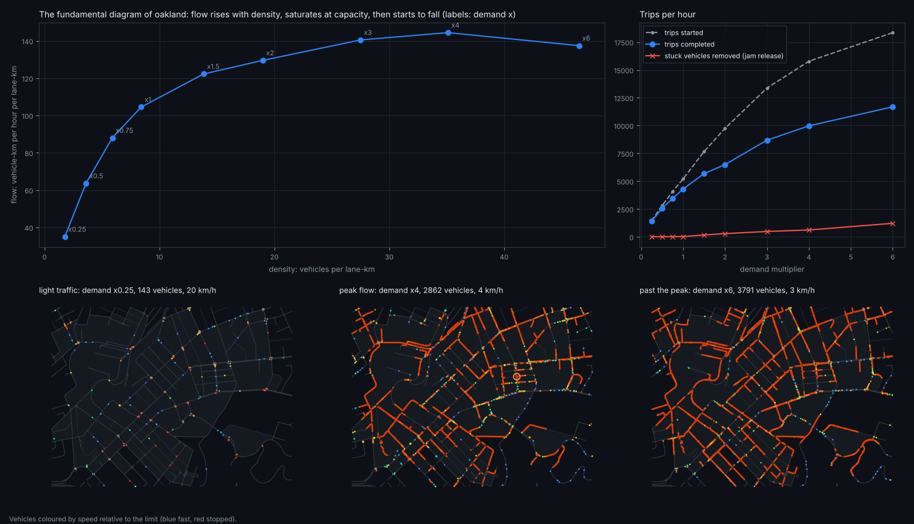
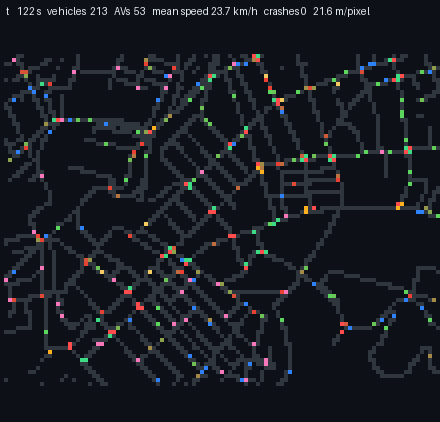

# Examples

Short scripts that each answer one question on a laptop CPU, with one figure and one number. Every result below was produced by
the script next to it.

| example | question | time | output |
|---|---|---|---|
| [`av_share_sweep.py`](av_share_sweep.py) | how many AVs until a city's crashes halve? | ~7 min | [figure](../docs/img/example_av_share.png) |
| [`gridlock.py`](gridlock.py) | the fundamental diagram of a whole city: flow against density up to the jam | ~6 min | [figure](../docs/img/example_gridlock.png) |
| [`my_policy.py`](my_policy.py) | write your own AV driver in ~15 lines and see where it lands on AVBench | ~1.5 min | a scorecard table |
| `av-world watch oakland` | the city driving live in your terminal (truecolor text), or `--follow` an AV | live | [GIF](../docs/img/watch_oakland.gif) |

Guided notebooks (the tour, RL, PPO, perception export, AVBench) are in [notebooks/](../notebooks/README.md).
Every script has `--quick` for a smoke run; `tests/test_examples.py` runs them all in tiny configurations.

## How many AVs until crashes halve?


Oakland, calibrated human drivers, the rule-based AV under its envelope; 80 copies x 5 simulated minutes per AV share. Crashes per
1,000 vehicle-hours fall from 10.8 [7.4, 15.9] with no AVs to 3.3 [1.7, 6.6] at 75 %; **they halve at about 55 % AVs**. The
100 % point (5.0) is within the noise of 75 %. Throughput and speed change by about 2 %.

Getting a curve this clear took two corrections, both now built into the script: crashes are rare at calibrated rates (~15 per
1,000 vehicle-hours), so each share needs ~2,400 vehicle-hours; and with fixed routes the city fills up over half an hour (22 ->
6 km/h), where traffic barely crashes, so the sweep uses many short copies measured while traffic still flows.

## The fundamental diagram of a city



Demand x0.25 to x6 on Oakland, with the simulator's re-routing, each level warmed 10 min to its steady state. Flow rises steeply,
**saturates at about 140 vehicle-km per hour per lane-km from demand x2 to x4** (speed down to 4 km/h), and falls past that.
It never collapses to zero: the simulator removes vehicles stuck for 4 minutes (1,215 an hour at x6), which is how the model
releases deadlocks. Completed trips keep rising even past the peak, because short trips near the edge of the map still finish
while the interior jams. At x6 the 4,096 vehicle slots are 93 % full, so density there is slightly capped (the script warns).

## Your own driver

```python
def careful_idm(obs, key):        # the Intelligent Driver Model, 1.5 s headway, an active stop line treated as a stopped leader
    ...
bench.evaluate(careful_idm, ["nominal", "jaywalkers"])
```

| policy (nominal + jaywalkers) | av_world score | fixed checks | crashes / AV-h, no filter | comfort | progress |
|---|---|---|---|---|---|
| careful_idm (15 lines) | **75.9** | 10 / 16 | **0.011** | 0.873 | 0.959 |
| rule-based AV | 48.1 | 10 / 16 | 0.035 | 0.922 | 1.061 |
| PPO + barrier teacher (phase 3) | 53.8 | **13 / 16** | 0.044 | **0.990** | 1.007 |

The textbook model is the safest of the three without a filter and wins the score, which weighs unaided harm heavily; it loses on
the fixed checks, being 4 % slower than the humans and braking hard more often. The two views disagree on purpose: the checks are
bars, the score is an exchange rate. Change the function and re-run.

## Watch it live

```bash
av-world watch oakland                  # the whole area
av-world watch oakland --follow         # a 400 m window riding along with one AV
```


