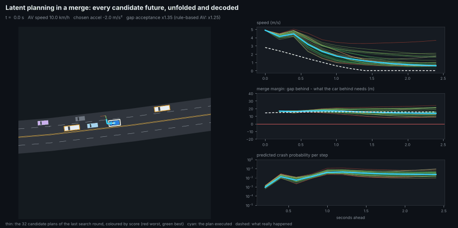
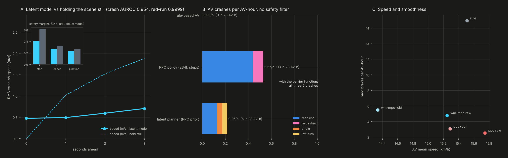
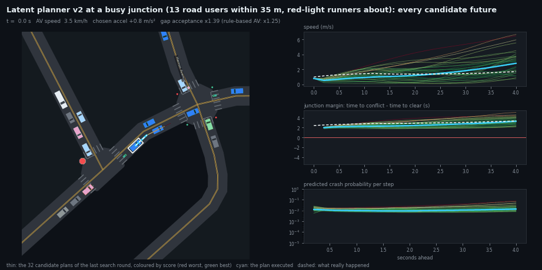

# wmplan: driving by imagining in a latent world model

An AV that plans merges and junctions by unrolling learned latent representations into the future, in the whole-area
Pittsburgh simulator (`xnet`), among risky human drivers, pedestrians and cyclists.


*Left: the AV (white outline) and, along its route, where each of the 32 candidate plans of the last search round puts it
over the next 2.4 s, coloured by score (red worst, green best); cyan is the plan it executes, dashed white is what really
happened. Right: the same plans decoded into speed, the junction time-to-conflict margin, and crash risk.*



## How it works

```
obs_t (28 features: own motion, leader, stop target, signal, right of way, conflicting traffic, merge gaps)
  │ enc
  ▼
 z_t ──dyn(z, u_t)──▶ z_t+1 ──dyn(z, u_t+1)──▶ z_t+2 ──▶ …  z_t+12        (2.4 s, in latent space only)
  │                    │                        │
  ▼ decoders           ▼                        ▼
 margins, obs        reward, P(crash), P(near miss), P(red-light run), margins
```

1. **Data** (`data.py`, 25 s of simulation for 800 k decisions). The 234k-step PPO driver, plus exploration. Every
   vehicle slot gets its own persistent style, from timid to reckless, in both acceleration and gap acceptance. No
   safety filter, so the logs hold the consequences: 666 crashes and 101 red-light runs. Each decision is logged
   with five safety margins, which are the barrier values: stop target, leader, junction time-to-conflict, and the
   merge gaps behind and ahead.
2. **World model** (`model.py`, ~5 min on CPU). An encoder to a 48-d latent, residual latent dynamics conditioned on the
   2-d action (acceleration, gap acceptance), and decoders for the scene, the margins, the reward and three events.
   Trained by unrolling 15 steps (3 s) from each encoded start. Every prediction is compared with what happened, plus a
   consistency loss toward the encoding of the real next scene. Windows that end in a crash still teach.
3. **Planner** (`planner.py`). Model-predictive control by the cross-entropy method. Every 0.2 s, for every AV at once:
   - propose 32 smooth action sequences (3 knots per dimension) around a prior from the PPO policy;
   - unroll each in latent space;
   - score them: reward − 30·P(crash) − 3·P(near miss) − 20·P(red run) − margin violations − jerk;
   - refit to the best 6 and repeat twice;
   - execute the first action.

   The second action dimension is the AV's gap acceptance at the next junction and in a merge. So *whether to go* is
   chosen by imagining what the junction margin and the crash risk do a few seconds after going.

## Results



**The model** (a held-out copy of the area, 85 k windows):

| prediction | latent model | holding the scene still |
|---|---|---|
| AV speed, 1 s / 2 s / 3 s ahead (RMS) | **0.46 / 0.57 / 0.68 m/s** | 1.02 / 1.52 / 1.88 m/s |
| stop-line margin at 2 s (RMS, units of 20 m) | **0.40** | 0.61 |
| leader margin at 2 s | **0.27** | 0.32 |
| junction time-to-conflict margin at 2 s (units of 5 s) | **0.23** | 0.27 |
| crash in the next step: AUROC (300 held-out crashes) | **0.954** | |
| red-light run: AUROC (75 held-out) | **0.9999** | |

**Driving** (`evaluate.py`). Oakland with humans 5× riskier than calibrated, demand ×1.2, 1.5× pedestrians, 5 %
cyclists, 15 % AVs. 4 copies × 5 min per driver, about 23 AV-hours each, all from the same warm state:

| driver | crashes /AV-h, no filter (AVs crashed) | crash events by type | with the barrier function | AV km/h | hard brakes /h |
|---|---|---|---|---|---|
| rule-based AV | 0 | | | 15.5 | 17.0 |
| PPO policy (234k steps) | 0.57 (13) | 10 rear-end, 2 pedestrian | 0 | 15.7 | 2.5 |
| **latent planner, PPO prior** | **0.26 (6)** | 3 rear-end, 1 angle, 1 left-turn | 0 | 15.2 | 4.8 |

- **Planning in the latent model halves the unaided crash rate of the policy it starts from**, at 3 % lower speed. The
  crashes it still has are spread across junction types, because it now makes the junction decisions itself.
- **Under the barrier function every driver has 0 crashes.** Without it, the planner and PPO both spend about 1 % of AV
  time outside the barrier's safe set; with it, 0.1 %.
- **Cost.** With the planner driving every AV, 4 copies of the area run at about 3× real time on 4 CPU cores, against
  about 75× with the policy alone.

```bash
python -m wmplan.data 300       # 800 k decisions (~1 min incl. warm-up)
python -m wmplan.model          # train the world model (~5 min)
python -m wmplan.evaluate       # the five drivers (~15 min; the two planner runs ~7 min each)
python -m wmplan.plot           # docs/img/wm_planner.png
python -m wmplan.viz            # the two GIFs
```

## v2: what was wrong with v1, and what fixing it bought (`v2.py`, 2026-10-22)

On AVBench v1 scored 0.8 out of 100 on its 3 scenarios. The cause was **red-light runs**, about 5 per 100 km where its PPO prior
has none. It also inherited that prior's crash rate. v2 was built and benchmarked in one session on an NVIDIA L4:

| change | why |
|---|---|
| 4 s plans, 5 s training unrolls, a terminal value head and "event within 2 s" heads | stopping from 15 m/s takes about 4 s: inside v1's 2.4 s horizon a red run was often already unavoidable |
| distance features scored only while their flag says the stop target / leader exists | the 300 m "no target" sentinel jumps when a light turns; v1's stop-gap error was 36 m at 2 s, worse than holding it (8.6 m) |
| an ensemble of 3 dynamics + event heads; plans scored by mean - spread; actions kept inside the data's range | a single deterministic model is easy for the search to exploit (PETS, MOPO) |
| LayerNorm + SiLU blocks, a SimNorm latent, bfloat16 matmuls | TD-MPC2's recipe for stable latent dynamics; bf16 made planning 35 % faster on the L4 |
| the barrier-teacher phase 3 policy as prior, 1.35 M decisions logged under it and the 234k-step policy | v1's prior crashed 0.64 times per AV-hour unaided |
| the prior's plan imagined in the latent (the policy acting on the decoded scene), and a trust region: the planner overrides only when its plan beats that by a margin, and only towards caution (harder braking, a larger gap) | free overrides, and comparing against the prior's current action held for 4 s, made v2 run reds and rear-end cars |

**The model** (held out, 30 k windows): stop-gap error at 2 s fell from 36 m to **5.4 m**, now better than holding it (7.0 m).
Speed error at 2 s fell from 0.91 to **0.63 m/s**. Crash AUROC is 0.947 and red-run AUROC 0.995, on a held-out set that also
holds phase-3 driving. Leader-gap prediction is still worse than holding it.

**Driving** (AVBench, nominal / red runners / inattentive, unaided and with the envelope):

| driver | absolute checks (of 24) | av_world score | unaided crashes /AV-h | red runs /100 km | progress |
|---|---|---|---|---|---|
| latent planner v1 | 8 | 0.8 | 0.47 | 4.9-5.4 | 1.05 |
| **latent planner v2** | **17** | **46.0** | **0.039** | **0** | 0.95 |
| its prior, barrier-teacher phase 3 | 22 | 63.8 | 0.025 | 0 | 1.01 |
| rule-based AV | 18 | 78.2 | 0.008 | 0 | 1.06 |

On nominal v2 scores 93.0, with no crashes or red runs, against its prior's 98.0. **v2 is fixed, but it does not beat the
policy it plans around.** Its caution costs about 5 % speed, and it does not prevent the prior's rare crashes in the red-runner
and inattentive scenarios: one or two crashes per run either way, which is within noise. The planner sees the same 28 features
as the policy, so lookahead is its only edge, and the barrier teacher already gave the policy most of that.

What the session's quick 60 s probes showed (nominal, no filter):

| variant | crashes /AV-h | red runs |
|---|---|---|
| first v2: hard-reject plans whose decoded margins go negative | 3.86 (all rear-end) | 0 |
| no hard reject | 0.32 | 2 |
| + trust region, free overrides | 0.08 | 3-4 |
| + imagined prior plan, overrides only towards caution | 0 | 0 |



```bash
python -m wmplan.v2 train          # ~8 min on an L4 (data: wmplan.data under both policies, results/wmplan/v2/data_*.npz)
python -m avrl.bench run-wm2 nominal red_runners inattentive    # ~3 min per scenario and mode on an L4
python -m wmplan.v2 gifs           # docs/img/wm2_planner_*.gif
```

Sources: TD-MPC2 (Hansen et al., 2023: LayerNorm + Mish, SimNorm, policy prior, terminal value), DreamerV3 (Hafner et al.,
2023: robust targets), PETS (Chua et al., 2018) and MOPO (Yu et al., 2020: ensembles against model exploitation).

## v3: let the world model train the policy instead (`v3.py`, 2026-10-23)

v2 could not beat the policy it planned around. v3 tried the fast fixes from the literature, each screened in the real
simulator (32 copies x 60 s, paired seeds, red runners / inattentive / dartout) before any full benchmark:

1. **Counterfactual data (fork at danger).** The simulator was forked at risky moments and replayed for 6 s under the same
   random numbers, with the risky AVs' first 2 s of action changed: brake harder or less, demand a bigger or smaller gap.
   This gave 9.5 M decisions over 8 scenarios. Fine-tuning v2 on them, with a discrete control-barrier condition on the decoded
   margins, raised crash AUROC to 0.955, counterfactual crash AUROC to 0.999 (only 3 held-out crashes), and red-run AUROC to
   0.9999.
2. **A safe actor-critic in imagination** (Think2Drive / Dreamer, with SafeDreamer's Lagrangian cost and MOPO's ensemble
   penalty), starting from the phase 3 policy. **It exploited the model.** Its imagined cost fell while in the real simulator it
   crashed 30-40 times per AV-hour and ran hundreds of reds.
3. **One-step improvement on measured actions only.** For 2 M real states the model scored just the five actions the
   counterfactual branches tested, picked the best where it beat the prior by a margin, and that choice was distilled into
   the policy.

| policy (screen) | red runners: crashes, km/h | inattentive | dartout |
|---|---|---|---|
| phase 3 (the prior) | 4, 17.4 | 2, 17.4 | 4, 14.9 |
| v3 one-step, gate 2.0 (changes 8 % of actions) | 4, 16.2 | 1, 16.3 | 4, 13.9 |
| v3 one-step, gate 0.5 (changes 46 %) | 19, 10.0 | 21, 10.2 | 7, 8.9 |
| v3 actor-critic | 1294, 18.8 | 1233, 18.7 | 1078, 15.8 |

**No v3 variant beats the prior.** The counterfactual branches show why. With the policy's 28 features, the only action that
changes outcomes is braking. Braking *less* clearly causes crashes: 2-8x the prior's in every scenario. Braking *more* does not
prevent them, and braking a lot adds rear-end crashes from the humans behind. Changing gap acceptance changed nothing measurable.
The barrier-taught prior already sits at the best point of that trade-off. The best v3 matches its crashes at 6 % lower speed,
with about 3x the hard braking (its distilled actions are less smooth). The remaining lever is information the policy does not
have: the other road users as individual objects (agent tokens). That needs a new simulator output and a set encoder.

```bash
python -m wmplan.v3 collect          # 9.5 M counterfactual decisions, ~16 min on an L4
python -m wmplan.v3 finetune         # ~7 min
python -m wmplan.v3 improve d 2.0    # ~1 min to score 2 M states, then distil
python -m wmplan.v3 screen d         # ~4 min
```

Sources: Think2Drive (Li et al., ECCV 2024), SafeDreamer (Huang et al., ICLR 2024), MOPO (Yu et al., 2020), one-step offline
improvement (Brandfonbrener et al., 2021), and the repo's own fork-at-danger (`avrl/fork.py`).

## Next

- **Amortise the planner into the policy** (Dreamer / TD-MPC style). Train the PPO actor on imagined rollouts with
  the planner's targets, so the deployed driver keeps the planner's foresight at the policy's speed.
- **Scene-level latent.** Encode the AV's neighbourhood as a set of agents, not 28 hand-built features, so the model
  can imagine the other drivers' choices: the merge partner who does not yield, the left turner who goes.
- **Plan against the barrier.** Put the barrier's constraint inside the search (reject plans whose decoded margins go
  negative), so the filter almost never has to step in.
